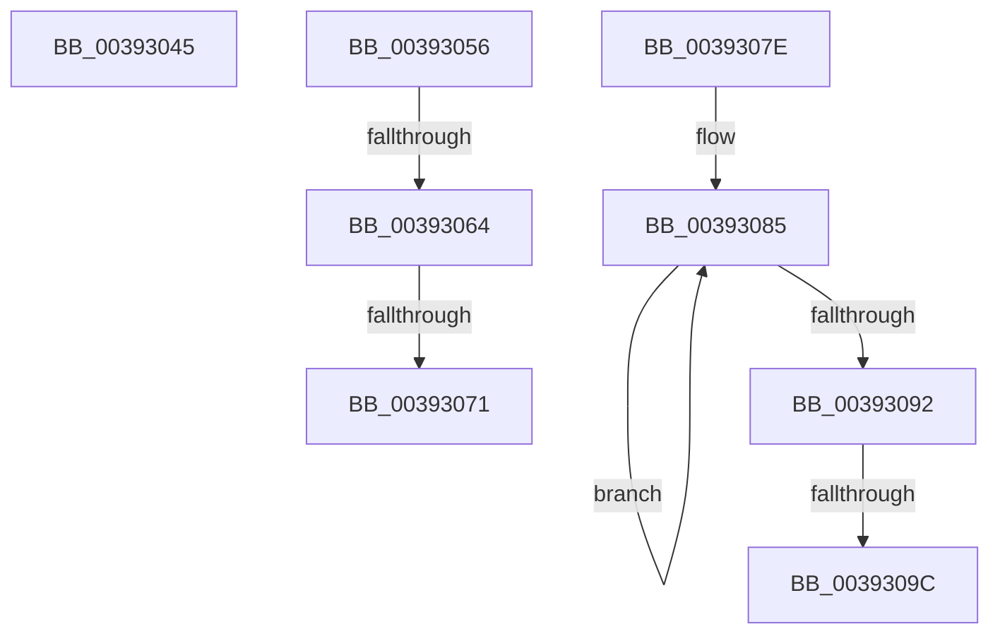

# sub_00393045

- RVA: `0x00393045`–`0x003930A6` (길이 `97` bytes)
- VA: `0x0000000140393045`
- 실행 섹션: `.text`
- PDB 이름 있음: `아니요`; PDB Function 태그: `아니요`
- unwind 정보 RVA: `0x00080DE4`
- 디코드: `23`개 명령, `97/97` bytes 표시
- 미해석 바이트: `0` (있으면 어셈블리에 `.byte`로 보존)

> 이 문서는 커널 이미지의 기계어와 PDB 기호를 분석해 생성했습니다. 4번과 5번은 함수 원형과 자료형을 바이너리 사용 방식에서 추정한 C 해석이며 원본 소스 복구 결과는 아닙니다.

## 1. Dependencies

- 직접 호출 지점: **4**; 고유 호출 대상: **4**
- 직접 호출자로 확인된 함수: **0**
- RIP 상대 이미지 참조: **1**

### Outgoing calls
- `0x0039304C` → [KiRaiseIrqlProcessIrqlFlags](../4F/KiRaiseIrqlProcessIrqlFlags_function_004F56FC.md) (function, `0x004F56FC`)
- `0x00393064` → [KiCheckVpBackingLongSpinWaitHypercall](../30/KiCheckVpBackingLongSpinWaitHypercall_function_0030F490.md) (function, `0x0030F490`)
- `0x00393074` → [HvlNotifyLongSpinWait](../30/HvlNotifyLongSpinWait_function_0030F460.md) (function, `0x0030F460`)
- `0x0039309C` → [KiRemoveSystemWorkPriorityKick](../26/KiRemoveSystemWorkPriorityKick_function_002631D0.md) (function, `0x002631D0`)

### Direct callers
- 이 함수 시작 RVA로 연결되는 직접 call은 확인되지 않았습니다. 간접 호출은 완전히 역산할 수 없습니다.

### Static image references
- `0x00393056` → RVA `0x00FC6AB8` (`ALMOSTRO`; read)

## 2. Other-region calls and transfers

- 다른 실행 섹션으로 향하는 call: **0**
- call이 아닌 외부 분기/꼬리 이동: **6**
  - `0x00393051` → [sub_00392F50 + 0x1F](Unknown_function_00392F50.md) (`tail-transfer`)
  - `0x0039305E` → [sub_00392F50 + 0x6D](Unknown_function_00392F50.md) (`tail-transfer`)
  - `0x0039306B` → [sub_00392F50 + 0x6D](Unknown_function_00392F50.md) (`tail-transfer`)
  - `0x00393079` → [sub_00392F50 + 0x6F](Unknown_function_00392F50.md) (`tail-transfer`)
  - `0x00393096` → [sub_00392F50 + 0x50](Unknown_function_00392F50.md) (`tail-transfer`)
  - `0x003930A1` → [sub_00392F50 + 0x50](Unknown_function_00392F50.md) (`tail-transfer`)

## 3. Assembly (complete function range)

```asm
00393045  0F B6 D0                        movzx edx, al
00393048  40 0F B6 CE                     movzx ecx, sil
0039304C  E8 AB 26 16 00                  call 0x1404f56fc
00393051  E9 19 FF FF FF                  jmp 0x140392f6f
00393056  8B 05 5C 3A C3 00               mov eax, dword ptr [rip + 0xc33a5c]
0039305C  A8 40                           test al, 0x40
0039305E  0F 84 59 FF FF FF               je 0x140392fbd
00393064  E8 27 C4 F7 FF                  call 0x14030f490
00393069  84 C0                           test al, al
0039306B  0F 84 4C FF FF FF               je 0x140392fbd
00393071  41 8B CE                        mov ecx, r14d
00393074  E8 E7 C3 F7 FF                  call 0x14030f460
00393079  E9 41 FF FF FF                  jmp 0x140392fbf
0039307E  41 0F 0D 08                     prefetchw byte ptr [r8]
00393082  41 8B 00                        mov eax, dword ptr [r8]
00393085  8B D0                           mov edx, eax
00393087  0F BA F2 15                     btr edx, 0x15
0039308B  F0 41 0F B1 10                  lock cmpxchg dword ptr [r8], edx
00393090  75 F3                           jne 0x140393085
00393092  0F BA E0 15                     bt eax, 0x15
00393096  0F 83 04 FF FF FF               jae 0x140392fa0
0039309C  E8 2F 01 ED FF                  call 0x1402631d0
003930A1  E9 FA FE FF FF                  jmp 0x140392fa0
```

## 4. C-style interpretation (structured pseudocode)

```c
__int64 __fastcall sub_00393045(__int64 a1, __int64 a2, __int64 a3)
{
    __int64 result;

    result = KiRaiseIrqlProcessIrqlFlags((unsigned __int8)(v_rsi), (unsigned __int8)(result), a3, a4);
}
```

## 5. (Beta) C Style

```c
int64_t sub_00393045(int64_t Arg1, int64_t Arg2, int64_t Arg3)
{
    int64_t result;

    result = KiRaiseIrqlProcessIrqlFlags((uint8_t)(local_rsi), (uint8_t)(result), Arg3, a4);
}
```

## 6. Execution-region graph

[열기: 2D/3D 그래프와 함수 탐색 컨트롤 패널](../../../control-panel.html?section=text&rva=0x00393045&view=graph)

- 2D 그래프는 위에서 아래로 흐르고, 3D 그래프는 빈 공간을 드래그해 회전합니다. Shift+드래그는 이동, 휠은 확대·축소, 함수 노드 선택은 대상 보고서 이동입니다.

### Static fallback


