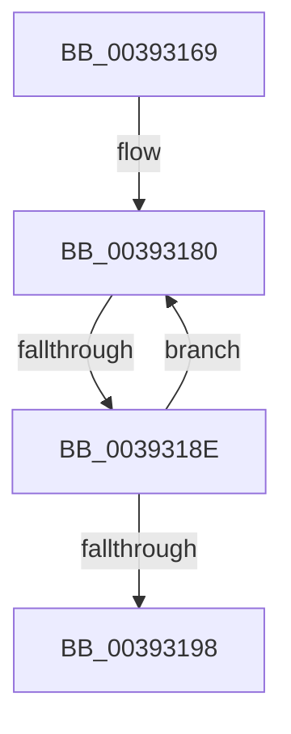

# sub_00393169

- RVA: `0x00393169`–`0x003931AD` (길이 `68` bytes)
- VA: `0x0000000140393169`
- 실행 섹션: `.text`
- PDB 이름 있음: `아니요`; PDB Function 태그: `아니요`
- unwind 정보 RVA: `0x00080E1C`
- 디코드: `19`개 명령, `68/68` bytes 표시
- 미해석 바이트: `0` (있으면 어셈블리에 `.byte`로 보존)

> 이 문서는 커널 이미지의 기계어와 PDB 기호를 분석해 생성했습니다. 4번과 5번은 함수 원형과 자료형을 바이너리 사용 방식에서 추정한 C 해석이며 원본 소스 복구 결과는 아닙니다.

## 1. Dependencies

- 직접 호출 지점: **0**; 고유 호출 대상: **0**
- 직접 호출자로 확인된 함수: **0**
- RIP 상대 이미지 참조: **0**

### Outgoing calls
- 직접 디코드된 call 명령이 없습니다.

### Direct callers
- 이 함수 시작 RVA로 연결되는 직접 call은 확인되지 않았습니다. 간접 호출은 완전히 역산할 수 없습니다.

### Static image references
- 디코드된 RIP-relative 메모리 참조가 없습니다.

## 2. Other-region calls and transfers

- 다른 실행 섹션으로 향하는 call: **0**
- call이 아닌 외부 분기/꼬리 이동: **1**
  - `0x0039318C` → [sub_003931B0](Unknown_function_003931B0.md) (`tail-transfer`)

## 3. Assembly (complete function range)

```asm
00393169  48 89 5C 24 30                  mov qword ptr [rsp + 0x30], rbx
0039316E  48 8B F9                        mov rdi, rcx
00393171  48 89 6C 24 38                  mov qword ptr [rsp + 0x38], rbp
00393176  48 89 74 24 40                  mov qword ptr [rsp + 0x40], rsi
0039317B  8B EA                           mov ebp, edx
0039317D  0F 1F 00                        nop dword ptr [rax]
00393180  48 8B 1F                        mov rbx, qword ptr [rdi]
00393183  33 F6                           xor esi, esi
00393185  F0 48 0F BA 6B 30 00            lock bts qword ptr [rbx + 0x30], 0
0039318C  72 22                           jb 0x1403931b0
0039318E  48 83 C7 08                     add rdi, 8
00393192  48 83 ED 01                     sub rbp, 1
00393196  75 E8                           jne 0x140393180
00393198  48 8B 74 24 40                  mov rsi, qword ptr [rsp + 0x40]
0039319D  48 8B 6C 24 38                  mov rbp, qword ptr [rsp + 0x38]
003931A2  48 8B 5C 24 30                  mov rbx, qword ptr [rsp + 0x30]
003931A7  48 83 C4 20                     add rsp, 0x20
003931AB  5F                              pop rdi
003931AC  C3                              ret
```

## 4. C-style interpretation (structured pseudocode)

```c
void __fastcall sub_00393169(__int64 a1, int a2, __int64 a3, __int64 a4, __int64 a5, __int64 a6, __int64 a7, __int64 a8)
{
    __int64 v_rbp;
    __int64 v_rdi;
    __int64 v_rsi;
    __int64 v_rsp;
    unsigned __int64 v_stack_p30;
    unsigned __int64 v_stack_p38;
    unsigned __int64 v_stack_p40;

    v_stack_p30 = v_rbx;
    v_stack_p38 = v_rbp;
    v_stack_p40 = v_rsi;
loc_00393180:
    v_rsi = 0;
    v_rdi = (a1) + (8);
    v_rbp = ((unsigned int)(a2)) - (1);
    if (condition_is_not_equal) goto loc_00393180;
    v_rsp = (v_rsp) + (32);
    return;
}
```

## 5. (Beta) C Style

```c
void sub_00393169(void *Arg1, int32_t Arg2, int64_t Arg3, int64_t Arg4, uint64_t Arg5, int64_t Arg6, int64_t Arg7, int64_t Arg8)
{
    uint8_t *arg1 = (uint8_t *)Arg1;

    int64_t local_rbp;
    int64_t local_rdi;
    int64_t local_rsi;
    int64_t local_rsp;
    uint64_t v_stack_p30;
    uint64_t v_stack_p38;
    uint64_t v_stack_p40;

    v_stack_p30 = local_rbx;
    v_stack_p38 = local_rbp;
    v_stack_p40 = local_rsi;
loc_00393180:
    local_rsi = 0;
    local_rdi = (Arg1) + (8);
    local_rbp = ((uint32_t)(Arg2)) - (1);
    if (condition_is_not_equal) goto loc_00393180;
    local_rsp = (local_rsp) + (32);
    return;
}
```

### 관측된 메모리 오프셋

구조체 형식이 확인되지 않은 접근은 인자 기준의 오프셋으로만 기록했습니다.

| 기준 인자 | 오프셋 표현 | 폭 (bit) | 접근 |
|---|---:|---:|---|
| `Arg1` | `+ 0x0` | `64` | `R` |

## 6. Execution-region graph

[열기: 2D/3D 그래프와 함수 탐색 컨트롤 패널](../../../control-panel.html?section=text&rva=0x00393169&view=graph)

- 2D 그래프는 위에서 아래로 흐르고, 3D 그래프는 빈 공간을 드래그해 회전합니다. Shift+드래그는 이동, 휠은 확대·축소, 함수 노드 선택은 대상 보고서 이동입니다.

### Static fallback


