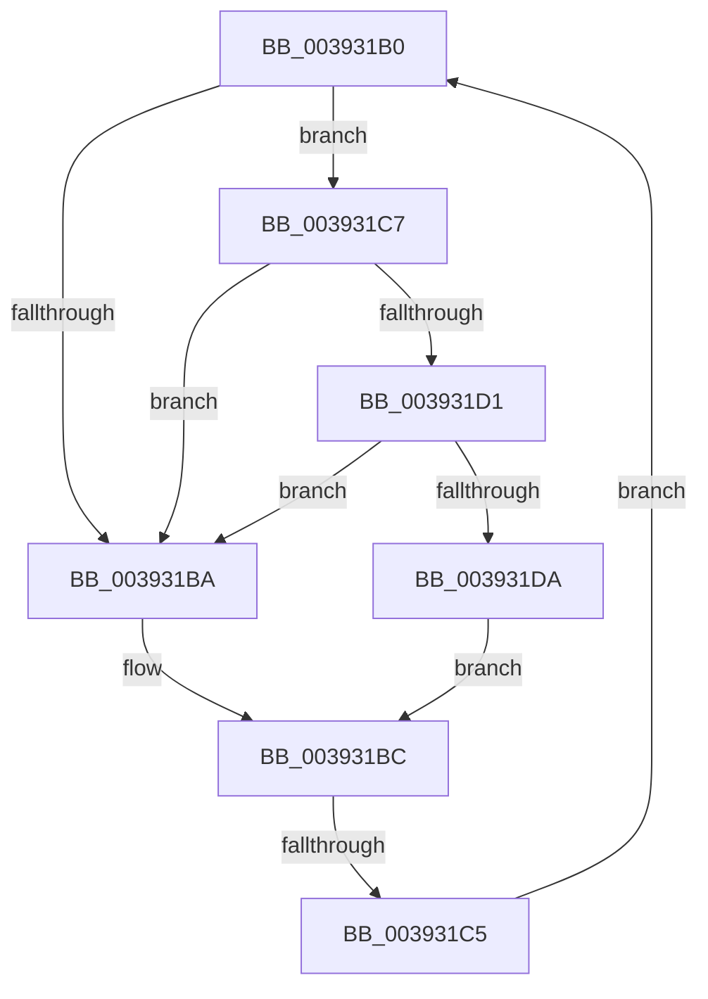

# sub_003931B0

- RVA: `0x003931B0`–`0x003931E3` (길이 `51` bytes)
- VA: `0x00000001403931B0`
- 실행 섹션: `.text`
- PDB 이름 있음: `아니요`; PDB Function 태그: `아니요`
- unwind 정보 RVA: `0x00080E4C`
- 디코드: `17`개 명령, `51/51` bytes 표시
- 미해석 바이트: `0` (있으면 어셈블리에 `.byte`로 보존)

> 이 문서는 커널 이미지의 기계어와 PDB 기호를 분석해 생성했습니다. 4번과 5번은 함수 원형과 자료형을 바이너리 사용 방식에서 추정한 C 해석이며 원본 소스 복구 결과는 아닙니다.

## 1. Dependencies

- 직접 호출 지점: **2**; 고유 호출 대상: **2**
- 직접 호출자로 확인된 함수: **0**
- RIP 상대 이미지 참조: **2**

### Outgoing calls
- `0x003931D1` → [KiCheckVpBackingLongSpinWaitHypercall](../30/KiCheckVpBackingLongSpinWaitHypercall_function_0030F490.md) (function, `0x0030F490`)
- `0x003931DC` → [HvlNotifyLongSpinWait](../30/HvlNotifyLongSpinWait_function_0030F460.md) (function, `0x0030F460`)

### Direct callers
- 이 함수 시작 RVA로 연결되는 직접 call은 확인되지 않았습니다. 간접 호출은 완전히 역산할 수 없습니다.

### Static image references
- `0x003931B2` → RVA `0x00FC52AC` (`ALMOSTRO`; reference)
- `0x003931C7` → RVA `0x00FC6AB8` (`ALMOSTRO`; read)

## 2. Other-region calls and transfers

- 다른 실행 섹션으로 향하는 call: **0**
- call이 아닌 외부 분기/꼬리 이동: **1**
  - `0x003931C3` → [sub_00393169 + 0x1C](Unknown_function_00393169.md) (`tail-transfer`)

## 3. Assembly (complete function range)

```asm
003931B0  FF C6                           inc esi
003931B2  85 35 F4 20 C3 00               test dword ptr [rip + 0xc320f4], esi
003931B8  74 0D                           je 0x1403931c7
003931BA  F3 90                           pause
003931BC  48 8B 43 30                     mov rax, qword ptr [rbx + 0x30]
003931C0  48 85 C0                        test rax, rax
003931C3  74 C0                           je 0x140393185
003931C5  EB E9                           jmp 0x1403931b0
003931C7  8B 05 EB 38 C3 00               mov eax, dword ptr [rip + 0xc338eb]
003931CD  A8 40                           test al, 0x40
003931CF  74 E9                           je 0x1403931ba
003931D1  E8 BA C2 F7 FF                  call 0x14030f490
003931D6  84 C0                           test al, al
003931D8  74 E0                           je 0x1403931ba
003931DA  8B CE                           mov ecx, esi
003931DC  E8 7F C2 F7 FF                  call 0x14030f460
003931E1  EB D9                           jmp 0x1403931bc
```

## 4. C-style interpretation (structured pseudocode)

```c
__int64 __fastcall sub_003931B0(void)
{
    __int64 result;
    __int64 v_rsi;

    v_rsi = (unsigned int)((v_rsi) + 1);
    if (((*(unsigned int *)(v_rip + 12787956)) & ((unsigned int)(v_rsi))) == 0) goto loc_003931C7;
loc_003931BA:
loc_003931BC:
    goto loc_003931B0;
loc_003931C7:
    if ((((unsigned __int8)((unsigned int)(*(unsigned int *)(v_rip + 12794091)))) & (64)) == 0) goto loc_003931BA;
    result = KiCheckVpBackingLongSpinWaitHypercall(a1, a2, a3, a4);
    if ((unsigned __int8)(result) == 0) goto loc_003931BA;
    result = HvlNotifyLongSpinWait((unsigned int)((unsigned int)(v_rsi)), a2, a3, a4);
    goto loc_003931BC;
}
```

## 5. (Beta) C Style

```c
void sub_003931B0(void)
{
    int64_t result;
    int64_t local_rsi;

    local_rsi = (uint32_t)((local_rsi) + 1);
    if (((*(uint32_t *)(v_rip + 0xC320F4)) & ((uint32_t)(local_rsi))) == 0) goto loc_003931C7;
loc_003931BA:
loc_003931BC:
    goto loc_003931B0;
loc_003931C7:
    if ((((uint8_t)((uint32_t)(*(uint32_t *)(v_rip + 0xC338EB)))) & (64)) == 0) goto loc_003931BA;
    result = KiCheckVpBackingLongSpinWaitHypercall(a1, a2, a3, a4);
    if ((uint8_t)(result) == 0) goto loc_003931BA;
    result = HvlNotifyLongSpinWait((uint32_t)((uint32_t)(local_rsi)), a2, a3, a4);
    goto loc_003931BC;
}
```

## 6. Execution-region graph

[열기: 2D/3D 그래프와 함수 탐색 컨트롤 패널](../../../control-panel.html?section=text&rva=0x003931B0&view=graph)

- 2D 그래프는 위에서 아래로 흐르고, 3D 그래프는 빈 공간을 드래그해 회전합니다. Shift+드래그는 이동, 휠은 확대·축소, 함수 노드 선택은 대상 보고서 이동입니다.

### Static fallback


