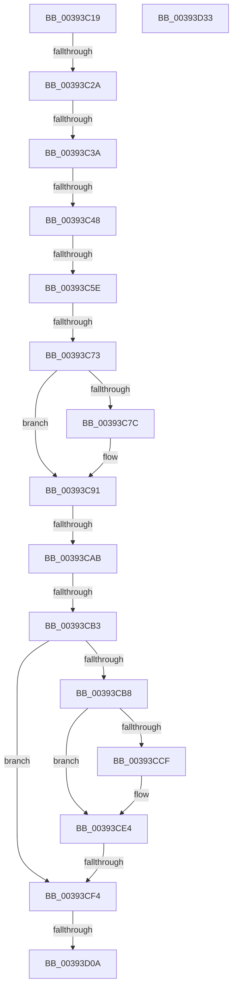

# sub_00393C19

- RVA: `0x00393C19`–`0x00393D34` (길이 `283` bytes)
- VA: `0x0000000140393C19`
- 실행 섹션: `.text`
- PDB 이름 있음: `아니요`; PDB Function 태그: `아니요`
- unwind 정보 RVA: `0x00080EEC`
- 디코드: `60`개 명령, `283/283` bytes 표시
- 미해석 바이트: `0` (있으면 어셈블리에 `.byte`로 보존)

> 이 문서는 커널 이미지의 기계어와 PDB 기호를 분석해 생성했습니다. 4번과 5번은 함수 원형과 자료형을 바이너리 사용 방식에서 추정한 C 해석이며 원본 소스 복구 결과는 아닙니다.

## 1. Dependencies

- 직접 호출 지점: **5**; 고유 호출 대상: **4**
- 직접 호출자로 확인된 함수: **0**
- RIP 상대 이미지 참조: **4**

### Outgoing calls
- `0x00393C5E` → [ExFreePoolWithTag](../../poolcode/B8/ExFreePoolWithTag_function_00B82870.md) (function, `0x00B82870`)
- `0x00393C8C` → [ObpPushStackInfo](../21/ObpPushStackInfo_function_002109E4.md) (function, `0x002109E4`)
- `0x00393CC1` → [PspRevertContainerImpersonation](PspRevertContainerImpersonation_function_00395070.md) (function, `0x00395070`)
- `0x00393CDF` → [ObpPushStackInfo](../21/ObpPushStackInfo_function_002109E4.md) (function, `0x002109E4`)
- `0x00393D1A` → [_security_check_cookie](../6A/_security_check_cookie_function_006AC640.md) (function, `0x006AC640`)

### Direct callers
- 이 함수 시작 RVA로 연결되는 직접 call은 확인되지 않았습니다. 간접 호출은 완전히 역산할 수 없습니다.

### Static image references
- `0x00393C2A` → RVA `0x00FC6B08` (`ALMOSTRO`; read)
- `0x00393C48` → RVA `0x00B82870` (`ExFreePoolWithTag`; read)
- `0x00393C73` → RVA `0x00FC5010` (`ALMOSTRO`; read)
- `0x00393C9A` → RVA `0x00000000` (`image boundary/outside`; read)

## 2. Other-region calls and transfers

- 다른 실행 섹션으로 향하는 call: **1**
  - `0x00393C5E` → [ExFreePoolWithTag](../../poolcode/B8/ExFreePoolWithTag_function_00B82870.md) (`.text` → `POOLCODE`)
- call이 아닌 외부 분기/꼬리 이동: **9**
  - `0x00393C24` → [sub_00393D34](Unknown_function_00393D34.md) (`tail-transfer`)
  - `0x00393C34` → [sub_003941F0](Unknown_function_003941F0.md) (`tail-transfer`)
  - `0x00393C42` → [sub_00393E0F + 0xA1](Unknown_function_00393E0F.md) (`tail-transfer`)
  - `0x00393C58` → [sub_00393F79 + 0x16](Unknown_function_00393F79.md) (`tail-transfer`)
  - `0x00393C6D` → [sub_003941F0 + 0x12](Unknown_function_003941F0.md) (`tail-transfer`)
  - `0x00393CA5` → [sub_00393E0F + 0x4B](Unknown_function_00393E0F.md) (`tail-transfer`)
  - `0x00393CAD` → [sub_003941F0 + 0x24](Unknown_function_003941F0.md) (`tail-transfer`)
  - `0x00393CEE` → [sub_00393E0F + 0x74](Unknown_function_00393E0F.md) (`tail-transfer`)
  - `0x00393D04` → [sub_003941F0 + 0x3D](Unknown_function_003941F0.md) (`tail-transfer`)

## 3. Assembly (complete function range)

```asm
00393C19  4C 89 B4 24 A0 00 00 00         mov qword ptr [rsp + 0xa0], r14
00393C21  48 85 F6                        test rsi, rsi
00393C24  0F 85 0A 01 00 00               jne 0x140393d34
00393C2A  F7 05 D4 2E C3 00 00 00 00 08   test dword ptr [rip + 0xc32ed4], 0x8000000
00393C34  0F 85 B6 05 00 00               jne 0x1403941f0
00393C3A  83 7B 40 00                     cmp dword ptr [rbx + 0x40], 0
00393C3E  48 8B 53 30                     mov rdx, qword ptr [rbx + 0x30]
00393C42  0F 84 68 02 00 00               je 0x140393eb0
00393C48  48 8D 05 21 EC 7E 00            lea rax, [rip + 0x7eec21]
00393C4F  4C 8B C3                        mov r8, rbx
00393C52  49 8B CF                        mov rcx, r15
00393C55  4C 3B E0                        cmp r12, rax
00393C58  0F 85 31 03 00 00               jne 0x140393f8f
00393C5E  E8 0D EC 7E 00                  call 0x140b82870
00393C63  F7 05 9B 2E C3 00 00 00 00 08   test dword ptr [rip + 0xc32e9b], 0x8000000
00393C6D  0F 85 8F 05 00 00               jne 0x140394202
00393C73  83 3D 96 13 C3 00 00            cmp dword ptr [rip + 0xc31396], 0
00393C7A  74 15                           je 0x140393c91
00393C7C  33 D2                           xor edx, edx
00393C7E  49 8D 4F D0                     lea rcx, [r15 - 0x30]
00393C82  41 B9 44 66 6C 74               mov r9d, 0x746c6644
00393C88  44 8D 42 01                     lea r8d, [rdx + 1]
00393C8C  E8 53 CD E7 FF                  call 0x1402109e4
00393C91  48 8B C7                        mov rax, rdi
00393C94  F0 49 0F C1 47 D0               lock xadd qword ptr [r15 - 0x30], rax
00393C9A  4C 8D 35 5F C3 C6 FF            lea r14, [rip - 0x393ca1]
00393CA1  48 83 E8 01                     sub rax, 1
00393CA5  0F 8E AF 01 00 00               jle 0x140393e5a
00393CAB  85 ED                           test ebp, ebp
00393CAD  0F 85 61 05 00 00               jne 0x140394214
00393CB3  48 85 F6                        test rsi, rsi
00393CB6  74 3C                           je 0x140393cf4
00393CB8  65 48 8B 0C 25 88 01 00 00      mov rcx, qword ptr gs:[0x188]
00393CC1  E8 AA 13 00 00                  call 0x140395070
00393CC6  83 3D 43 13 C3 00 00            cmp dword ptr [rip + 0xc31343], 0
00393CCD  74 15                           je 0x140393ce4
00393CCF  33 D2                           xor edx, edx
00393CD1  48 8D 4E D0                     lea rcx, [rsi - 0x30]
00393CD5  41 B9 44 66 6C 74               mov r9d, 0x746c6644
00393CDB  44 8D 42 01                     lea r8d, [rdx + 1]
00393CDF  E8 00 CD E7 FF                  call 0x1402109e4
00393CE4  F0 48 0F C1 7E D0               lock xadd qword ptr [rsi - 0x30], rdi
00393CEA  48 83 EF 01                     sub rdi, 1
00393CEE  0F 8E 8F 01 00 00               jle 0x140393e83
00393CF4  65 48 8B 04 25 88 01 00 00      mov rax, qword ptr gs:[0x188]
00393CFD  83 B8 E4 01 00 00 00            cmp dword ptr [rax + 0x1e4], 0
00393D04  0F 85 23 05 00 00               jne 0x14039422d
00393D0A  4C 8B B4 24 A0 00 00 00         mov r14, qword ptr [rsp + 0xa0]
00393D12  48 8B 4C 24 50                  mov rcx, qword ptr [rsp + 0x50]
00393D17  48 33 CC                        xor rcx, rsp
00393D1A  E8 21 89 31 00                  call 0x1406ac640
00393D1F  48 8B 9C 24 A8 00 00 00         mov rbx, qword ptr [rsp + 0xa8]
00393D27  48 83 C4 60                     add rsp, 0x60
00393D2B  41 5F                           pop r15
00393D2D  41 5C                           pop r12
00393D2F  5F                              pop rdi
00393D30  5E                              pop rsi
00393D31  5D                              pop rbp
00393D32  C3                              ret
00393D33  CC                              int3
```

## 4. C-style interpretation (structured pseudocode)

```c
__int64 __fastcall sub_00393C19(__int64 a1, __int64 a2, __int64 a3, __int64 a4, __int64 a5, __int64 a6, __int64 a7, __int64 a8, __int64 a9, __int64 a10, __int64 a11, __int64 a12, __int64 a13, __int64 a14, __int64 a15, __int64 a16, __int64 a17, __int64 a18, __int64 a19, __int64 a20, __int64 a21)
{
    __int64 result;
    __int64 v_rdi;
    __int64 v_rsp;
    unsigned __int64 v_stack_pA0;

    v_stack_pA0 = v_r14;
    result = ExFreePoolWithTag(v_r15, *(unsigned __int64 *)(v_rbx + 48), v_rbx, a4);
    if ((*(unsigned int *)(v_rip + 12784534)) != 0) {
        a2 = 0;
        a1 = v_r15 - 48;
        a4 = 0x746C6644ULL;
        a3 = a2 + 1;
        result = ObpPushStackInfo(a1, a2, a3, a4);
    }
    result = (v_rdi) - (1);
    if (v_rsi == 0) goto loc_00393CF4;
    result = PspRevertContainerImpersonation(*(unsigned __int64 *)(gs_base + (0 + 392)), a2, a3, a4);
    if ((*(unsigned int *)(v_rip + 12784451)) != 0) {
        a2 = 0;
        a1 = v_rsi - 48;
        a4 = 0x746C6644ULL;
        a3 = a2 + 1;
        result = ObpPushStackInfo(a1, a2, a3, a4);
    }
    v_rdi = (v_rdi) - (1);
loc_00393CF4:
    a1 = (a10) ^ (v_rsp);
    result = _security_check_cookie(a1, a2, a3, a4);
    v_rsp = (v_rsp) + (96);
    return result;
}
```

## 5. (Beta) C Style

```c
int64_t sub_00393C19(int64_t Arg1, int64_t Arg2, int64_t Arg3, int64_t Arg4, uint64_t Arg5, uint64_t Arg6, uint64_t Arg7, uint64_t Arg8, uint64_t Arg9, int64_t Arg10, uint64_t Arg11, uint64_t Arg12, uint64_t Arg13, uint64_t Arg14, uint64_t Arg15, uint64_t Arg16, uint64_t Arg17, uint64_t Arg18, uint64_t Arg19, int64_t Arg20, int64_t Arg21)
{
    int64_t result;
    int64_t local_rdi;
    int64_t local_rsp;
    uint64_t v_stack_pA0;

    v_stack_pA0 = local_r14;
    result = ExFreePoolWithTag(local_r15, *(uint64_t *)(local_rbx + 0x30), local_rbx, Arg4);
    if ((*(uint32_t *)(v_rip + 0xC31396)) != 0) {
        Arg2 = 0;
        Arg1 = local_r15 - 48;
        Arg4 = 0x746C6644ULL;
        Arg3 = Arg2 + 1;
        result = ObpPushStackInfo(Arg1, Arg2, Arg3, Arg4);
    }
    result = (local_rdi) - (1);
    if (local_rsi == 0) goto loc_00393CF4;
    result = PspRevertContainerImpersonation(*(uint64_t *)(gs_base + (0 + 0x188)), Arg2, Arg3, Arg4);
    if ((*(uint32_t *)(v_rip + 0xC31343)) != 0) {
        Arg2 = 0;
        Arg1 = local_rsi - 48;
        Arg4 = 0x746C6644ULL;
        Arg3 = Arg2 + 1;
        result = ObpPushStackInfo(Arg1, Arg2, Arg3, Arg4);
    }
    local_rdi = (local_rdi) - (1);
loc_00393CF4:
    Arg1 = (Arg10) ^ (local_rsp);
    result = _security_check_cookie(Arg1, Arg2, Arg3, Arg4);
    local_rsp = (local_rsp) + (96);
    return result;
}
```

## 6. Execution-region graph

[열기: 2D/3D 그래프와 함수 탐색 컨트롤 패널](../../../control-panel.html?section=text&rva=0x00393C19&view=graph)

- 2D 그래프는 위에서 아래로 흐르고, 3D 그래프는 빈 공간을 드래그해 회전합니다. Shift+드래그는 이동, 휠은 확대·축소, 함수 노드 선택은 대상 보고서 이동입니다.

### Static fallback


