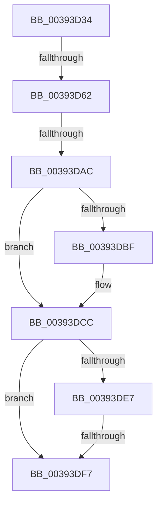

# sub_00393D34

- RVA: `0x00393D34`–`0x00393E0F` (길이 `219` bytes)
- VA: `0x0000000140393D34`
- 실행 섹션: `.text`
- PDB 이름 있음: `아니요`; PDB Function 태그: `아니요`
- unwind 정보 RVA: `0x00080F04`
- 디코드: `43`개 명령, `219/219` bytes 표시
- 미해석 바이트: `0` (있으면 어셈블리에 `.byte`로 보존)

> 이 문서는 커널 이미지의 기계어와 PDB 기호를 분석해 생성했습니다. 4번과 5번은 함수 원형과 자료형을 바이너리 사용 방식에서 추정한 C 해석이며 원본 소스 복구 결과는 아닙니다.

## 1. Dependencies

- 직접 호출 지점: **6**; 고유 호출 대상: **6**
- 직접 호출자로 확인된 함수: **0**
- RIP 상대 이미지 참조: **4**

### Outgoing calls
- `0x00393D54` → [ObfReferenceObjectWithTag](../21/ObfReferenceObjectWithTag_function_00210710.md) (function, `0x00210710`)
- `0x00393D69` → [ExAcquireSpinLockExclusive](../24/ExAcquireSpinLockExclusive_function_00248690.md) (function, `0x00248690`)
- `0x00393D86` → [KeAdjustWobPriority](KeAdjustWobPriority_function_00393570.md) (function, `0x00393570`)
- `0x00393D9A` → [KeApplyWobBamQos](KeApplyWobBamQos_function_003937AC.md) (function, `0x003937AC`)
- `0x00393DC7` → [KiLowerIrqlProcessIrqlFlags](../4F/KiLowerIrqlProcessIrqlFlags_function_004F5698.md) (function, `0x004F5698`)
- `0x00393DFD` → [EtwTraceThreadWorkOnBehalfUpdate](EtwTraceThreadWorkOnBehalfUpdate_function_00393A50.md) (function, `0x00393A50`)

### Direct callers
- 이 함수 시작 RVA로 연결되는 직접 call은 확인되지 않았습니다. 간접 호출은 완전히 역산할 수 없습니다.

### Static image references
- `0x00393D62` → RVA `0x00F06590` (`.data`; read)
- `0x00393D9F` → RVA `0x00FC6B06` (`ALMOSTRO`; read)
- `0x00393DAC` → RVA `0x00F06590` (`.data`; write)
- `0x00393DB6` → RVA `0x00FC6D20` (`ALMOSTRO`; read)

## 2. Other-region calls and transfers

- 다른 실행 섹션으로 향하는 call: **0**
- call이 아닌 외부 분기/꼬리 이동: **4**
  - `0x00393D5C` → [sub_00393FA5](Unknown_function_00393FA5.md) (`tail-transfer`)
  - `0x00393DA6` → [sub_0039410B](Unknown_function_0039410B.md) (`tail-transfer`)
  - `0x00393DF1` → [sub_00393F58](Unknown_function_00393F58.md) (`tail-transfer`)
  - `0x00393E0D` → [sub_00393E0F + 0x31](Unknown_function_00393E0F.md) (`tail-transfer`)

## 3. Assembly (complete function range)

```asm
00393D34  4C 89 AC 24 98 00 00 00         mov qword ptr [rsp + 0x98], r13
00393D3C  BA 43 6F 6E 74                  mov edx, 0x746e6f43
00393D41  65 4C 8B 2C 25 88 01 00 00      mov r13, qword ptr gs:[0x188]
00393D4A  48 8B CE                        mov rcx, rsi
00393D4D  49 8B AD 50 06 00 00            mov rbp, qword ptr [r13 + 0x650]
00393D54  E8 B7 C9 E7 FF                  call 0x140210710
00393D59  48 85 ED                        test rbp, rbp
00393D5C  0F 85 43 02 00 00               jne 0x140393fa5
00393D62  48 8D 0D 27 28 B7 00            lea rcx, [rip + 0xb72827]
00393D69  E8 22 49 EB FF                  call 0x140248690
00393D6E  48 8B CE                        mov rcx, rsi
00393D71  44 0F B6 E0                     movzx r12d, al
00393D75  49 89 8D 50 06 00 00            mov qword ptr [r13 + 0x650], rcx
00393D7C  49 8B CD                        mov rcx, r13
00393D7F  0F BE 96 C3 00 00 00            movsx edx, byte ptr [rsi + 0xc3]
00393D86  E8 E5 F7 FF FF                  call 0x140393570
00393D8B  65 48 8B 0C 25 20 00 00 00      mov rcx, qword ptr gs:[0x20]
00393D94  4C 8B C6                        mov r8, rsi
00393D97  49 8B D5                        mov rdx, r13
00393D9A  E8 0D FA FF FF                  call 0x1403937ac
00393D9F  F6 05 60 2D C3 00 01            test byte ptr [rip + 0xc32d60], 1
00393DA6  0F 85 5F 03 00 00               jne 0x14039410b
00393DAC  C7 05 DA 27 B7 00 00 00 00 00   mov dword ptr [rip + 0xb727da], 0
00393DB6  83 3D 63 2F C3 00 00            cmp dword ptr [rip + 0xc32f63], 0
00393DBD  74 0D                           je 0x140393dcc
00393DBF  44 0F 20 C1                     mov rcx, cr8
00393DC3  41 0F B6 D4                     movzx edx, r12b
00393DC7  E8 CC 18 16 00                  call 0x1404f5698
00393DCC  41 0F B6 C4                     movzx eax, r12b
00393DD0  44 0F 22 C0                     mov cr8, rax
00393DD4  48 8B 86 20 02 00 00            mov rax, qword ptr [rsi + 0x220]
00393DDB  48 8B 88 A0 02 00 00            mov rcx, qword ptr [rax + 0x2a0]
00393DE2  48 85 C9                        test rcx, rcx
00393DE5  74 10                           je 0x140393df7
00393DE7  48 8B 91 E0 04 00 00            mov rdx, qword ptr [rcx + 0x4e0]
00393DEE  48 85 D2                        test rdx, rdx
00393DF1  0F 85 61 01 00 00               jne 0x140393f58
00393DF7  48 8B D6                        mov rdx, rsi
00393DFA  48 8B CD                        mov rcx, rbp
00393DFD  E8 4E FC FF FF                  call 0x140393a50
00393E02  4C 8B AC 24 98 00 00 00         mov r13, qword ptr [rsp + 0x98]
00393E0A  48 85 ED                        test rbp, rbp
00393E0D  74 31                           je 0x140393e40
```

## 4. C-style interpretation (structured pseudocode)

```c
__int64 __fastcall sub_00393D34(__int64 a1, __int64 a2, __int64 a3, __int64 a4, __int64 a5, __int64 a6, __int64 a7, __int64 a8, __int64 a9, __int64 a10, __int64 a11, __int64 a12, __int64 a13, __int64 a14, __int64 a15, __int64 a16, __int64 a17, __int64 a18, __int64 a19)
{
    __int64 result;
    unsigned __int64 v_stack_p98;

    v_stack_p98 = v_r13;
    result = ObfReferenceObjectWithTag(v_rsi, (unsigned int)(0x746E6F43ULL), a3, a4);
    result = ExAcquireSpinLockExclusive(v_rip + 12003367, (unsigned int)(0x746E6F43ULL), a3, a4);
    *(unsigned __int64 *)(*(unsigned __int64 *)(gs_base + (0 + 392)) + 1616) = v_rsi;
    result = KeAdjustWobPriority(*(unsigned __int64 *)(gs_base + (0 + 392)), (__int8)(*(unsigned __int8 *)(v_rsi + 195)), a3, a4);
    result = KeApplyWobBamQos(*(unsigned __int64 *)(gs_base + (0 + 32)), *(unsigned __int64 *)(gs_base + (0 + 392)), v_rsi, a4);
    *(unsigned int *)(v_rip + 12003290) = 0;
    if ((*(unsigned int *)(v_rip + 12791651)) != 0) {
        a1 = v_cr8;
        a2 = (unsigned __int8)((unsigned __int8)(result));
        result = KiLowerIrqlProcessIrqlFlags(a1, a2, v_rsi, a4);
    }
    if (*(unsigned __int64 *)(*(unsigned __int64 *)(v_rsi + 544) + 672) == 0) goto loc_00393DF7;
loc_00393DF7:
    result = EtwTraceThreadWorkOnBehalfUpdate(*(unsigned __int64 *)(*(unsigned __int64 *)(gs_base + (0 + 392)) + 1616), v_rsi, v_rsi, a4);
}
```

## 5. (Beta) C Style

```c
int64_t sub_00393D34(int64_t Arg1, int64_t Arg2, int64_t Arg3, int64_t Arg4, uint64_t Arg5, uint64_t Arg6, uint64_t Arg7, uint64_t Arg8, uint64_t Arg9, uint64_t Arg10, uint64_t Arg11, uint64_t Arg12, uint64_t Arg13, uint64_t Arg14, uint64_t Arg15, uint64_t Arg16, uint64_t Arg17, uint64_t Arg18, int64_t Arg19)
{
    int64_t result;
    uint64_t v_stack_p98;

    v_stack_p98 = local_r13;
    result = ObfReferenceObjectWithTag(local_rsi, (uint32_t)(0x746E6F43ULL), Arg3, Arg4);
    result = ExAcquireSpinLockExclusive(v_rip + 12003367, (uint32_t)(0x746E6F43ULL), Arg3, Arg4);
    *(uint64_t *)(*(uint64_t *)(gs_base + (0 + 0x188)) + 0x650) = local_rsi;
    result = KeAdjustWobPriority(*(uint64_t *)(gs_base + (0 + 0x188)), (int8_t)(*(uint8_t *)(local_rsi + 0xC3)), Arg3, Arg4);
    result = KeApplyWobBamQos(*(uint64_t *)(gs_base + (0 + 0x20)), *(uint64_t *)(gs_base + (0 + 0x188)), local_rsi, Arg4);
    *(uint32_t *)(v_rip + 0xB727DA) = 0;
    if ((*(uint32_t *)(v_rip + 0xC32F63)) != 0) {
        Arg1 = v_cr8;
        Arg2 = (uint8_t)((uint8_t)(result));
        result = KiLowerIrqlProcessIrqlFlags(Arg1, Arg2, local_rsi, Arg4);
    }
    if (*(uint64_t *)(*(uint64_t *)(local_rsi + 0x220) + 0x2A0) == 0) goto loc_00393DF7;
loc_00393DF7:
    result = EtwTraceThreadWorkOnBehalfUpdate(*(uint64_t *)(*(uint64_t *)(gs_base + (0 + 0x188)) + 0x650), local_rsi, local_rsi, Arg4);
}
```

## 6. Execution-region graph

[열기: 2D/3D 그래프와 함수 탐색 컨트롤 패널](../../../control-panel.html?section=text&rva=0x00393D34&view=graph)

- 2D 그래프는 위에서 아래로 흐르고, 3D 그래프는 빈 공간을 드래그해 회전합니다. Shift+드래그는 이동, 휠은 확대·축소, 함수 노드 선택은 대상 보고서 이동입니다.

### Static fallback


