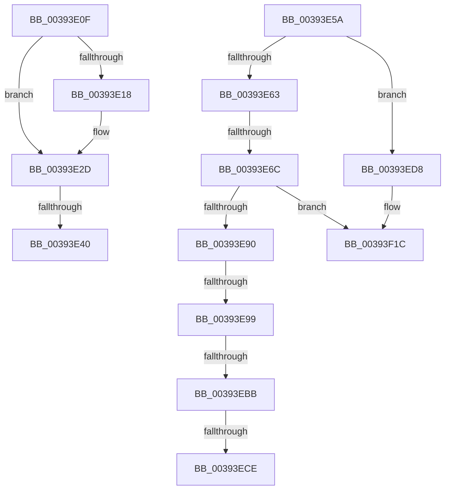

# sub_00393E0F

- RVA: `0x00393E0F`–`0x00393F58` (길이 `329` bytes)
- VA: `0x0000000140393E0F`
- 실행 섹션: `.text`
- PDB 이름 있음: `아니요`; PDB Function 태그: `아니요`
- unwind 정보 RVA: `0x00080F18`
- 디코드: `77`개 명령, `329/329` bytes 표시
- 미해석 바이트: `0` (있으면 어셈블리에 `.byte`로 보존)

> 이 문서는 커널 이미지의 기계어와 PDB 기호를 분석해 생성했습니다. 4번과 5번은 함수 원형과 자료형을 바이너리 사용 방식에서 추정한 C 해석이며 원본 소스 복구 결과는 아닙니다.

## 1. Dependencies

- 직접 호출 지점: **6**; 고유 호출 대상: **3**
- 직접 호출자로 확인된 함수: **0**
- RIP 상대 이미지 참조: **4**

### Outgoing calls
- `0x00393E28` → [ObpPushStackInfo](../21/ObpPushStackInfo_function_002109E4.md) (function, `0x002109E4`)
- `0x00393E7D` → [KeBugCheckEx](../4F/KeBugCheckEx_function_004FD660.md) (function, `0x004FD660`)
- `0x00393EAA` → [KeBugCheckEx](../4F/KeBugCheckEx_function_004FD660.md) (function, `0x004FD660`)
- `0x00393ECE` → [IoReleaseRemoveLockEx](../33/IoReleaseRemoveLockEx_function_0033D330.md) (function, `0x0033D330`)
- `0x00393F16` → [KeBugCheckEx](../4F/KeBugCheckEx_function_004FD660.md) (function, `0x004FD660`)
- `0x00393F52` → [KeBugCheckEx](../4F/KeBugCheckEx_function_004FD660.md) (function, `0x004FD660`)

### Direct callers
- 이 함수 시작 RVA로 연결되는 직접 call은 확인되지 않았습니다. 간접 호출은 완전히 역산할 수 없습니다.

### Static image references
- `0x00393E0F` → RVA `0x00FC5010` (`ALMOSTRO`; read)
- `0x00393EBB` → RVA `0x0033D330` (`IoReleaseRemoveLockEx`; read)
- `0x00393EEE` → RVA `0x00000000` (`image boundary/outside`; read)
- `0x00393F04` → RVA `0x00FC6E4C` (`ALMOSTRO`; read)

## 2. Other-region calls and transfers

- 다른 실행 섹션으로 향하는 call: **0**
- call이 아닌 외부 분기/꼬리 이동: **7**
  - `0x00393E3A` → [sub_00394132](Unknown_function_00394132.md) (`tail-transfer`)
  - `0x00393E55` → [sub_00393C19 + 0x11](Unknown_function_00393C19.md) (`tail-transfer`)
  - `0x00393E66` → [sub_00393FDE + 0x32](Unknown_function_00393FDE.md) (`tail-transfer`)
  - `0x00393E93` → [sub_00393FDE + 0xB0](Unknown_function_00393FDE.md) (`tail-transfer`)
  - `0x00393EB5` → [sub_00393FDE](Unknown_function_00393FDE.md) (`tail-transfer`)
  - `0x00393EC8` → [sub_00393F79](Unknown_function_00393F79.md) (`tail-transfer`)
  - `0x00393ED3` → [sub_00393C19 + 0x4A](Unknown_function_00393C19.md) (`tail-transfer`)

## 3. Assembly (complete function range)

```asm
00393E0F  83 3D FA 11 C3 00 00            cmp dword ptr [rip + 0xc311fa], 0
00393E16  74 15                           je 0x140393e2d
00393E18  33 D2                           xor edx, edx
00393E1A  48 8D 4D D0                     lea rcx, [rbp - 0x30]
00393E1E  41 B9 43 6F 6E 74               mov r9d, 0x746e6f43
00393E24  44 8D 42 01                     lea r8d, [rdx + 1]
00393E28  E8 B7 CB E7 FF                  call 0x1402109e4
00393E2D  48 8B C7                        mov rax, rdi
00393E30  F0 48 0F C1 45 D0               lock xadd qword ptr [rbp - 0x30], rax
00393E36  48 83 E8 01                     sub rax, 1
00393E3A  0F 8E F2 02 00 00               jle 0x140394132
00393E40  48 8B 73 38                     mov rsi, qword ptr [rbx + 0x38]
00393E44  8B 6C 24 30                     mov ebp, dword ptr [rsp + 0x30]
00393E48  4C 8B 64 24 38                  mov r12, qword ptr [rsp + 0x38]
00393E4D  48 C7 43 38 00 00 00 00         mov qword ptr [rbx + 0x38], 0
00393E55  E9 D0 FD FF FF                  jmp 0x140393c2a
00393E5A  49 8B 4F D8                     mov rcx, qword ptr [r15 - 0x28]
00393E5E  48 85 C9                        test rcx, rcx
00393E61  75 75                           jne 0x140393ed8
00393E63  48 85 C0                        test rax, rax
00393E66  0F 89 A4 01 00 00               jns 0x140394010
00393E6C  33 D2                           xor edx, edx
00393E6E  48 89 44 24 20                  mov qword ptr [rsp + 0x20], rax
00393E73  44 8D 49 02                     lea r9d, [rcx + 2]
00393E77  4D 8B C7                        mov r8, r15
00393E7A  8D 4A 18                        lea ecx, [rdx + 0x18]
00393E7D  E8 DE 97 16 00                  call 0x1404fd660
00393E82  CC                              int3
00393E83  48 8B 4E D8                     mov rcx, qword ptr [rsi - 0x28]
00393E87  48 85 C9                        test rcx, rcx
00393E8A  0F 85 8C 00 00 00               jne 0x140393f1c
00393E90  48 85 FF                        test rdi, rdi
00393E93  0F 89 F5 01 00 00               jns 0x14039408e
00393E99  33 D2                           xor edx, edx
00393E9B  48 89 7C 24 20                  mov qword ptr [rsp + 0x20], rdi
00393EA0  44 8D 49 02                     lea r9d, [rcx + 2]
00393EA4  4C 8B C6                        mov r8, rsi
00393EA7  8D 4A 18                        lea ecx, [rdx + 0x18]
00393EAA  E8 B1 97 16 00                  call 0x1404fd660
00393EAF  CC                              int3
00393EB0  66 41 83 3F 03                  cmp word ptr [r15], 3
00393EB5  0F 85 23 01 00 00               jne 0x140393fde
00393EBB  48 8D 05 6E 94 FA FF            lea rax, [rip - 0x56b92]
00393EC2  49 8B CF                        mov rcx, r15
00393EC5  4C 3B E0                        cmp r12, rax
00393EC8  0F 85 AB 00 00 00               jne 0x140393f79
00393ECE  E8 5D 94 FA FF                  call 0x14033d330
00393ED3  E9 8B FD FF FF                  jmp 0x140393c63
00393ED8  41 B9 01 00 00 00               mov r9d, 1
00393EDE  48 89 4C 24 20                  mov qword ptr [rsp + 0x20], rcx
00393EE3  49 8D 47 D0                     lea rax, [r15 - 0x30]
00393EE7  4D 8B C7                        mov r8, r15
00393EEA  48 C1 E8 08                     shr rax, 8
00393EEE  4C 8D 35 0B C1 C6 FF            lea r14, [rip - 0x393ef5]
00393EF5  0F B6 D0                        movzx edx, al
00393EF8  41 0F B6 47 E8                  movzx eax, byte ptr [r15 - 0x18]
00393EFD  41 8D 49 17                     lea ecx, [r9 + 0x17]
00393F01  48 33 D0                        xor rdx, rax
00393F04  0F B6 05 41 2F C3 00            movzx eax, byte ptr [rip + 0xc32f41]
00393F0B  48 33 D0                        xor rdx, rax
00393F0E  49 8B 94 D6 00 78 FC 00         mov rdx, qword ptr [r14 + rdx*8 + 0xfc7800]
00393F16  E8 45 97 16 00                  call 0x1404fd660
00393F1B  CC                              int3
00393F1C  41 B9 01 00 00 00               mov r9d, 1
00393F22  48 89 4C 24 20                  mov qword ptr [rsp + 0x20], rcx
00393F27  48 8D 46 D0                     lea rax, [rsi - 0x30]
00393F2B  4C 8B C6                        mov r8, rsi
00393F2E  48 C1 E8 08                     shr rax, 8
00393F32  0F B6 D0                        movzx edx, al
00393F35  0F B6 46 E8                     movzx eax, byte ptr [rsi - 0x18]
00393F39  41 8D 49 17                     lea ecx, [r9 + 0x17]
00393F3D  48 33 D0                        xor rdx, rax
00393F40  0F B6 05 05 2F C3 00            movzx eax, byte ptr [rip + 0xc32f05]
00393F47  48 33 D0                        xor rdx, rax
00393F4A  49 8B 94 D6 00 78 FC 00         mov rdx, qword ptr [r14 + rdx*8 + 0xfc7800]
00393F52  E8 09 97 16 00                  call 0x1404fd660
00393F57  CC                              int3
```

## 4. C-style interpretation (structured pseudocode)

```c
__int64 __fastcall sub_00393E0F(__int64 a1, int a2, __int64 a3, __int64 a4, __int64 a5, unsigned int a6, __int64 a7)
{
    __int64 result;
    unsigned __int64 v_stack_p20;

    if ((*(unsigned int *)(v_rip + 12784122)) != 0) {
        a2 = 0;
        a1 = v_rbp - 48;
        a4 = 0x746E6F43ULL;
        a3 = a2 + 1;
        result = ObpPushStackInfo(a1, a2, a3, a4);
    }
    result = (v_rdi) - (1);
    *(unsigned __int64 *)(v_rbx + 56) = 0;
}
```

## 5. (Beta) C Style

```c
int64_t sub_00393E0F(int64_t Arg1, int32_t Arg2, int64_t Arg3, int64_t Arg4, uint64_t Arg5, uint32_t Arg6, int64_t Arg7)
{
    int64_t result;
    uint64_t v_stack_p20;

    if ((*(uint32_t *)(v_rip + 0xC311FA)) != 0) {
        Arg2 = 0;
        Arg1 = local_rbp - 48;
        Arg4 = 0x746E6F43ULL;
        Arg3 = Arg2 + 1;
        result = ObpPushStackInfo(Arg1, Arg2, Arg3, Arg4);
    }
    result = (local_rdi) - (1);
    *(uint64_t *)(local_rbx + 0x38) = 0;
}
```

## 6. Execution-region graph

[열기: 2D/3D 그래프와 함수 탐색 컨트롤 패널](../../../control-panel.html?section=text&rva=0x00393E0F&view=graph)

- 2D 그래프는 위에서 아래로 흐르고, 3D 그래프는 빈 공간을 드래그해 회전합니다. Shift+드래그는 이동, 휠은 확대·축소, 함수 노드 선택은 대상 보고서 이동입니다.

### Static fallback


