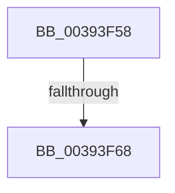

# sub_00393F58

- RVA: `0x00393F58`–`0x00393F79` (길이 `33` bytes)
- VA: `0x0000000140393F58`
- 실행 섹션: `.text`
- PDB 이름 있음: `아니요`; PDB Function 태그: `아니요`
- unwind 정보 RVA: `0x00080F28`
- 디코드: `6`개 명령, `33/33` bytes 표시
- 미해석 바이트: `0` (있으면 어셈블리에 `.byte`로 보존)

> 이 문서는 커널 이미지의 기계어와 PDB 기호를 분석해 생성했습니다. 4번과 5번은 함수 원형과 자료형을 바이너리 사용 방식에서 추정한 C 해석이며 원본 소스 복구 결과는 아닙니다.

## 1. Dependencies

- 직접 호출 지점: **1**; 고유 호출 대상: **1**
- 직접 호출자로 확인된 함수: **0**
- RIP 상대 이미지 참조: **0**

### Outgoing calls
- `0x00393F5B` → [KeSetThreadChargeOnlySchedulingGroup](KeSetThreadChargeOnlySchedulingGroup_function_00392F20.md) (function, `0x00392F20`)

### Direct callers
- 이 함수 시작 RVA로 연결되는 직접 call은 확인되지 않았습니다. 간접 호출은 완전히 역산할 수 없습니다.

### Static image references
- 디코드된 RIP-relative 메모리 참조가 없습니다.

## 2. Other-region calls and transfers

- 다른 실행 섹션으로 향하는 call: **0**
- call이 아닌 외부 분기/꼬리 이동: **2**
  - `0x00393F62` → [sub_00393D34 + 0xC3](Unknown_function_00393D34.md) (`tail-transfer`)
  - `0x00393F74` → [sub_00393D34 + 0xC3](Unknown_function_00393D34.md) (`tail-transfer`)

## 3. Assembly (complete function range)

```asm
00393F58  49 8B CD                        mov rcx, r13
00393F5B  E8 C0 EF FF FF                  call 0x140392f20
00393F60  84 C0                           test al, al
00393F62  0F 84 8F FE FF FF               je 0x140393df7
00393F68  F0 41 81 8D A0 05 00 00 00 00 00 01  lock or dword ptr [r13 + 0x5a0], 0x1000000
00393F74  E9 7E FE FF FF                  jmp 0x140393df7
```

## 4. C-style interpretation (structured pseudocode)

```c
__int64 __fastcall sub_00393F58(void)
{
    __int64 result;

    result = KeSetThreadChargeOnlySchedulingGroup(v_r13, a2, a3, a4);
}
```

## 5. (Beta) C Style

```c
void sub_00393F58(void)
{
    int64_t result;

    result = KeSetThreadChargeOnlySchedulingGroup(local_r13, a2, a3, a4);
}
```

## 6. Execution-region graph

[열기: 2D/3D 그래프와 함수 탐색 컨트롤 패널](../../../control-panel.html?section=text&rva=0x00393F58&view=graph)

- 2D 그래프는 위에서 아래로 흐르고, 3D 그래프는 빈 공간을 드래그해 회전합니다. Shift+드래그는 이동, 휠은 확대·축소, 함수 노드 선택은 대상 보고서 이동입니다.

### Static fallback


