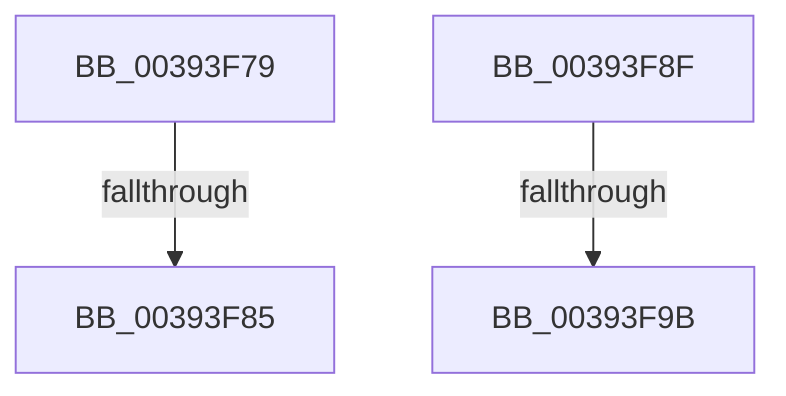

# sub_00393F79

- RVA: `0x00393F79`–`0x00393FA5` (길이 `44` bytes)
- VA: `0x0000000140393F79`
- 실행 섹션: `.text`
- PDB 이름 있음: `아니요`; PDB Function 태그: `아니요`
- unwind 정보 RVA: `0x00080F3C`
- 디코드: `10`개 명령, `44/44` bytes 표시
- 미해석 바이트: `0` (있으면 어셈블리에 `.byte`로 보존)

> 이 문서는 커널 이미지의 기계어와 PDB 기호를 분석해 생성했습니다. 4번과 5번은 함수 원형과 자료형을 바이너리 사용 방식에서 추정한 C 해석이며 원본 소스 복구 결과는 아닙니다.

## 1. Dependencies

- 직접 호출 지점: **2**; 고유 호출 대상: **2**
- 직접 호출자로 확인된 함수: **0**
- RIP 상대 이미지 참조: **2**

### Outgoing calls
- `0x00393F85` → [ExFreePoolWithTag](../../poolcode/B8/ExFreePoolWithTag_function_00B82870.md) (function, `0x00B82870`)
- `0x00393F9B` → [KeReleaseSpinLock](KeReleaseSpinLock_function_00392BA0.md) (function, `0x00392BA0`)

### Direct callers
- 이 함수 시작 RVA로 연결되는 직접 call은 확인되지 않았습니다. 간접 호출은 완전히 역산할 수 없습니다.

### Static image references
- `0x00393F79` → RVA `0x00B82870` (`ExFreePoolWithTag`; read)
- `0x00393F8F` → RVA `0x00392BA0` (`KeReleaseSpinLock`; read)

## 2. Other-region calls and transfers

- 다른 실행 섹션으로 향하는 call: **1**
  - `0x00393F85` → [ExFreePoolWithTag](../../poolcode/B8/ExFreePoolWithTag_function_00B82870.md) (`.text` → `POOLCODE`)
- call이 아닌 외부 분기/꼬리 이동: **4**
  - `0x00393F83` → [sub_00393FDE + 0x2](Unknown_function_00393FDE.md) (`tail-transfer`)
  - `0x00393F8A` → [sub_00393C19 + 0x4A](Unknown_function_00393C19.md) (`tail-transfer`)
  - `0x00393F99` → [sub_00393FDE + 0xF](Unknown_function_00393FDE.md) (`tail-transfer`)
  - `0x00393FA0` → [sub_00393C19 + 0x4A](Unknown_function_00393C19.md) (`tail-transfer`)

## 3. Assembly (complete function range)

```asm
00393F79  48 8D 05 F0 E8 7E 00            lea rax, [rip + 0x7ee8f0]
00393F80  4C 3B E0                        cmp r12, rax
00393F83  75 5B                           jne 0x140393fe0
00393F85  E8 E6 E8 7E 00                  call 0x140b82870
00393F8A  E9 D4 FC FF FF                  jmp 0x140393c63
00393F8F  48 8D 05 0A EC FF FF            lea rax, [rip - 0x13f6]
00393F96  4C 3B E0                        cmp r12, rax
00393F99  75 52                           jne 0x140393fed
00393F9B  E8 00 EC FF FF                  call 0x140392ba0
00393FA0  E9 BE FC FF FF                  jmp 0x140393c63
```

## 4. C-style interpretation (structured pseudocode)

```c
__int64 __fastcall sub_00393F79(void)
{
    __int64 result;

    result = ExFreePoolWithTag(a1, a2, a3, a4);
}
```

## 5. (Beta) C Style

```c
void sub_00393F79(void)
{
    int64_t result;

    result = ExFreePoolWithTag(a1, a2, a3, a4);
}
```

## 6. Execution-region graph

[열기: 2D/3D 그래프와 함수 탐색 컨트롤 패널](../../../control-panel.html?section=text&rva=0x00393F79&view=graph)

- 2D 그래프는 위에서 아래로 흐르고, 3D 그래프는 빈 공간을 드래그해 회전합니다. Shift+드래그는 이동, 휠은 확대·축소, 함수 노드 선택은 대상 보고서 이동입니다.

### Static fallback


