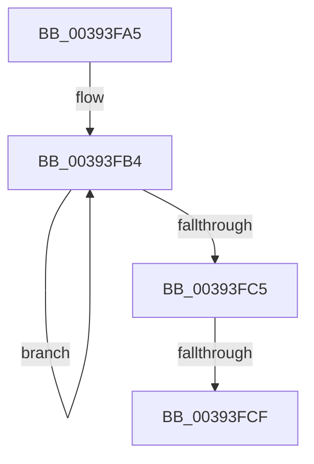

# sub_00393FA5

- RVA: `0x00393FA5`–`0x00393FDE` (길이 `57` bytes)
- VA: `0x0000000140393FA5`
- 실행 섹션: `.text`
- PDB 이름 있음: `아니요`; PDB Function 태그: `아니요`
- unwind 정보 RVA: `0x00080F4C`
- 디코드: `12`개 명령, `57/57` bytes 표시
- 미해석 바이트: `0` (있으면 어셈블리에 `.byte`로 보존)

> 이 문서는 커널 이미지의 기계어와 PDB 기호를 분석해 생성했습니다. 4번과 5번은 함수 원형과 자료형을 바이너리 사용 방식에서 추정한 C 해석이며 원본 소스 복구 결과는 아닙니다.

## 1. Dependencies

- 직접 호출 지점: **1**; 고유 호출 대상: **1**
- 직접 호출자로 확인된 함수: **0**
- RIP 상대 이미지 참조: **0**

### Outgoing calls
- `0x00393FD4` → [KeSetThreadChargeOnlySchedulingGroup](KeSetThreadChargeOnlySchedulingGroup_function_00392F20.md) (function, `0x00392F20`)

### Direct callers
- 이 함수 시작 RVA로 연결되는 직접 call은 확인되지 않았습니다. 간접 호출은 완전히 역산할 수 없습니다.

### Static image references
- 디코드된 RIP-relative 메모리 참조가 없습니다.

## 2. Other-region calls and transfers

- 다른 실행 섹션으로 향하는 call: **0**
- call이 아닌 외부 분기/꼬리 이동: **2**
  - `0x00393FC9` → [sub_00393D34 + 0x2E](Unknown_function_00393D34.md) (`tail-transfer`)
  - `0x00393FD9` → [sub_00393D34 + 0x2E](Unknown_function_00393D34.md) (`tail-transfer`)

## 3. Assembly (complete function range)

```asm
00393FA5  41 0F 0D 8D A0 05 00 00         prefetchw byte ptr [r13 + 0x5a0]
00393FAD  41 8B 85 A0 05 00 00            mov eax, dword ptr [r13 + 0x5a0]
00393FB4  8B C8                           mov ecx, eax
00393FB6  0F BA F1 18                     btr ecx, 0x18
00393FBA  F0 41 0F B1 8D A0 05 00 00      lock cmpxchg dword ptr [r13 + 0x5a0], ecx
00393FC3  75 EF                           jne 0x140393fb4
00393FC5  0F BA E0 18                     bt eax, 0x18
00393FC9  0F 83 93 FD FF FF               jae 0x140393d62
00393FCF  33 D2                           xor edx, edx
00393FD1  49 8B CD                        mov rcx, r13
00393FD4  E8 47 EF FF FF                  call 0x140392f20
00393FD9  E9 84 FD FF FF                  jmp 0x140393d62
```

## 4. C-style interpretation (structured pseudocode)

```c
__int64 __fastcall sub_00393FA5(__int64 a1, int a2)
{
    __int64 result;

loc_00393FB4:
    if (condition_is_not_equal) goto loc_00393FB4;
    a2 = 0;
    result = KeSetThreadChargeOnlySchedulingGroup(v_r13, a2, a3, a4);
}
```

## 5. (Beta) C Style

```c
int64_t sub_00393FA5(int64_t Arg1, int32_t Arg2)
{
    int64_t result;

loc_00393FB4:
    if (condition_is_not_equal) goto loc_00393FB4;
    Arg2 = 0;
    result = KeSetThreadChargeOnlySchedulingGroup(local_r13, Arg2, a3, a4);
}
```

## 6. Execution-region graph

[열기: 2D/3D 그래프와 함수 탐색 컨트롤 패널](../../../control-panel.html?section=text&rva=0x00393FA5&view=graph)

- 2D 그래프는 위에서 아래로 흐르고, 3D 그래프는 빈 공간을 드래그해 회전합니다. Shift+드래그는 이동, 휠은 확대·축소, 함수 노드 선택은 대상 보고서 이동입니다.

### Static fallback


