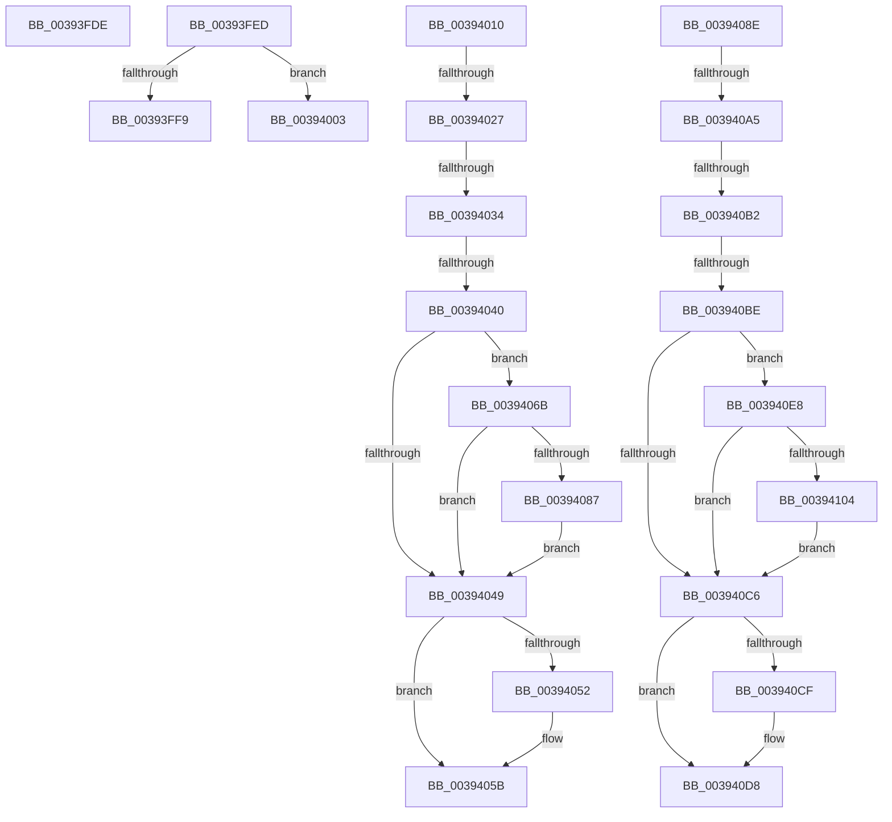

# sub_00393FDE

- RVA: `0x00393FDE`–`0x0039410B` (길이 `301` bytes)
- VA: `0x0000000140393FDE`
- 실행 섹션: `.text`
- PDB 이름 있음: `아니요`; PDB Function 태그: `아니요`
- unwind 정보 RVA: `0x00080F60`
- 디코드: `70`개 명령, `301/301` bytes 표시
- 미해석 바이트: `0` (있으면 어셈블리에 `.byte`로 보존)

> 이 문서는 커널 이미지의 기계어와 PDB 기호를 분석해 생성했습니다. 4번과 5번은 함수 원형과 자료형을 바이너리 사용 방식에서 추정한 C 해석이며 원본 소스 복구 결과는 아닙니다.

## 1. Dependencies

- 직접 호출 지점: **11**; 고유 호출 대상: **6**
- 직접 호출자로 확인된 함수: **0**
- RIP 상대 이미지 참조: **2**

### Outgoing calls
- `0x00393FE3` → [guard_dispatch_icall](../6B/guard_dispatch_icall_function_006BAAD0.md) (function, `0x006BAAD0`)
- `0x00393FF9` → [PnpDeviceCompletionRequestDestroyWorkItem](../47/PnpDeviceCompletionRequestDestroyWorkItem_function_00471FC0.md) (function, `0x00471FC0`)
- `0x00394006` → [guard_dispatch_icall](../6B/guard_dispatch_icall_function_006BAAD0.md) (function, `0x006BAAD0`)
- `0x00394027` → [KeAreInterruptsEnabled](../2F/KeAreInterruptsEnabled_function_002F8060.md) (function, `0x002F8060`)
- `0x00394056` → [ObpDeregisterObject](../../page/9D/ObpDeregisterObject_function_009D7F78.md) (function, `0x009D7F78`)
- `0x00394061` → [ObpRemoveObjectRoutine](../../page/86/ObpRemoveObjectRoutine_function_00864A60.md) (function, `0x00864A60`)
- `0x00394087` → [ObpHandleRevocationBlockRemoveObject](../../page/9D/ObpHandleRevocationBlockRemoveObject_function_009D7E30.md) (function, `0x009D7E30`)
- `0x003940A5` → [KeAreInterruptsEnabled](../2F/KeAreInterruptsEnabled_function_002F8060.md) (function, `0x002F8060`)
- `0x003940D3` → [ObpDeregisterObject](../../page/9D/ObpDeregisterObject_function_009D7F78.md) (function, `0x009D7F78`)
- `0x003940DE` → [ObpRemoveObjectRoutine](../../page/86/ObpRemoveObjectRoutine_function_00864A60.md) (function, `0x00864A60`)
- `0x00394104` → [ObpHandleRevocationBlockRemoveObject](../../page/9D/ObpHandleRevocationBlockRemoveObject_function_009D7E30.md) (function, `0x009D7E30`)

### Direct callers
- 이 함수 시작 RVA로 연결되는 직접 call은 확인되지 않았습니다. 간접 호출은 완전히 역산할 수 없습니다.

### Static image references
- `0x00393FED` → RVA `0x00471FC0` (`PnpDeviceCompletionRequestDestroyWorkItem`; read)
- `0x00394049` → RVA `0x00FC5010` (`ALMOSTRO`; read)

## 2. Other-region calls and transfers

- 다른 실행 섹션으로 향하는 call: **6**
  - `0x00394056` → [ObpDeregisterObject](../../page/9D/ObpDeregisterObject_function_009D7F78.md) (`.text` → `PAGE`)
  - `0x00394061` → [ObpRemoveObjectRoutine](../../page/86/ObpRemoveObjectRoutine_function_00864A60.md) (`.text` → `PAGE`)
  - `0x00394087` → [ObpHandleRevocationBlockRemoveObject](../../page/9D/ObpHandleRevocationBlockRemoveObject_function_009D7E30.md) (`.text` → `PAGE`)
  - `0x003940D3` → [ObpDeregisterObject](../../page/9D/ObpDeregisterObject_function_009D7F78.md) (`.text` → `PAGE`)
  - `0x003940DE` → [ObpRemoveObjectRoutine](../../page/86/ObpRemoveObjectRoutine_function_00864A60.md) (`.text` → `PAGE`)
  - `0x00394104` → [ObpHandleRevocationBlockRemoveObject](../../page/9D/ObpHandleRevocationBlockRemoveObject_function_009D7E30.md) (`.text` → `PAGE`)
- call이 아닌 외부 분기/꼬리 이동: **11**
  - `0x00393FE8` → [sub_00393C19 + 0x4A](Unknown_function_00393C19.md) (`tail-transfer`)
  - `0x00393FFE` → [sub_00393C19 + 0x4A](Unknown_function_00393C19.md) (`tail-transfer`)
  - `0x0039400B` → [sub_00393C19 + 0x4A](Unknown_function_00393C19.md) (`tail-transfer`)
  - `0x00394021` → [sub_00394132 + 0x76](Unknown_function_00394132.md) (`tail-transfer`)
  - `0x0039402E` → [sub_00394132 + 0x76](Unknown_function_00394132.md) (`tail-transfer`)
  - `0x0039403A` → [sub_00394132 + 0x76](Unknown_function_00394132.md) (`tail-transfer`)
  - `0x00394066` → [sub_00393C19 + 0x92](Unknown_function_00393C19.md) (`tail-transfer`)
  - `0x0039409F` → [sub_00394132 + 0x84](Unknown_function_00394132.md) (`tail-transfer`)
  - `0x003940AC` → [sub_00394132 + 0x84](Unknown_function_00394132.md) (`tail-transfer`)
  - `0x003940B8` → [sub_00394132 + 0x84](Unknown_function_00394132.md) (`tail-transfer`)
  - `0x003940E3` → [sub_00393C19 + 0xDB](Unknown_function_00393C19.md) (`tail-transfer`)

## 3. Assembly (complete function range)

```asm
00393FDE  33 C9                           xor ecx, ecx
00393FE0  49 8B C4                        mov rax, r12
00393FE3  E8 E8 6A 32 00                  call 0x1406baad0
00393FE8  E9 76 FC FF FF                  jmp 0x140393c63
00393FED  48 8D 05 CC DF 0D 00            lea rax, [rip + 0xddfcc]
00393FF4  4C 3B E0                        cmp r12, rax
00393FF7  75 0A                           jne 0x140394003
00393FF9  E8 C2 DF 0D 00                  call 0x140471fc0
00393FFE  E9 60 FC FF FF                  jmp 0x140393c63
00394003  49 8B C4                        mov rax, r12
00394006  E8 C5 6A 32 00                  call 0x1406baad0
0039400B  E9 53 FC FF FF                  jmp 0x140393c63
00394010  65 48 8B 04 25 88 01 00 00      mov rax, qword ptr gs:[0x188]
00394019  66 83 B8 E6 01 00 00 00         cmp word ptr [rax + 0x1e6], 0
00394021  0F 85 81 01 00 00               jne 0x1403941a8
00394027  E8 34 40 F6 FF                  call 0x1402f8060
0039402C  84 C0                           test al, al
0039402E  0F 84 74 01 00 00               je 0x1403941a8
00394034  44 0F 20 C0                     mov rax, cr8
00394038  3C 01                           cmp al, 1
0039403A  0F 83 68 01 00 00               jae 0x1403941a8
00394040  41 0F B6 47 EA                  movzx eax, byte ptr [r15 - 0x16]
00394045  A8 40                           test al, 0x40
00394047  75 22                           jne 0x14039406b
00394049  83 3D C0 0F C3 00 00            cmp dword ptr [rip + 0xc30fc0], 0
00394050  74 09                           je 0x14039405b
00394052  49 8D 4F D0                     lea rcx, [r15 - 0x30]
00394056  E8 1D 3F 64 00                  call 0x1409d7f78
0039405B  33 D2                           xor edx, edx
0039405D  49 8D 4F D0                     lea rcx, [r15 - 0x30]
00394061  E8 FA 09 4D 00                  call 0x140864a60
00394066  E9 40 FC FF FF                  jmp 0x140393cab
0039406B  83 E0 7F                        and eax, 0x7f
0039406E  49 8D 4F D0                     lea rcx, [r15 - 0x30]
00394072  42 0F B6 84 30 80 FF F0 00      movzx eax, byte ptr [rax + r14 + 0xf0ff80]
0039407B  48 2B C8                        sub rcx, rax
0039407E  48 8B 09                        mov rcx, qword ptr [rcx]
00394081  80 79 18 00                     cmp byte ptr [rcx + 0x18], 0
00394085  74 C2                           je 0x140394049
00394087  E8 A4 3D 64 00                  call 0x1409d7e30
0039408C  EB BB                           jmp 0x140394049
0039408E  65 48 8B 04 25 88 01 00 00      mov rax, qword ptr gs:[0x188]
00394097  66 83 B8 E6 01 00 00 00         cmp word ptr [rax + 0x1e6], 0
0039409F  0F 85 11 01 00 00               jne 0x1403941b6
003940A5  E8 B6 3F F6 FF                  call 0x1402f8060
003940AA  84 C0                           test al, al
003940AC  0F 84 04 01 00 00               je 0x1403941b6
003940B2  44 0F 20 C0                     mov rax, cr8
003940B6  3C 01                           cmp al, 1
003940B8  0F 83 F8 00 00 00               jae 0x1403941b6
003940BE  0F B6 46 EA                     movzx eax, byte ptr [rsi - 0x16]
003940C2  A8 40                           test al, 0x40
003940C4  75 22                           jne 0x1403940e8
003940C6  83 3D 43 0F C3 00 00            cmp dword ptr [rip + 0xc30f43], 0
003940CD  74 09                           je 0x1403940d8
003940CF  48 8D 4E D0                     lea rcx, [rsi - 0x30]
003940D3  E8 A0 3E 64 00                  call 0x1409d7f78
003940D8  33 D2                           xor edx, edx
003940DA  48 8D 4E D0                     lea rcx, [rsi - 0x30]
003940DE  E8 7D 09 4D 00                  call 0x140864a60
003940E3  E9 0C FC FF FF                  jmp 0x140393cf4
003940E8  83 E0 7F                        and eax, 0x7f
003940EB  48 8D 4E D0                     lea rcx, [rsi - 0x30]
003940EF  42 0F B6 84 30 80 FF F0 00      movzx eax, byte ptr [rax + r14 + 0xf0ff80]
003940F8  48 2B C8                        sub rcx, rax
003940FB  48 8B 09                        mov rcx, qword ptr [rcx]
003940FE  80 79 18 00                     cmp byte ptr [rcx + 0x18], 0
00394102  74 C2                           je 0x1403940c6
00394104  E8 27 3D 64 00                  call 0x1409d7e30
00394109  EB BB                           jmp 0x1403940c6
```

## 4. C-style interpretation (structured pseudocode)

```c
__int64 __fastcall sub_00393FDE(int a1, int a2)
{
    __int64 result;

    a1 = 0;
    result = guard_dispatch_icall(a1, a2, a3, a4);
}
```

## 5. (Beta) C Style

```c
int64_t sub_00393FDE(int32_t Arg1, int32_t Arg2)
{
    int64_t result;

    Arg1 = 0;
    result = guard_dispatch_icall(Arg1, Arg2, a3, a4);
}
```

## 6. Execution-region graph

[열기: 2D/3D 그래프와 함수 탐색 컨트롤 패널](../../../control-panel.html?section=text&rva=0x00393FDE&view=graph)

- 2D 그래프는 위에서 아래로 흐르고, 3D 그래프는 빈 공간을 드래그해 회전합니다. Shift+드래그는 이동, 휠은 확대·축소, 함수 노드 선택은 대상 보고서 이동입니다.

### Static fallback


