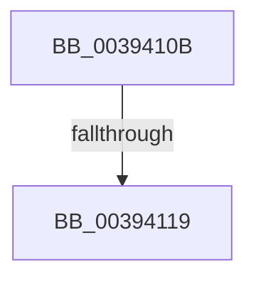

# sub_0039410B

- RVA: `0x0039410B`–`0x00394132` (길이 `39` bytes)
- VA: `0x000000014039410B`
- 실행 섹션: `.text`
- PDB 이름 있음: `아니요`; PDB Function 태그: `아니요`
- unwind 정보 RVA: `0x00080F70`
- 디코드: `7`개 명령, `39/39` bytes 표시
- 미해석 바이트: `0` (있으면 어셈블리에 `.byte`로 보존)

> 이 문서는 커널 이미지의 기계어와 PDB 기호를 분석해 생성했습니다. 4번과 5번은 함수 원형과 자료형을 바이너리 사용 방식에서 추정한 C 해석이며 원본 소스 복구 결과는 아닙니다.

## 1. Dependencies

- 직접 호출 지점: **1**; 고유 호출 대상: **1**
- 직접 호출자로 확인된 함수: **0**
- RIP 상대 이미지 참조: **2**

### Outgoing calls
- `0x00394128` → [ExpReleaseSpinLockExclusiveFromDpcLevelInstrumented](../2C/ExpReleaseSpinLockExclusiveFromDpcLevelInstrumented_function_002C0F44.md) (function, `0x002C0F44`)

### Direct callers
- 이 함수 시작 RVA로 연결되는 직접 call은 확인되지 않았습니다. 간접 호출은 완전히 역산할 수 없습니다.

### Static image references
- `0x0039410B` → RVA `0x00F0DE58` (`.data`; read)
- `0x00394121` → RVA `0x00F06590` (`.data`; read)

## 2. Other-region calls and transfers

- 다른 실행 섹션으로 향하는 call: **0**
- call이 아닌 외부 분기/꼬리 이동: **2**
  - `0x00394113` → [sub_00393D34 + 0x78](Unknown_function_00393D34.md) (`tail-transfer`)
  - `0x0039412D` → [sub_00393D34 + 0x82](Unknown_function_00393D34.md) (`tail-transfer`)

## 3. Assembly (complete function range)

```asm
0039410B  8B 05 47 9D B7 00               mov eax, dword ptr [rip + 0xb79d47]
00394111  85 C0                           test eax, eax
00394113  0F 85 93 FC FF FF               jne 0x140393dac
00394119  48 8B 94 24 88 00 00 00         mov rdx, qword ptr [rsp + 0x88]
00394121  48 8D 0D 68 24 B7 00            lea rcx, [rip + 0xb72468]
00394128  E8 17 CE F2 FF                  call 0x1402c0f44
0039412D  E9 84 FC FF FF                  jmp 0x140393db6
```

## 4. C-style interpretation (structured pseudocode)

```c
__int64 __fastcall sub_0039410B(__int64 a1, __int64 a2, __int64 a3, __int64 a4, __int64 a5, __int64 a6, __int64 a7, __int64 a8, __int64 a9, __int64 a10, __int64 a11, __int64 a12, __int64 a13, __int64 a14, __int64 a15, __int64 a16, __int64 a17)
{
    __int64 result;

    result = ExpReleaseSpinLockExclusiveFromDpcLevelInstrumented(v_rip + 12002408, a17, a3, a4);
}
```

## 5. (Beta) C Style

```c
int64_t sub_0039410B(int64_t Arg1, int64_t Arg2, int64_t Arg3, int64_t Arg4, uint64_t Arg5, uint64_t Arg6, uint64_t Arg7, uint64_t Arg8, uint64_t Arg9, uint64_t Arg10, uint64_t Arg11, uint64_t Arg12, uint64_t Arg13, uint64_t Arg14, uint64_t Arg15, uint64_t Arg16, int64_t Arg17)
{
    int64_t result;

    result = ExpReleaseSpinLockExclusiveFromDpcLevelInstrumented(v_rip + 12002408, Arg17, Arg3, Arg4);
}
```

## 6. Execution-region graph

[열기: 2D/3D 그래프와 함수 탐색 컨트롤 패널](../../../control-panel.html?section=text&rva=0x0039410B&view=graph)

- 2D 그래프는 위에서 아래로 흐르고, 3D 그래프는 빈 공간을 드래그해 회전합니다. Shift+드래그는 이동, 휠은 확대·축소, 함수 노드 선택은 대상 보고서 이동입니다.

### Static fallback


