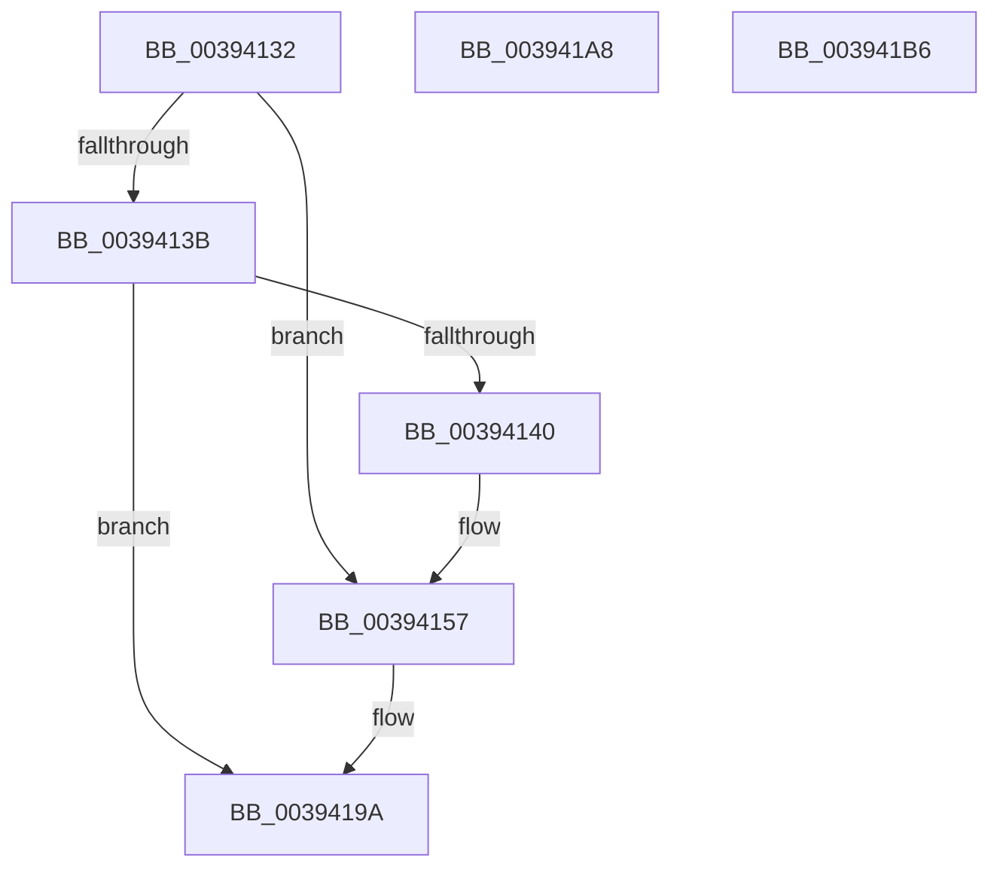

# sub_00394132

- RVA: `0x00394132`–`0x003941C4` (길이 `146` bytes)
- VA: `0x0000000140394132`
- 실행 섹션: `.text`
- PDB 이름 있음: `아니요`; PDB Function 태그: `아니요`
- unwind 정보 RVA: `0x00080F84`
- 디코드: `36`개 명령, `146/146` bytes 표시
- 미해석 바이트: `0` (있으면 어셈블리에 `.byte`로 보존)

> 이 문서는 커널 이미지의 기계어와 PDB 기호를 분석해 생성했습니다. 4번과 5번은 함수 원형과 자료형을 바이너리 사용 방식에서 추정한 C 해석이며 원본 소스 복구 결과는 아닙니다.

## 1. Dependencies

- 직접 호출 지점: **5**; 고유 호출 대상: **2**
- 직접 호출자로 확인된 함수: **0**
- RIP 상대 이미지 참조: **2**

### Outgoing calls
- `0x00394151` → [KeBugCheckEx](../4F/KeBugCheckEx_function_004FD660.md) (function, `0x004FD660`)
- `0x00394194` → [KeBugCheckEx](../4F/KeBugCheckEx_function_004FD660.md) (function, `0x004FD660`)
- `0x0039419E` → [ObpDeferObjectDeletion](../3A/ObpDeferObjectDeletion_function_003A2394.md) (function, `0x003A2394`)
- `0x003941AC` → [ObpDeferObjectDeletion](../3A/ObpDeferObjectDeletion_function_003A2394.md) (function, `0x003A2394`)
- `0x003941BA` → [ObpDeferObjectDeletion](../3A/ObpDeferObjectDeletion_function_003A2394.md) (function, `0x003A2394`)

### Direct callers
- 이 함수 시작 RVA로 연결되는 직접 call은 확인되지 않았습니다. 간접 호출은 완전히 역산할 수 없습니다.

### Static image references
- `0x0039416D` → RVA `0x00000000` (`image boundary/outside`; read)
- `0x00394182` → RVA `0x00FC6E4C` (`ALMOSTRO`; read)

## 2. Other-region calls and transfers

- 다른 실행 섹션으로 향하는 call: **0**
- call이 아닌 외부 분기/꼬리 이동: **3**
  - `0x003941A3` → [sub_00393E0F + 0x31](Unknown_function_00393E0F.md) (`tail-transfer`)
  - `0x003941B1` → [sub_00393C19 + 0x92](Unknown_function_00393C19.md) (`tail-transfer`)
  - `0x003941BF` → [sub_00393C19 + 0xDB](Unknown_function_00393C19.md) (`tail-transfer`)

## 3. Assembly (complete function range)

```asm
00394132  48 8B 4D D8                     mov rcx, qword ptr [rbp - 0x28]
00394136  48 85 C9                        test rcx, rcx
00394139  75 1C                           jne 0x140394157
0039413B  48 85 C0                        test rax, rax
0039413E  79 5A                           jns 0x14039419a
00394140  33 D2                           xor edx, edx
00394142  48 89 44 24 20                  mov qword ptr [rsp + 0x20], rax
00394147  44 8D 49 04                     lea r9d, [rcx + 4]
0039414B  4C 8B C5                        mov r8, rbp
0039414E  8D 4A 18                        lea ecx, [rdx + 0x18]
00394151  E8 0A 95 16 00                  call 0x1404fd660
00394156  CC                              int3
00394157  41 B9 03 00 00 00               mov r9d, 3
0039415D  48 89 4C 24 20                  mov qword ptr [rsp + 0x20], rcx
00394162  48 8D 45 D0                     lea rax, [rbp - 0x30]
00394166  4C 8B C5                        mov r8, rbp
00394169  48 C1 E8 08                     shr rax, 8
0039416D  4C 8D 35 8C BE C6 FF            lea r14, [rip - 0x394174]
00394174  0F B6 D0                        movzx edx, al
00394177  0F B6 45 E8                     movzx eax, byte ptr [rbp - 0x18]
0039417B  41 8D 49 15                     lea ecx, [r9 + 0x15]
0039417F  48 33 D0                        xor rdx, rax
00394182  0F B6 05 C3 2C C3 00            movzx eax, byte ptr [rip + 0xc32cc3]
00394189  48 33 D0                        xor rdx, rax
0039418C  49 8B 94 D6 00 78 FC 00         mov rdx, qword ptr [r14 + rdx*8 + 0xfc7800]
00394194  E8 C7 94 16 00                  call 0x1404fd660
00394199  CC                              int3
0039419A  48 8D 4D D0                     lea rcx, [rbp - 0x30]
0039419E  E8 F1 E1 00 00                  call 0x1403a2394
003941A3  E9 98 FC FF FF                  jmp 0x140393e40
003941A8  49 8D 4F D0                     lea rcx, [r15 - 0x30]
003941AC  E8 E3 E1 00 00                  call 0x1403a2394
003941B1  E9 F5 FA FF FF                  jmp 0x140393cab
003941B6  48 8D 4E D0                     lea rcx, [rsi - 0x30]
003941BA  E8 D5 E1 00 00                  call 0x1403a2394
003941BF  E9 30 FB FF FF                  jmp 0x140393cf4
```

## 4. C-style interpretation (structured pseudocode)

```c
__int64 __fastcall sub_00394132(__int64 a1, int a2)
{
    __int64 result;
    unsigned __int64 v_stack_p20;

    if (*(unsigned __int64 *)(v_rbp - 40) != 0) goto loc_00394157;
    if (!sign_flag) goto loc_0039419A;
    a2 = 0;
    v_stack_p20 = result;
    result = KeBugCheckEx(a2 + 24, a2, v_rbp, *(unsigned __int64 *)(v_rbp - 40) + 4);
loc_00394157:
    v_stack_p20 = a2 + 24;
    result = (v_rbp - 48) >> (8);
    a2 = ((unsigned __int8)(result)) ^ (*(unsigned __int8 *)(v_rbp - 24));
    a2 = (a2) ^ (*(unsigned __int8 *)(v_rip + 12790979));
    result = KeBugCheckEx(3 + 21, *(unsigned __int64 *)(v_rip - 3752308 + a2 * 8 + 16545792), v_rbp, 3);
loc_0039419A:
    result = ObpDeferObjectDeletion(v_rbp - 48, *(unsigned __int64 *)(v_rip - 3752308 + a2 * 8 + 16545792), v_rbp, 3);
}
```

## 5. (Beta) C Style

```c
int64_t sub_00394132(int64_t Arg1, int32_t Arg2)
{
    int64_t result;
    uint64_t v_stack_p20;

    if (*(uint64_t *)(local_rbp - 0x28) != 0) goto loc_00394157;
    if (!sign_flag) goto loc_0039419A;
    Arg2 = 0;
    v_stack_p20 = result;
    result = KeBugCheckEx(Arg2 + 24, Arg2, local_rbp, *(uint64_t *)(local_rbp - 0x28) + 4);
loc_00394157:
    v_stack_p20 = Arg2 + 24;
    result = (local_rbp - 48) >> (8);
    Arg2 = ((uint8_t)(result)) ^ (*(uint8_t *)(local_rbp - 0x18));
    Arg2 = (Arg2) ^ (*(uint8_t *)(v_rip + 0xC32CC3));
    result = KeBugCheckEx(3 + 21, *(uint64_t *)(v_rip - 0x394174 + Arg2 * 8 + 0xFC7800), local_rbp, 3);
loc_0039419A:
    result = ObpDeferObjectDeletion(local_rbp - 48, *(uint64_t *)(v_rip - 0x394174 + Arg2 * 8 + 0xFC7800), local_rbp, 3);
}
```

## 6. Execution-region graph

[열기: 2D/3D 그래프와 함수 탐색 컨트롤 패널](../../../control-panel.html?section=text&rva=0x00394132&view=graph)

- 2D 그래프는 위에서 아래로 흐르고, 3D 그래프는 빈 공간을 드래그해 회전합니다. Shift+드래그는 이동, 휠은 확대·축소, 함수 노드 선택은 대상 보고서 이동입니다.

### Static fallback


