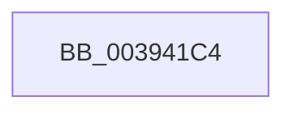

# sub_003941C4

- RVA: `0x003941C4`–`0x003941F0` (길이 `44` bytes)
- VA: `0x00000001403941C4`
- 실행 섹션: `.text`
- PDB 이름 있음: `아니요`; PDB Function 태그: `아니요`
- unwind 정보 RVA: `0x00080F94`
- 디코드: `8`개 명령, `44/44` bytes 표시
- 미해석 바이트: `0` (있으면 어셈블리에 `.byte`로 보존)

> 이 문서는 커널 이미지의 기계어와 PDB 기호를 분석해 생성했습니다. 4번과 5번은 함수 원형과 자료형을 바이너리 사용 방식에서 추정한 C 해석이며 원본 소스 복구 결과는 아닙니다.

## 1. Dependencies

- 직접 호출 지점: **0**; 고유 호출 대상: **0**
- 직접 호출자로 확인된 함수: **0**
- RIP 상대 이미지 참조: **0**

### Outgoing calls
- 직접 디코드된 call 명령이 없습니다.

### Direct callers
- 이 함수 시작 RVA로 연결되는 직접 call은 확인되지 않았습니다. 간접 호출은 완전히 역산할 수 없습니다.

### Static image references
- 디코드된 RIP-relative 메모리 참조가 없습니다.

## 2. Other-region calls and transfers

- 다른 실행 섹션으로 향하는 call: **0**
- call이 아닌 외부 분기/꼬리 이동: **1**
  - `0x003941EB` → [IopProcessWorkItem + 0x5E](IopProcessWorkItem_function_00393BB0.md) (`tail-transfer`)

## 3. Assembly (complete function range)

```asm
003941C4  0F 10 43 44                     movups xmm0, xmmword ptr [rbx + 0x44]
003941C8  48 8D 4C 24 40                  lea rcx, [rsp + 0x40]
003941CD  BD 01 00 00 00                  mov ebp, 1
003941D2  89 6C 24 30                     mov dword ptr [rsp + 0x30], ebp
003941D6  0F 11 44 24 40                  movups xmmword ptr [rsp + 0x40], xmm0
003941DB  65 48 8B 04 25 88 01 00 00      mov rax, qword ptr gs:[0x188]
003941E4  48 89 88 30 06 00 00            mov qword ptr [rax + 0x630], rcx
003941EB  E9 1E FA FF FF                  jmp 0x140393c0e
```

## 4. C-style interpretation (structured pseudocode)

```c
__int64 __fastcall sub_003941C4(__int64 a1, __int64 a2, __int64 a3, __int64 a4, __int64 a5, __int64 a6, __int64 a7, __int64 a8)
{
    unsigned int v_stack_p30;

    v_stack_p30 = 1;
    a8 = v_xmm0;
    *(unsigned __int64 *)(*(unsigned __int64 *)(gs_base + (0 + 392)) + 1584) = a8;
}
```

## 5. (Beta) C Style

```c
int64_t sub_003941C4(int64_t Arg1, int64_t Arg2, int64_t Arg3, int64_t Arg4, uint64_t Arg5, uint64_t Arg6, uint64_t Arg7, int64_t Arg8)
{
    uint32_t v_stack_p30;

    v_stack_p30 = 1;
    Arg8 = v_xmm0;
    *(uint64_t *)(*(uint64_t *)(gs_base + (0 + 0x188)) + 0x630) = Arg8;
}
```

## 6. Execution-region graph

[열기: 2D/3D 그래프와 함수 탐색 컨트롤 패널](../../../control-panel.html?section=text&rva=0x003941C4&view=graph)

- 2D 그래프는 위에서 아래로 흐르고, 3D 그래프는 빈 공간을 드래그해 회전합니다. Shift+드래그는 이동, 휠은 확대·축소, 함수 노드 선택은 대상 보고서 이동입니다.

### Static fallback


