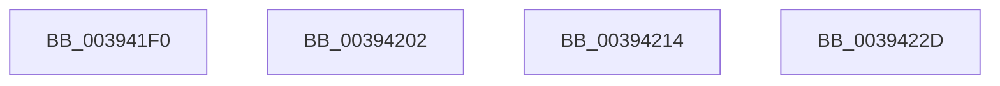

# sub_003941F0

- RVA: `0x003941F0`–`0x00394265` (길이 `117` bytes)
- VA: `0x00000001403941F0`
- 실행 섹션: `.text`
- PDB 이름 있음: `아니요`; PDB Function 태그: `아니요`
- unwind 정보 RVA: `0x00080FA4`
- 디코드: `20`개 명령, `117/117` bytes 표시
- 미해석 바이트: `0` (있으면 어셈블리에 `.byte`로 보존)

> 이 문서는 커널 이미지의 기계어와 PDB 기호를 분석해 생성했습니다. 4번과 5번은 함수 원형과 자료형을 바이너리 사용 방식에서 추정한 C 해석이며 원본 소스 복구 결과는 아닙니다.

## 1. Dependencies

- 직접 호출 지점: **3**; 고유 호출 대상: **2**
- 직접 호출자로 확인된 함수: **0**
- RIP 상대 이미지 참조: **0**

### Outgoing calls
- `0x003941F8` → [EtwTraceThreadWorkItem](../4D/EtwTraceThreadWorkItem_function_004DC3D0.md) (function, `0x004DC3D0`)
- `0x0039420A` → [EtwTraceThreadWorkItem](../4D/EtwTraceThreadWorkItem_function_004DC3D0.md) (function, `0x004DC3D0`)
- `0x0039425F` → [KeBugCheckEx](../4F/KeBugCheckEx_function_004FD660.md) (function, `0x004FD660`)

### Direct callers
- 이 함수 시작 RVA로 연결되는 직접 call은 확인되지 않았습니다. 간접 호출은 완전히 역산할 수 없습니다.

### Static image references
- 디코드된 RIP-relative 메모리 참조가 없습니다.

## 2. Other-region calls and transfers

- 다른 실행 섹션으로 향하는 call: **0**
- call이 아닌 외부 분기/꼬리 이동: **3**
  - `0x003941FD` → [sub_00393C19 + 0x21](Unknown_function_00393C19.md) (`tail-transfer`)
  - `0x0039420F` → [sub_00393C19 + 0x5A](Unknown_function_00393C19.md) (`tail-transfer`)
  - `0x00394228` → [sub_00393C19 + 0x9A](Unknown_function_00393C19.md) (`tail-transfer`)

## 3. Assembly (complete function range)

```asm
003941F0  BA 40 05 00 00                  mov edx, 0x540
003941F5  49 8B CC                        mov rcx, r12
003941F8  E8 D3 81 14 00                  call 0x1404dc3d0
003941FD  E9 38 FA FF FF                  jmp 0x140393c3a
00394202  BA 41 05 00 00                  mov edx, 0x541
00394207  49 8B CC                        mov rcx, r12
0039420A  E8 C1 81 14 00                  call 0x1404dc3d0
0039420F  E9 5F FA FF FF                  jmp 0x140393c73
00394214  65 48 8B 04 25 88 01 00 00      mov rax, qword ptr gs:[0x188]
0039421D  48 C7 80 30 06 00 00 00 00 00 00  mov qword ptr [rax + 0x630], 0
00394228  E9 86 FA FF FF                  jmp 0x140393cb3
0039422D  65 48 8B 04 25 88 01 00 00      mov rax, qword ptr gs:[0x188]
00394236  49 8B D4                        mov rdx, r12
00394239  B9 01 00 00 00                  mov ecx, 1
0039423E  48 C7 44 24 20 00 00 00 00      mov qword ptr [rsp + 0x20], 0
00394247  44 8B 88 E4 01 00 00            mov r9d, dword ptr [rax + 0x1e4]
0039424E  65 48 8B 04 25 88 01 00 00      mov rax, qword ptr gs:[0x188]
00394257  44 0F B6 80 4A 02 00 00         movzx r8d, byte ptr [rax + 0x24a]
0039425F  E8 FC 93 16 00                  call 0x1404fd660
00394264  CC                              int3
```

## 4. C-style interpretation (structured pseudocode)

```c
__int64 __fastcall sub_003941F0(void)
{
    __int64 result;
    unsigned __int64 v_stack_p20;

    result = EtwTraceThreadWorkItem(v_r12, (unsigned int)(0x540ULL), a3, a4);
}
```

## 5. (Beta) C Style

```c
void sub_003941F0(void)
{
    int64_t result;
    uint64_t v_stack_p20;

    result = EtwTraceThreadWorkItem(local_r12, (uint32_t)(0x540ULL), a3, a4);
}
```

## 6. Execution-region graph

[열기: 2D/3D 그래프와 함수 탐색 컨트롤 패널](../../../control-panel.html?section=text&rva=0x003941F0&view=graph)

- 2D 그래프는 위에서 아래로 흐르고, 3D 그래프는 빈 공간을 드래그해 회전합니다. Shift+드래그는 이동, 휠은 확대·축소, 함수 노드 선택은 대상 보고서 이동입니다.

### Static fallback


