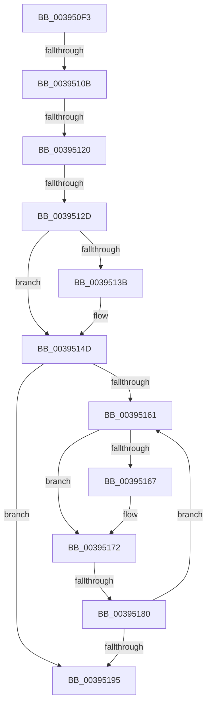

# sub_003950F3

- RVA: `0x003950F3`–`0x003951B9` (길이 `198` bytes)
- VA: `0x00000001403950F3`
- 실행 섹션: `.text`
- PDB 이름 있음: `아니요`; PDB Function 태그: `아니요`
- unwind 정보 RVA: `0x00081074`
- 디코드: `40`개 명령, `198/198` bytes 표시
- 미해석 바이트: `0` (있으면 어셈블리에 `.byte`로 보존)

> 이 문서는 커널 이미지의 기계어와 PDB 기호를 분석해 생성했습니다. 4번과 5번은 함수 원형과 자료형을 바이너리 사용 방식에서 추정한 C 해석이며 원본 소스 복구 결과는 아닙니다.

## 1. Dependencies

- 직접 호출 지점: **1**; 고유 호출 대상: **1**
- 직접 호출자로 확인된 함수: **0**
- RIP 상대 이미지 참조: **5**

### Outgoing calls
- `0x00395146` → [ExpWaitForSpinLockExclusiveAndAcquire](../32/ExpWaitForSpinLockExclusiveAndAcquire_function_003239A0.md) (function, `0x003239A0`)

### Direct callers
- 이 함수 시작 RVA로 연결되는 직접 call은 확인되지 않았습니다. 간접 호출은 완전히 역산할 수 없습니다.

### Static image references
- `0x00395113` → RVA `0x00FC6D20` (`ALMOSTRO`; read)
- `0x00395120` → RVA `0x00FC6B06` (`ALMOSTRO`; read)
- `0x0039512D` → RVA `0x00F06590` (`.data`; read/write)
- `0x0039513F` → RVA `0x00F06590` (`.data`; read)
- `0x00395174` → RVA `0x00FC52AC` (`ALMOSTRO`; reference)

## 2. Other-region calls and transfers

- 다른 실행 섹션으로 향하는 call: **0**
- call이 아닌 외부 분기/꼬리 이동: **5**
  - `0x00395105` → [sub_0039535C + 0x23](Unknown_function_0039535C.md) (`tail-transfer`)
  - `0x0039511A` → [sub_00395404](Unknown_function_00395404.md) (`tail-transfer`)
  - `0x00395127` → [sub_0039535C](Unknown_function_0039535C.md) (`tail-transfer`)
  - `0x0039517A` → [sub_003954A1](Unknown_function_003954A1.md) (`tail-transfer`)
  - `0x003951B3` → [sub_00395304](Unknown_function_00395304.md) (`tail-transfer`)

## 3. Assembly (complete function range)

```asm
003950F3  48 89 B4 24 D0 00 00 00         mov qword ptr [rsp + 0xd0], rsi
003950FB  41 BC 02 00 00 00               mov r12d, 2
00395101  0F BA E0 18                     bt eax, 0x18
00395105  0F 82 74 02 00 00               jb 0x14039537f
0039510B  44 0F 20 C5                     mov rbp, cr8
0039510F  45 0F 22 C4                     mov cr8, r12
00395113  44 39 3D 06 1C C3 00            cmp dword ptr [rip + 0xc31c06], r15d
0039511A  0F 85 E4 02 00 00               jne 0x140395404
00395120  F6 05 DF 19 C3 00 21            test byte ptr [rip + 0xc319df], 0x21
00395127  0F 85 2F 02 00 00               jne 0x14039535c
0039512D  F0 0F BA 2D 5A 14 B7 00 1F      lock bts dword ptr [rip + 0xb7145a], 0x1f
00395136  41 8B F7                        mov esi, r15d
00395139  73 12                           jae 0x14039514d
0039513B  40 0F B6 D5                     movzx edx, bpl
0039513F  48 8D 0D 4A 14 B7 00            lea rcx, [rip + 0xb7144a]
00395146  E8 55 E8 F8 FF                  call 0x1403239a0
0039514B  8B F0                           mov esi, eax
0039514D  8B 15 3D 14 B7 00               mov edx, dword ptr [rip + 0xb7143d]
00395153  8B CA                           mov ecx, edx
00395155  0F BA F1 1E                     btr ecx, 0x1e
00395159  81 F9 00 00 00 80               cmp ecx, 0x80000000
0039515F  74 34                           je 0x140395195
00395161  0F BA E2 1E                     bt edx, 0x1e
00395165  72 0B                           jb 0x140395172
00395167  F0 81 0D 1E 14 B7 00 00 00 00 40  lock or dword ptr [rip + 0xb7141e], 0x40000000
00395172  FF C6                           inc esi
00395174  85 35 32 01 C3 00               test dword ptr [rip + 0xc30132], esi
0039517A  0F 84 21 03 00 00               je 0x1403954a1
00395180  F3 90                           pause
00395182  8B 15 08 14 B7 00               mov edx, dword ptr [rip + 0xb71408]
00395188  8B C2                           mov eax, edx
0039518A  0F BA F0 1E                     btr eax, 0x1e
0039518E  3D 00 00 00 80                  cmp eax, 0x80000000
00395193  75 CC                           jne 0x140395161
00395195  48 8B B4 24 D0 00 00 00         mov rsi, qword ptr [rsp + 0xd0]
0039519D  4C 89 BB 50 06 00 00            mov qword ptr [rbx + 0x650], r15
003951A4  65 48 8B 04 25 88 01 00 00      mov rax, qword ptr gs:[0x188]
003951AD  8B 48 74                        mov ecx, dword ptr [rax + 0x74]
003951B0  F6 C1 04                        test cl, 4
003951B3  0F 84 4B 01 00 00               je 0x140395304
```

## 4. C-style interpretation (structured pseudocode)

```c
__int64 __fastcall sub_003950F3(__int64 a1, __int64 a2, __int64 a3, __int64 a4, __int64 a5, __int64 a6, __int64 a7, __int64 a8, __int64 a9, __int64 a10, __int64 a11, __int64 a12, __int64 a13, __int64 a14, __int64 a15, __int64 a16, __int64 a17, __int64 a18, __int64 a19, __int64 a20, __int64 a21, __int64 a22, __int64 a23, __int64 a24, __int64 a25, __int64 a26)
{
    __int64 result;
    __int64 v_rsi;
    unsigned __int64 v_stack_pD0;

    v_stack_pD0 = v_rsi;
    v_rsi = (unsigned int)((unsigned int)(v_r15));
    if (!(condition_is_above_or_equal)) {
        a2 = (unsigned __int8)(v_cr8);
        a1 = v_rip + 11998282;
        result = ExpWaitForSpinLockExclusiveAndAcquire(a1, a2, a3, a4);
        v_rsi = (unsigned int)(result);
    }
    if (((unsigned int)((unsigned int)((unsigned int)((unsigned int)(*(unsigned int *)(v_rip + 11998269)))))) == 0x80000000ULL) goto loc_00395195;
loc_00395161:
    if (((unsigned int)((unsigned int)((unsigned int)((unsigned int)(*(unsigned int *)(v_rip + 11998269)))))) >= 0x80000000ULL) {
    }
    v_rsi = (unsigned int)((v_rsi) + 1);
    if (((unsigned int)((unsigned int)((unsigned int)((unsigned int)(*(unsigned int *)(v_rip + 11998216)))))) != 0x80000000ULL) goto loc_00395161;
loc_00395195:
    *(unsigned __int64 *)(v_rbx + 1616) = v_r15;
}
```

## 5. (Beta) C Style

```c
int64_t sub_003950F3(int64_t Arg1, int64_t Arg2, int64_t Arg3, int64_t Arg4, uint64_t Arg5, uint64_t Arg6, uint64_t Arg7, uint64_t Arg8, uint64_t Arg9, uint64_t Arg10, uint64_t Arg11, uint64_t Arg12, uint64_t Arg13, uint64_t Arg14, uint64_t Arg15, uint64_t Arg16, uint64_t Arg17, uint64_t Arg18, uint64_t Arg19, uint64_t Arg20, uint64_t Arg21, uint64_t Arg22, uint64_t Arg23, uint64_t Arg24, uint64_t Arg25, int64_t Arg26)
{
    int64_t result;
    int64_t local_rsi;
    uint64_t v_stack_pD0;

    v_stack_pD0 = local_rsi;
    local_rsi = (uint32_t)((uint32_t)(local_r15));
    if (!(condition_is_above_or_equal)) {
        Arg2 = (uint8_t)(v_cr8);
        Arg1 = v_rip + 11998282;
        result = ExpWaitForSpinLockExclusiveAndAcquire(Arg1, Arg2, Arg3, Arg4);
        local_rsi = (uint32_t)(result);
    }
    if (((uint32_t)((uint32_t)((uint32_t)((uint32_t)(*(uint32_t *)(v_rip + 0xB7143D)))))) == 0x80000000ULL) goto loc_00395195;
loc_00395161:
    if (((uint32_t)((uint32_t)((uint32_t)((uint32_t)(*(uint32_t *)(v_rip + 0xB7143D)))))) >= 0x80000000ULL) {
    }
    local_rsi = (uint32_t)((local_rsi) + 1);
    if (((uint32_t)((uint32_t)((uint32_t)((uint32_t)(*(uint32_t *)(v_rip + 0xB71408)))))) != 0x80000000ULL) goto loc_00395161;
loc_00395195:
    *(uint64_t *)(local_rbx + 0x650) = local_r15;
}
```

## 6. Execution-region graph

[열기: 2D/3D 그래프와 함수 탐색 컨트롤 패널](../../../control-panel.html?section=text&rva=0x003950F3&view=graph)

- 2D 그래프는 위에서 아래로 흐르고, 3D 그래프는 빈 공간을 드래그해 회전합니다. Shift+드래그는 이동, 휠은 확대·축소, 함수 노드 선택은 대상 보고서 이동입니다.

### Static fallback


