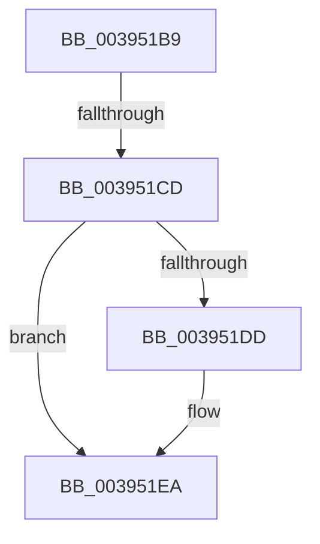

# sub_003951B9

- RVA: `0x003951B9`–`0x00395206` (길이 `77` bytes)
- VA: `0x00000001403951B9`
- 실행 섹션: `.text`
- PDB 이름 있음: `아니요`; PDB Function 태그: `아니요`
- unwind 정보 RVA: `0x00081088`
- 디코드: `15`개 명령, `77/77` bytes 표시
- 미해석 바이트: `0` (있으면 어셈블리에 `.byte`로 보존)

> 이 문서는 커널 이미지의 기계어와 PDB 기호를 분석해 생성했습니다. 4번과 5번은 함수 원형과 자료형을 바이너리 사용 방식에서 추정한 C 해석이며 원본 소스 복구 결과는 아닙니다.

## 1. Dependencies

- 직접 호출 지점: **1**; 고유 호출 대상: **1**
- 직접 호출자로 확인된 함수: **0**
- RIP 상대 이미지 참조: **4**

### Outgoing calls
- `0x003951E5` → [KiLowerIrqlProcessIrqlFlags](../4F/KiLowerIrqlProcessIrqlFlags_function_004F5698.md) (function, `0x004F5698`)

### Direct callers
- 이 함수 시작 RVA로 연결되는 직접 call은 확인되지 않았습니다. 간접 호출은 완전히 역산할 수 없습니다.

### Static image references
- `0x003951C0` → RVA `0x00FC6B06` (`ALMOSTRO`; read)
- `0x003951CD` → RVA `0x00F06590` (`.data`; write)
- `0x003951D4` → RVA `0x00FC6D20` (`ALMOSTRO`; read)
- `0x003951F2` → RVA `0x00EFF9E8` (`.data`; read)

## 2. Other-region calls and transfers

- 다른 실행 섹션으로 향하는 call: **0**
- call이 아닌 외부 분기/꼬리 이동: **2**
  - `0x003951C7` → [sub_00395529](Unknown_function_00395529.md) (`tail-transfer`)
  - `0x00395204` → [sub_00395206 + 0x1F](Unknown_function_00395206.md) (`tail-transfer`)

## 3. Assembly (complete function range)

```asm
003951B9  81 4B 74 00 00 01 00            or dword ptr [rbx + 0x74], 0x10000
003951C0  F6 05 3F 19 C3 00 01            test byte ptr [rip + 0xc3193f], 1
003951C7  0F 85 5C 03 00 00               jne 0x140395529
003951CD  44 89 3D BC 13 B7 00            mov dword ptr [rip + 0xb713bc], r15d
003951D4  44 39 3D 45 1B C3 00            cmp dword ptr [rip + 0xc31b45], r15d
003951DB  74 0D                           je 0x1403951ea
003951DD  44 0F 20 C1                     mov rcx, cr8
003951E1  40 0F B6 D5                     movzx edx, bpl
003951E5  E8 AE 04 16 00                  call 0x1404f5698
003951EA  40 0F B6 C5                     movzx eax, bpl
003951EE  44 0F 22 C0                     mov cr8, rax
003951F2  48 8B 15 EF A7 B6 00            mov rdx, qword ptr [rip + 0xb6a7ef]
003951F9  48 8B AC 24 C8 00 00 00         mov rbp, qword ptr [rsp + 0xc8]
00395201  48 85 D2                        test rdx, rdx
00395204  74 1F                           je 0x140395225
```

## 4. C-style interpretation (structured pseudocode)

```c
__int64 __fastcall sub_003951B9(__int64 a1, __int64 a2, __int64 a3, __int64 a4, __int64 a5, __int64 a6, __int64 a7, __int64 a8, __int64 a9, __int64 a10, __int64 a11, __int64 a12, __int64 a13, __int64 a14, __int64 a15, __int64 a16, __int64 a17, __int64 a18, __int64 a19, __int64 a20, __int64 a21, __int64 a22, __int64 a23, __int64 a24, __int64 a25)
{
    __int64 result;

    *(unsigned int *)(v_rip + 11998140) = (unsigned int)(v_r15);
    if ((*(unsigned int *)(v_rip + 12786501)) != ((unsigned int)(v_r15))) {
        a1 = v_cr8;
        a2 = (unsigned __int8)(v_rbp);
        result = KiLowerIrqlProcessIrqlFlags(a1, a2, a3, a4);
    }
}
```

## 5. (Beta) C Style

```c
int64_t sub_003951B9(int64_t Arg1, int64_t Arg2, int64_t Arg3, int64_t Arg4, uint64_t Arg5, uint64_t Arg6, uint64_t Arg7, uint64_t Arg8, uint64_t Arg9, uint64_t Arg10, uint64_t Arg11, uint64_t Arg12, uint64_t Arg13, uint64_t Arg14, uint64_t Arg15, uint64_t Arg16, uint64_t Arg17, uint64_t Arg18, uint64_t Arg19, uint64_t Arg20, uint64_t Arg21, uint64_t Arg22, uint64_t Arg23, uint64_t Arg24, int64_t Arg25)
{
    int64_t result;

    *(uint32_t *)(v_rip + 0xB713BC) = (uint32_t)(local_r15);
    if ((*(uint32_t *)(v_rip + 0xC31B45)) != ((uint32_t)(local_r15))) {
        Arg1 = v_cr8;
        Arg2 = (uint8_t)(local_rbp);
        result = KiLowerIrqlProcessIrqlFlags(Arg1, Arg2, Arg3, Arg4);
    }
}
```

## 6. Execution-region graph

[열기: 2D/3D 그래프와 함수 탐색 컨트롤 패널](../../../control-panel.html?section=text&rva=0x003951B9&view=graph)

- 2D 그래프는 위에서 아래로 흐르고, 3D 그래프는 빈 공간을 드래그해 회전합니다. Shift+드래그는 이동, 휠은 확대·축소, 함수 노드 선택은 대상 보고서 이동입니다.

### Static fallback


