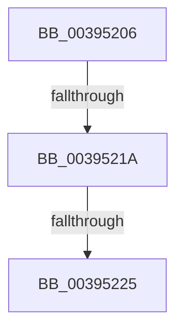

# sub_00395206

- RVA: `0x00395206`–`0x0039523E` (길이 `56` bytes)
- VA: `0x0000000140395206`
- 실행 섹션: `.text`
- PDB 이름 있음: `아니요`; PDB Function 태그: `아니요`
- unwind 정보 RVA: `0x00081098`
- 디코드: `10`개 명령, `56/56` bytes 표시
- 미해석 바이트: `0` (있으면 어셈블리에 `.byte`로 보존)

> 이 문서는 커널 이미지의 기계어와 PDB 기호를 분석해 생성했습니다. 4번과 5번은 함수 원형과 자료형을 바이너리 사용 방식에서 추정한 C 해석이며 원본 소스 복구 결과는 아닙니다.

## 1. Dependencies

- 직접 호출 지점: **0**; 고유 호출 대상: **0**
- 직접 호출자로 확인된 함수: **0**
- RIP 상대 이미지 참조: **1**

### Outgoing calls
- 직접 디코드된 call 명령이 없습니다.

### Direct callers
- 이 함수 시작 RVA로 연결되는 직접 call은 확인되지 않았습니다. 간접 호출은 완전히 역산할 수 없습니다.

### Static image references
- `0x00395225` → RVA `0x00FC5010` (`ALMOSTRO`; read)

## 2. Other-region calls and transfers

- 다른 실행 섹션으로 향하는 call: **0**
- call이 아닌 외부 분기/꼬리 이동: **3**
  - `0x00395218` → [sub_00395271](Unknown_function_00395271.md) (`tail-transfer`)
  - `0x0039521F` → [sub_00395455](Unknown_function_00395455.md) (`tail-transfer`)
  - `0x0039523C` → [sub_0039523E + 0x15](Unknown_function_0039523E.md) (`tail-transfer`)

## 3. Assembly (complete function range)

```asm
00395206  48 8B 4A 20                     mov rcx, qword ptr [rdx + 0x20]
0039520A  49 B8 00 20 00 00 00 00 00 80   movabs r8, 0x8000000000002000
00395214  44 39 79 60                     cmp dword ptr [rcx + 0x60], r15d
00395218  75 57                           jne 0x140395271
0039521A  66 44 39 7A 66                  cmp word ptr [rdx + 0x66], r15w
0039521F  0F 85 30 02 00 00               jne 0x140395455
00395225  83 3D E4 FD C2 00 00            cmp dword ptr [rip + 0xc2fde4], 0
0039522C  4C 8B BC 24 90 00 00 00         mov r15, qword ptr [rsp + 0x90]
00395234  4C 8B A4 24 A0 00 00 00         mov r12, qword ptr [rsp + 0xa0]
0039523C  74 15                           je 0x140395253
```

## 4. C-style interpretation (structured pseudocode)

```c
void __fastcall sub_00395206(__int64 a1, __int64 a2, __int64 a3, __int64 a4, __int64 a5, __int64 a6, __int64 a7, __int64 a8, __int64 a9, __int64 a10, __int64 a11, __int64 a12, __int64 a13, __int64 a14, __int64 a15, __int64 a16, __int64 a17, __int64 a18, __int64 a19, __int64 a20)
{
}
```

## 5. (Beta) C Style

```c
void sub_00395206(int64_t Arg1, void *Arg2, int64_t Arg3, int64_t Arg4, uint64_t Arg5, uint64_t Arg6, uint64_t Arg7, uint64_t Arg8, uint64_t Arg9, uint64_t Arg10, uint64_t Arg11, uint64_t Arg12, uint64_t Arg13, uint64_t Arg14, uint64_t Arg15, uint64_t Arg16, uint64_t Arg17, int64_t Arg18, uint64_t Arg19, int64_t Arg20)
{
    uint8_t *arg2 = (uint8_t *)Arg2;

}
```

### 관측된 메모리 오프셋

구조체 형식이 확인되지 않은 접근은 인자 기준의 오프셋으로만 기록했습니다.

| 기준 인자 | 오프셋 표현 | 폭 (bit) | 접근 |
|---|---:|---:|---|
| `Arg2` | `+ 0x20` | `64` | `R` |
| `Arg2` | `+ 0x66` | `16` | `R` |

## 6. Execution-region graph

[열기: 2D/3D 그래프와 함수 탐색 컨트롤 패널](../../../control-panel.html?section=text&rva=0x00395206&view=graph)

- 2D 그래프는 위에서 아래로 흐르고, 3D 그래프는 빈 공간을 드래그해 회전합니다. Shift+드래그는 이동, 휠은 확대·축소, 함수 노드 선택은 대상 보고서 이동입니다.

### Static fallback


