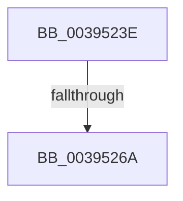

# sub_0039523E

- RVA: `0x0039523E`–`0x00395271` (길이 `51` bytes)
- VA: `0x000000014039523E`
- 실행 섹션: `.text`
- PDB 이름 있음: `아니요`; PDB Function 태그: `아니요`
- unwind 정보 RVA: `0x000810B0`
- 디코드: `11`개 명령, `51/51` bytes 표시
- 미해석 바이트: `0` (있으면 어셈블리에 `.byte`로 보존)

> 이 문서는 커널 이미지의 기계어와 PDB 기호를 분석해 생성했습니다. 4번과 5번은 함수 원형과 자료형을 바이너리 사용 방식에서 추정한 C 해석이며 원본 소스 복구 결과는 아닙니다.

## 1. Dependencies

- 직접 호출 지점: **1**; 고유 호출 대상: **1**
- 직접 호출자로 확인된 함수: **0**
- RIP 상대 이미지 참조: **0**

### Outgoing calls
- `0x0039524E` → [ObpPushStackInfo](../21/ObpPushStackInfo_function_002109E4.md) (function, `0x002109E4`)

### Direct callers
- 이 함수 시작 RVA로 연결되는 직접 call은 확인되지 않았습니다. 간접 호출은 완전히 역산할 수 없습니다.

### Static image references
- 디코드된 RIP-relative 메모리 참조가 없습니다.

## 2. Other-region calls and transfers

- 다른 실행 섹션으로 향하는 call: **0**
- call이 아닌 외부 분기/꼬리 이동: **2**
  - `0x00395264` → [sub_0039555D](Unknown_function_0039555D.md) (`tail-transfer`)
  - `0x0039526C` → [PspRevertContainerImpersonation + 0x30](PspRevertContainerImpersonation_function_00395070.md) (`tail-transfer`)

## 3. Assembly (complete function range)

```asm
0039523E  33 D2                           xor edx, edx
00395240  48 8D 4F D0                     lea rcx, [rdi - 0x30]
00395244  41 B9 43 6F 6E 74               mov r9d, 0x746e6f43
0039524A  44 8D 42 01                     lea r8d, [rdx + 1]
0039524E  E8 91 B7 E7 FF                  call 0x1402109e4
00395253  48 C7 C0 FF FF FF FF            mov rax, 0xffffffffffffffff
0039525A  F0 48 0F C1 47 D0               lock xadd qword ptr [rdi - 0x30], rax
00395260  48 83 E8 01                     sub rax, 1
00395264  0F 8E F3 02 00 00               jle 0x14039555d
0039526A  33 C0                           xor eax, eax
0039526C  E9 2F FE FF FF                  jmp 0x1403950a0
```

## 4. C-style interpretation (structured pseudocode)

```c
__int64 __fastcall sub_0039523E(__int64 a1, int a2)
{
    __int64 result;

    a2 = 0;
    result = ObpPushStackInfo(v_rdi - 48, a2, a2 + 1, (unsigned int)(0x746E6F43ULL));
    result = (-1) - (1);
    result = 0;
}
```

## 5. (Beta) C Style

```c
int64_t sub_0039523E(int64_t Arg1, int32_t Arg2)
{
    int64_t result;

    Arg2 = 0;
    result = ObpPushStackInfo(local_rdi - 48, Arg2, Arg2 + 1, (uint32_t)(0x746E6F43ULL));
    result = (-1) - (1);
    result = 0;
}
```

## 6. Execution-region graph

[열기: 2D/3D 그래프와 함수 탐색 컨트롤 패널](../../../control-panel.html?section=text&rva=0x0039523E&view=graph)

- 2D 그래프는 위에서 아래로 흐르고, 3D 그래프는 빈 공간을 드래그해 회전합니다. Shift+드래그는 이동, 휠은 확대·축소, 함수 노드 선택은 대상 보고서 이동입니다.

### Static fallback


