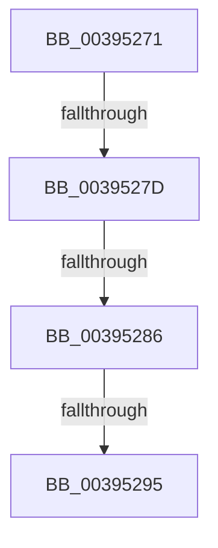

# sub_00395271

- RVA: `0x00395271`–`0x00395304` (길이 `147` bytes)
- VA: `0x0000000140395271`
- 실행 섹션: `.text`
- PDB 이름 있음: `아니요`; PDB Function 태그: `아니요`
- unwind 정보 RVA: `0x000810C0`
- 디코드: `31`개 명령, `147/147` bytes 표시
- 미해석 바이트: `0` (있으면 어셈블리에 `.byte`로 보존)

> 이 문서는 커널 이미지의 기계어와 PDB 기호를 분석해 생성했습니다. 4번과 5번은 함수 원형과 자료형을 바이너리 사용 방식에서 추정한 C 해석이며 원본 소스 복구 결과는 아닙니다.

## 1. Dependencies

- 직접 호출 지점: **1**; 고유 호출 대상: **1**
- 직접 호출자로 확인된 함수: **0**
- RIP 상대 이미지 참조: **2**

### Outgoing calls
- `0x003952FA` → [EtwWriteEx](../25/EtwWriteEx_function_0025F0D0.md) (function, `0x0025F0D0`)

### Direct callers
- 이 함수 시작 RVA로 연결되는 직접 call은 확인되지 않았습니다. 간접 호출은 완전히 역산할 수 없습니다.

### Static image references
- `0x0039529B` → RVA `0x000112C0` (`.rdata`; read)
- `0x003952A2` → RVA `0x00EFF9E8` (`.data`; read)

## 2. Other-region calls and transfers

- 다른 실행 섹션으로 향하는 call: **0**
- call이 아닌 외부 분기/꼬리 이동: **4**
  - `0x00395277` → [sub_00395455 + 0x3F](Unknown_function_00395455.md) (`tail-transfer`)
  - `0x00395284` → [sub_00395206 + 0x14](Unknown_function_00395206.md) (`tail-transfer`)
  - `0x00395293` → [sub_00395206 + 0x14](Unknown_function_00395206.md) (`tail-transfer`)
  - `0x003952FF` → [sub_00395206 + 0x1F](Unknown_function_00395206.md) (`tail-transfer`)

## 3. Assembly (complete function range)

```asm
00395271  0F B6 41 64                     movzx eax, byte ptr [rcx + 0x64]
00395275  3C 04                           cmp al, 4
00395277  0F 82 17 02 00 00               jb 0x140395494
0039527D  8B 41 68                        mov eax, dword ptr [rcx + 0x68]
00395280  4C 85 41 70                     test qword ptr [rcx + 0x70], r8
00395284  74 94                           je 0x14039521a
00395286  48 8B 49 78                     mov rcx, qword ptr [rcx + 0x78]
0039528A  48 8B C1                        mov rax, rcx
0039528D  49 23 C0                        and rax, r8
00395290  48 3B C1                        cmp rax, rcx
00395293  75 85                           jne 0x14039521a
00395295  8B 87 10 05 00 00               mov eax, dword ptr [rdi + 0x510]
0039529B  48 8D 15 1E C0 C7 FF            lea rdx, [rip - 0x383fe2]
003952A2  48 8B 0D 3F A7 B6 00            mov rcx, qword ptr [rip + 0xb6a73f]
003952A9  41 B9 01 00 00 00               mov r9d, 1
003952AF  89 44 24 44                     mov dword ptr [rsp + 0x44], eax
003952B3  45 33 C0                        xor r8d, r8d
003952B6  48 8D 44 24 44                  lea rax, [rsp + 0x44]
003952BB  48 C7 44 24 68 04 00 00 00      mov qword ptr [rsp + 0x68], 4
003952C4  48 89 44 24 60                  mov qword ptr [rsp + 0x60], rax
003952C9  48 8D 44 24 48                  lea rax, [rsp + 0x48]
003952CE  48 89 44 24 70                  mov qword ptr [rsp + 0x70], rax
003952D3  48 8D 44 24 60                  lea rax, [rsp + 0x60]
003952D8  48 89 44 24 38                  mov qword ptr [rsp + 0x38], rax
003952DD  44 89 64 24 30                  mov dword ptr [rsp + 0x30], r12d
003952E2  4C 89 7C 24 28                  mov qword ptr [rsp + 0x28], r15
003952E7  4C 89 7C 24 20                  mov qword ptr [rsp + 0x20], r15
003952EC  44 89 7C 24 48                  mov dword ptr [rsp + 0x48], r15d
003952F1  48 C7 44 24 78 04 00 00 00      mov qword ptr [rsp + 0x78], 4
003952FA  E8 D1 9D EC FF                  call 0x14025f0d0
003952FF  E9 21 FF FF FF                  jmp 0x140395225
```

## 4. C-style interpretation (structured pseudocode)

```c
__int64 __fastcall sub_00395271(__int64 a1, __int64 a2, __int64 a3, __int64 a4, __int64 a5, __int64 a6, __int64 a7, __int64 a8, __int64 a9, __int64 a10, __int64 a11, __int64 a12)
{
    __int64 result;
    unsigned __int64 v_stack_p20;
    unsigned __int64 v_stack_p28;
    unsigned int v_stack_p30;
    unsigned __int64 v_stack_p38;
    unsigned int v_stack_p44;
    unsigned int v_stack_p48;
    unsigned __int64 v_stack_p60;
    unsigned __int64 v_stack_p68;
    unsigned __int64 v_stack_p70;
    unsigned __int64 v_stack_p78;

    result = (*(unsigned __int64 *)(a1 + 120)) & (a3);
    v_stack_p44 = (unsigned int)((unsigned int)(*(unsigned int *)(v_rdi + 1296)));
    a3 = 0;
    v_stack_p68 = 4;
    v_stack_p60 = v_stack_p44;
    v_stack_p70 = a9;
    v_stack_p38 = a12;
    v_stack_p30 = (unsigned int)(v_r12);
    v_stack_p28 = v_r15;
    v_stack_p20 = v_r15;
    v_stack_p48 = (unsigned int)(v_r15);
    v_stack_p78 = 4;
    result = EtwWriteEx(*(unsigned __int64 *)(v_rip + 11970367), v_rip - 3686370, a3, 1);
}
```

## 5. (Beta) C Style

```c
int64_t sub_00395271(void *Arg1, int64_t Arg2, int64_t Arg3, int64_t Arg4, uint64_t Arg5, uint64_t Arg6, uint64_t Arg7, uint64_t Arg8, int64_t Arg9, uint64_t Arg10, uint64_t Arg11, int64_t Arg12)
{
    uint8_t *arg1 = (uint8_t *)Arg1;

    int64_t result;
    uint64_t v_stack_p20;
    uint64_t v_stack_p28;
    uint32_t v_stack_p30;
    uint64_t v_stack_p38;
    uint32_t v_stack_p44;
    uint32_t v_stack_p48;
    uint64_t v_stack_p60;
    uint64_t v_stack_p68;
    uint64_t v_stack_p70;
    uint64_t v_stack_p78;

    result = (*(uint64_t *)(arg1 + 0x78)) & (Arg3);
    v_stack_p44 = (uint32_t)((uint32_t)(*(uint32_t *)(local_rdi + 0x510)));
    Arg3 = 0;
    v_stack_p68 = 4;
    v_stack_p60 = v_stack_p44;
    v_stack_p70 = Arg9;
    v_stack_p38 = Arg12;
    v_stack_p30 = (uint32_t)(local_r12);
    v_stack_p28 = local_r15;
    v_stack_p20 = local_r15;
    v_stack_p48 = (uint32_t)(local_r15);
    v_stack_p78 = 4;
    result = EtwWriteEx(*(uint64_t *)(v_rip + 0xB6A73F), v_rip - 3686370, Arg3, 1);
}
```

### 관측된 메모리 오프셋

구조체 형식이 확인되지 않은 접근은 인자 기준의 오프셋으로만 기록했습니다.

| 기준 인자 | 오프셋 표현 | 폭 (bit) | 접근 |
|---|---:|---:|---|
| `Arg1` | `+ 0x64` | `8` | `R` |
| `Arg1` | `+ 0x68` | `32` | `R` |
| `Arg1` | `+ 0x70` | `64` | `R` |
| `Arg1` | `+ 0x78` | `64` | `R` |

## 6. Execution-region graph

[열기: 2D/3D 그래프와 함수 탐색 컨트롤 패널](../../../control-panel.html?section=text&rva=0x00395271&view=graph)

- 2D 그래프는 위에서 아래로 흐르고, 3D 그래프는 빈 공간을 드래그해 회전합니다. Shift+드래그는 이동, 휠은 확대·축소, 함수 노드 선택은 대상 보고서 이동입니다.

### Static fallback


