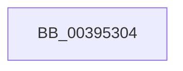

# sub_00395304

- RVA: `0x00395304`–`0x0039535C` (길이 `88` bytes)
- VA: `0x0000000140395304`
- 실행 섹션: `.text`
- PDB 이름 있음: `아니요`; PDB Function 태그: `아니요`
- unwind 정보 RVA: `0x000810D8`
- 디코드: `17`개 명령, `88/88` bytes 표시
- 미해석 바이트: `0` (있으면 어셈블리에 `.byte`로 보존)

> 이 문서는 커널 이미지의 기계어와 PDB 기호를 분석해 생성했습니다. 4번과 5번은 함수 원형과 자료형을 바이너리 사용 방식에서 추정한 C 해석이며 원본 소스 복구 결과는 아닙니다.

## 1. Dependencies

- 직접 호출 지점: **3**; 고유 호출 대상: **3**
- 직접 호출자로 확인된 함수: **0**
- RIP 상대 이미지 참조: **0**

### Outgoing calls
- `0x00395316` → [KiAcquireThreadLockRaiseToDpc](KiAcquireThreadLockRaiseToDpc_function_00396280.md) (function, `0x00396280`)
- `0x00395335` → [KiClearPriorityFloor](KiClearPriorityFloor_function_00396314.md) (function, `0x00396314`)
- `0x00395352` → [KiProcessDeferredReadyList](../25/KiProcessDeferredReadyList_function_00250800.md) (function, `0x00250800`)

### Direct callers
- 이 함수 시작 RVA로 연결되는 직접 call은 확인되지 않았습니다. 간접 호출은 완전히 역산할 수 없습니다.

### Static image references
- 디코드된 RIP-relative 메모리 참조가 없습니다.

## 2. Other-region calls and transfers

- 다른 실행 섹션으로 향하는 call: **0**
- call이 아닌 외부 분기/꼬리 이동: **1**
  - `0x00395357` → [sub_003951B9 + 0x7](Unknown_function_003951B9.md) (`tail-transfer`)

## 3. Assembly (complete function range)

```asm
00395304  48 8D 54 24 40                  lea rdx, [rsp + 0x40]
00395309  44 88 7C 24 40                  mov byte ptr [rsp + 0x40], r15b
0039530E  48 8B CB                        mov rcx, rbx
00395311  4C 89 7C 24 50                  mov qword ptr [rsp + 0x50], r15
00395316  E8 65 0F 00 00                  call 0x140396280
0039531B  44 0F BE 83 1B 03 00 00         movsx r8d, byte ptr [rbx + 0x31b]
00395323  48 8D 54 24 50                  lea rdx, [rsp + 0x50]
00395328  41 B1 01                        mov r9b, 1
0039532B  C6 83 1B 03 00 00 20            mov byte ptr [rbx + 0x31b], 0x20
00395332  48 8B CB                        mov rcx, rbx
00395335  E8 DA 0F 00 00                  call 0x140396314
0039533A  4C 89 7B 40                     mov qword ptr [rbx + 0x40], r15
0039533E  48 8D 54 24 50                  lea rdx, [rsp + 0x50]
00395343  65 48 8B 0C 25 20 00 00 00      mov rcx, qword ptr gs:[0x20]
0039534C  44 0F B6 44 24 40               movzx r8d, byte ptr [rsp + 0x40]
00395352  E8 A9 B4 EB FF                  call 0x140250800
00395357  E9 64 FE FF FF                  jmp 0x1403951c0
```

## 4. C-style interpretation (structured pseudocode)

```c
__int64 __fastcall sub_00395304(__int64 a1, __int64 a2, __int64 a3, __int64 a4, __int64 a5, __int64 a6, __int64 a7, unsigned __int8 a8, __int64 a9, __int64 a10)
{
    __int64 result;
    unsigned __int8 v_stack_p40;
    unsigned __int64 v_stack_p50;

    v_stack_p40 = (unsigned __int8)(v_r15);
    v_stack_p50 = v_r15;
    result = KiAcquireThreadLockRaiseToDpc(v_rbx, a8, a3, a4);
    *(unsigned __int8 *)(v_rbx + 795) = 32;
    result = KiClearPriorityFloor(v_rbx, a10, (__int8)(*(unsigned __int8 *)(v_rbx + 795)), 1);
    *(unsigned __int64 *)(v_rbx + 64) = v_r15;
    result = KiProcessDeferredReadyList(*(unsigned __int64 *)(gs_base + (0 + 32)), a10, a8, 1);
}
```

## 5. (Beta) C Style

```c
int64_t sub_00395304(int64_t Arg1, int64_t Arg2, int64_t Arg3, int64_t Arg4, uint64_t Arg5, uint64_t Arg6, uint64_t Arg7, uint8_t Arg8, uint64_t Arg9, int64_t Arg10)
{
    int64_t result;
    uint8_t v_stack_p40;
    uint64_t v_stack_p50;

    v_stack_p40 = (uint8_t)(local_r15);
    v_stack_p50 = local_r15;
    result = KiAcquireThreadLockRaiseToDpc(local_rbx, Arg8, Arg3, Arg4);
    *(uint8_t *)(local_rbx + 0x31B) = 32;
    result = KiClearPriorityFloor(local_rbx, Arg10, (int8_t)(*(uint8_t *)(local_rbx + 0x31B)), 1);
    *(uint64_t *)(local_rbx + 0x40) = local_r15;
    result = KiProcessDeferredReadyList(*(uint64_t *)(gs_base + (0 + 0x20)), Arg10, Arg8, 1);
}
```

## 6. Execution-region graph

[열기: 2D/3D 그래프와 함수 탐색 컨트롤 패널](../../../control-panel.html?section=text&rva=0x00395304&view=graph)

- 2D 그래프는 위에서 아래로 흐르고, 3D 그래프는 빈 공간을 드래그해 회전합니다. Shift+드래그는 이동, 휠은 확대·축소, 함수 노드 선택은 대상 보고서 이동입니다.

### Static fallback


