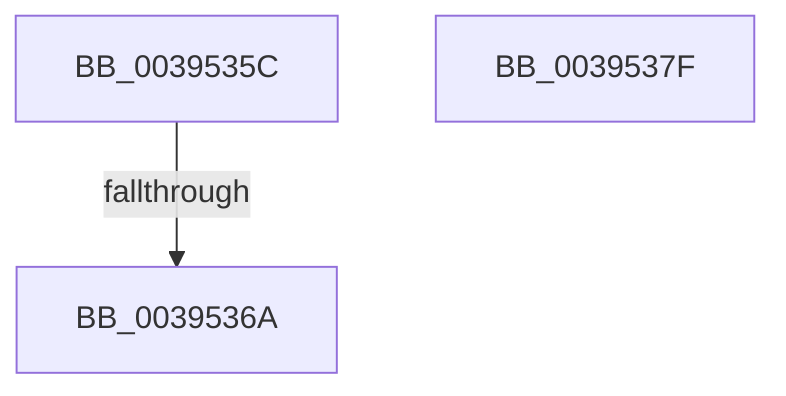

# sub_0039535C

- RVA: `0x0039535C`–`0x0039538C` (길이 `48` bytes)
- VA: `0x000000014039535C`
- 실행 섹션: `.text`
- PDB 이름 있음: `아니요`; PDB Function 태그: `아니요`
- unwind 정보 RVA: `0x000810F4`
- 디코드: `9`개 명령, `48/48` bytes 표시
- 미해석 바이트: `0` (있으면 어셈블리에 `.byte`로 보존)

> 이 문서는 커널 이미지의 기계어와 PDB 기호를 분석해 생성했습니다. 4번과 5번은 함수 원형과 자료형을 바이너리 사용 방식에서 추정한 C 해석이며 원본 소스 복구 결과는 아닙니다.

## 1. Dependencies

- 직접 호출 지점: **1**; 고유 호출 대상: **1**
- 직접 호출자로 확인된 함수: **0**
- RIP 상대 이미지 참조: **2**

### Outgoing calls
- `0x00395375` → [ExpAcquireSpinLockExclusiveAtDpcLevelInstrumented](../32/ExpAcquireSpinLockExclusiveAtDpcLevelInstrumented_function_00323A70.md) (function, `0x00323A70`)

### Direct callers
- 이 함수 시작 RVA로 연결되는 직접 call은 확인되지 않았습니다. 간접 호출은 완전히 역산할 수 없습니다.

### Static image references
- `0x0039535C` → RVA `0x00F0DE58` (`.data`; read)
- `0x0039536E` → RVA `0x00F06590` (`.data`; read)

## 2. Other-region calls and transfers

- 다른 실행 섹션으로 향하는 call: **0**
- call이 아닌 외부 분기/꼬리 이동: **3**
  - `0x00395364` → [sub_003950F3 + 0x3A](Unknown_function_003950F3.md) (`tail-transfer`)
  - `0x0039537A` → [sub_003950F3 + 0xA2](Unknown_function_003950F3.md) (`tail-transfer`)
  - `0x00395386` → [sub_003950F3 + 0x18](Unknown_function_003950F3.md) (`tail-transfer`)

## 3. Assembly (complete function range)

```asm
0039535C  8B 05 F6 8A B7 00               mov eax, dword ptr [rip + 0xb78af6]
00395362  85 C0                           test eax, eax
00395364  0F 85 C3 FD FF FF               jne 0x14039512d
0039536A  40 0F B6 D5                     movzx edx, bpl
0039536E  48 8D 0D 1B 12 B7 00            lea rcx, [rip + 0xb7121b]
00395375  E8 F6 E6 F8 FF                  call 0x140323a70
0039537A  E9 16 FE FF FF                  jmp 0x140395195
0039537F  F7 43 78 00 02 00 00            test dword ptr [rbx + 0x78], 0x200
00395386  0F 84 7F FD FF FF               je 0x14039510b
```

## 4. C-style interpretation (structured pseudocode)

```c
__int64 __fastcall sub_0039535C(void)
{
    __int64 result;

    result = ExpAcquireSpinLockExclusiveAtDpcLevelInstrumented(v_rip + 11997723, (unsigned __int8)(v_rbp), a3, a4);
}
```

## 5. (Beta) C Style

```c
void sub_0039535C(void)
{
    int64_t result;

    result = ExpAcquireSpinLockExclusiveAtDpcLevelInstrumented(v_rip + 11997723, (uint8_t)(local_rbp), a3, a4);
}
```

## 6. Execution-region graph

[열기: 2D/3D 그래프와 함수 탐색 컨트롤 패널](../../../control-panel.html?section=text&rva=0x0039535C&view=graph)

- 2D 그래프는 위에서 아래로 흐르고, 3D 그래프는 빈 공간을 드래그해 회전합니다. Shift+드래그는 이동, 휠은 확대·축소, 함수 노드 선택은 대상 보고서 이동입니다.

### Static fallback


