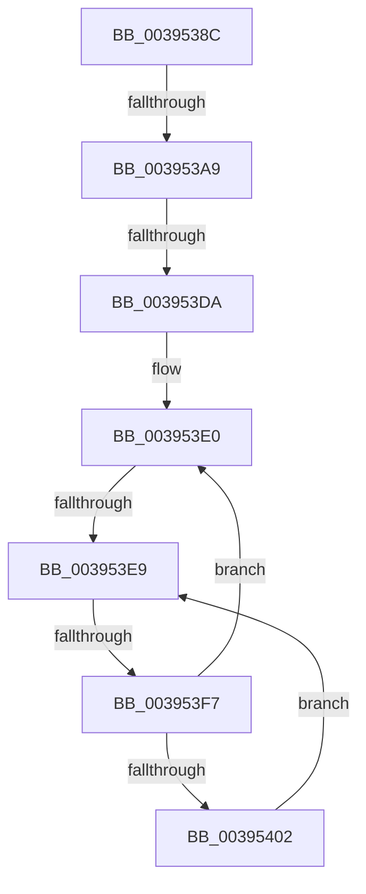

# sub_0039538C

- RVA: `0x0039538C`–`0x00395404` (길이 `120` bytes)
- VA: `0x000000014039538C`
- 실행 섹션: `.text`
- PDB 이름 있음: `아니요`; PDB Function 태그: `아니요`
- unwind 정보 RVA: `0x00081114`
- 디코드: `28`개 명령, `120/120` bytes 표시
- 미해석 바이트: `0` (있으면 어셈블리에 `.byte`로 보존)

> 이 문서는 커널 이미지의 기계어와 PDB 기호를 분석해 생성했습니다. 4번과 5번은 함수 원형과 자료형을 바이너리 사용 방식에서 추정한 C 해석이며 원본 소스 복구 결과는 아닙니다.

## 1. Dependencies

- 직접 호출 지점: **1**; 고유 호출 대상: **1**
- 직접 호출자로 확인된 함수: **0**
- RIP 상대 이미지 참조: **2**

### Outgoing calls
- `0x003953BC` → [KiUpdateTotalCyclesCurrentThread](../37/KiUpdateTotalCyclesCurrentThread_function_0037DE40.md) (function, `0x0037DE40`)

### Direct callers
- 이 함수 시작 RVA로 연결되는 직접 call은 확인되지 않았습니다. 간접 호출은 완전히 역산할 수 없습니다.

### Static image references
- `0x0039539C` → RVA `0x00FC6D20` (`ALMOSTRO`; read)
- `0x003953EB` → RVA `0x00FC52AC` (`ALMOSTRO`; reference)

## 2. Other-region calls and transfers

- 다른 실행 섹션으로 향하는 call: **0**
- call이 아닌 외부 분기/꼬리 이동: **4**
  - `0x003953A3` → [sub_003954C8](Unknown_function_003954C8.md) (`tail-transfer`)
  - `0x003953D4` → [sub_003954C8 + 0x39](Unknown_function_003954C8.md) (`tail-transfer`)
  - `0x003953E7` → [sub_00395416](Unknown_function_00395416.md) (`tail-transfer`)
  - `0x003953F1` → [sub_003954C8 + 0x12](Unknown_function_003954C8.md) (`tail-transfer`)

## 3. Assembly (complete function range)

```asm
0039538C  4C 89 B4 24 98 00 00 00         mov qword ptr [rsp + 0x98], r14
00395394  45 0F 20 C6                     mov r14, cr8
00395398  45 0F 22 C4                     mov cr8, r12
0039539C  44 39 3D 7D 19 C3 00            cmp dword ptr [rip + 0xc3197d], r15d
003953A3  0F 85 1F 01 00 00               jne 0x1403954c8
003953A9  65 48 8B 34 25 20 00 00 00      mov rsi, qword ptr gs:[0x20]
003953B2  FA                              cli
003953B3  45 33 C0                        xor r8d, r8d
003953B6  48 8B D3                        mov rdx, rbx
003953B9  48 8B CE                        mov rcx, rsi
003953BC  E8 7F 8A FE FF                  call 0x14037de40
003953C1  65 48 8B 0C 25 20 00 00 00      mov rcx, qword ptr gs:[0x20]
003953CA  4C 8B 81 B8 8E 00 00            mov r8, qword ptr [rcx + 0x8eb8]
003953D1  4D 85 C0                        test r8, r8
003953D4  0F 85 27 01 00 00               jne 0x140395501
003953DA  FB                              sti
003953DB  41 8B EF                        mov ebp, r15d
003953DE  66 90                           nop
003953E0  F0 48 0F BA 6E 30 00            lock bts qword ptr [rsi + 0x30], 0
003953E7  73 2D                           jae 0x140395416
003953E9  FF C5                           inc ebp
003953EB  85 2D BB FE C2 00               test dword ptr [rip + 0xc2febb], ebp
003953F1  0F 84 E3 00 00 00               je 0x1403954da
003953F7  F3 90                           pause
003953F9  48 8B 46 30                     mov rax, qword ptr [rsi + 0x30]
003953FD  48 85 C0                        test rax, rax
00395400  74 DE                           je 0x1403953e0
00395402  EB E5                           jmp 0x1403953e9
```

## 4. C-style interpretation (structured pseudocode)

```c
__int64 __fastcall sub_0039538C(__int64 a1, __int64 a2, int a3)
{
    __int64 result;
    __int64 v_rbp;
    unsigned __int64 v_stack_p98;

    v_stack_p98 = v_r14;
    a3 = 0;
    result = KiUpdateTotalCyclesCurrentThread(*(unsigned __int64 *)(gs_base + (0 + 32)), v_rbx, a3, a4);
loc_003953E0:
loc_003953E9:
    v_rbp = (unsigned int)(((unsigned int)((unsigned int)(v_r15))) + 1);
    if (*(unsigned __int64 *)(*(unsigned __int64 *)(gs_base + (0 + 32)) + 48) == 0) goto loc_003953E0;
    goto loc_003953E9;
}
```

## 5. (Beta) C Style

```c
int64_t sub_0039538C(int64_t Arg1, int64_t Arg2, int32_t Arg3)
{
    int64_t result;
    int64_t local_rbp;
    uint64_t v_stack_p98;

    v_stack_p98 = local_r14;
    Arg3 = 0;
    result = KiUpdateTotalCyclesCurrentThread(*(uint64_t *)(gs_base + (0 + 0x20)), local_rbx, Arg3, a4);
loc_003953E0:
loc_003953E9:
    local_rbp = (uint32_t)(((uint32_t)((uint32_t)(local_r15))) + 1);
    if (*(uint64_t *)(*(uint64_t *)(gs_base + (0 + 0x20)) + 0x30) == 0) goto loc_003953E0;
    goto loc_003953E9;
}
```

## 6. Execution-region graph

[열기: 2D/3D 그래프와 함수 탐색 컨트롤 패널](../../../control-panel.html?section=text&rva=0x0039538C&view=graph)

- 2D 그래프는 위에서 아래로 흐르고, 3D 그래프는 빈 공간을 드래그해 회전합니다. Shift+드래그는 이동, 휠은 확대·축소, 함수 노드 선택은 대상 보고서 이동입니다.

### Static fallback


