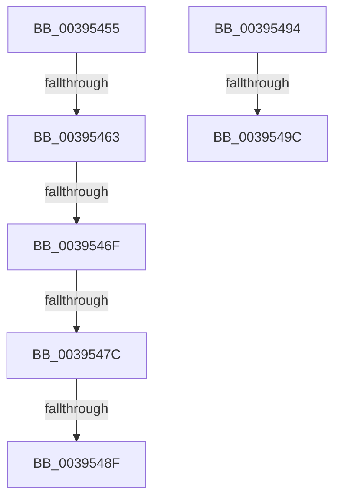

# sub_00395455

- RVA: `0x00395455`–`0x003954A1` (길이 `76` bytes)
- VA: `0x0000000140395455`
- 실행 섹션: `.text`
- PDB 이름 있음: `아니요`; PDB Function 태그: `아니요`
- unwind 정보 RVA: `0x0008114C`
- 디코드: `18`개 명령, `76/76` bytes 표시
- 미해석 바이트: `0` (있으면 어셈블리에 `.byte`로 보존)

> 이 문서는 커널 이미지의 기계어와 PDB 기호를 분석해 생성했습니다. 4번과 5번은 함수 원형과 자료형을 바이너리 사용 방식에서 추정한 C 해석이며 원본 소스 복구 결과는 아닙니다.

## 1. Dependencies

- 직접 호출 지점: **0**; 고유 호출 대상: **0**
- 직접 호출자로 확인된 함수: **0**
- RIP 상대 이미지 참조: **0**

### Outgoing calls
- 직접 디코드된 call 명령이 없습니다.

### Direct callers
- 이 함수 시작 RVA로 연결되는 직접 call은 확인되지 않았습니다. 간접 호출은 완전히 역산할 수 없습니다.

### Static image references
- 디코드된 RIP-relative 메모리 참조가 없습니다.

## 2. Other-region calls and transfers

- 다른 실행 섹션으로 향하는 call: **0**
- call이 아닌 외부 분기/꼬리 이동: **7**
  - `0x0039545D` → [sub_00395206 + 0x1F](Unknown_function_00395206.md) (`tail-transfer`)
  - `0x00395469` → [sub_00395550](Unknown_function_00395550.md) (`tail-transfer`)
  - `0x00395476` → [sub_00395206 + 0x1F](Unknown_function_00395206.md) (`tail-transfer`)
  - `0x00395489` → [sub_00395206 + 0x1F](Unknown_function_00395206.md) (`tail-transfer`)
  - `0x0039548F` → [sub_00395271 + 0x24](Unknown_function_00395271.md) (`tail-transfer`)
  - `0x00395496` → [sub_00395271 + 0xC](Unknown_function_00395271.md) (`tail-transfer`)
  - `0x0039549C` → [sub_00395206 + 0x14](Unknown_function_00395206.md) (`tail-transfer`)

## 3. Assembly (complete function range)

```asm
00395455  48 8B 4A 28                     mov rcx, qword ptr [rdx + 0x28]
00395459  44 39 79 60                     cmp dword ptr [rcx + 0x60], r15d
0039545D  0F 84 C2 FD FF FF               je 0x140395225
00395463  0F B6 41 64                     movzx eax, byte ptr [rcx + 0x64]
00395467  3C 04                           cmp al, 4
00395469  0F 82 E1 00 00 00               jb 0x140395550
0039546F  8B 41 68                        mov eax, dword ptr [rcx + 0x68]
00395472  4C 85 41 70                     test qword ptr [rcx + 0x70], r8
00395476  0F 84 A9 FD FF FF               je 0x140395225
0039547C  48 8B 49 78                     mov rcx, qword ptr [rcx + 0x78]
00395480  48 8B C1                        mov rax, rcx
00395483  49 23 C0                        and rax, r8
00395486  48 3B C1                        cmp rax, rcx
00395489  0F 85 96 FD FF FF               jne 0x140395225
0039548F  E9 01 FE FF FF                  jmp 0x140395295
00395494  84 C0                           test al, al
00395496  0F 84 E1 FD FF FF               je 0x14039527d
0039549C  E9 79 FD FF FF                  jmp 0x14039521a
```

## 4. C-style interpretation (structured pseudocode)

```c
__int64 __fastcall sub_00395455(__int64 a1, __int64 a2, __int64 a3)
{
    __int64 result;

    result = (*(unsigned __int64 *)(*(unsigned __int64 *)(a2 + 40) + 120)) & (a3);
}
```

## 5. (Beta) C Style

```c
int64_t sub_00395455(int64_t Arg1, void *Arg2, int64_t Arg3)
{
    uint8_t *arg2 = (uint8_t *)Arg2;

    int64_t result;

    result = (*(uint64_t *)(*(uint64_t *)(arg2 + 0x28) + 0x78)) & (Arg3);
}
```

### 관측된 메모리 오프셋

구조체 형식이 확인되지 않은 접근은 인자 기준의 오프셋으로만 기록했습니다.

| 기준 인자 | 오프셋 표현 | 폭 (bit) | 접근 |
|---|---:|---:|---|
| `Arg2` | `+ 0x28` | `64` | `R` |

## 6. Execution-region graph

[열기: 2D/3D 그래프와 함수 탐색 컨트롤 패널](../../../control-panel.html?section=text&rva=0x00395455&view=graph)

- 2D 그래프는 위에서 아래로 흐르고, 3D 그래프는 빈 공간을 드래그해 회전합니다. Shift+드래그는 이동, 휠은 확대·축소, 함수 노드 선택은 대상 보고서 이동입니다.

### Static fallback


