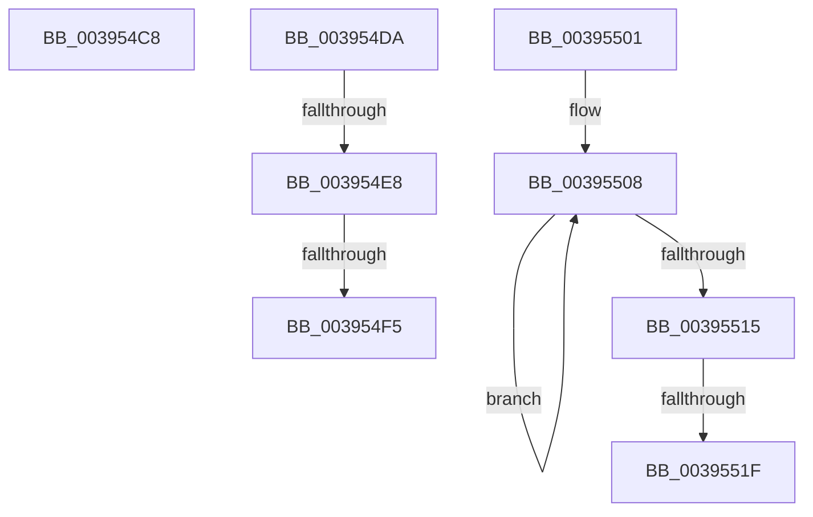

# sub_003954C8

- RVA: `0x003954C8`–`0x00395529` (길이 `97` bytes)
- VA: `0x00000001403954C8`
- 실행 섹션: `.text`
- PDB 이름 있음: `아니요`; PDB Function 태그: `아니요`
- unwind 정보 RVA: `0x00081184`
- 디코드: `23`개 명령, `97/97` bytes 표시
- 미해석 바이트: `0` (있으면 어셈블리에 `.byte`로 보존)

> 이 문서는 커널 이미지의 기계어와 PDB 기호를 분석해 생성했습니다. 4번과 5번은 함수 원형과 자료형을 바이너리 사용 방식에서 추정한 C 해석이며 원본 소스 복구 결과는 아닙니다.

## 1. Dependencies

- 직접 호출 지점: **4**; 고유 호출 대상: **4**
- 직접 호출자로 확인된 함수: **0**
- RIP 상대 이미지 참조: **1**

### Outgoing calls
- `0x003954D0` → [KiRaiseIrqlProcessIrqlFlags](../4F/KiRaiseIrqlProcessIrqlFlags_function_004F56FC.md) (function, `0x004F56FC`)
- `0x003954E8` → [KiCheckVpBackingLongSpinWaitHypercall](../30/KiCheckVpBackingLongSpinWaitHypercall_function_0030F490.md) (function, `0x0030F490`)
- `0x003954F7` → [HvlNotifyLongSpinWait](../30/HvlNotifyLongSpinWait_function_0030F460.md) (function, `0x0030F460`)
- `0x0039551F` → [KiRemoveSystemWorkPriorityKick](../26/KiRemoveSystemWorkPriorityKick_function_002631D0.md) (function, `0x002631D0`)

### Direct callers
- 이 함수 시작 RVA로 연결되는 직접 call은 확인되지 않았습니다. 간접 호출은 완전히 역산할 수 없습니다.

### Static image references
- `0x003954DA` → RVA `0x00FC6AB8` (`ALMOSTRO`; read)

## 2. Other-region calls and transfers

- 다른 실행 섹션으로 향하는 call: **0**
- call이 아닌 외부 분기/꼬리 이동: **6**
  - `0x003954D5` → [sub_0039538C + 0x1D](Unknown_function_0039538C.md) (`tail-transfer`)
  - `0x003954E2` → [sub_0039538C + 0x6B](Unknown_function_0039538C.md) (`tail-transfer`)
  - `0x003954EF` → [sub_0039538C + 0x6B](Unknown_function_0039538C.md) (`tail-transfer`)
  - `0x003954FC` → [sub_0039538C + 0x6D](Unknown_function_0039538C.md) (`tail-transfer`)
  - `0x00395519` → [sub_0039538C + 0x4E](Unknown_function_0039538C.md) (`tail-transfer`)
  - `0x00395524` → [sub_0039538C + 0x4E](Unknown_function_0039538C.md) (`tail-transfer`)

## 3. Assembly (complete function range)

```asm
003954C8  41 0F B6 D4                     movzx edx, r12b
003954CC  41 0F B6 CE                     movzx ecx, r14b
003954D0  E8 27 02 16 00                  call 0x1404f56fc
003954D5  E9 CF FE FF FF                  jmp 0x1403953a9
003954DA  8B 05 D8 15 C3 00               mov eax, dword ptr [rip + 0xc315d8]
003954E0  A8 40                           test al, 0x40
003954E2  0F 84 0F FF FF FF               je 0x1403953f7
003954E8  E8 A3 9F F7 FF                  call 0x14030f490
003954ED  84 C0                           test al, al
003954EF  0F 84 02 FF FF FF               je 0x1403953f7
003954F5  8B CD                           mov ecx, ebp
003954F7  E8 64 9F F7 FF                  call 0x14030f460
003954FC  E9 F8 FE FF FF                  jmp 0x1403953f9
00395501  41 0F 0D 08                     prefetchw byte ptr [r8]
00395505  41 8B 00                        mov eax, dword ptr [r8]
00395508  8B D0                           mov edx, eax
0039550A  0F BA F2 15                     btr edx, 0x15
0039550E  F0 41 0F B1 10                  lock cmpxchg dword ptr [r8], edx
00395513  75 F3                           jne 0x140395508
00395515  0F BA E0 15                     bt eax, 0x15
00395519  0F 83 BB FE FF FF               jae 0x1403953da
0039551F  E8 AC DC EC FF                  call 0x1402631d0
00395524  E9 B1 FE FF FF                  jmp 0x1403953da
```

## 4. C-style interpretation (structured pseudocode)

```c
__int64 __fastcall sub_003954C8(__int64 a1, __int64 a2, __int64 a3)
{
    __int64 result;

    result = KiRaiseIrqlProcessIrqlFlags((unsigned __int8)(v_r14), (unsigned __int8)(v_r12), a3, a4);
}
```

## 5. (Beta) C Style

```c
int64_t sub_003954C8(int64_t Arg1, int64_t Arg2, int64_t Arg3)
{
    int64_t result;

    result = KiRaiseIrqlProcessIrqlFlags((uint8_t)(local_r14), (uint8_t)(local_r12), Arg3, a4);
}
```

## 6. Execution-region graph

[열기: 2D/3D 그래프와 함수 탐색 컨트롤 패널](../../../control-panel.html?section=text&rva=0x003954C8&view=graph)

- 2D 그래프는 위에서 아래로 흐르고, 3D 그래프는 빈 공간을 드래그해 회전합니다. Shift+드래그는 이동, 휠은 확대·축소, 함수 노드 선택은 대상 보고서 이동입니다.

### Static fallback


