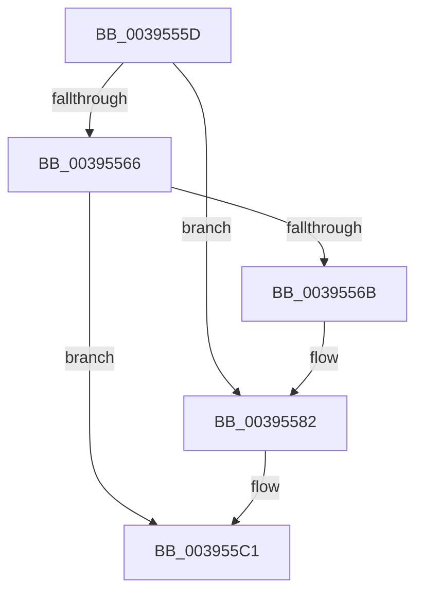

# sub_0039555D

- RVA: `0x0039555D`–`0x003955CF` (길이 `114` bytes)
- VA: `0x000000014039555D`
- 실행 섹션: `.text`
- PDB 이름 있음: `아니요`; PDB Function 태그: `아니요`
- unwind 정보 RVA: `0x000811DC`
- 디코드: `30`개 명령, `114/114` bytes 표시
- 미해석 바이트: `0` (있으면 어셈블리에 `.byte`로 보존)

> 이 문서는 커널 이미지의 기계어와 PDB 기호를 분석해 생성했습니다. 4번과 5번은 함수 원형과 자료형을 바이너리 사용 방식에서 추정한 C 해석이며 원본 소스 복구 결과는 아닙니다.

## 1. Dependencies

- 직접 호출 지점: **3**; 고유 호출 대상: **2**
- 직접 호출자로 확인된 함수: **0**
- RIP 상대 이미지 참조: **2**

### Outgoing calls
- `0x0039557C` → [KeBugCheckEx](../4F/KeBugCheckEx_function_004FD660.md) (function, `0x004FD660`)
- `0x003955BB` → [KeBugCheckEx](../4F/KeBugCheckEx_function_004FD660.md) (function, `0x004FD660`)
- `0x003955C5` → [ObpDeferObjectDeletion](../3A/ObpDeferObjectDeletion_function_003A2394.md) (function, `0x003A2394`)

### Direct callers
- 이 함수 시작 RVA로 연결되는 직접 call은 확인되지 않았습니다. 간접 호출은 완전히 역산할 수 없습니다.

### Static image references
- `0x003955A6` → RVA `0x00FC6E4C` (`ALMOSTRO`; read)
- `0x003955B0` → RVA `0x00FC7800` (`ALMOSTRO`; read)

## 2. Other-region calls and transfers

- 다른 실행 섹션으로 향하는 call: **0**
- call이 아닌 외부 분기/꼬리 이동: **1**
  - `0x003955CA` → [sub_0039523E + 0x2C](Unknown_function_0039523E.md) (`tail-transfer`)

## 3. Assembly (complete function range)

```asm
0039555D  48 8B 4F D8                     mov rcx, qword ptr [rdi - 0x28]
00395561  48 85 C9                        test rcx, rcx
00395564  75 1C                           jne 0x140395582
00395566  48 85 C0                        test rax, rax
00395569  79 56                           jns 0x1403955c1
0039556B  33 D2                           xor edx, edx
0039556D  48 89 44 24 20                  mov qword ptr [rsp + 0x20], rax
00395572  44 8D 49 04                     lea r9d, [rcx + 4]
00395576  4C 8B C7                        mov r8, rdi
00395579  8D 4A 18                        lea ecx, [rdx + 0x18]
0039557C  E8 DF 80 16 00                  call 0x1404fd660
00395581  CC                              int3
00395582  41 B9 03 00 00 00               mov r9d, 3
00395588  48 89 4C 24 20                  mov qword ptr [rsp + 0x20], rcx
0039558D  48 8D 47 D0                     lea rax, [rdi - 0x30]
00395591  4C 8B C7                        mov r8, rdi
00395594  48 C1 E8 08                     shr rax, 8
00395598  0F B6 D0                        movzx edx, al
0039559B  0F B6 47 E8                     movzx eax, byte ptr [rdi - 0x18]
0039559F  41 8D 49 15                     lea ecx, [r9 + 0x15]
003955A3  48 33 D0                        xor rdx, rax
003955A6  0F B6 05 9F 18 C3 00            movzx eax, byte ptr [rip + 0xc3189f]
003955AD  48 33 D0                        xor rdx, rax
003955B0  48 8D 05 49 22 C3 00            lea rax, [rip + 0xc32249]
003955B7  48 8B 14 D0                     mov rdx, qword ptr [rax + rdx*8]
003955BB  E8 A0 80 16 00                  call 0x1404fd660
003955C0  CC                              int3
003955C1  48 8D 4F D0                     lea rcx, [rdi - 0x30]
003955C5  E8 CA CD 00 00                  call 0x1403a2394
003955CA  E9 9B FC FF FF                  jmp 0x14039526a
```

## 4. C-style interpretation (structured pseudocode)

```c
__int64 __fastcall sub_0039555D(__int64 a1, int a2)
{
    __int64 result;
    unsigned __int64 v_stack_p20;

    if (*(unsigned __int64 *)(v_rdi - 40) != 0) goto loc_00395582;
    if (!sign_flag) goto loc_003955C1;
    a2 = 0;
    v_stack_p20 = result;
    result = KeBugCheckEx(a2 + 24, a2, v_rdi, *(unsigned __int64 *)(v_rdi - 40) + 4);
loc_00395582:
    v_stack_p20 = a2 + 24;
    result = (v_rdi - 48) >> (8);
    a2 = ((unsigned __int8)(result)) ^ (*(unsigned __int8 *)(v_rdi - 24));
    a2 = (a2) ^ (*(unsigned __int8 *)(v_rip + 12785823));
    result = KeBugCheckEx(3 + 21, *(unsigned __int64 *)(v_rip + 12788297 + a2 * 8), v_rdi, 3);
loc_003955C1:
    result = ObpDeferObjectDeletion(v_rdi - 48, *(unsigned __int64 *)(v_rip + 12788297 + a2 * 8), v_rdi, 3);
}
```

## 5. (Beta) C Style

```c
int64_t sub_0039555D(int64_t Arg1, int32_t Arg2)
{
    int64_t result;
    uint64_t v_stack_p20;

    if (*(uint64_t *)(local_rdi - 0x28) != 0) goto loc_00395582;
    if (!sign_flag) goto loc_003955C1;
    Arg2 = 0;
    v_stack_p20 = result;
    result = KeBugCheckEx(Arg2 + 24, Arg2, local_rdi, *(uint64_t *)(local_rdi - 0x28) + 4);
loc_00395582:
    v_stack_p20 = Arg2 + 24;
    result = (local_rdi - 48) >> (8);
    Arg2 = ((uint8_t)(result)) ^ (*(uint8_t *)(local_rdi - 0x18));
    Arg2 = (Arg2) ^ (*(uint8_t *)(v_rip + 0xC3189F));
    result = KeBugCheckEx(3 + 21, *(uint64_t *)(v_rip + 0xC32249 + Arg2 * 8), local_rdi, 3);
loc_003955C1:
    result = ObpDeferObjectDeletion(local_rdi - 48, *(uint64_t *)(v_rip + 0xC32249 + Arg2 * 8), local_rdi, 3);
}
```

## 6. Execution-region graph

[열기: 2D/3D 그래프와 함수 탐색 컨트롤 패널](../../../control-panel.html?section=text&rva=0x0039555D&view=graph)

- 2D 그래프는 위에서 아래로 흐르고, 3D 그래프는 빈 공간을 드래그해 회전합니다. Shift+드래그는 이동, 휠은 확대·축소, 함수 노드 선택은 대상 보고서 이동입니다.

### Static fallback


