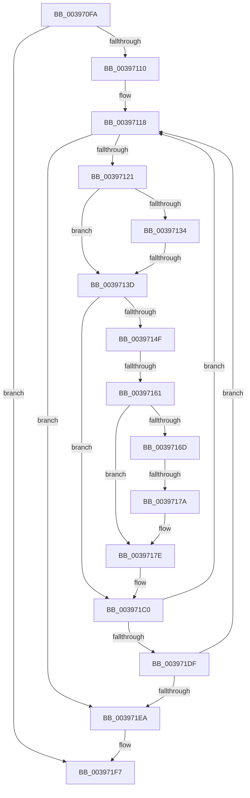

# sub_003970FA

- RVA: `0x003970FA`–`0x00397240` (길이 `326` bytes)
- VA: `0x00000001403970FA`
- 실행 섹션: `.text`
- PDB 이름 있음: `아니요`; PDB Function 태그: `아니요`
- unwind 정보 RVA: `0x000812C8`
- 디코드: `78`개 명령, `326/326` bytes 표시
- 미해석 바이트: `0` (있으면 어셈블리에 `.byte`로 보존)

> 이 문서는 커널 이미지의 기계어와 PDB 기호를 분석해 생성했습니다. 4번과 5번은 함수 원형과 자료형을 바이너리 사용 방식에서 추정한 C 해석이며 원본 소스 복구 결과는 아닙니다.

## 1. Dependencies

- 직접 호출 지점: **3**; 고유 호출 대상: **3**
- 직접 호출자로 확인된 함수: **0**
- RIP 상대 이미지 참조: **0**

### Outgoing calls
- `0x00397181` → [KiRemovePrcbWaitEntry](../25/KiRemovePrcbWaitEntry_function_002502D0.md) (function, `0x002502D0`)
- `0x00397189` → [KiEnterDeferredReadyState](KiEnterDeferredReadyState_function_00397420.md) (function, `0x00397420`)
- `0x0039721D` → [KiExitDispatcher](../25/KiExitDispatcher_function_00251CF0.md) (function, `0x00251CF0`)

### Direct callers
- 이 함수 시작 RVA로 연결되는 직접 call은 확인되지 않았습니다. 간접 호출은 완전히 역산할 수 없습니다.

### Static image references
- 디코드된 RIP-relative 메모리 참조가 없습니다.

## 2. Other-region calls and transfers

- 다른 실행 섹션으로 향하는 call: **0**
- call이 아닌 외부 분기/꼬리 이동: **3**
  - `0x00397137` → [sub_00397241](Unknown_function_00397241.md) (`tail-transfer`)
  - `0x0039715B` → [sub_0039737C + 0x1D](Unknown_function_0039737C.md) (`tail-transfer`)
  - `0x00397174` → [sub_00397299 + 0x28](Unknown_function_00397299.md) (`tail-transfer`)

## 3. Assembly (complete function range)

```asm
003970FA  4C 89 6C 24 50                  mov qword ptr [rsp + 0x50], r13
003970FF  4C 89 74 24 48                  mov qword ptr [rsp + 0x48], r14
00397104  41 89 47 04                     mov dword ptr [r15 + 4], eax
00397108  85 C9                           test ecx, ecx
0039710A  0F 85 E7 00 00 00               jne 0x1403971f7
00397110  4D 8B 77 08                     mov r14, qword ptr [r15 + 8]
00397114  4D 8D 6F 08                     lea r13, [r15 + 8]
00397118  4D 3B F5                        cmp r14, r13
0039711B  0F 84 C9 00 00 00               je 0x1403971ea
00397121  49 8B 06                        mov rax, qword ptr [r14]
00397124  49 8B FE                        mov rdi, r14
00397127  4C 8B F0                        mov r14, rax
0039712A  48 8B 4F 08                     mov rcx, qword ptr [rdi + 8]
0039712E  48 39 78 08                     cmp qword ptr [rax + 8], rdi
00397132  75 09                           jne 0x14039713d
00397134  48 39 39                        cmp qword ptr [rcx], rdi
00397137  0F 84 04 01 00 00               je 0x140397241
0039713D  B9 03 00 00 00                  mov ecx, 3
00397142  CD 29                           int 0x29
00397144  0F B6 83 84 01 00 00            movzx eax, byte ptr [rbx + 0x184]
0039714B  3C 05                           cmp al, 5
0039714D  75 71                           jne 0x1403971c0
0039714F  0F B6 4B 70                     movzx ecx, byte ptr [rbx + 0x70]
00397153  8B C1                           mov eax, ecx
00397155  83 E0 07                        and eax, 7
00397158  83 F8 01                        cmp eax, 1
0039715B  0F 85 38 02 00 00               jne 0x140397399
00397161  48 8B 93 E8 00 00 00            mov rdx, qword ptr [rbx + 0xe8]
00397168  48 85 D2                        test rdx, rdx
0039716B  74 11                           je 0x14039717e
0039716D  0F B6 02                        movzx eax, byte ptr [rdx]
00397170  24 7F                           and al, 0x7f
00397172  3C 15                           cmp al, 0x15
00397174  0F 84 47 01 00 00               je 0x1403972c1
0039717A  F0 FF 42 28                     lock inc dword ptr [rdx + 0x28]
0039717E  48 8B CB                        mov rcx, rbx
00397181  E8 4A 91 EB FF                  call 0x1402502d0
00397186  48 8B CB                        mov rcx, rbx
00397189  E8 92 02 00 00                  call 0x140397420
0039718E  48 8B 54 24 30                  mov rdx, qword ptr [rsp + 0x30]
00397193  48 8D 8B D8 00 00 00            lea rcx, [rbx + 0xd8]
0039719A  48 8B 82 08 2D 00 00            mov rax, qword ptr [rdx + 0x2d08]
003971A1  48 89 01                        mov qword ptr [rcx], rax
003971A4  48 89 8A 08 2D 00 00            mov qword ptr [rdx + 0x2d08], rcx
003971AB  4C 89 A3 C8 00 00 00            mov qword ptr [rbx + 0xc8], r12
003971B2  48 C7 83 D0 03 00 00 00 00 00 00  mov qword ptr [rbx + 0x3d0], 0
003971BD  40 B5 01                        mov bpl, 1
003971C0  48 8B 74 24 30                  mov rsi, qword ptr [rsp + 0x30]
003971C5  48 C7 43 40 00 00 00 00         mov qword ptr [rbx + 0x40], 0
003971CD  0F B6 47 11                     movzx eax, byte ptr [rdi + 0x11]
003971D1  FE C0                           inc al
003971D3  88 47 11                        mov byte ptr [rdi + 0x11], al
003971D6  40 84 ED                        test bpl, bpl
003971D9  0F 84 39 FF FF FF               je 0x140397118
003971DF  41 83 6F 04 01                  sub dword ptr [r15 + 4], 1
003971E4  0F 85 2E FF FF FF               jne 0x140397118
003971EA  0F B6 AC 24 A8 00 00 00         movzx ebp, byte ptr [rsp + 0xa8]
003971F2  4C 8B 64 24 38                  mov r12, qword ptr [rsp + 0x38]
003971F7  F0 41 81 27 7F FF FF FF         lock and dword ptr [r15], 0xffffff7f
003971FF  44 8B 8C 24 98 00 00 00         mov r9d, dword ptr [rsp + 0x98]
00397207  40 F6 DD                        neg bpl
0039720A  41 B8 01 00 00 00               mov r8d, 1
00397210  44 88 64 24 20                  mov byte ptr [rsp + 0x20], r12b
00397215  1B D2                           sbb edx, edx
00397217  48 8B CE                        mov rcx, rsi
0039721A  83 E2 03                        and edx, 3
0039721D  E8 CE AA EB FF                  call 0x140251cf0
00397222  8B 84 24 A0 00 00 00            mov eax, dword ptr [rsp + 0xa0]
00397229  4C 8B 6C 24 50                  mov r13, qword ptr [rsp + 0x50]
0039722E  4C 8B 74 24 48                  mov r14, qword ptr [rsp + 0x48]
00397233  48 83 C4 58                     add rsp, 0x58
00397237  41 5F                           pop r15
00397239  41 5C                           pop r12
0039723B  5F                              pop rdi
0039723C  5E                              pop rsi
0039723D  5D                              pop rbp
0039723E  5B                              pop rbx
0039723F  C3                              ret
```

## 4. C-style interpretation (structured pseudocode)

```c
__int64 __fastcall sub_003970FA(int a1, __int64 a2, __int64 a3, __int64 a4, __int64 a5, __int64 a6, __int64 a7, __int64 a8, __int64 a9, __int64 a10, __int64 a11, __int64 a12, __int64 a13, __int64 a14, __int64 a15, __int64 a16, __int64 a17, __int64 a18, unsigned int a19, unsigned int a20, unsigned __int8 a21)
{
    __int64 result;
    __int64 v_rbp;
    __int64 v_rsp;
    unsigned __int8 v_stack_p20;
    unsigned __int64 v_stack_p48;
    unsigned __int64 v_stack_p50;

    v_stack_p50 = v_r13;
    v_stack_p48 = v_r14;
    *(unsigned int *)(v_r15 + 4) = (unsigned int)(result);
    if (a1 != 0) goto loc_003971F7;
loc_00397118:
    if ((*(unsigned __int64 *)(v_r15 + 8)) == (v_r15 + 8)) goto loc_003971EA;
    if ((*(unsigned __int64 *)(*(unsigned __int64 *)(*(unsigned __int64 *)(v_r15 + 8)) + 8)) != (*(unsigned __int64 *)(v_r15 + 8))) goto loc_0039713D;
loc_0039713D:
    if (((unsigned __int8)(*(unsigned __int8 *)(v_rbx + 388))) != 5) goto loc_003971C0;
    result = (unsigned int)(((unsigned int)((unsigned int)(*(unsigned __int8 *)(v_rbx + 112)))) & (7));
    if (*(unsigned __int64 *)(v_rbx + 232) == 0) goto loc_0039717E;
    result = (unsigned __int8)((*(unsigned __int8 *)(*(unsigned __int64 *)(v_rbx + 232))) & (127));
loc_0039717E:
    result = KiRemovePrcbWaitEntry(v_rbx, *(unsigned __int64 *)(v_rbx + 232), a3, a4);
    result = KiEnterDeferredReadyState(v_rbx, *(unsigned __int64 *)(v_rbx + 232), a3, a4);
    *(unsigned __int64 *)(v_rbx + 216) = *(unsigned __int64 *)(a6 + 11528);
    *(unsigned __int64 *)(a6 + 11528) = v_rbx + 216;
    *(unsigned __int64 *)(v_rbx + 200) = v_r12;
    *(unsigned __int64 *)(v_rbx + 976) = 0;
loc_003971C0:
    *(unsigned __int64 *)(v_rbx + 64) = 0;
    result = (unsigned __int8)((*(unsigned __int8 *)(*(unsigned __int64 *)(v_r15 + 8) + 17)) + 1);
    *(unsigned __int8 *)(*(unsigned __int64 *)(v_r15 + 8) + 17) = (unsigned __int8)(result);
    if (1 == 0) goto loc_00397118;
    if (1 != 0) goto loc_00397118;
loc_003971EA:
loc_003971F7:
    v_rbp = (unsigned __int8)(-(a21));
    v_stack_p20 = (unsigned __int8)(a7);
    a2 = (unsigned int)((a6) & (3));
    result = KiExitDispatcher(a6, a2, 1, (unsigned int)(a19));
    v_rsp = (v_rsp) + (88);
    return (unsigned int)(a20);
}
```

## 5. (Beta) C Style

```c
int64_t sub_003970FA(int32_t Arg1, int64_t Arg2, int64_t Arg3, int64_t Arg4, uint64_t Arg5, void *Arg6, int64_t Arg7, uint64_t Arg8, int64_t Arg9, int64_t Arg10, uint64_t Arg11, uint64_t Arg12, uint64_t Arg13, uint64_t Arg14, uint64_t Arg15, uint64_t Arg16, uint64_t Arg17, uint64_t Arg18, uint32_t Arg19, uint32_t Arg20, uint8_t Arg21)
{
    uint8_t *arg6 = (uint8_t *)Arg6;

    int64_t result;
    int64_t local_rbp;
    int64_t local_rsp;
    uint8_t v_stack_p20;
    uint64_t v_stack_p48;
    uint64_t v_stack_p50;

    v_stack_p50 = local_r13;
    v_stack_p48 = local_r14;
    *(uint32_t *)(local_r15 + 0x4) = (uint32_t)(result);
    if (Arg1 != 0) goto loc_003971F7;
loc_00397118:
    if ((*(uint64_t *)(local_r15 + 0x8)) == (local_r15 + 8)) goto loc_003971EA;
    if ((*(uint64_t *)(*(uint64_t *)(*(uint64_t *)(local_r15 + 0x8)) + 0x8)) != (*(uint64_t *)(local_r15 + 0x8))) goto loc_0039713D;
loc_0039713D:
    if (((uint8_t)(*(uint8_t *)(local_rbx + 0x184))) != 5) goto loc_003971C0;
    result = (uint32_t)(((uint32_t)((uint32_t)(*(uint8_t *)(local_rbx + 0x70)))) & (7));
    if (*(uint64_t *)(local_rbx + 0xE8) == 0) goto loc_0039717E;
    result = (uint8_t)((*(uint8_t *)(*(uint64_t *)(local_rbx + 0xE8))) & (127));
loc_0039717E:
    result = KiRemovePrcbWaitEntry(local_rbx, *(uint64_t *)(local_rbx + 0xE8), Arg3, Arg4);
    result = KiEnterDeferredReadyState(local_rbx, *(uint64_t *)(local_rbx + 0xE8), Arg3, Arg4);
    *(uint64_t *)(local_rbx + 0xD8) = *(uint64_t *)(arg6 + 0x2D08);
    *(uint64_t *)(arg6 + 0x2D08) = local_rbx + 216;
    *(uint64_t *)(local_rbx + 0xC8) = local_r12;
    *(uint64_t *)(local_rbx + 0x3D0) = 0;
loc_003971C0:
    *(uint64_t *)(local_rbx + 0x40) = 0;
    result = (uint8_t)((*(uint8_t *)(*(uint64_t *)(local_r15 + 0x8) + 0x11)) + 1);
    *(uint8_t *)(*(uint64_t *)(local_r15 + 0x8) + 0x11) = (uint8_t)(result);
    if (1 == 0) goto loc_00397118;
    if (1 != 0) goto loc_00397118;
loc_003971EA:
loc_003971F7:
    local_rbp = (uint8_t)(-(Arg21));
    v_stack_p20 = (uint8_t)(Arg7);
    Arg2 = (uint32_t)((Arg6) & (3));
    result = KiExitDispatcher(Arg6, Arg2, 1, (uint32_t)(Arg19));
    local_rsp = (local_rsp) + (88);
    return (uint32_t)(Arg20);
}
```

### 관측된 메모리 오프셋

구조체 형식이 확인되지 않은 접근은 인자 기준의 오프셋으로만 기록했습니다.

| 기준 인자 | 오프셋 표현 | 폭 (bit) | 접근 |
|---|---:|---:|---|
| `Arg6` | `+ 0x2D08` | `64` | `R` |
| `Arg6` | `+ 0x2D08` | `64` | `W` |

## 6. Execution-region graph

[열기: 2D/3D 그래프와 함수 탐색 컨트롤 패널](../../../control-panel.html?section=text&rva=0x003970FA&view=graph)

- 2D 그래프는 위에서 아래로 흐르고, 3D 그래프는 빈 공간을 드래그해 회전합니다. Shift+드래그는 이동, 휠은 확대·축소, 함수 노드 선택은 대상 보고서 이동입니다.

### Static fallback


