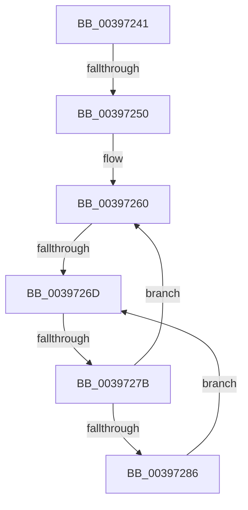

# sub_00397241

- RVA: `0x00397241`–`0x00397288` (길이 `71` bytes)
- VA: `0x0000000140397241`
- 실행 섹션: `.text`
- PDB 이름 있음: `아니요`; PDB Function 태그: `아니요`
- unwind 정보 RVA: `0x000812F4`
- 디코드: `20`개 명령, `71/71` bytes 표시
- 미해석 바이트: `0` (있으면 어셈블리에 `.byte`로 보존)

> 이 문서는 커널 이미지의 기계어와 PDB 기호를 분석해 생성했습니다. 4번과 5번은 함수 원형과 자료형을 바이너리 사용 방식에서 추정한 C 해석이며 원본 소스 복구 결과는 아닙니다.

## 1. Dependencies

- 직접 호출 지점: **0**; 고유 호출 대상: **0**
- 직접 호출자로 확인된 함수: **0**
- RIP 상대 이미지 참조: **1**

### Outgoing calls
- 직접 디코드된 call 명령이 없습니다.

### Direct callers
- 이 함수 시작 RVA로 연결되는 직접 call은 확인되지 않았습니다. 간접 호출은 완전히 역산할 수 없습니다.

### Static image references
- `0x0039726F` → RVA `0x00FC52AC` (`ALMOSTRO`; reference)

## 2. Other-region calls and transfers

- 다른 실행 섹션으로 향하는 call: **0**
- call이 아닌 외부 분기/꼬리 이동: **3**
  - `0x0039724E` → [sub_00397299](Unknown_function_00397299.md) (`tail-transfer`)
  - `0x00397267` → [sub_003970FA + 0x4A](Unknown_function_003970FA.md) (`tail-transfer`)
  - `0x00397275` → [sub_00397301](Unknown_function_00397301.md) (`tail-transfer`)

## 3. Assembly (complete function range)

```asm
00397241  48 89 01                        mov qword ptr [rcx], rax
00397244  48 89 48 08                     mov qword ptr [rax + 8], rcx
00397248  0F B6 47 10                     movzx eax, byte ptr [rdi + 0x10]
0039724C  3C 01                           cmp al, 1
0039724E  75 49                           jne 0x140397299
00397250  44 0F B7 67 12                  movzx r12d, word ptr [rdi + 0x12]
00397255  40 32 ED                        xor bpl, bpl
00397258  48 8B 5F 18                     mov rbx, qword ptr [rdi + 0x18]
0039725C  33 F6                           xor esi, esi
0039725E  66 90                           nop
00397260  F0 48 0F BA 6B 40 00            lock bts qword ptr [rbx + 0x40], 0
00397267  0F 83 D7 FE FF FF               jae 0x140397144
0039726D  FF C6                           inc esi
0039726F  85 35 37 E0 C2 00               test dword ptr [rip + 0xc2e037], esi
00397275  0F 84 86 00 00 00               je 0x140397301
0039727B  F3 90                           pause
0039727D  48 8B 43 40                     mov rax, qword ptr [rbx + 0x40]
00397281  48 85 C0                        test rax, rax
00397284  74 DA                           je 0x140397260
00397286  EB E5                           jmp 0x14039726d
```

## 4. C-style interpretation (structured pseudocode)

```c
__int64 __fastcall sub_00397241(__int64 a1)
{
    __int64 v_rbp;
    __int64 v_rsi;

    *(unsigned __int64 *)(a1) = result;
    *(unsigned __int64 *)(result + 8) = a1;
    v_rbp = 0;
    v_rsi = 0;
loc_00397260:
loc_0039726D:
    v_rsi = (unsigned int)((v_rsi) + 1);
    if (*(unsigned __int64 *)(*(unsigned __int64 *)(v_rdi + 24) + 64) == 0) goto loc_00397260;
    goto loc_0039726D;
}
```

## 5. (Beta) C Style

```c
int64_t sub_00397241(void *Arg1)
{
    uint8_t *arg1 = (uint8_t *)Arg1;

    int64_t local_rbp;
    int64_t local_rsi;

    *(uint64_t *)(arg1) = result;
    *(void **)(result + 0x8) = Arg1;
    local_rbp = 0;
    local_rsi = 0;
loc_00397260:
loc_0039726D:
    local_rsi = (uint32_t)((local_rsi) + 1);
    if (*(uint64_t *)(*(uint64_t *)(local_rdi + 0x18) + 0x40) == 0) goto loc_00397260;
    goto loc_0039726D;
}
```

### 관측된 메모리 오프셋

구조체 형식이 확인되지 않은 접근은 인자 기준의 오프셋으로만 기록했습니다.

| 기준 인자 | 오프셋 표현 | 폭 (bit) | 접근 |
|---|---:|---:|---|
| `Arg1` | `+ 0x0` | `64` | `W` |

## 6. Execution-region graph

[열기: 2D/3D 그래프와 함수 탐색 컨트롤 패널](../../../control-panel.html?section=text&rva=0x00397241&view=graph)

- 2D 그래프는 위에서 아래로 흐르고, 3D 그래프는 빈 공간을 드래그해 회전합니다. Shift+드래그는 이동, 휠은 확대·축소, 함수 노드 선택은 대상 보고서 이동입니다.

### Static fallback


