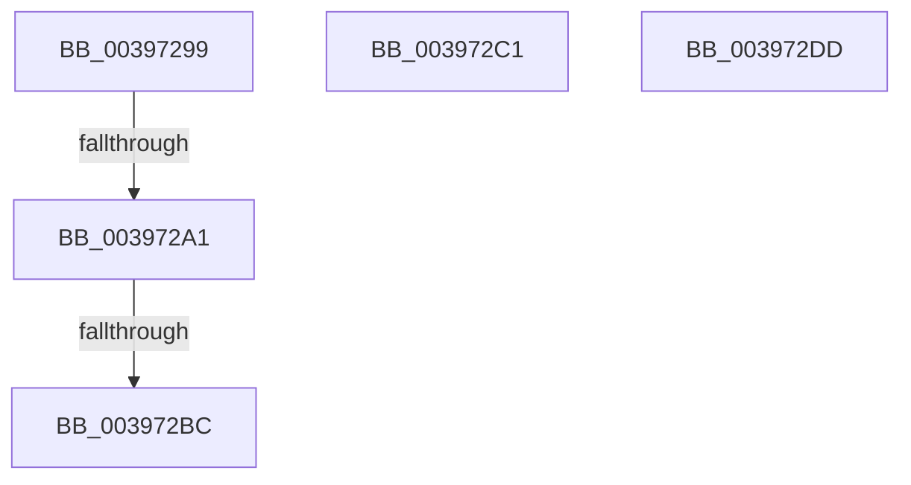

# sub_00397299

- RVA: `0x00397299`–`0x003972E0` (길이 `71` bytes)
- VA: `0x0000000140397299`
- 실행 섹션: `.text`
- PDB 이름 있음: `아니요`; PDB Function 태그: `아니요`
- unwind 정보 RVA: `0x0008131C`
- 디코드: `15`개 명령, `71/71` bytes 표시
- 미해석 바이트: `0` (있으면 어셈블리에 `.byte`로 보존)

> 이 문서는 커널 이미지의 기계어와 PDB 기호를 분석해 생성했습니다. 4번과 5번은 함수 원형과 자료형을 바이너리 사용 방식에서 추정한 C 해석이며 원본 소스 복구 결과는 아닙니다.

## 1. Dependencies

- 직접 호출 지점: **1**; 고유 호출 대상: **1**
- 직접 호출자로 확인된 함수: **0**
- RIP 상대 이미지 참조: **0**

### Outgoing calls
- `0x003972AC` → [KiInsertQueueInternal](../21/KiInsertQueueInternal_function_00219B30.md) (function, `0x00219B30`)

### Direct callers
- 이 함수 시작 RVA로 연결되는 직접 call은 확인되지 않았습니다. 간접 호출은 완전히 역산할 수 없습니다.

### Static image references
- 디코드된 RIP-relative 메모리 참조가 없습니다.

## 2. Other-region calls and transfers

- 다른 실행 섹션으로 향하는 call: **0**
- call이 아닌 외부 분기/꼬리 이동: **4**
  - `0x0039729B` → [sub_0039737C](Unknown_function_0039737C.md) (`tail-transfer`)
  - `0x003972B6` → [sub_003970FA + 0xF0](Unknown_function_003970FA.md) (`tail-transfer`)
  - `0x003972BC` → [sub_003970FA + 0x1E](Unknown_function_003970FA.md) (`tail-transfer`)
  - `0x003972D8` → [sub_003970FA + 0x84](Unknown_function_003970FA.md) (`tail-transfer`)

## 3. Assembly (complete function range)

```asm
00397299  3C 02                           cmp al, 2
0039729B  0F 85 DB 00 00 00               jne 0x14039737c
003972A1  C6 47 11 05                     mov byte ptr [rdi + 0x11], 5
003972A5  48 8B D7                        mov rdx, rdi
003972A8  48 8B 4F 18                     mov rcx, qword ptr [rdi + 0x18]
003972AC  E8 7F 28 E8 FF                  call 0x140219b30
003972B1  41 83 6F 04 01                  sub dword ptr [r15 + 4], 1
003972B6  0F 84 2E FF FF FF               je 0x1403971ea
003972BC  E9 57 FE FF FF                  jmp 0x140397118
003972C1  8B 83 1C 02 00 00               mov eax, dword ptr [rbx + 0x21c]
003972C7  0F B6 C0                        movzx eax, al
003972CA  89 83 1C 02 00 00               mov dword ptr [rbx + 0x21c], eax
003972D0  F0 FF 84 82 18 02 00 00         lock inc dword ptr [rdx + rax*4 + 0x218]
003972D8  E9 A1 FE FF FF                  jmp 0x14039717e
003972DD  0F 1F 00                        nop dword ptr [rax]
```

## 4. C-style interpretation (structured pseudocode)

```c
__int64 __fastcall sub_00397299(void)
{
    __int64 result;

    *(unsigned __int8 *)(v_rdi + 17) = 5;
    result = KiInsertQueueInternal(*(unsigned __int64 *)(v_rdi + 24), v_rdi, a3, a4);
}
```

## 5. (Beta) C Style

```c
void sub_00397299(void)
{
    int64_t result;

    *(uint8_t *)(local_rdi + 0x11) = 5;
    result = KiInsertQueueInternal(*(uint64_t *)(local_rdi + 0x18), local_rdi, a3, a4);
}
```

## 6. Execution-region graph

[열기: 2D/3D 그래프와 함수 탐색 컨트롤 패널](../../../control-panel.html?section=text&rva=0x00397299&view=graph)

- 2D 그래프는 위에서 아래로 흐르고, 3D 그래프는 빈 공간을 드래그해 회전합니다. Shift+드래그는 이동, 휠은 확대·축소, 함수 노드 선택은 대상 보고서 이동입니다.

### Static fallback


