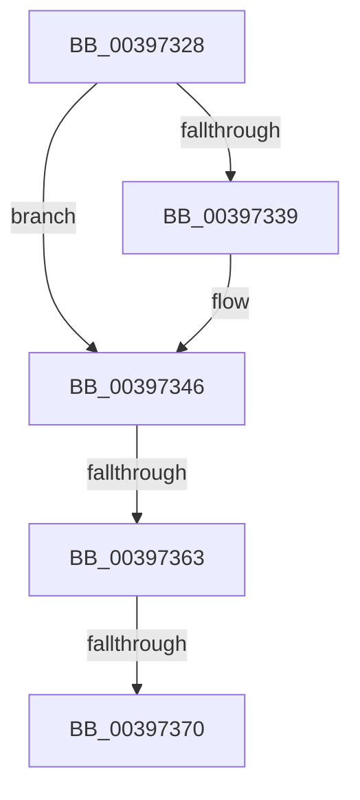

# sub_00397328

- RVA: `0x00397328`–`0x0039737C` (길이 `84` bytes)
- VA: `0x0000000140397328`
- 실행 섹션: `.text`
- PDB 이름 있음: `아니요`; PDB Function 태그: `아니요`
- unwind 정보 RVA: `0x0008135C`
- 디코드: `20`개 명령, `84/84` bytes 표시
- 미해석 바이트: `0` (있으면 어셈블리에 `.byte`로 보존)

> 이 문서는 커널 이미지의 기계어와 PDB 기호를 분석해 생성했습니다. 4번과 5번은 함수 원형과 자료형을 바이너리 사용 방식에서 추정한 C 해석이며 원본 소스 복구 결과는 아닙니다.

## 1. Dependencies

- 직접 호출 지점: **4**; 고유 호출 대상: **4**
- 직접 호출자로 확인된 함수: **0**
- RIP 상대 이미지 참조: **2**

### Outgoing calls
- `0x00397341` → [KiLowerIrqlProcessIrqlFlags](../4F/KiLowerIrqlProcessIrqlFlags_function_004F5698.md) (function, `0x004F5698`)
- `0x00397353` → [RtlRaiseStatus](../2F/RtlRaiseStatus_function_002F6A50.md) (function, `0x002F6A50`)
- `0x00397363` → [KiCheckVpBackingLongSpinWaitHypercall](../30/KiCheckVpBackingLongSpinWaitHypercall_function_0030F490.md) (function, `0x0030F490`)
- `0x00397372` → [HvlNotifyLongSpinWait](../30/HvlNotifyLongSpinWait_function_0030F460.md) (function, `0x0030F460`)

### Direct callers
- 이 함수 시작 RVA로 연결되는 직접 call은 확인되지 않았습니다. 간접 호출은 완전히 역산할 수 없습니다.

### Static image references
- `0x00397330` → RVA `0x00FC6D20` (`ALMOSTRO`; read)
- `0x00397359` → RVA `0x00FC6AB8` (`ALMOSTRO`; read)

## 2. Other-region calls and transfers

- 다른 실행 섹션으로 향하는 call: **0**
- call이 아닌 외부 분기/꼬리 이동: **3**
  - `0x00397361` → [sub_003972E0 + 0xA](Unknown_function_003972E0.md) (`tail-transfer`)
  - `0x0039736A` → [sub_003972E0 + 0xA](Unknown_function_003972E0.md) (`tail-transfer`)
  - `0x00397377` → [sub_003972E0 + 0xC](Unknown_function_003972E0.md) (`tail-transfer`)

## 3. Assembly (complete function range)

```asm
00397328  F0 41 81 27 7F FF FF FF         lock and dword ptr [r15], 0xffffff7f
00397330  83 3D E9 F9 C2 00 00            cmp dword ptr [rip + 0xc2f9e9], 0
00397337  74 0D                           je 0x140397346
00397339  44 0F 20 C1                     mov rcx, cr8
0039733D  41 0F B6 D4                     movzx edx, r12b
00397341  E8 52 E3 15 00                  call 0x1404f5698
00397346  41 0F B6 C4                     movzx eax, r12b
0039734A  44 0F 22 C0                     mov cr8, rax
0039734E  B9 47 00 00 C0                  mov ecx, 0xc0000047
00397353  E8 F8 F6 F5 FF                  call 0x1402f6a50
00397358  CC                              int3
00397359  8B 05 59 F7 C2 00               mov eax, dword ptr [rip + 0xc2f759]
0039735F  A8 40                           test al, 0x40
00397361  74 87                           je 0x1403972ea
00397363  E8 28 81 F7 FF                  call 0x14030f490
00397368  84 C0                           test al, al
0039736A  0F 84 7A FF FF FF               je 0x1403972ea
00397370  8B CB                           mov ecx, ebx
00397372  E8 E9 80 F7 FF                  call 0x14030f460
00397377  E9 70 FF FF FF                  jmp 0x1403972ec
```

## 4. C-style interpretation (structured pseudocode)

```c
__int64 __fastcall sub_00397328(void)
{
    __int64 result;

    if ((*(unsigned int *)(v_rip + 12777961)) != 0) {
        a1 = v_cr8;
        a2 = (unsigned __int8)(v_r12);
        result = KiLowerIrqlProcessIrqlFlags(a1, a2, a3, a4);
    }
    result = RtlRaiseStatus((unsigned int)(0xC0000047ULL), a2, a3, a4);
    result = KiCheckVpBackingLongSpinWaitHypercall((unsigned int)(0xC0000047ULL), a2, a3, a4);
    result = HvlNotifyLongSpinWait((unsigned int)((unsigned int)(v_rbx)), a2, a3, a4);
}
```

## 5. (Beta) C Style

```c
void sub_00397328(void)
{
    int64_t result;

    if ((*(uint32_t *)(v_rip + 0xC2F9E9)) != 0) {
        a1 = v_cr8;
        a2 = (uint8_t)(local_r12);
        result = KiLowerIrqlProcessIrqlFlags(a1, a2, a3, a4);
    }
    result = RtlRaiseStatus((uint32_t)(0xC0000047ULL), a2, a3, a4);
    result = KiCheckVpBackingLongSpinWaitHypercall((uint32_t)(0xC0000047ULL), a2, a3, a4);
    result = HvlNotifyLongSpinWait((uint32_t)((uint32_t)(local_rbx)), a2, a3, a4);
}
```

## 6. Execution-region graph

[열기: 2D/3D 그래프와 함수 탐색 컨트롤 패널](../../../control-panel.html?section=text&rva=0x00397328&view=graph)

- 2D 그래프는 위에서 아래로 흐르고, 3D 그래프는 빈 공간을 드래그해 회전합니다. Shift+드래그는 이동, 휠은 확대·축소, 함수 노드 선택은 대상 보고서 이동입니다.

### Static fallback


