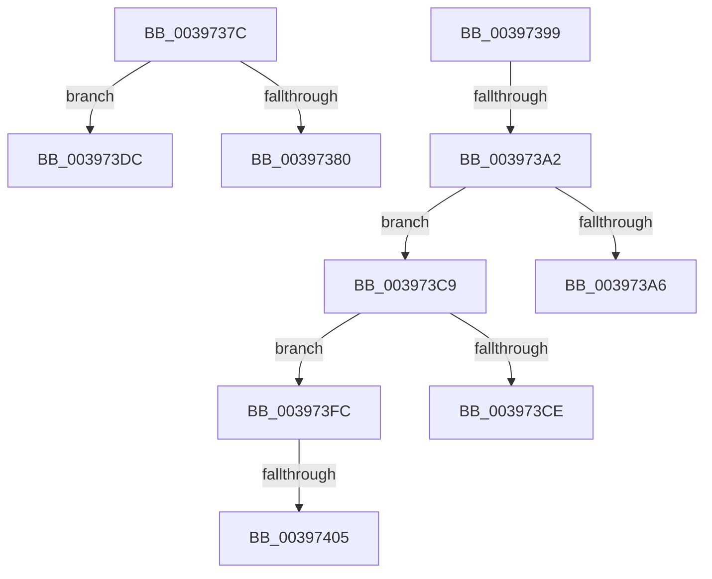

# sub_0039737C

- RVA: `0x0039737C`–`0x0039740E` (길이 `146` bytes)
- VA: `0x000000014039737C`
- 실행 섹션: `.text`
- PDB 이름 있음: `아니요`; PDB Function 태그: `아니요`
- unwind 정보 RVA: `0x0008136C`
- 디코드: `36`개 명령, `146/146` bytes 표시
- 미해석 바이트: `0` (있으면 어셈블리에 `.byte`로 보존)

> 이 문서는 커널 이미지의 기계어와 PDB 기호를 분석해 생성했습니다. 4번과 5번은 함수 원형과 자료형을 바이너리 사용 방식에서 추정한 C 해석이며 원본 소스 복구 결과는 아닙니다.

## 1. Dependencies

- 직접 호출 지점: **2**; 고유 호출 대상: **2**
- 직접 호출자로 확인된 함수: **0**
- RIP 상대 이미지 참조: **0**

### Outgoing calls
- `0x0039738F` → [KiTryUnwaitThread](../35/KiTryUnwaitThread_function_003506D0.md) (function, `0x003506D0`)
- `0x003973F2` → [KeInsertQueueDpc](../20/KeInsertQueueDpc_function_00207C50.md) (function, `0x00207C50`)

### Direct callers
- 이 함수 시작 RVA로 연결되는 직접 call은 확인되지 않았습니다. 간접 호출은 완전히 역산할 수 없습니다.

### Static image references
- 디코드된 RIP-relative 메모리 참조가 없습니다.

## 2. Other-region calls and transfers

- 다른 실행 섹션으로 향하는 call: **0**
- call이 아닌 외부 분기/꼬리 이동: **7**
  - `0x00397394` → [sub_003970FA + 0x1E](Unknown_function_003970FA.md) (`tail-transfer`)
  - `0x0039739C` → [sub_003970FA + 0x67](Unknown_function_003970FA.md) (`tail-transfer`)
  - `0x003973C4` → [sub_003970FA + 0xC3](Unknown_function_003970FA.md) (`tail-transfer`)
  - `0x003973D7` → [sub_003970FA + 0xC6](Unknown_function_003970FA.md) (`tail-transfer`)
  - `0x003973F7` → [sub_003970FA + 0x1E](Unknown_function_003970FA.md) (`tail-transfer`)
  - `0x003973FF` → [sub_003970FA + 0xC6](Unknown_function_003970FA.md) (`tail-transfer`)
  - `0x00397409` → [sub_003970FA + 0xC6](Unknown_function_003970FA.md) (`tail-transfer`)

## 3. Assembly (complete function range)

```asm
0039737C  3C 04                           cmp al, 4
0039737E  74 5C                           je 0x1403973dc
00397380  45 33 C9                        xor r9d, r9d
00397383  41 B8 00 01 00 00               mov r8d, 0x100
00397389  48 8B D7                        mov rdx, rdi
0039738C  48 8B CE                        mov rcx, rsi
0039738F  E8 3C 93 FB FF                  call 0x1403506d0
00397394  E9 7F FD FF FF                  jmp 0x140397118
00397399  83 F8 04                        cmp eax, 4
0039739C  0F 84 BF FD FF FF               je 0x140397161
003973A2  85 C0                           test eax, eax
003973A4  75 23                           jne 0x1403973c9
003973A6  80 E1 FA                        and cl, 0xfa
003973A9  80 C9 02                        or cl, 2
003973AC  88 4B 70                        mov byte ptr [rbx + 0x70], cl
003973AF  4C 89 A3 C8 00 00 00            mov qword ptr [rbx + 0xc8], r12
003973B6  48 C7 83 D0 03 00 00 00 00 00 00  mov qword ptr [rbx + 0x3d0], 0
003973C1  88 47 11                        mov byte ptr [rdi + 0x11], al
003973C4  E9 F4 FD FF FF                  jmp 0x1403971bd
003973C9  83 F8 05                        cmp eax, 5
003973CC  75 2E                           jne 0x1403973fc
003973CE  80 E1 FE                        and cl, 0xfe
003973D1  80 C9 06                        or cl, 6
003973D4  88 4B 70                        mov byte ptr [rbx + 0x70], cl
003973D7  E9 E4 FD FF FF                  jmp 0x1403971c0
003973DC  C6 47 11 05                     mov byte ptr [rdi + 0x11], 5
003973E0  4C 8B C7                        mov r8, rdi
003973E3  41 C7 47 04 00 00 00 00         mov dword ptr [r15 + 4], 0
003973EB  49 8B D7                        mov rdx, r15
003973EE  48 8B 4F 18                     mov rcx, qword ptr [rdi + 0x18]
003973F2  E8 59 08 E7 FF                  call 0x140207c50
003973F7  E9 1C FD FF FF                  jmp 0x140397118
003973FC  83 F8 03                        cmp eax, 3
003973FF  0F 85 BB FD FF FF               jne 0x1403971c0
00397405  C6 47 11 02                     mov byte ptr [rdi + 0x11], 2
00397409  E9 B2 FD FF FF                  jmp 0x1403971c0
```

## 4. C-style interpretation (structured pseudocode)

```c
__int64 __fastcall sub_0039737C(__int64 a1, __int64 a2, __int64 a3, int a4)
{
    __int64 result;

    if (((unsigned __int8)(result)) == 4) goto loc_003973DC;
    a4 = 0;
    result = KiTryUnwaitThread(v_rsi, v_rdi, 256, a4);
loc_003973DC:
    *(unsigned __int8 *)(v_rdi + 17) = 5;
    *(unsigned int *)(v_r15 + 4) = 0;
    result = KeInsertQueueDpc(*(unsigned __int64 *)(v_rdi + 24), v_r15, v_rdi, a4);
}
```

## 5. (Beta) C Style

```c
int64_t sub_0039737C(int64_t Arg1, int64_t Arg2, int64_t Arg3, int32_t Arg4)
{
    int64_t result;

    if (((uint8_t)(result)) == 4) goto loc_003973DC;
    Arg4 = 0;
    result = KiTryUnwaitThread(local_rsi, local_rdi, 256, Arg4);
loc_003973DC:
    *(uint8_t *)(local_rdi + 0x11) = 5;
    *(uint32_t *)(local_r15 + 0x4) = 0;
    result = KeInsertQueueDpc(*(uint64_t *)(local_rdi + 0x18), local_r15, local_rdi, Arg4);
}
```

## 6. Execution-region graph

[열기: 2D/3D 그래프와 함수 탐색 컨트롤 패널](../../../control-panel.html?section=text&rva=0x0039737C&view=graph)

- 2D 그래프는 위에서 아래로 흐르고, 3D 그래프는 빈 공간을 드래그해 회전합니다. Shift+드래그는 이동, 휠은 확대·축소, 함수 노드 선택은 대상 보고서 이동입니다.

### Static fallback


