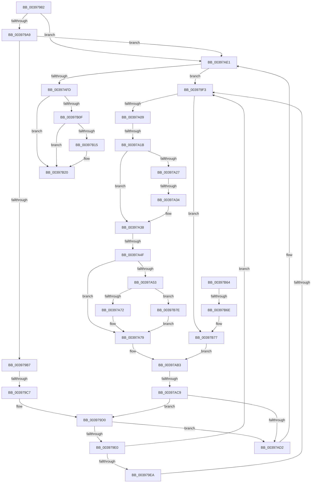

# sub_00397982

- RVA: `0x00397982`–`0x00397B8A` (길이 `520` bytes)
- VA: `0x0000000140397982`
- 실행 섹션: `.text`
- PDB 이름 있음: `아니요`; PDB Function 태그: `아니요`
- unwind 정보 RVA: `0x000813B8`
- 디코드: `124`개 명령, `520/520` bytes 표시
- 미해석 바이트: `0` (있으면 어셈블리에 `.byte`로 보존)

> 이 문서는 커널 이미지의 기계어와 PDB 기호를 분석해 생성했습니다. 4번과 5번은 함수 원형과 자료형을 바이너리 사용 방식에서 추정한 C 해석이며 원본 소스 복구 결과는 아닙니다.

## 1. Dependencies

- 직접 호출 지점: **4**; 고유 호출 대상: **4**
- 직접 호출자로 확인된 함수: **0**
- RIP 상대 이미지 참조: **0**

### Outgoing calls
- `0x0039798F` → [KiAcquireKobjectLockSafe](../25/KiAcquireKobjectLockSafe_function_00251C90.md) (function, `0x00251C90`)
- `0x00397A3B` → [KiRemovePrcbWaitEntry](../25/KiRemovePrcbWaitEntry_function_002502D0.md) (function, `0x002502D0`)
- `0x00397B1B` → [KiWakeOtherQueueWaiters](KiWakeOtherQueueWaiters_function_003964D0.md) (function, `0x003964D0`)
- `0x00397B40` → [KiExitDispatcher](../25/KiExitDispatcher_function_00251CF0.md) (function, `0x00251CF0`)

### Direct callers
- 이 함수 시작 RVA로 연결되는 직접 call은 확인되지 않았습니다. 간접 호출은 완전히 역산할 수 없습니다.

### Static image references
- 디코드된 RIP-relative 메모리 참조가 없습니다.

## 2. Other-region calls and transfers

- 다른 실행 섹션으로 향하는 call: **0**
- call이 아닌 외부 분기/꼬리 이동: **7**
  - `0x003979C1` → [sub_00397C4F + 0x9](Unknown_function_00397C4F.md) (`tail-transfer`)
  - `0x003979ED` → [sub_00397B9E](Unknown_function_00397B9E.md) (`tail-transfer`)
  - `0x00397A15` → [sub_00397C4F + 0x1B](Unknown_function_00397C4F.md) (`tail-transfer`)
  - `0x00397A2E` → [sub_00397B9E + 0x36](Unknown_function_00397B9E.md) (`tail-transfer`)
  - `0x00397A49` → [sub_00397C4F](Unknown_function_00397C4F.md) (`tail-transfer`)
  - `0x00397AC3` → [sub_00397C00](Unknown_function_00397C00.md) (`tail-transfer`)
  - `0x00397B68` → [sub_00397C4F + 0x58](Unknown_function_00397C4F.md) (`tail-transfer`)

## 3. Assembly (complete function range)

```asm
00397982  48 89 6C 24 40                  mov qword ptr [rsp + 0x40], rbp
00397987  49 8B CE                        mov rcx, r14
0039798A  4C 89 7C 24 38                  mov qword ptr [rsp + 0x38], r15
0039798F  E8 FC A2 EB FF                  call 0x140251c90
00397994  41 8B 46 04                     mov eax, dword ptr [r14 + 4]
00397998  89 84 24 98 00 00 00            mov dword ptr [rsp + 0x98], eax
0039799F  4D 39 24 24                     cmp qword ptr [r12], r12
003979A3  0F 84 38 01 00 00               je 0x140397ae1
003979A9  41 8B 46 28                     mov eax, dword ptr [r14 + 0x28]
003979AD  41 3B 46 2C                     cmp eax, dword ptr [r14 + 0x2c]
003979B1  0F 83 2A 01 00 00               jae 0x140397ae1
003979B7  48 8B 83 E8 00 00 00            mov rax, qword ptr [rbx + 0xe8]
003979BE  49 3B C6                        cmp rax, r14
003979C1  0F 84 91 02 00 00               je 0x140397c58
003979C7  49 8B 34 24                     mov rsi, qword ptr [r12]
003979CB  33 D2                           xor edx, edx
003979CD  0F 1F 00                        nop dword ptr [rax]
003979D0  48 8B FE                        mov rdi, rsi
003979D3  48 8B 36                        mov rsi, qword ptr [rsi]
003979D6  80 7F 10 03                     cmp byte ptr [rdi + 0x10], 3
003979DA  0F 85 F2 00 00 00               jne 0x140397ad2
003979E0  48 8B 47 08                     mov rax, qword ptr [rdi + 8]
003979E4  48 39 7E 08                     cmp qword ptr [rsi + 8], rdi
003979E8  75 09                           jne 0x1403979f3
003979EA  48 39 38                        cmp qword ptr [rax], rdi
003979ED  0F 84 AB 01 00 00               je 0x140397b9e
003979F3  B9 03 00 00 00                  mov ecx, 3
003979F8  CD 29                           int 0x29
003979FA  0F B6 83 84 01 00 00            movzx eax, byte ptr [rbx + 0x184]
00397A01  3C 05                           cmp al, 5
00397A03  0F 85 6E 01 00 00               jne 0x140397b77
00397A09  0F B6 4B 70                     movzx ecx, byte ptr [rbx + 0x70]
00397A0D  8B C1                           mov eax, ecx
00397A0F  83 E0 07                        and eax, 7
00397A12  83 F8 01                        cmp eax, 1
00397A15  0F 85 4F 02 00 00               jne 0x140397c6a
00397A1B  48 8B 93 E8 00 00 00            mov rdx, qword ptr [rbx + 0xe8]
00397A22  48 85 D2                        test rdx, rdx
00397A25  74 11                           je 0x140397a38
00397A27  0F B6 02                        movzx eax, byte ptr [rdx]
00397A2A  24 7F                           and al, 0x7f
00397A2C  3C 15                           cmp al, 0x15
00397A2E  0F 84 A0 01 00 00               je 0x140397bd4
00397A34  F0 FF 42 28                     lock inc dword ptr [rdx + 0x28]
00397A38  48 8B CB                        mov rcx, rbx
00397A3B  E8 90 88 EB FF                  call 0x1402502d0
00397A40  0F B6 83 84 01 00 00            movzx eax, byte ptr [rbx + 0x184]
00397A47  3C 01                           cmp al, 1
00397A49  0F 84 00 02 00 00               je 0x140397c4f
00397A4F  3C 05                           cmp al, 5
00397A51  75 26                           jne 0x140397a79
00397A53  48 B8 20 03 00 00 80 F7 FF FF   movabs rax, 0xfffff78000000320
00397A5D  8B 08                           mov ecx, dword ptr [rax]
00397A5F  2B 8B B4 01 00 00               sub ecx, dword ptr [rbx + 0x1b4]
00397A65  44 38 BB 87 01 00 00            cmp byte ptr [rbx + 0x187], r15b
00397A6C  0F 84 0C 01 00 00               je 0x140397b7e
00397A72  48 01 8B E8 03 00 00            add qword ptr [rbx + 0x3e8], rcx
00397A79  C6 83 84 01 00 00 07            mov byte ptr [rbx + 0x184], 7
00397A80  48 8D 8B D8 00 00 00            lea rcx, [rbx + 0xd8]
00397A87  49 8B 85 08 2D 00 00            mov rax, qword ptr [r13 + 0x2d08]
00397A8E  33 D2                           xor edx, edx
00397A90  48 89 01                        mov qword ptr [rcx], rax
00397A93  41 B7 01                        mov r15b, 1
00397A96  48 8B 84 24 88 00 00 00         mov rax, qword ptr [rsp + 0x88]
00397A9E  49 89 8D 08 2D 00 00            mov qword ptr [r13 + 0x2d08], rcx
00397AA5  48 89 83 C8 00 00 00            mov qword ptr [rbx + 0xc8], rax
00397AAC  48 89 93 D0 03 00 00            mov qword ptr [rbx + 0x3d0], rdx
00397AB3  48 89 53 40                     mov qword ptr [rbx + 0x40], rdx
00397AB7  0F B6 47 11                     movzx eax, byte ptr [rdi + 0x11]
00397ABB  FE C0                           inc al
00397ABD  88 47 11                        mov byte ptr [rdi + 0x11], al
00397AC0  45 84 FF                        test r15b, r15b
00397AC3  0F 85 37 01 00 00               jne 0x140397c00
00397AC9  49 3B F4                        cmp rsi, r12
00397ACC  0F 85 FE FE FF FF               jne 0x1403979d0
00397AD2  48 8B B4 24 88 00 00 00         mov rsi, qword ptr [rsp + 0x88]
00397ADA  8B BC 24 90 00 00 00            mov edi, dword ptr [rsp + 0x90]
00397AE1  41 8B 56 04                     mov edx, dword ptr [r14 + 4]
00397AE5  8D 42 01                        lea eax, [rdx + 1]
00397AE8  41 89 46 04                     mov dword ptr [r14 + 4], eax
00397AEC  49 8D 46 18                     lea rax, [r14 + 0x18]
00397AF0  48 8B 48 08                     mov rcx, qword ptr [rax + 8]
00397AF4  48 39 01                        cmp qword ptr [rcx], rax
00397AF7  0F 85 F6 FE FF FF               jne 0x1403979f3
00397AFD  48 89 06                        mov qword ptr [rsi], rax
00397B00  48 89 4E 08                     mov qword ptr [rsi + 8], rcx
00397B04  48 89 31                        mov qword ptr [rcx], rsi
00397B07  48 89 70 08                     mov qword ptr [rax + 8], rsi
00397B0B  85 D2                           test edx, edx
00397B0D  75 11                           jne 0x140397b20
00397B0F  4D 39 24 24                     cmp qword ptr [r12], r12
00397B13  74 0B                           je 0x140397b20
00397B15  49 8B D6                        mov rdx, r14
00397B18  49 8B CD                        mov rcx, r13
00397B1B  E8 B0 E9 FF FF                  call 0x1403964d0
00397B20  F0 41 81 26 7F FF FF FF         lock and dword ptr [r14], 0xffffff7f
00397B28  48 8B 84 24 80 00 00 00         mov rax, qword ptr [rsp + 0x80]
00397B30  33 D2                           xor edx, edx
00397B32  44 8B CF                        mov r9d, edi
00397B35  88 44 24 20                     mov byte ptr [rsp + 0x20], al
00397B39  49 8B CD                        mov rcx, r13
00397B3C  44 8D 42 01                     lea r8d, [rdx + 1]
00397B40  E8 AB A1 EB FF                  call 0x140251cf0
00397B45  8B 84 24 98 00 00 00            mov eax, dword ptr [rsp + 0x98]
00397B4C  4C 8B 7C 24 38                  mov r15, qword ptr [rsp + 0x38]
00397B51  48 8B 6C 24 40                  mov rbp, qword ptr [rsp + 0x40]
00397B56  48 83 C4 48                     add rsp, 0x48
00397B5A  41 5E                           pop r14
00397B5C  41 5D                           pop r13
00397B5E  41 5C                           pop r12
00397B60  5F                              pop rdi
00397B61  5E                              pop rsi
00397B62  5B                              pop rbx
00397B63  C3                              ret
00397B64  CC                              int3
00397B65  83 F8 05                        cmp eax, 5
00397B68  0F 85 39 01 00 00               jne 0x140397ca7
00397B6E  80 E1 FE                        and cl, 0xfe
00397B71  80 C9 06                        or cl, 6
00397B74  88 4B 70                        mov byte ptr [rbx + 0x70], cl
00397B77  33 D2                           xor edx, edx
00397B79  E9 35 FF FF FF                  jmp 0x140397ab3
00397B7E  48 01 8B E0 03 00 00            add qword ptr [rbx + 0x3e0], rcx
00397B85  E9 EF FE FF FF                  jmp 0x140397a79
```

## 4. C-style interpretation (structured pseudocode)

```c
__int64 __fastcall sub_00397982(__int64 a1, int a2, __int64 a3, __int64 a4, __int64 a5, __int64 a6, __int64 a7, __int64 a8, __int64 a9, __int64 a10, __int64 a11, __int64 a12, __int64 a13, __int64 a14, __int64 a15, __int64 a16, __int64 a17, unsigned int a18, unsigned int a19)
{
    __int64 result;
    __int64 v_rsp;
    unsigned __int8 v_stack_p20;
    unsigned __int64 v_stack_p38;
    unsigned __int64 v_stack_p40;
    unsigned int v_stack_p98;

    v_stack_p40 = v_rbp;
    v_stack_p38 = v_r15;
    result = KiAcquireKobjectLockSafe(v_r14, a2, a3, a4);
    v_stack_p98 = (unsigned int)((unsigned int)(*(unsigned int *)(v_r14 + 4)));
    if ((*(unsigned __int64 *)(v_r12)) == v_r12) goto loc_00397AE1;
    if (((unsigned int)((unsigned int)(*(unsigned int *)(v_r14 + 40)))) >= (*(unsigned int *)(v_r14 + 44))) goto loc_00397AE1;
    a2 = 0;
loc_003979D0:
    if ((*(unsigned __int8 *)(*(unsigned __int64 *)(v_r12) + 16)) != 3) goto loc_00397AD2;
    if ((*(unsigned __int64 *)(*(unsigned __int64 *)(*(unsigned __int64 *)(v_r12)) + 8)) != (*(unsigned __int64 *)(v_r12))) goto loc_003979F3;
loc_003979F3:
    if (((unsigned __int8)(*(unsigned __int8 *)(v_rbx + 388))) != 5) goto loc_00397B77;
    result = (unsigned int)(((unsigned int)((unsigned int)(*(unsigned __int8 *)(v_rbx + 112)))) & (7));
    if (*(unsigned __int64 *)(v_rbx + 232) == 0) goto loc_00397A38;
    result = (unsigned __int8)((*(unsigned __int8 *)(*(unsigned __int64 *)(v_rbx + 232))) & (127));
loc_00397A38:
    result = KiRemovePrcbWaitEntry(v_rbx, *(unsigned __int64 *)(v_rbx + 232), a3, a4);
    if (((unsigned __int8)(*(unsigned __int8 *)(v_rbx + 388))) != 5) goto loc_00397A79;
    a1 = (unsigned int)(((unsigned int)(*(unsigned int *)(*(unsigned __int8 *)(v_rbx + 388)))) - (*(unsigned int *)(v_rbx + 436)));
    if ((*(unsigned __int8 *)(v_rbx + 391)) == ((unsigned __int8)(v_r15))) goto loc_00397B7E;
loc_00397A79:
    *(unsigned __int8 *)(v_rbx + 388) = 7;
    a2 = 0;
    *(unsigned __int64 *)(v_rbx + 216) = *(unsigned __int64 *)(v_r13 + 11528);
    *(unsigned __int64 *)(v_r13 + 11528) = v_rbx + 216;
    *(unsigned __int64 *)(v_rbx + 200) = a17;
    *(unsigned __int64 *)(v_rbx + 976) = 0;
loc_00397AB3:
    *(unsigned __int64 *)(v_rbx + 64) = 0;
    result = (unsigned __int8)((*(unsigned __int8 *)(*(unsigned __int64 *)(v_r12) + 17)) + 1);
    *(unsigned __int8 *)(*(unsigned __int64 *)(v_r12) + 17) = (unsigned __int8)(result);
    if ((*(unsigned __int64 *)(*(unsigned __int64 *)(v_r12))) != v_r12) goto loc_003979D0;
loc_00397AD2:
loc_00397AE1:
    *(unsigned int *)(v_r14 + 4) = (unsigned int)((unsigned int)(*(unsigned int *)(v_r14 + 4)) + 1);
    if ((*(unsigned __int64 *)(*(unsigned __int64 *)(v_r14 + 24 + 8))) != (v_r14 + 24)) goto loc_003979F3;
    *(unsigned __int64 *)(a17) = v_r14 + 24;
    *(unsigned __int64 *)(a17 + 8) = *(unsigned __int64 *)(v_r14 + 24 + 8);
    *(unsigned __int64 *)(*(unsigned __int64 *)(v_r14 + 24 + 8)) = a17;
    *(unsigned __int64 *)(v_r14 + 24 + 8) = a17;
    if ((unsigned int)((unsigned int)(*(unsigned int *)(v_r14 + 4))) != 0) goto loc_00397B20;
    result = v_r14 + 24;
    if ((*(unsigned __int64 *)(v_r12)) != v_r12) {
        a2 = v_r14;
        a1 = v_r13;
        result = KiWakeOtherQueueWaiters(a1, a2, a3, a4);
    }
    a2 = 0;
    v_stack_p20 = (unsigned __int8)(a16);
    result = KiExitDispatcher(v_r13, a2, a2 + 1, (unsigned int)((unsigned int)((unsigned int)(a18))));
    v_rsp = (v_rsp) + (72);
    return (unsigned int)(a19);
loc_00397B77:
    a2 = 0;
    goto loc_00397AB3;
loc_00397B7E:
    goto loc_00397A79;
}
```

## 5. (Beta) C Style

```c
int64_t sub_00397982(int64_t Arg1, int32_t Arg2, int64_t Arg3, int64_t Arg4, uint64_t Arg5, uint64_t Arg6, int64_t Arg7, int64_t Arg8, uint64_t Arg9, uint64_t Arg10, uint64_t Arg11, uint64_t Arg12, uint64_t Arg13, uint64_t Arg14, uint64_t Arg15, int64_t Arg16, int64_t Arg17, uint32_t Arg18, uint32_t Arg19)
{
    int64_t result;
    int64_t local_rsp;
    uint8_t v_stack_p20;
    uint64_t v_stack_p38;
    uint64_t v_stack_p40;
    uint32_t v_stack_p98;

    v_stack_p40 = local_rbp;
    v_stack_p38 = local_r15;
    result = KiAcquireKobjectLockSafe(local_r14, Arg2, Arg3, Arg4);
    v_stack_p98 = (uint32_t)((uint32_t)(*(uint32_t *)(local_r14 + 0x4)));
    if ((*(uint64_t *)(local_r12)) == local_r12) goto loc_00397AE1;
    if (((uint32_t)((uint32_t)(*(uint32_t *)(local_r14 + 0x28)))) >= (*(uint32_t *)(local_r14 + 0x2C))) goto loc_00397AE1;
    Arg2 = 0;
loc_003979D0:
    if ((*(uint8_t *)(*(uint64_t *)(local_r12) + 0x10)) != 3) goto loc_00397AD2;
    if ((*(uint64_t *)(*(uint64_t *)(*(uint64_t *)(local_r12)) + 0x8)) != (*(uint64_t *)(local_r12))) goto loc_003979F3;
loc_003979F3:
    if (((uint8_t)(*(uint8_t *)(local_rbx + 0x184))) != 5) goto loc_00397B77;
    result = (uint32_t)(((uint32_t)((uint32_t)(*(uint8_t *)(local_rbx + 0x70)))) & (7));
    if (*(uint64_t *)(local_rbx + 0xE8) == 0) goto loc_00397A38;
    result = (uint8_t)((*(uint8_t *)(*(uint64_t *)(local_rbx + 0xE8))) & (127));
loc_00397A38:
    result = KiRemovePrcbWaitEntry(local_rbx, *(uint64_t *)(local_rbx + 0xE8), Arg3, Arg4);
    if (((uint8_t)(*(uint8_t *)(local_rbx + 0x184))) != 5) goto loc_00397A79;
    Arg1 = (uint32_t)(((uint32_t)(*(uint32_t *)(*(uint8_t *)(local_rbx + 0x184)))) - (*(uint32_t *)(local_rbx + 0x1B4)));
    if ((*(uint8_t *)(local_rbx + 0x187)) == ((uint8_t)(local_r15))) goto loc_00397B7E;
loc_00397A79:
    *(uint8_t *)(local_rbx + 0x184) = 7;
    Arg2 = 0;
    *(uint64_t *)(local_rbx + 0xD8) = *(uint64_t *)(local_r13 + 0x2D08);
    *(uint64_t *)(local_r13 + 0x2D08) = local_rbx + 216;
    *(uint64_t *)(local_rbx + 0xC8) = Arg17;
    *(uint64_t *)(local_rbx + 0x3D0) = 0;
loc_00397AB3:
    *(uint64_t *)(local_rbx + 0x40) = 0;
    result = (uint8_t)((*(uint8_t *)(*(uint64_t *)(local_r12) + 0x11)) + 1);
    *(uint8_t *)(*(uint64_t *)(local_r12) + 0x11) = (uint8_t)(result);
    if ((*(uint64_t *)(*(uint64_t *)(local_r12))) != local_r12) goto loc_003979D0;
loc_00397AD2:
loc_00397AE1:
    *(uint32_t *)(local_r14 + 0x4) = (uint32_t)((uint32_t)(*(uint32_t *)(local_r14 + 0x4)) + 1);
    if ((*(uint64_t *)(*(uint64_t *)(local_r14 + 0x18 + 0x8))) != (local_r14 + 24)) goto loc_003979F3;
    *(uint64_t *)(Arg17) = local_r14 + 24;
    *(uint64_t *)(Arg17 + 0x8) = *(uint64_t *)(local_r14 + 0x18 + 0x8);
    *(uint64_t *)(*(uint64_t *)(local_r14 + 0x18 + 0x8)) = Arg17;
    *(uint64_t *)(local_r14 + 0x18 + 0x8) = Arg17;
    if ((uint32_t)((uint32_t)(*(uint32_t *)(local_r14 + 0x4))) != 0) goto loc_00397B20;
    result = local_r14 + 24;
    if ((*(uint64_t *)(local_r12)) != local_r12) {
        Arg2 = local_r14;
        Arg1 = local_r13;
        result = KiWakeOtherQueueWaiters(Arg1, Arg2, Arg3, Arg4);
    }
    Arg2 = 0;
    v_stack_p20 = (uint8_t)(Arg16);
    result = KiExitDispatcher(local_r13, Arg2, Arg2 + 1, (uint32_t)((uint32_t)((uint32_t)(Arg18))));
    local_rsp = (local_rsp) + (72);
    return (uint32_t)(Arg19);
loc_00397B77:
    Arg2 = 0;
    goto loc_00397AB3;
loc_00397B7E:
    goto loc_00397A79;
}
```

## 6. Execution-region graph

[열기: 2D/3D 그래프와 함수 탐색 컨트롤 패널](../../../control-panel.html?section=text&rva=0x00397982&view=graph)

- 2D 그래프는 위에서 아래로 흐르고, 3D 그래프는 빈 공간을 드래그해 회전합니다. Shift+드래그는 이동, 휠은 확대·축소, 함수 노드 선택은 대상 보고서 이동입니다.

### Static fallback


