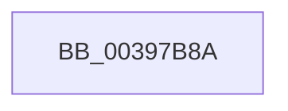

# sub_00397B8A

- RVA: `0x00397B8A`–`0x00397B9E` (길이 `20` bytes)
- VA: `0x0000000140397B8A`
- 실행 섹션: `.text`
- PDB 이름 있음: `아니요`; PDB Function 태그: `아니요`
- unwind 정보 RVA: `0x000813D4`
- 디코드: `4`개 명령, `20/20` bytes 표시
- 미해석 바이트: `0` (있으면 어셈블리에 `.byte`로 보존)

> 이 문서는 커널 이미지의 기계어와 PDB 기호를 분석해 생성했습니다. 4번과 5번은 함수 원형과 자료형을 바이너리 사용 방식에서 추정한 C 해석이며 원본 소스 복구 결과는 아닙니다.

## 1. Dependencies

- 직접 호출 지점: **0**; 고유 호출 대상: **0**
- 직접 호출자로 확인된 함수: **0**
- RIP 상대 이미지 참조: **0**

### Outgoing calls
- 직접 디코드된 call 명령이 없습니다.

### Direct callers
- 이 함수 시작 RVA로 연결되는 직접 call은 확인되지 않았습니다. 간접 호출은 완전히 역산할 수 없습니다.

### Static image references
- 디코드된 RIP-relative 메모리 참조가 없습니다.

## 2. Other-region calls and transfers

- 다른 실행 섹션으로 향하는 call: **0**
- call이 아닌 외부 분기/꼬리 이동: **1**
  - `0x00397B99` → [sub_00397982](Unknown_function_00397982.md) (`tail-transfer`)

## 3. Assembly (complete function range)

```asm
00397B8A  41 F6 46 01 02                  test byte ptr [r14 + 1], 2
00397B8F  0F 45 F9                        cmovne edi, ecx
00397B92  89 BC 24 90 00 00 00            mov dword ptr [rsp + 0x90], edi
00397B99  E9 E4 FD FF FF                  jmp 0x140397982
```

## 4. C-style interpretation (structured pseudocode)

```c
void __fastcall sub_00397B8A(int a1)
{
    __int64 v_rdi;
    unsigned int v_stack_p90;

    if (((*(unsigned __int8 *)(v_r14 + 1)) & (2)) != 0) { v_rdi = a1; }
    v_stack_p90 = (unsigned int)(v_rdi);
}
```

## 5. (Beta) C Style

```c
void sub_00397B8A(int32_t Arg1)
{
    int64_t local_rdi;
    uint32_t v_stack_p90;

    if (((*(uint8_t *)(local_r14 + 0x1)) & (2)) != 0) { local_rdi = Arg1; }
    v_stack_p90 = (uint32_t)(local_rdi);
}
```

## 6. Execution-region graph

[열기: 2D/3D 그래프와 함수 탐색 컨트롤 패널](../../../control-panel.html?section=text&rva=0x00397B8A&view=graph)

- 2D 그래프는 위에서 아래로 흐르고, 3D 그래프는 빈 공간을 드래그해 회전합니다. Shift+드래그는 이동, 휠은 확대·축소, 함수 노드 선택은 대상 보고서 이동입니다.

### Static fallback


