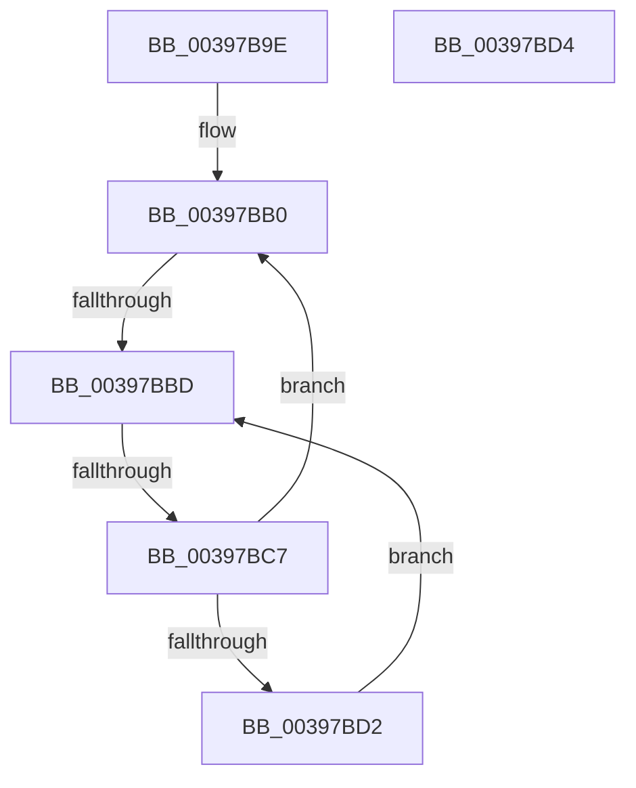

# sub_00397B9E

- RVA: `0x00397B9E`–`0x00397BF0` (길이 `82` bytes)
- VA: `0x0000000140397B9E`
- 실행 섹션: `.text`
- PDB 이름 있음: `아니요`; PDB Function 태그: `아니요`
- unwind 정보 RVA: `0x000813E4`
- 디코드: `21`개 명령, `82/82` bytes 표시
- 미해석 바이트: `0` (있으면 어셈블리에 `.byte`로 보존)

> 이 문서는 커널 이미지의 기계어와 PDB 기호를 분석해 생성했습니다. 4번과 5번은 함수 원형과 자료형을 바이너리 사용 방식에서 추정한 C 해석이며 원본 소스 복구 결과는 아닙니다.

## 1. Dependencies

- 직접 호출 지점: **0**; 고유 호출 대상: **0**
- 직접 호출자로 확인된 함수: **0**
- RIP 상대 이미지 참조: **1**

### Outgoing calls
- 직접 디코드된 call 명령이 없습니다.

### Direct callers
- 이 함수 시작 RVA로 연결되는 직접 call은 확인되지 않았습니다. 간접 호출은 완전히 역산할 수 없습니다.

### Static image references
- `0x00397BBF` → RVA `0x00FC52AC` (`ALMOSTRO`; reference)

## 2. Other-region calls and transfers

- 다른 실행 섹션으로 향하는 call: **0**
- call이 아닌 외부 분기/꼬리 이동: **3**
  - `0x00397BB7` → [sub_00397982 + 0x78](Unknown_function_00397982.md) (`tail-transfer`)
  - `0x00397BC5` → [sub_00397C00 + 0x17](Unknown_function_00397C00.md) (`tail-transfer`)
  - `0x00397BEB` → [sub_00397982 + 0xB6](Unknown_function_00397982.md) (`tail-transfer`)

## 3. Assembly (complete function range)

```asm
00397B9E  48 89 30                        mov qword ptr [rax], rsi
00397BA1  45 32 FF                        xor r15b, r15b
00397BA4  48 89 46 08                     mov qword ptr [rsi + 8], rax
00397BA8  8B EA                           mov ebp, edx
00397BAA  48 8B 5F 18                     mov rbx, qword ptr [rdi + 0x18]
00397BAE  66 90                           nop
00397BB0  F0 48 0F BA 6B 40 00            lock bts qword ptr [rbx + 0x40], 0
00397BB7  0F 83 3D FE FF FF               jae 0x1403979fa
00397BBD  FF C5                           inc ebp
00397BBF  85 2D E7 D6 C2 00               test dword ptr [rip + 0xc2d6e7], ebp
00397BC5  74 50                           je 0x140397c17
00397BC7  F3 90                           pause
00397BC9  48 8B 43 40                     mov rax, qword ptr [rbx + 0x40]
00397BCD  48 85 C0                        test rax, rax
00397BD0  74 DE                           je 0x140397bb0
00397BD2  EB E9                           jmp 0x140397bbd
00397BD4  8B 83 1C 02 00 00               mov eax, dword ptr [rbx + 0x21c]
00397BDA  0F B6 C0                        movzx eax, al
00397BDD  89 83 1C 02 00 00               mov dword ptr [rbx + 0x21c], eax
00397BE3  F0 FF 84 82 18 02 00 00         lock inc dword ptr [rdx + rax*4 + 0x218]
00397BEB  E9 48 FE FF FF                  jmp 0x140397a38
```

## 4. C-style interpretation (structured pseudocode)

```c
__int64 __fastcall sub_00397B9E(__int64 a1, __int64 a2)
{
    __int64 v_r15;
    __int64 v_rbp;

    *(unsigned __int64 *)(result) = v_rsi;
    v_r15 = 0;
    *(unsigned __int64 *)(v_rsi + 8) = result;
loc_00397BB0:
loc_00397BBD:
    v_rbp = (unsigned int)(((unsigned int)((unsigned int)(a2))) + 1);
    if (*(unsigned __int64 *)(*(unsigned __int64 *)(v_rdi + 24) + 64) == 0) goto loc_00397BB0;
    goto loc_00397BBD;
}
```

## 5. (Beta) C Style

```c
int64_t sub_00397B9E(int64_t Arg1, int64_t Arg2)
{
    int64_t local_r15;
    int64_t local_rbp;

    *(uint64_t *)(result) = local_rsi;
    local_r15 = 0;
    *(uint64_t *)(local_rsi + 0x8) = result;
loc_00397BB0:
loc_00397BBD:
    local_rbp = (uint32_t)(((uint32_t)((uint32_t)(Arg2))) + 1);
    if (*(uint64_t *)(*(uint64_t *)(local_rdi + 0x18) + 0x40) == 0) goto loc_00397BB0;
    goto loc_00397BBD;
}
```

## 6. Execution-region graph

[열기: 2D/3D 그래프와 함수 탐색 컨트롤 패널](../../../control-panel.html?section=text&rva=0x00397B9E&view=graph)

- 2D 그래프는 위에서 아래로 흐르고, 3D 그래프는 빈 공간을 드래그해 회전합니다. Shift+드래그는 이동, 휠은 확대·축소, 함수 노드 선택은 대상 보고서 이동입니다.

### Static fallback


