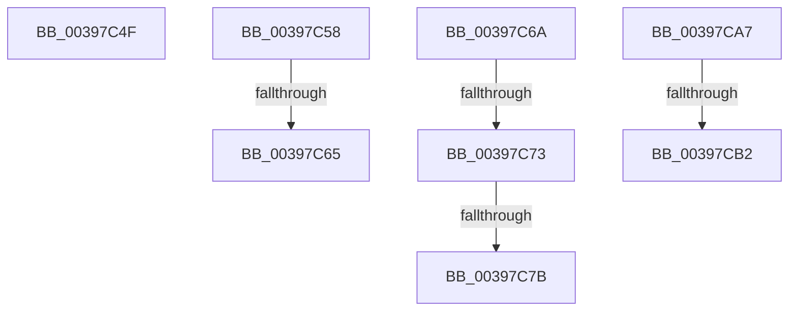

# sub_00397C4F

- RVA: `0x00397C4F`–`0x00397CBB` (길이 `108` bytes)
- VA: `0x0000000140397C4F`
- 실행 섹션: `.text`
- PDB 이름 있음: `아니요`; PDB Function 태그: `아니요`
- unwind 정보 RVA: `0x00081434`
- 디코드: `24`개 명령, `108/108` bytes 표시
- 미해석 바이트: `0` (있으면 어셈블리에 `.byte`로 보존)

> 이 문서는 커널 이미지의 기계어와 PDB 기호를 분석해 생성했습니다. 4번과 5번은 함수 원형과 자료형을 바이너리 사용 방식에서 추정한 C 해석이며 원본 소스 복구 결과는 아닙니다.

## 1. Dependencies

- 직접 호출 지점: **0**; 고유 호출 대상: **0**
- 직접 호출자로 확인된 함수: **0**
- RIP 상대 이미지 참조: **0**

### Outgoing calls
- 직접 디코드된 call 명령이 없습니다.

### Direct callers
- 이 함수 시작 RVA로 연결되는 직접 call은 확인되지 않았습니다. 간접 호출은 완전히 역산할 수 없습니다.

### Static image references
- 디코드된 RIP-relative 메모리 참조가 없습니다.

## 2. Other-region calls and transfers

- 다른 실행 섹션으로 향하는 call: **0**
- call이 아닌 외부 분기/꼬리 이동: **8**
  - `0x00397C53` → [sub_00397982 + 0xF7](Unknown_function_00397982.md) (`tail-transfer`)
  - `0x00397C5F` → [sub_00397982 + 0x45](Unknown_function_00397982.md) (`tail-transfer`)
  - `0x00397C65` → [sub_00397982 + 0x15F](Unknown_function_00397982.md) (`tail-transfer`)
  - `0x00397C6D` → [sub_00397982 + 0x99](Unknown_function_00397982.md) (`tail-transfer`)
  - `0x00397C75` → [sub_00397982 + 0x1E3](Unknown_function_00397982.md) (`tail-transfer`)
  - `0x00397CA2` → [sub_00397982 + 0x131](Unknown_function_00397982.md) (`tail-transfer`)
  - `0x00397CAC` → [sub_00397982 + 0x131](Unknown_function_00397982.md) (`tail-transfer`)
  - `0x00397CB6` → [sub_00397982 + 0x131](Unknown_function_00397982.md) (`tail-transfer`)

## 3. Assembly (complete function range)

```asm
00397C4F  83 4B 74 02                     or dword ptr [rbx + 0x74], 2
00397C53  E9 21 FE FF FF                  jmp 0x140397a79
00397C58  80 BB 83 02 00 00 0F            cmp byte ptr [rbx + 0x283], 0xf
00397C5F  0F 85 62 FD FF FF               jne 0x1403979c7
00397C65  E9 77 FE FF FF                  jmp 0x140397ae1
00397C6A  83 F8 04                        cmp eax, 4
00397C6D  0F 84 A8 FD FF FF               je 0x140397a1b
00397C73  85 C0                           test eax, eax
00397C75  0F 85 EA FE FF FF               jne 0x140397b65
00397C7B  48 8B 84 24 88 00 00 00         mov rax, qword ptr [rsp + 0x88]
00397C83  80 E1 FA                        and cl, 0xfa
00397C86  80 C9 02                        or cl, 2
00397C89  41 B7 01                        mov r15b, 1
00397C8C  88 4B 70                        mov byte ptr [rbx + 0x70], cl
00397C8F  33 D2                           xor edx, edx
00397C91  48 89 83 C8 00 00 00            mov qword ptr [rbx + 0xc8], rax
00397C98  48 89 93 D0 03 00 00            mov qword ptr [rbx + 0x3d0], rdx
00397C9F  88 57 11                        mov byte ptr [rdi + 0x11], dl
00397CA2  E9 0C FE FF FF                  jmp 0x140397ab3
00397CA7  33 D2                           xor edx, edx
00397CA9  83 F8 03                        cmp eax, 3
00397CAC  0F 85 01 FE FF FF               jne 0x140397ab3
00397CB2  C6 47 11 02                     mov byte ptr [rdi + 0x11], 2
00397CB6  E9 F8 FD FF FF                  jmp 0x140397ab3
```

## 4. C-style interpretation (structured pseudocode)

```c
__int64 __fastcall sub_00397C4F(unsigned __int8 a1, int a2)
{
    unsigned __int64 v_stack_p88;
}
```

## 5. (Beta) C Style

```c
int64_t sub_00397C4F(uint8_t Arg1, int32_t Arg2)
{
    uint64_t v_stack_p88;
}
```

## 6. Execution-region graph

[열기: 2D/3D 그래프와 함수 탐색 컨트롤 패널](../../../control-panel.html?section=text&rva=0x00397C4F&view=graph)

- 2D 그래프는 위에서 아래로 흐르고, 3D 그래프는 빈 공간을 드래그해 회전합니다. Shift+드래그는 이동, 휠은 확대·축소, 함수 노드 선택은 대상 보고서 이동입니다.

### Static fallback


