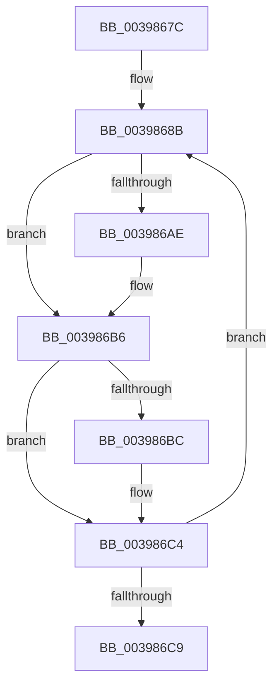

# sub_0039867C

- RVA: `0x0039867C`–`0x003986CE` (길이 `82` bytes)
- VA: `0x000000014039867C`
- 실행 섹션: `.text`
- PDB 이름 있음: `아니요`; PDB Function 태그: `아니요`
- unwind 정보 RVA: `0x000814EC`
- 디코드: `21`개 명령, `82/82` bytes 표시
- 미해석 바이트: `0` (있으면 어셈블리에 `.byte`로 보존)

> 이 문서는 커널 이미지의 기계어와 PDB 기호를 분석해 생성했습니다. 4번과 5번은 함수 원형과 자료형을 바이너리 사용 방식에서 추정한 C 해석이며 원본 소스 복구 결과는 아닙니다.

## 1. Dependencies

- 직접 호출 지점: **2**; 고유 호출 대상: **2**
- 직접 호출자로 확인된 함수: **0**
- RIP 상대 이미지 참조: **0**

### Outgoing calls
- `0x0039869D` → [KiDeferredReadySingleThread](../25/KiDeferredReadySingleThread_function_00252FE0.md) (function, `0x00252FE0`)
- `0x003986BF` → [KiFlushSoftwareInterruptBatch](../25/KiFlushSoftwareInterruptBatch_function_00252200.md) (function, `0x00252200`)

### Direct callers
- 이 함수 시작 RVA로 연결되는 직접 call은 확인되지 않았습니다. 간접 호출은 완전히 역산할 수 없습니다.

### Static image references
- 디코드된 RIP-relative 메모리 참조가 없습니다.

## 2. Other-region calls and transfers

- 다른 실행 섹션으로 향하는 call: **0**
- 별도 외부 분기/꼬리 이동을 확인하지 못했습니다.

## 3. Assembly (complete function range)

```asm
0039867C  48 89 7C 24 38                  mov qword ptr [rsp + 0x38], rdi
00398681  BF 01 00 00 00                  mov edi, 1
00398686  48 89 44 24 30                  mov qword ptr [rsp + 0x30], rax
0039868B  48 8D 93 28 FF FF FF            lea rdx, [rbx - 0xd8]
00398692  45 33 C9                        xor r9d, r9d
00398695  4C 8D 44 24 30                  lea r8, [rsp + 0x30]
0039869A  48 8B CD                        mov rcx, rbp
0039869D  E8 3E A9 EB FF                  call 0x140252fe0
003986A2  48 8B 5C 24 30                  mov rbx, qword ptr [rsp + 0x30]
003986A7  FF C7                           inc edi
003986A9  48 85 DB                        test rbx, rbx
003986AC  74 08                           je 0x1403986b6
003986AE  48 8B 03                        mov rax, qword ptr [rbx]
003986B1  48 89 44 24 30                  mov qword ptr [rsp + 0x30], rax
003986B6  40 F6 C7 0F                     test dil, 0xf
003986BA  75 08                           jne 0x1403986c4
003986BC  48 8B CE                        mov rcx, rsi
003986BF  E8 3C 9B EB FF                  call 0x140252200
003986C4  48 85 DB                        test rbx, rbx
003986C7  75 C2                           jne 0x14039868b
003986C9  48 8B 7C 24 38                  mov rdi, qword ptr [rsp + 0x38]
```

## 4. C-style interpretation (structured pseudocode)

```c
__int64 __fastcall sub_0039867C(__int64 a1, __int64 a2, __int64 a3, int a4, __int64 a5, __int64 a6, __int64 a7)
{
    __int64 result;
    __int64 v_rdi;
    unsigned __int64 v_stack_p30;
    unsigned __int64 v_stack_p38;

    v_stack_p38 = v_rdi;
    v_stack_p30 = result;
loc_0039868B:
    a4 = 0;
    result = KiDeferredReadySingleThread(v_rbp, v_rbx - 216, a6, a4);
    v_rdi = (unsigned int)((1) + 1);
    if (a6 != 0) {
        result = *(unsigned __int64 *)(a6);
        v_stack_p30 = result;
    }
    if ((((unsigned __int8)(v_rdi)) & (15)) == 0) {
        a1 = v_rsi;
        result = KiFlushSoftwareInterruptBatch(a1, v_rbx - 216, a6, a4);
    }
    if (a6 != 0) goto loc_0039868B;
    return result;
}
```

## 5. (Beta) C Style

```c
int64_t sub_0039867C(int64_t Arg1, int64_t Arg2, int64_t Arg3, int32_t Arg4, uint64_t Arg5, int64_t Arg6, int64_t Arg7)
{
    int64_t result;
    int64_t local_rdi;
    uint64_t v_stack_p30;
    uint64_t v_stack_p38;

    v_stack_p38 = local_rdi;
    v_stack_p30 = result;
loc_0039868B:
    Arg4 = 0;
    result = KiDeferredReadySingleThread(local_rbp, local_rbx - 216, Arg6, Arg4);
    local_rdi = (uint32_t)((1) + 1);
    if (Arg6 != 0) {
        result = *(uint64_t *)(Arg6);
        v_stack_p30 = result;
    }
    if ((((uint8_t)(local_rdi)) & (15)) == 0) {
        Arg1 = local_rsi;
        result = KiFlushSoftwareInterruptBatch(Arg1, local_rbx - 216, Arg6, Arg4);
    }
    if (Arg6 != 0) goto loc_0039868B;
    return result;
}
```

## 6. Execution-region graph

[열기: 2D/3D 그래프와 함수 탐색 컨트롤 패널](../../../control-panel.html?section=text&rva=0x0039867C&view=graph)

- 2D 그래프는 위에서 아래로 흐르고, 3D 그래프는 빈 공간을 드래그해 회전합니다. Shift+드래그는 이동, 휠은 확대·축소, 함수 노드 선택은 대상 보고서 이동입니다.

### Static fallback


