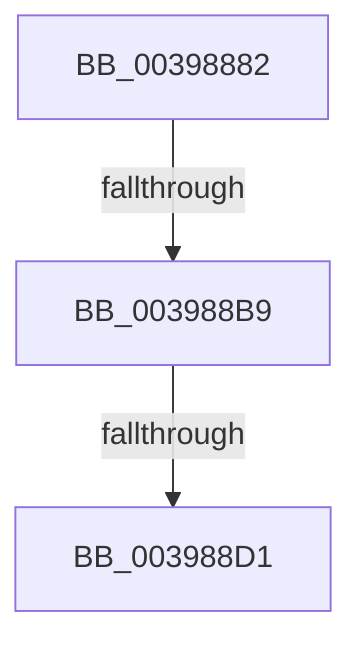

# sub_00398882

- RVA: `0x00398882`–`0x003988DA` (길이 `88` bytes)
- VA: `0x0000000140398882`
- 실행 섹션: `.text`
- PDB 이름 있음: `아니요`; PDB Function 태그: `아니요`
- unwind 정보 RVA: `0x00081538`
- 디코드: `18`개 명령, `88/88` bytes 표시
- 미해석 바이트: `0` (있으면 어셈블리에 `.byte`로 보존)

> 이 문서는 커널 이미지의 기계어와 PDB 기호를 분석해 생성했습니다. 4번과 5번은 함수 원형과 자료형을 바이너리 사용 방식에서 추정한 C 해석이며 원본 소스 복구 결과는 아닙니다.

## 1. Dependencies

- 직접 호출 지점: **0**; 고유 호출 대상: **0**
- 직접 호출자로 확인된 함수: **0**
- RIP 상대 이미지 참조: **1**

### Outgoing calls
- 직접 디코드된 call 명령이 없습니다.

### Direct callers
- 이 함수 시작 RVA로 연결되는 직접 call은 확인되지 않았습니다. 간접 호출은 완전히 역산할 수 없습니다.

### Static image references
- `0x003988AD` → RVA `0x00FC6D20` (`ALMOSTRO`; read)

## 2. Other-region calls and transfers

- 다른 실행 섹션으로 향하는 call: **0**
- call이 아닌 외부 분기/꼬리 이동: **3**
  - `0x003988B3` → [sub_003989EB](Unknown_function_003989EB.md) (`tail-transfer`)
  - `0x003988CB` → [sub_003989EB + 0x11](Unknown_function_003989EB.md) (`tail-transfer`)
  - `0x003988D4` → [sub_003989EB + 0x11](Unknown_function_003989EB.md) (`tail-transfer`)

## 3. Assembly (complete function range)

```asm
00398882  48 89 6C 24 68                  mov qword ptr [rsp + 0x68], rbp
00398887  48 89 7C 24 78                  mov qword ptr [rsp + 0x78], rdi
0039888C  33 FF                           xor edi, edi
0039888E  4C 89 6C 24 38                  mov qword ptr [rsp + 0x38], r13
00398893  4C 89 7C 24 30                  mov qword ptr [rsp + 0x30], r15
00398898  45 32 FF                        xor r15b, r15b
0039889B  48 89 7C 24 60                  mov qword ptr [rsp + 0x60], rdi
003988A0  45 0F 20 C5                     mov r13, cr8
003988A4  B8 02 00 00 00                  mov eax, 2
003988A9  44 0F 22 C0                     mov cr8, rax
003988AD  39 3D 6D E4 C2 00               cmp dword ptr [rip + 0xc2e46d], edi
003988B3  0F 85 32 01 00 00               jne 0x1403989eb
003988B9  65 48 8B 2C 25 20 00 00 00      mov rbp, qword ptr gs:[0x20]
003988C2  0F BE 83 C3 00 00 00            movsx eax, byte ptr [rbx + 0xc3]
003988C9  84 C0                           test al, al
003988CB  0F 8E 2B 01 00 00               jle 0x1403989fc
003988D1  41 3B C6                        cmp eax, r14d
003988D4  0F 8D 22 01 00 00               jge 0x1403989fc
```

## 4. C-style interpretation (structured pseudocode)

```c
__int64 __fastcall sub_00398882(void)
{
    __int64 v_r15;
    __int64 v_rdi;
    unsigned __int64 v_stack_p30;
    unsigned __int64 v_stack_p38;
    unsigned __int64 v_stack_p60;
    unsigned __int64 v_stack_p68;
    unsigned __int64 v_stack_p78;

    v_stack_p68 = v_rbp;
    v_stack_p78 = v_rdi;
    v_rdi = 0;
    v_stack_p38 = v_r13;
    v_stack_p30 = v_r15;
    v_r15 = 0;
    v_stack_p60 = 0;
}
```

## 5. (Beta) C Style

```c
void sub_00398882(void)
{
    int64_t local_r15;
    int64_t local_rdi;
    uint64_t v_stack_p30;
    uint64_t v_stack_p38;
    uint64_t v_stack_p60;
    uint64_t v_stack_p68;
    uint64_t v_stack_p78;

    v_stack_p68 = local_rbp;
    v_stack_p78 = local_rdi;
    local_rdi = 0;
    v_stack_p38 = local_r13;
    v_stack_p30 = local_r15;
    local_r15 = 0;
    v_stack_p60 = 0;
}
```

## 6. Execution-region graph

[열기: 2D/3D 그래프와 함수 탐색 컨트롤 패널](../../../control-panel.html?section=text&rva=0x00398882&view=graph)

- 2D 그래프는 위에서 아래로 흐르고, 3D 그래프는 빈 공간을 드래그해 회전합니다. Shift+드래그는 이동, 휠은 확대·축소, 함수 노드 선택은 대상 보고서 이동입니다.

### Static fallback


