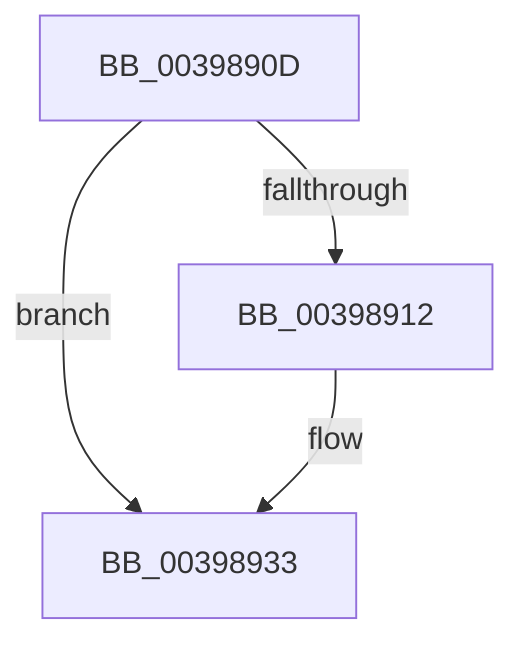

# sub_0039890D

- RVA: `0x0039890D`–`0x00398945` (길이 `56` bytes)
- VA: `0x000000014039890D`
- 실행 섹션: `.text`
- PDB 이름 있음: `아니요`; PDB Function 태그: `아니요`
- unwind 정보 RVA: `0x00081570`
- 디코드: `14`개 명령, `56/56` bytes 표시
- 미해석 바이트: `0` (있으면 어셈블리에 `.byte`로 보존)

> 이 문서는 커널 이미지의 기계어와 PDB 기호를 분석해 생성했습니다. 4번과 5번은 함수 원형과 자료형을 바이너리 사용 방식에서 추정한 C 해석이며 원본 소스 복구 결과는 아닙니다.

## 1. Dependencies

- 직접 호출 지점: **1**; 고유 호출 대상: **1**
- 직접 호출자로 확인된 함수: **0**
- RIP 상대 이미지 참조: **1**

### Outgoing calls
- `0x0039892E` → [KiSetPriorityBoost](KiSetPriorityBoost_function_00398A40.md) (function, `0x00398A40`)

### Direct callers
- 이 함수 시작 RVA로 연결되는 직접 call은 확인되지 않았습니다. 간접 호출은 완전히 역산할 수 없습니다.

### Static image references
- `0x00398912` → RVA `0x00FC6C4C` (`ALMOSTRO`; read)

## 2. Other-region calls and transfers

- 다른 실행 섹션으로 향하는 call: **0**
- call이 아닌 외부 분기/꼬리 이동: **1**
  - `0x0039893F` → [sub_003989EB + 0x11](Unknown_function_003989EB.md) (`tail-transfer`)

## 3. Assembly (complete function range)

```asm
0039890D  41 3B C6                        cmp eax, r14d
00398910  7D 21                           jge 0x140398933
00398912  8B 05 34 E3 C2 00               mov eax, dword ptr [rip + 0xc2e334]
00398918  48 8D 4C 24 60                  lea rcx, [rsp + 0x60]
0039891D  45 0F BE C6                     movsx r8d, r14b
00398921  4D 8B CC                        mov r9, r12
00398924  48 8B D3                        mov rdx, rbx
00398927  89 44 24 20                     mov dword ptr [rsp + 0x20], eax
0039892B  41 B7 01                        mov r15b, 1
0039892E  E8 0D 01 00 00                  call 0x140398a40
00398933  4C 8B 64 24 40                  mov r12, qword ptr [rsp + 0x40]
00398938  48 89 7B 40                     mov qword ptr [rbx + 0x40], rdi
0039893C  45 84 FF                        test r15b, r15b
0039893F  0F 84 B7 00 00 00               je 0x1403989fc
```

## 4. C-style interpretation (structured pseudocode)

```c
__int64 __fastcall sub_0039890D(__int64 a1, __int64 a2, __int64 a3, __int64 a4, __int64 a5, __int64 a6, __int64 a7, __int64 a8, __int64 a9, __int64 a10, __int64 a11, __int64 a12)
{
    __int64 result;
    __int64 v_r15;
    unsigned int v_stack_p20;

    if (((unsigned int)(result)) < ((unsigned int)(v_r14))) {
        result = *(unsigned int *)(v_rip + 12772148);
        a1 = a12;
        a3 = (__int8)((unsigned __int8)(v_r14));
        a4 = v_r12;
        a2 = v_rbx;
        v_stack_p20 = (unsigned int)(result);
        v_r15 = 1;
        result = KiSetPriorityBoost(a1, a2, a3, a4);
    }
    *(unsigned __int64 *)(v_rbx + 64) = v_rdi;
}
```

## 5. (Beta) C Style

```c
int64_t sub_0039890D(int64_t Arg1, int64_t Arg2, int64_t Arg3, int64_t Arg4, uint64_t Arg5, uint64_t Arg6, uint64_t Arg7, int64_t Arg8, uint64_t Arg9, uint64_t Arg10, uint64_t Arg11, int64_t Arg12)
{
    int64_t result;
    int64_t local_r15;
    uint32_t v_stack_p20;

    if (((uint32_t)(result)) < ((uint32_t)(local_r14))) {
        result = *(uint32_t *)(v_rip + 0xC2E334);
        Arg1 = Arg12;
        Arg3 = (int8_t)((uint8_t)(local_r14));
        Arg4 = local_r12;
        Arg2 = local_rbx;
        v_stack_p20 = (uint32_t)(result);
        local_r15 = 1;
        result = KiSetPriorityBoost(Arg1, Arg2, Arg3, Arg4);
    }
    *(uint64_t *)(local_rbx + 0x40) = local_rdi;
}
```

## 6. Execution-region graph

[열기: 2D/3D 그래프와 함수 탐색 컨트롤 패널](../../../control-panel.html?section=text&rva=0x0039890D&view=graph)

- 2D 그래프는 위에서 아래로 흐르고, 3D 그래프는 빈 공간을 드래그해 회전합니다. Shift+드래그는 이동, 휠은 확대·축소, 함수 노드 선택은 대상 보고서 이동입니다.

### Static fallback


