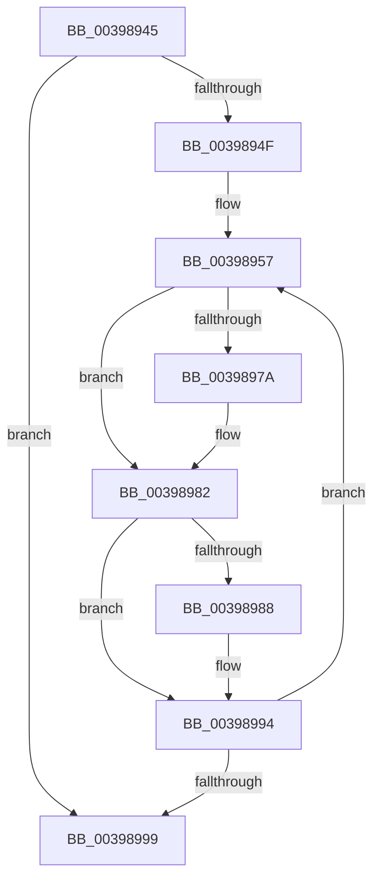

# sub_00398945

- RVA: `0x00398945`–`0x003989C5` (길이 `128` bytes)
- VA: `0x0000000140398945`
- 실행 섹션: `.text`
- PDB 이름 있음: `아니요`; PDB Function 태그: `아니요`
- unwind 정보 RVA: `0x00081584`
- 디코드: `31`개 명령, `128/128` bytes 표시
- 미해석 바이트: `0` (있으면 어셈블리에 `.byte`로 보존)

> 이 문서는 커널 이미지의 기계어와 PDB 기호를 분석해 생성했습니다. 4번과 5번은 함수 원형과 자료형을 바이너리 사용 방식에서 추정한 C 해석이며 원본 소스 복구 결과는 아닙니다.

## 1. Dependencies

- 직접 호출 지점: **4**; 고유 호출 대상: **3**
- 직접 호출자로 확인된 함수: **0**
- RIP 상대 이미지 참조: **0**

### Outgoing calls
- `0x00398969` → [KiDeferredReadySingleThread](../25/KiDeferredReadySingleThread_function_00252FE0.md) (function, `0x00252FE0`)
- `0x0039898F` → [KiFlushSoftwareInterruptBatch](../25/KiFlushSoftwareInterruptBatch_function_00252200.md) (function, `0x00252200`)
- `0x003989A0` → [KiFlushSoftwareInterruptBatch](../25/KiFlushSoftwareInterruptBatch_function_00252200.md) (function, `0x00252200`)
- `0x003989AC` → [KiCheckForThreadDispatch](../25/KiCheckForThreadDispatch_function_00250648.md) (function, `0x00250648`)

### Direct callers
- 이 함수 시작 RVA로 연결되는 직접 call은 확인되지 않았습니다. 간접 호출은 완전히 역산할 수 없습니다.

### Static image references
- 디코드된 RIP-relative 메모리 참조가 없습니다.

## 2. Other-region calls and transfers

- 다른 실행 섹션으로 향하는 call: **0**
- 별도 외부 분기/꼬리 이동을 확인하지 못했습니다.

## 3. Assembly (complete function range)

```asm
00398945  48 8B 5C 24 60                  mov rbx, qword ptr [rsp + 0x60]
0039894A  48 85 DB                        test rbx, rbx
0039894D  74 4A                           je 0x140398999
0039894F  48 8B 03                        mov rax, qword ptr [rbx]
00398952  48 89 44 24 60                  mov qword ptr [rsp + 0x60], rax
00398957  48 8D 93 28 FF FF FF            lea rdx, [rbx - 0xd8]
0039895E  45 33 C9                        xor r9d, r9d
00398961  4C 8D 44 24 60                  lea r8, [rsp + 0x60]
00398966  48 8B CD                        mov rcx, rbp
00398969  E8 72 A6 EB FF                  call 0x140252fe0
0039896E  48 8B 5C 24 60                  mov rbx, qword ptr [rsp + 0x60]
00398973  FF C7                           inc edi
00398975  48 85 DB                        test rbx, rbx
00398978  74 08                           je 0x140398982
0039897A  48 8B 03                        mov rax, qword ptr [rbx]
0039897D  48 89 44 24 60                  mov qword ptr [rsp + 0x60], rax
00398982  40 F6 C7 0F                     test dil, 0xf
00398986  75 0C                           jne 0x140398994
00398988  48 8D 8D D8 35 00 00            lea rcx, [rbp + 0x35d8]
0039898F  E8 6C 98 EB FF                  call 0x140252200
00398994  48 85 DB                        test rbx, rbx
00398997  75 BE                           jne 0x140398957
00398999  48 8D 8D D8 35 00 00            lea rcx, [rbp + 0x35d8]
003989A0  E8 5B 98 EB FF                  call 0x140252200
003989A5  41 0F B6 D5                     movzx edx, r13b
003989A9  48 8B CD                        mov rcx, rbp
003989AC  E8 97 7C EB FF                  call 0x140250648
003989B1  4C 8B 6C 24 38                  mov r13, qword ptr [rsp + 0x38]
003989B6  48 8B 7C 24 78                  mov rdi, qword ptr [rsp + 0x78]
003989BB  48 8B 6C 24 68                  mov rbp, qword ptr [rsp + 0x68]
003989C0  4C 8B 7C 24 30                  mov r15, qword ptr [rsp + 0x30]
```

## 4. C-style interpretation (structured pseudocode)

```c
__int64 __fastcall sub_00398945(__int64 a1, __int64 a2, __int64 a3, int a4, __int64 a5, __int64 a6, __int64 a7, __int64 a8, __int64 a9, __int64 a10, __int64 a11, __int64 a12, __int64 a13, __int64 a14, __int64 a15)
{
    __int64 result;
    __int64 v_rdi;
    unsigned __int64 v_stack_p60;

    if (a12 == 0) goto loc_00398999;
    v_stack_p60 = *(unsigned __int64 *)(a12);
loc_00398957:
    a4 = 0;
    result = KiDeferredReadySingleThread(v_rbp, a12 - 216, a12, a4);
    v_rdi = (unsigned int)((v_rdi) + 1);
    if (a12 != 0) {
        result = *(unsigned __int64 *)(a12);
        v_stack_p60 = result;
    }
    if ((((unsigned __int8)(v_rdi)) & (15)) == 0) {
        a1 = v_rbp + 13784;
        result = KiFlushSoftwareInterruptBatch(a1, a12 - 216, a12, a4);
    }
    if (a12 != 0) goto loc_00398957;
loc_00398999:
    result = KiFlushSoftwareInterruptBatch(v_rbp + 13784, a12 - 216, a12, a4);
    result = KiCheckForThreadDispatch(v_rbp, (unsigned __int8)(v_r13), a12, a4);
    return result;
}
```

## 5. (Beta) C Style

```c
int64_t sub_00398945(int64_t Arg1, int64_t Arg2, int64_t Arg3, int32_t Arg4, uint64_t Arg5, int64_t Arg6, int64_t Arg7, uint64_t Arg8, uint64_t Arg9, uint64_t Arg10, uint64_t Arg11, int64_t Arg12, int64_t Arg13, uint64_t Arg14, int64_t Arg15)
{
    int64_t result;
    int64_t local_rdi;
    uint64_t v_stack_p60;

    if (Arg12 == 0) goto loc_00398999;
    v_stack_p60 = *(uint64_t *)(Arg12);
loc_00398957:
    Arg4 = 0;
    result = KiDeferredReadySingleThread(local_rbp, Arg12 - 216, Arg12, Arg4);
    local_rdi = (uint32_t)((local_rdi) + 1);
    if (Arg12 != 0) {
        result = *(uint64_t *)(Arg12);
        v_stack_p60 = result;
    }
    if ((((uint8_t)(local_rdi)) & (15)) == 0) {
        Arg1 = local_rbp + 13784;
        result = KiFlushSoftwareInterruptBatch(Arg1, Arg12 - 216, Arg12, Arg4);
    }
    if (Arg12 != 0) goto loc_00398957;
loc_00398999:
    result = KiFlushSoftwareInterruptBatch(local_rbp + 13784, Arg12 - 216, Arg12, Arg4);
    result = KiCheckForThreadDispatch(local_rbp, (uint8_t)(local_r13), Arg12, Arg4);
    return result;
}
```

## 6. Execution-region graph

[열기: 2D/3D 그래프와 함수 탐색 컨트롤 패널](../../../control-panel.html?section=text&rva=0x00398945&view=graph)

- 2D 그래프는 위에서 아래로 흐르고, 3D 그래프는 빈 공간을 드래그해 회전합니다. Shift+드래그는 이동, 휠은 확대·축소, 함수 노드 선택은 대상 보고서 이동입니다.

### Static fallback


