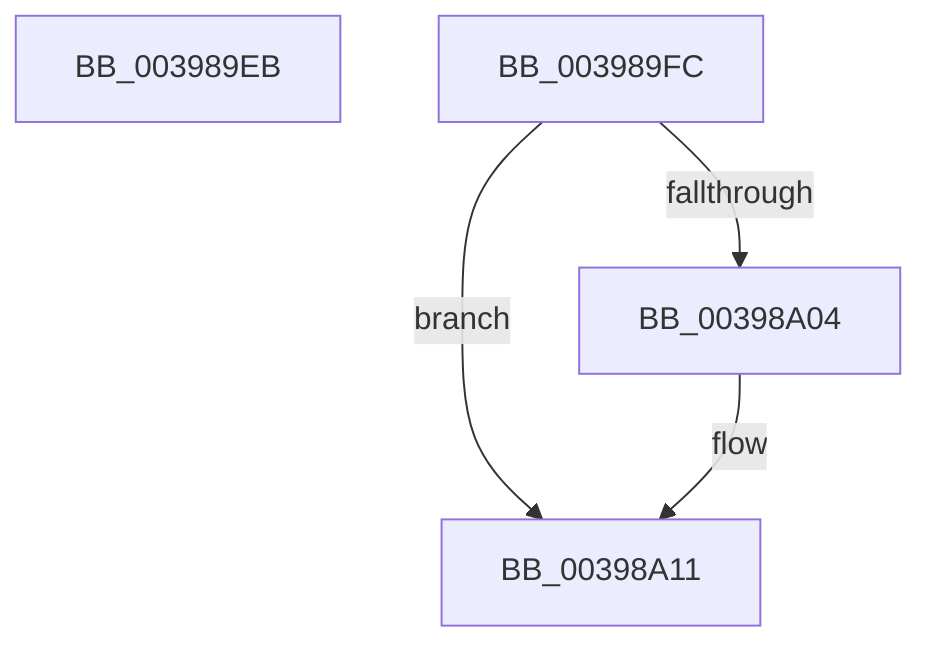

# sub_003989EB

- RVA: `0x003989EB`–`0x00398A1B` (길이 `48` bytes)
- VA: `0x00000001403989EB`
- 실행 섹션: `.text`
- PDB 이름 있음: `아니요`; PDB Function 태그: `아니요`
- unwind 정보 RVA: `0x000815D0`
- 디코드: `12`개 명령, `48/48` bytes 표시
- 미해석 바이트: `0` (있으면 어셈블리에 `.byte`로 보존)

> 이 문서는 커널 이미지의 기계어와 PDB 기호를 분석해 생성했습니다. 4번과 5번은 함수 원형과 자료형을 바이너리 사용 방식에서 추정한 C 해석이며 원본 소스 복구 결과는 아닙니다.

## 1. Dependencies

- 직접 호출 지점: **2**; 고유 호출 대상: **2**
- 직접 호출자로 확인된 함수: **0**
- RIP 상대 이미지 참조: **1**

### Outgoing calls
- `0x003989F2` → [KiRaiseIrqlProcessIrqlFlags](../4F/KiRaiseIrqlProcessIrqlFlags_function_004F56FC.md) (function, `0x004F56FC`)
- `0x00398A0C` → [KiLowerIrqlProcessIrqlFlags](../4F/KiLowerIrqlProcessIrqlFlags_function_004F5698.md) (function, `0x004F5698`)

### Direct callers
- 이 함수 시작 RVA로 연결되는 직접 call은 확인되지 않았습니다. 간접 호출은 완전히 역산할 수 없습니다.

### Static image references
- `0x003989FC` → RVA `0x00FC6D20` (`ALMOSTRO`; read)

## 2. Other-region calls and transfers

- 다른 실행 섹션으로 향하는 call: **0**
- call이 아닌 외부 분기/꼬리 이동: **2**
  - `0x003989F7` → [sub_00398882 + 0x37](Unknown_function_00398882.md) (`tail-transfer`)
  - `0x00398A19` → [sub_00398945 + 0x6C](Unknown_function_00398945.md) (`tail-transfer`)

## 3. Assembly (complete function range)

```asm
003989EB  0F B6 D0                        movzx edx, al
003989EE  41 0F B6 CD                     movzx ecx, r13b
003989F2  E8 05 CD 15 00                  call 0x1404f56fc
003989F7  E9 BD FE FF FF                  jmp 0x1403988b9
003989FC  39 3D 1E E3 C2 00               cmp dword ptr [rip + 0xc2e31e], edi
00398A02  74 0D                           je 0x140398a11
00398A04  44 0F 20 C1                     mov rcx, cr8
00398A08  41 0F B6 D5                     movzx edx, r13b
00398A0C  E8 87 CC 15 00                  call 0x1404f5698
00398A11  41 0F B6 C5                     movzx eax, r13b
00398A15  44 0F 22 C0                     mov cr8, rax
00398A19  EB 96                           jmp 0x1403989b1
```

## 4. C-style interpretation (structured pseudocode)

```c
__int64 __fastcall sub_003989EB(void)
{
    __int64 result;

    result = KiRaiseIrqlProcessIrqlFlags((unsigned __int8)(v_r13), (unsigned __int8)(result), a3, a4);
}
```

## 5. (Beta) C Style

```c
void sub_003989EB(void)
{
    int64_t result;

    result = KiRaiseIrqlProcessIrqlFlags((uint8_t)(local_r13), (uint8_t)(result), a3, a4);
}
```

## 6. Execution-region graph

[열기: 2D/3D 그래프와 함수 탐색 컨트롤 패널](../../../control-panel.html?section=text&rva=0x003989EB&view=graph)

- 2D 그래프는 위에서 아래로 흐르고, 3D 그래프는 빈 공간을 드래그해 회전합니다. Shift+드래그는 이동, 휠은 확대·축소, 함수 노드 선택은 대상 보고서 이동입니다.

### Static fallback


