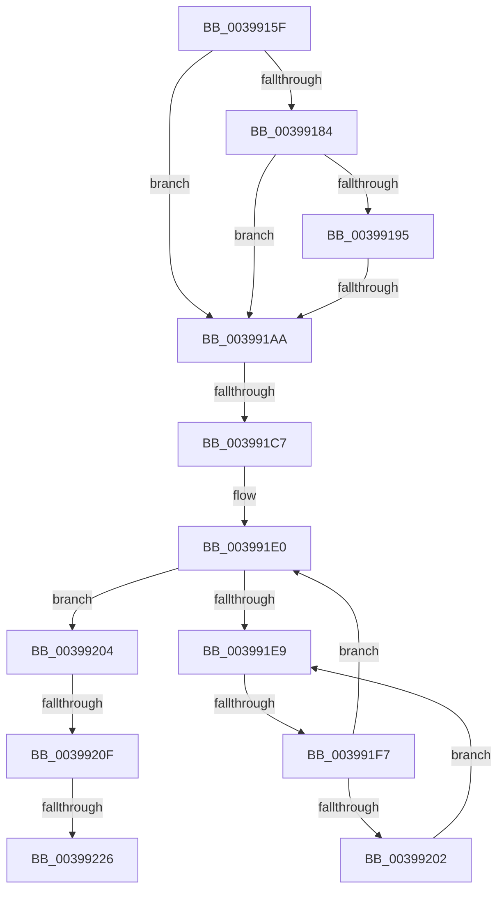

# sub_0039915F

- RVA: `0x0039915F`–`0x00399262` (길이 `259` bytes)
- VA: `0x000000014039915F`
- 실행 섹션: `.text`
- PDB 이름 있음: `아니요`; PDB Function 태그: `아니요`
- unwind 정보 RVA: `0x000816F4`
- 디코드: `59`개 명령, `259/259` bytes 표시
- 미해석 바이트: `0` (있으면 어셈블리에 `.byte`로 보존)

> 이 문서는 커널 이미지의 기계어와 PDB 기호를 분석해 생성했습니다. 4번과 5번은 함수 원형과 자료형을 바이너리 사용 방식에서 추정한 C 해석이며 원본 소스 복구 결과는 아닙니다.

## 1. Dependencies

- 직접 호출 지점: **1**; 고유 호출 대상: **1**
- 직접 호출자로 확인된 함수: **0**
- RIP 상대 이미지 참조: **4**

### Outgoing calls
- `0x0039923E` → [KiSetSystemAffinityThread](KiSetSystemAffinityThread_function_003993E0.md) (function, `0x003993E0`)

### Direct callers
- 이 함수 시작 RVA로 연결되는 직접 call은 확인되지 않았습니다. 간접 호출은 완전히 역산할 수 없습니다.

### Static image references
- `0x00399172` → RVA `0x00FC7120` (`ALMOSTRO`; read)
- `0x003991BA` → RVA `0x00FC6D20` (`ALMOSTRO`; read)
- `0x003991EB` → RVA `0x00FC52AC` (`ALMOSTRO`; reference)
- `0x00399248` → RVA `0x00FC6B14` (`ALMOSTRO`; read)

## 2. Other-region calls and transfers

- 다른 실행 섹션으로 향하는 call: **0**
- call이 아닌 외부 분기/꼬리 이동: **6**
  - `0x003991A4` → [sub_00399302](Unknown_function_00399302.md) (`tail-transfer`)
  - `0x003991C1` → [sub_00399302 + 0x55](Unknown_function_00399302.md) (`tail-transfer`)
  - `0x003991F1` → [sub_00399302 + 0x66](Unknown_function_00399302.md) (`tail-transfer`)
  - `0x00399209` → [sub_00399302 + 0x15](Unknown_function_00399302.md) (`tail-transfer`)
  - `0x00399220` → [sub_00399302 + 0x92](Unknown_function_00399302.md) (`tail-transfer`)
  - `0x0039925C` → [sub_003993C0](Unknown_function_003993C0.md) (`tail-transfer`)

## 3. Assembly (complete function range)

```asm
0039915F  4C 89 60 E8                     mov qword ptr [rax - 0x18], r12
00399163  4C 89 68 E0                     mov qword ptr [rax - 0x20], r13
00399167  4C 89 70 D8                     mov qword ptr [rax - 0x28], r14
0039916B  4C 8B F1                        mov r14, rcx
0039916E  0F 11 40 C8                     movups xmmword ptr [rax - 0x38], xmm0
00399172  0F B7 05 A7 DF C2 00            movzx eax, word ptr [rip + 0xc2dfa7]
00399179  44 0F B7 41 08                  movzx r8d, word ptr [rcx + 8]
0039917E  66 44 3B C0                     cmp r8w, ax
00399182  73 26                           jae 0x1403991aa
00399184  48 8D 15 95 DF C2 00            lea rdx, [rip + 0xc2df95]
0039918B  4A 8B 4C C2 08                  mov rcx, qword ptr [rdx + r8*8 + 8]
00399190  49 85 0E                        test qword ptr [r14], rcx
00399193  74 15                           je 0x1403991aa
00399195  41 0F B7 4E 0E                  movzx ecx, word ptr [r14 + 0xe]
0039919A  66 41 0B 4E 0C                  or cx, word ptr [r14 + 0xc]
0039919F  66 41 0B 4E 0A                  or cx, word ptr [r14 + 0xa]
003991A4  0F 84 58 01 00 00               je 0x140399302
003991AA  45 32 E4                        xor r12b, r12b
003991AD  45 0F 20 C5                     mov r13, cr8
003991B1  B8 02 00 00 00                  mov eax, 2
003991B6  44 0F 22 C0                     mov cr8, rax
003991BA  83 3D 5F DB C2 00 00            cmp dword ptr [rip + 0xc2db5f], 0
003991C1  0F 85 90 01 00 00               jne 0x140399357
003991C7  65 48 8B 34 25 20 00 00 00      mov rsi, qword ptr gs:[0x20]
003991D0  33 ED                           xor ebp, ebp
003991D2  8B DD                           mov ebx, ebp
003991D4  48 8B 7E 08                     mov rdi, qword ptr [rsi + 8]
003991D8  0F 1F 84 00 00 00 00 00         nop dword ptr [rax + rax]
003991E0  F0 48 0F BA 6F 40 00            lock bts qword ptr [rdi + 0x40], 0
003991E7  73 1B                           jae 0x140399204
003991E9  FF C3                           inc ebx
003991EB  85 1D BB C0 C2 00               test dword ptr [rip + 0xc2c0bb], ebx
003991F1  0F 84 71 01 00 00               je 0x140399368
003991F7  F3 90                           pause
003991F9  48 8B 47 40                     mov rax, qword ptr [rdi + 0x40]
003991FD  48 85 C0                        test rax, rax
00399200  74 DE                           je 0x1403991e0
00399202  EB E5                           jmp 0x1403991e9
00399204  8B 47 74                        mov eax, dword ptr [rdi + 0x74]
00399207  A8 08                           test al, 8
00399209  0F 85 08 01 00 00               jne 0x140399317
0039920F  83 C8 08                        or eax, 8
00399212  89 47 74                        mov dword ptr [rdi + 0x74], eax
00399215  48 8B DD                        mov rbx, rbp
00399218  48 89 5C 24 70                  mov qword ptr [rsp + 0x70], rbx
0039921D  45 84 E4                        test r12b, r12b
00399220  0F 84 6E 01 00 00               je 0x140399394
00399226  48 8D 44 24 70                  lea rax, [rsp + 0x70]
0039922B  41 B9 00 08 00 00               mov r9d, 0x800
00399231  4D 8B C6                        mov r8, r14
00399234  48 89 44 24 20                  mov qword ptr [rsp + 0x20], rax
00399239  33 D2                           xor edx, edx
0039923B  48 8B CE                        mov rcx, rsi
0039923E  E8 9D 01 00 00                  call 0x1403993e0
00399243  48 8B 5C 24 70                  mov rbx, qword ptr [rsp + 0x70]
00399248  F7 05 C2 D8 C2 00 00 02 00 00   test dword ptr [rip + 0xc2d8c2], 0x200
00399252  4C 8B 74 24 40                  mov r14, qword ptr [rsp + 0x40]
00399257  4C 8B 64 24 50                  mov r12, qword ptr [rsp + 0x50]
0039925C  0F 85 5E 01 00 00               jne 0x1403993c0
```

## 4. C-style interpretation (structured pseudocode)

```c
__int64 __fastcall sub_0039915F(__int64 a1, __int64 a2, __int64 a3, __int64 a4, __int64 a5, __int64 a6, __int64 a7, __int64 a8, __int64 a9, __int64 a10, __int64 a11, __int64 a12, __int64 a13, __int64 a14)
{
    __int64 result;
    __int64 v_r12;
    __int64 v_rbp;
    __int64 v_rbx;
    unsigned __int64 v_stack_p20;
    unsigned __int64 v_stack_p70;

    *(unsigned __int64 *)(result - 24) = v_r12;
    *(unsigned __int64 *)(result - 32) = v_r13;
    *(unsigned __int64 *)(result - 40) = v_r14;
    *(unsigned __int64 *)(result - 56) = v_xmm0;
    if (((unsigned __int16)(*(unsigned __int16 *)(a1 + 8))) >= ((unsigned __int16)(*(unsigned __int16 *)(v_rip + 12771239)))) goto loc_003991AA;
    if (((*(unsigned __int64 *)(a1)) & (*(unsigned __int64 *)(v_rip + 12771221 + *(unsigned __int16 *)(a1 + 8) * 8 + 8))) == 0) goto loc_003991AA;
    a1 = (unsigned __int16)((*(unsigned __int16 *)(a1 + 14)) | (*(unsigned __int16 *)(a1 + 12)));
    a1 = (unsigned __int16)((a1) | (*(unsigned __int16 *)(a1 + 10)));
loc_003991AA:
    v_r12 = 0;
    v_rbp = 0;
loc_003991E0:
    if (condition_is_above_or_equal) goto loc_00399204;
loc_003991E9:
    v_rbx = (unsigned int)((0) + 1);
    if (*(unsigned __int64 *)(*(unsigned __int64 *)(*(unsigned __int64 *)(gs_base + (0 + 32)) + 8) + 64) == 0) goto loc_003991E0;
    goto loc_003991E9;
loc_00399204:
    result = (unsigned int)(((unsigned int)(*(unsigned int *)(*(unsigned __int64 *)(*(unsigned __int64 *)(gs_base + (0 + 32)) + 8) + 116))) | (8));
    *(unsigned int *)(*(unsigned __int64 *)(*(unsigned __int64 *)(gs_base + (0 + 32)) + 8) + 116) = (unsigned int)(result);
    v_stack_p70 = 0;
    v_stack_p20 = a14;
    a2 = 0;
    result = KiSetSystemAffinityThread(*(unsigned __int64 *)(gs_base + (0 + 32)), a2, a1, (unsigned int)(0x800ULL));
}
```

## 5. (Beta) C Style

```c
int64_t sub_0039915F(void *Arg1, int64_t Arg2, int64_t Arg3, int64_t Arg4, uint64_t Arg5, uint64_t Arg6, uint64_t Arg7, int64_t Arg8, uint64_t Arg9, int64_t Arg10, uint64_t Arg11, uint64_t Arg12, uint64_t Arg13, int64_t Arg14)
{
    uint8_t *arg1 = (uint8_t *)Arg1;

    int64_t result;
    int64_t local_r12;
    int64_t local_rbp;
    int64_t local_rbx;
    uint64_t v_stack_p20;
    uint64_t v_stack_p70;

    *(uint64_t *)(result - 0x18) = local_r12;
    *(uint64_t *)(result - 0x20) = local_r13;
    *(uint64_t *)(result - 0x28) = local_r14;
    *(uint64_t *)(result - 0x38) = v_xmm0;
    if (((uint16_t)(*(uint16_t *)(arg1 + 0x8))) >= ((uint16_t)(*(uint16_t *)(v_rip + 0xC2DFA7)))) goto loc_003991AA;
    if (((*(uint64_t *)(arg1)) & (*(uint64_t *)(v_rip + 0xC2DF95 + *(uint16_t *)(arg1 + 0x8) * 8 + 0x8))) == 0) goto loc_003991AA;
    Arg1 = (uint16_t)((*(uint16_t *)(arg1 + 0xE)) | (*(uint16_t *)(arg1 + 0xC)));
    Arg1 = (uint16_t)((Arg1) | (*(uint16_t *)(arg1 + 0xA)));
loc_003991AA:
    local_r12 = 0;
    local_rbp = 0;
loc_003991E0:
    if (condition_is_above_or_equal) goto loc_00399204;
loc_003991E9:
    local_rbx = (uint32_t)((0) + 1);
    if (*(uint64_t *)(*(uint64_t *)(*(uint64_t *)(gs_base + (0 + 0x20)) + 0x8) + 0x40) == 0) goto loc_003991E0;
    goto loc_003991E9;
loc_00399204:
    result = (uint32_t)(((uint32_t)(*(uint32_t *)(*(uint64_t *)(*(uint64_t *)(gs_base + (0 + 0x20)) + 0x8) + 0x74))) | (8));
    *(uint32_t *)(*(uint64_t *)(*(uint64_t *)(gs_base + (0 + 0x20)) + 0x8) + 0x74) = (uint32_t)(result);
    v_stack_p70 = 0;
    v_stack_p20 = Arg14;
    Arg2 = 0;
    result = KiSetSystemAffinityThread(*(uint64_t *)(gs_base + (0 + 0x20)), Arg2, Arg1, (uint32_t)(0x800ULL));
}
```

### 관측된 메모리 오프셋

구조체 형식이 확인되지 않은 접근은 인자 기준의 오프셋으로만 기록했습니다.

| 기준 인자 | 오프셋 표현 | 폭 (bit) | 접근 |
|---|---:|---:|---|
| `Arg1` | `+ 0x0` | `64` | `R` |
| `Arg1` | `+ 0x8` | `16` | `R` |
| `Arg1` | `+ 0xA` | `16` | `R` |
| `Arg1` | `+ 0xC` | `16` | `R` |
| `Arg1` | `+ 0xE` | `16` | `R` |

## 6. Execution-region graph

[열기: 2D/3D 그래프와 함수 탐색 컨트롤 패널](../../../control-panel.html?section=text&rva=0x0039915F&view=graph)

- 2D 그래프는 위에서 아래로 흐르고, 3D 그래프는 빈 공간을 드래그해 회전합니다. Shift+드래그는 이동, 휠은 확대·축소, 함수 노드 선택은 대상 보고서 이동입니다.

### Static fallback


