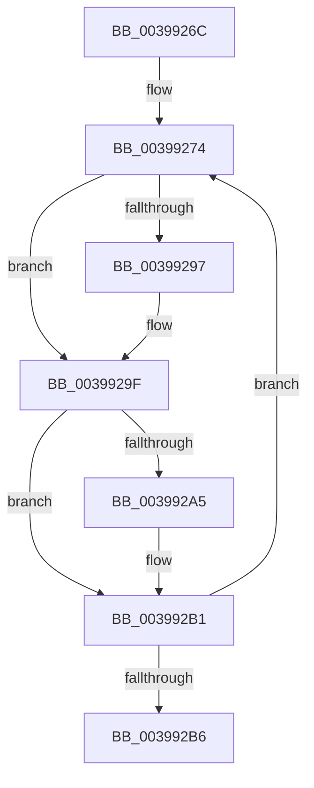

# sub_0039926C

- RVA: `0x0039926C`–`0x003992ED` (길이 `129` bytes)
- VA: `0x000000014039926C`
- 실행 섹션: `.text`
- PDB 이름 있음: `아니요`; PDB Function 태그: `아니요`
- unwind 정보 RVA: `0x00081724`
- 디코드: `30`개 명령, `129/129` bytes 표시
- 미해석 바이트: `0` (있으면 어셈블리에 `.byte`로 보존)

> 이 문서는 커널 이미지의 기계어와 PDB 기호를 분석해 생성했습니다. 4번과 5번은 함수 원형과 자료형을 바이너리 사용 방식에서 추정한 C 해석이며 원본 소스 복구 결과는 아닙니다.

## 1. Dependencies

- 직접 호출 지점: **4**; 고유 호출 대상: **3**
- 직접 호출자로 확인된 함수: **0**
- RIP 상대 이미지 참조: **0**

### Outgoing calls
- `0x00399286` → [KiDeferredReadySingleThread](../25/KiDeferredReadySingleThread_function_00252FE0.md) (function, `0x00252FE0`)
- `0x003992AC` → [KiFlushSoftwareInterruptBatch](../25/KiFlushSoftwareInterruptBatch_function_00252200.md) (function, `0x00252200`)
- `0x003992BD` → [KiFlushSoftwareInterruptBatch](../25/KiFlushSoftwareInterruptBatch_function_00252200.md) (function, `0x00252200`)
- `0x003992C9` → [KiCheckForThreadDispatch](../25/KiCheckForThreadDispatch_function_00250648.md) (function, `0x00250648`)

### Direct callers
- 이 함수 시작 RVA로 연결되는 직접 call은 확인되지 않았습니다. 간접 호출은 완전히 역산할 수 없습니다.

### Static image references
- 디코드된 RIP-relative 메모리 참조가 없습니다.

## 2. Other-region calls and transfers

- 다른 실행 섹션으로 향하는 call: **0**
- call이 아닌 외부 분기/꼬리 이동: **1**
  - `0x003992EB` → [sub_003992ED + 0x9](Unknown_function_003992ED.md) (`tail-transfer`)

## 3. Assembly (complete function range)

```asm
0039926C  48 8B 03                        mov rax, qword ptr [rbx]
0039926F  48 89 44 24 70                  mov qword ptr [rsp + 0x70], rax
00399274  48 8D 93 28 FF FF FF            lea rdx, [rbx - 0xd8]
0039927B  45 33 C9                        xor r9d, r9d
0039927E  4C 8D 44 24 70                  lea r8, [rsp + 0x70]
00399283  48 8B CE                        mov rcx, rsi
00399286  E8 55 9D EB FF                  call 0x140252fe0
0039928B  48 8B 5C 24 70                  mov rbx, qword ptr [rsp + 0x70]
00399290  FF C5                           inc ebp
00399292  48 85 DB                        test rbx, rbx
00399295  74 08                           je 0x14039929f
00399297  48 8B 03                        mov rax, qword ptr [rbx]
0039929A  48 89 44 24 70                  mov qword ptr [rsp + 0x70], rax
0039929F  40 F6 C5 0F                     test bpl, 0xf
003992A3  75 0C                           jne 0x1403992b1
003992A5  48 8D 8E D8 35 00 00            lea rcx, [rsi + 0x35d8]
003992AC  E8 4F 8F EB FF                  call 0x140252200
003992B1  48 85 DB                        test rbx, rbx
003992B4  75 BE                           jne 0x140399274
003992B6  48 8D 8E D8 35 00 00            lea rcx, [rsi + 0x35d8]
003992BD  E8 3E 8F EB FF                  call 0x140252200
003992C2  41 0F B6 D5                     movzx edx, r13b
003992C6  48 8B CE                        mov rcx, rsi
003992C9  E8 7A 73 EB FF                  call 0x140250648
003992CE  4C 8B 6C 24 48                  mov r13, qword ptr [rsp + 0x48]
003992D3  48 8B B4 24 88 00 00 00         mov rsi, qword ptr [rsp + 0x88]
003992DB  48 8B AC 24 80 00 00 00         mov rbp, qword ptr [rsp + 0x80]
003992E3  48 8B 5C 24 78                  mov rbx, qword ptr [rsp + 0x78]
003992E8  4D 85 FF                        test r15, r15
003992EB  74 09                           je 0x1403992f6
```

## 4. C-style interpretation (structured pseudocode)

```c
__int64 __fastcall sub_0039926C(__int64 a1, __int64 a2, __int64 a3, int a4, __int64 a5, __int64 a6, __int64 a7, __int64 a8, __int64 a9, __int64 a10, __int64 a11, __int64 a12, __int64 a13, __int64 a14, __int64 a15, __int64 a16, __int64 a17)
{
    __int64 result;
    __int64 v_rbp;
    unsigned __int64 v_stack_p70;

    v_stack_p70 = *(unsigned __int64 *)(v_rbx);
loc_00399274:
    a4 = 0;
    result = KiDeferredReadySingleThread(v_rsi, v_rbx - 216, a14, a4);
    v_rbp = (unsigned int)((v_rbp) + 1);
    if (a14 != 0) {
        result = *(unsigned __int64 *)(a14);
        v_stack_p70 = result;
    }
    if ((((unsigned __int8)(v_rbp)) & (15)) == 0) {
        a1 = v_rsi + 13784;
        result = KiFlushSoftwareInterruptBatch(a1, v_rbx - 216, a14, a4);
    }
    if (a14 != 0) goto loc_00399274;
    result = KiFlushSoftwareInterruptBatch(v_rsi + 13784, v_rbx - 216, a14, a4);
    result = KiCheckForThreadDispatch(v_rsi, (unsigned __int8)(v_r13), a14, a4);
}
```

## 5. (Beta) C Style

```c
int64_t sub_0039926C(int64_t Arg1, int64_t Arg2, int64_t Arg3, int32_t Arg4, uint64_t Arg5, uint64_t Arg6, uint64_t Arg7, uint64_t Arg8, int64_t Arg9, uint64_t Arg10, uint64_t Arg11, uint64_t Arg12, uint64_t Arg13, int64_t Arg14, int64_t Arg15, int64_t Arg16, int64_t Arg17)
{
    int64_t result;
    int64_t local_rbp;
    uint64_t v_stack_p70;

    v_stack_p70 = *(uint64_t *)(local_rbx);
loc_00399274:
    Arg4 = 0;
    result = KiDeferredReadySingleThread(local_rsi, local_rbx - 216, Arg14, Arg4);
    local_rbp = (uint32_t)((local_rbp) + 1);
    if (Arg14 != 0) {
        result = *(uint64_t *)(Arg14);
        v_stack_p70 = result;
    }
    if ((((uint8_t)(local_rbp)) & (15)) == 0) {
        Arg1 = local_rsi + 13784;
        result = KiFlushSoftwareInterruptBatch(Arg1, local_rbx - 216, Arg14, Arg4);
    }
    if (Arg14 != 0) goto loc_00399274;
    result = KiFlushSoftwareInterruptBatch(local_rsi + 13784, local_rbx - 216, Arg14, Arg4);
    result = KiCheckForThreadDispatch(local_rsi, (uint8_t)(local_r13), Arg14, Arg4);
}
```

## 6. Execution-region graph

[열기: 2D/3D 그래프와 함수 탐색 컨트롤 패널](../../../control-panel.html?section=text&rva=0x0039926C&view=graph)

- 2D 그래프는 위에서 아래로 흐르고, 3D 그래프는 빈 공간을 드래그해 회전합니다. Shift+드래그는 이동, 휠은 확대·축소, 함수 노드 선택은 대상 보고서 이동입니다.

### Static fallback


