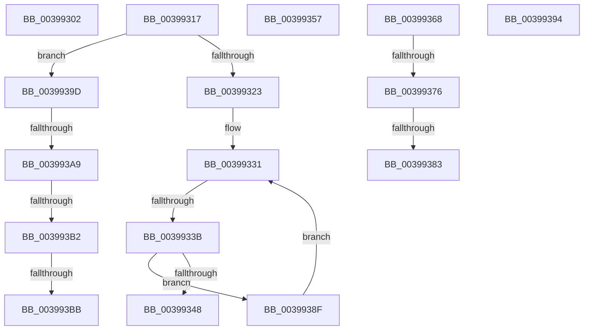

# sub_00399302

- RVA: `0x00399302`–`0x003993C0` (길이 `190` bytes)
- VA: `0x0000000140399302`
- 실행 섹션: `.text`
- PDB 이름 있음: `아니요`; PDB Function 태그: `아니요`
- unwind 정보 RVA: `0x0008174C`
- 디코드: `45`개 명령, `190/190` bytes 표시
- 미해석 바이트: `0` (있으면 어셈블리에 `.byte`로 보존)

> 이 문서는 커널 이미지의 기계어와 PDB 기호를 분석해 생성했습니다. 4번과 5번은 함수 원형과 자료형을 바이너리 사용 방식에서 추정한 C 해석이며 원본 소스 복구 결과는 아닙니다.

## 1. Dependencies

- 직접 호출 지점: **3**; 고유 호출 대상: **3**
- 직접 호출자로 확인된 함수: **0**
- RIP 상대 이미지 참조: **1**

### Outgoing calls
- `0x0039935E` → [KiRaiseIrqlProcessIrqlFlags](../4F/KiRaiseIrqlProcessIrqlFlags_function_004F56FC.md) (function, `0x004F56FC`)
- `0x00399376` → [KiCheckVpBackingLongSpinWaitHypercall](../30/KiCheckVpBackingLongSpinWaitHypercall_function_0030F490.md) (function, `0x0030F490`)
- `0x00399385` → [HvlNotifyLongSpinWait](../30/HvlNotifyLongSpinWait_function_0030F460.md) (function, `0x0030F460`)

### Direct callers
- 이 함수 시작 RVA로 연결되는 직접 call은 확인되지 않았습니다. 간접 호출은 완전히 역산할 수 없습니다.

### Static image references
- `0x00399368` → RVA `0x00FC6AB8` (`ALMOSTRO`; read)

## 2. Other-region calls and transfers

- 다른 실행 섹션으로 향하는 call: **0**
- call이 아닌 외부 분기/꼬리 이동: **12**
  - `0x00399312` → [sub_0039915F + 0x4E](Unknown_function_0039915F.md) (`tail-transfer`)
  - `0x00399335` → [sub_0039915F + 0xB6](Unknown_function_0039915F.md) (`tail-transfer`)
  - `0x00399352` → [sub_0039915F + 0xB6](Unknown_function_0039915F.md) (`tail-transfer`)
  - `0x00399363` → [sub_0039915F + 0x68](Unknown_function_0039915F.md) (`tail-transfer`)
  - `0x00399370` → [sub_0039915F + 0x98](Unknown_function_0039915F.md) (`tail-transfer`)
  - `0x0039937D` → [sub_0039915F + 0x98](Unknown_function_0039915F.md) (`tail-transfer`)
  - `0x0039938A` → [sub_0039915F + 0x9A](Unknown_function_0039915F.md) (`tail-transfer`)
  - `0x00399398` → [sub_0039915F + 0xE9](Unknown_function_0039915F.md) (`tail-transfer`)
  - `0x003993A3` → [sub_006E5A28 + 0x17](../6E/Unknown_function_006E5A28.md) (`tail-transfer`)
  - `0x003993AC` → [sub_006E5A28](../6E/Unknown_function_006E5A28.md) (`tail-transfer`)
  - `0x003993B5` → [sub_006E5A28 + 0x17](../6E/Unknown_function_006E5A28.md) (`tail-transfer`)
  - `0x003993BB` → [sub_0039915F + 0xB6](Unknown_function_0039915F.md) (`tail-transfer`)

## 3. Assembly (complete function range)

```asm
00399302  41 0F B7 46 08                  movzx eax, word ptr [r14 + 8]
00399307  41 B4 01                        mov r12b, 1
0039930A  48 8B 44 C2 08                  mov rax, qword ptr [rdx + rax*8 + 8]
0039930F  49 21 06                        and qword ptr [r14], rax
00399312  E9 96 FE FF FF                  jmp 0x1403991ad
00399317  48 8B 8F 50 04 00 00            mov rcx, qword ptr [rdi + 0x450]
0039931E  48 85 C9                        test rcx, rcx
00399321  75 7A                           jne 0x14039939d
00399323  4C 8B 87 40 02 00 00            mov r8, qword ptr [rdi + 0x240]
0039932A  0F B7 CD                        movzx ecx, bp
0039932D  45 0F B7 08                     movzx r9d, word ptr [r8]
00399331  66 41 3B C9                     cmp cx, r9w
00399335  0F 83 DA FE FF FF               jae 0x140399215
0039933B  0F B7 C1                        movzx eax, cx
0039933E  49 8B 54 C0 08                  mov rdx, qword ptr [r8 + rax*8 + 8]
00399343  48 85 D2                        test rdx, rdx
00399346  74 47                           je 0x14039938f
00399348  66 89 4C 24 38                  mov word ptr [rsp + 0x38], cx
0039934D  48 89 54 24 30                  mov qword ptr [rsp + 0x30], rdx
00399352  E9 BE FE FF FF                  jmp 0x140399215
00399357  0F B6 D0                        movzx edx, al
0039935A  41 0F B6 CD                     movzx ecx, r13b
0039935E  E8 99 C3 15 00                  call 0x1404f56fc
00399363  E9 5F FE FF FF                  jmp 0x1403991c7
00399368  8B 05 4A D7 C2 00               mov eax, dword ptr [rip + 0xc2d74a]
0039936E  A8 40                           test al, 0x40
00399370  0F 84 81 FE FF FF               je 0x1403991f7
00399376  E8 15 61 F7 FF                  call 0x14030f490
0039937B  84 C0                           test al, al
0039937D  0F 84 74 FE FF FF               je 0x1403991f7
00399383  8B CB                           mov ecx, ebx
00399385  E8 D6 60 F7 FF                  call 0x14030f460
0039938A  E9 6A FE FF FF                  jmp 0x1403991f9
0039938F  66 FF C1                        inc cx
00399392  EB 9D                           jmp 0x140399331
00399394  48 89 6F 40                     mov qword ptr [rdi + 0x40], rbp
00399398  E9 AB FE FF FF                  jmp 0x140399248
0039939D  0F B6 51 12                     movzx edx, byte ptr [rcx + 0x12]
003993A1  85 D2                           test edx, edx
003993A3  0F 84 96 C6 34 00               je 0x1406e5a3f
003993A9  83 EA 01                        sub edx, 1
003993AC  0F 84 76 C6 34 00               je 0x1406e5a28
003993B2  83 FA 01                        cmp edx, 1
003993B5  0F 84 84 C6 34 00               je 0x1406e5a3f
003993BB  E9 55 FE FF FF                  jmp 0x140399215
```

## 4. C-style interpretation (structured pseudocode)

```c
__int64 __fastcall sub_00399302(__int64 a1, __int64 a2)
{
    unsigned __int64 v_stack_p30;
    unsigned __int16 v_stack_p38;
}
```

## 5. (Beta) C Style

```c
int64_t sub_00399302(int64_t Arg1, void *Arg2)
{
    uint8_t *arg2 = (uint8_t *)Arg2;

    uint64_t v_stack_p30;
    uint16_t v_stack_p38;
}
```

### 관측된 메모리 오프셋

구조체 형식이 확인되지 않은 접근은 인자 기준의 오프셋으로만 기록했습니다.

| 기준 인자 | 오프셋 표현 | 폭 (bit) | 접근 |
|---|---:|---:|---|
| `Arg2` | `+ 0x8 + rax*8` | `64` | `R` |

## 6. Execution-region graph

[열기: 2D/3D 그래프와 함수 탐색 컨트롤 패널](../../../control-panel.html?section=text&rva=0x00399302&view=graph)

- 2D 그래프는 위에서 아래로 흐르고, 3D 그래프는 빈 공간을 드래그해 회전합니다. Shift+드래그는 이동, 휠은 확대·축소, 함수 노드 선택은 대상 보고서 이동입니다.

### Static fallback


