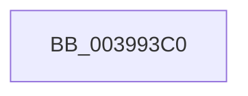

# sub_003993C0

- RVA: `0x003993C0`–`0x003993DA` (길이 `26` bytes)
- VA: `0x00000001403993C0`
- 실행 섹션: `.text`
- PDB 이름 있음: `아니요`; PDB Function 태그: `아니요`
- unwind 정보 RVA: `0x00081778`
- 디코드: `6`개 명령, `26/26` bytes 표시
- 미해석 바이트: `0` (있으면 어셈블리에 `.byte`로 보존)

> 이 문서는 커널 이미지의 기계어와 PDB 기호를 분석해 생성했습니다. 4번과 5번은 함수 원형과 자료형을 바이너리 사용 방식에서 추정한 C 해석이며 원본 소스 복구 결과는 아닙니다.

## 1. Dependencies

- 직접 호출 지점: **1**; 고유 호출 대상: **1**
- 직접 호출자로 확인된 함수: **0**
- RIP 상대 이미지 참조: **0**

### Outgoing calls
- `0x003993D0` → [KiCpuPartitionCheckAffinitization](../5C/KiCpuPartitionCheckAffinitization_function_005C1420.md) (function, `0x005C1420`)

### Direct callers
- 이 함수 시작 RVA로 연결되는 직접 call은 확인되지 않았습니다. 간접 호출은 완전히 역산할 수 없습니다.

### Static image references
- 디코드된 RIP-relative 메모리 참조가 없습니다.

## 2. Other-region calls and transfers

- 다른 실행 섹션으로 향하는 call: **0**
- call이 아닌 외부 분기/꼬리 이동: **1**
  - `0x003993D5` → [sub_00399262](Unknown_function_00399262.md) (`tail-transfer`)

## 3. Assembly (complete function range)

```asm
003993C0  48 8B 97 40 02 00 00            mov rdx, qword ptr [rdi + 0x240]
003993C7  45 33 C9                        xor r9d, r9d
003993CA  41 B0 01                        mov r8b, 1
003993CD  48 8B CF                        mov rcx, rdi
003993D0  E8 4B 80 22 00                  call 0x1405c1420
003993D5  E9 88 FE FF FF                  jmp 0x140399262
```

## 4. C-style interpretation (structured pseudocode)

```c
__int64 __fastcall sub_003993C0(__int64 a1, __int64 a2, __int64 a3, int a4)
{
    __int64 result;

    a4 = 0;
    result = KiCpuPartitionCheckAffinitization(v_rdi, *(unsigned __int64 *)(v_rdi + 576), 1, a4);
}
```

## 5. (Beta) C Style

```c
int64_t sub_003993C0(int64_t Arg1, int64_t Arg2, int64_t Arg3, int32_t Arg4)
{
    int64_t result;

    Arg4 = 0;
    result = KiCpuPartitionCheckAffinitization(local_rdi, *(uint64_t *)(local_rdi + 0x240), 1, Arg4);
}
```

## 6. Execution-region graph

[열기: 2D/3D 그래프와 함수 탐색 컨트롤 패널](../../../control-panel.html?section=text&rva=0x003993C0&view=graph)

- 2D 그래프는 위에서 아래로 흐르고, 3D 그래프는 빈 공간을 드래그해 회전합니다. Shift+드래그는 이동, 휠은 확대·축소, 함수 노드 선택은 대상 보고서 이동입니다.

### Static fallback


