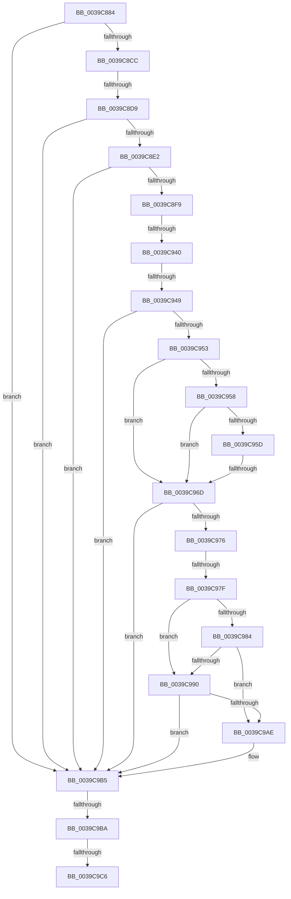

# sub_0039C884

- RVA: `0x0039C884`–`0x0039C9EE` (길이 `362` bytes)
- VA: `0x000000014039C884`
- 실행 섹션: `.text`
- PDB 이름 있음: `아니요`; PDB Function 태그: `아니요`
- unwind 정보 RVA: `0x000819B0`
- 디코드: `80`개 명령, `362/362` bytes 표시
- 미해석 바이트: `0` (있으면 어셈블리에 `.byte`로 보존)

> 이 문서는 커널 이미지의 기계어와 PDB 기호를 분석해 생성했습니다. 4번과 5번은 함수 원형과 자료형을 바이너리 사용 방식에서 추정한 C 해석이며 원본 소스 복구 결과는 아닙니다.

## 1. Dependencies

- 직접 호출 지점: **0**; 고유 호출 대상: **0**
- 직접 호출자로 확인된 함수: **0**
- RIP 상대 이미지 참조: **10**

### Outgoing calls
- 직접 디코드된 call 명령이 없습니다.

### Direct callers
- 이 함수 시작 RVA로 연결되는 직접 call은 확인되지 않았습니다. 간접 호출은 완전히 역산할 수 없습니다.

### Static image references
- `0x0039C8CC` → RVA `0x00FC5030` (`ALMOSTRO`; read)
- `0x0039C8E2` → RVA `0x00FC8C40` (`ALMOSTRO`; read)
- `0x0039C8F9` → RVA `0x00E668B0` (`.data`; read)
- `0x0039C900` → RVA `0x00E668A8` (`.data`; read)
- `0x0039C925` → RVA `0x00FC6C48` (`ALMOSTRO`; read)
- `0x0039C95D` → RVA `0x00F23390` (`.data`; read)
- `0x0039C984` → RVA `0x00F23378` (`.data`; read)
- `0x0039C990` → RVA `0x00F23360` (`.data`; read)
- `0x0039C99B` → RVA `0x00F23348` (`.data`; read)
- `0x0039C9C6` → RVA `0x00FC6B08` (`ALMOSTRO`; read)

## 2. Other-region calls and transfers

- 다른 실행 섹션으로 향하는 call: **0**
- call이 아닌 외부 분기/꼬리 이동: **8**
  - `0x0039C8D3` → [sub_0039CA0B + 0x2C9](Unknown_function_0039CA0B.md) (`tail-transfer`)
  - `0x0039C93A` → [sub_0039CA0B + 0x13E](Unknown_function_0039CA0B.md) (`tail-transfer`)
  - `0x0039C943` → [sub_0039CA0B + 0x13E](Unknown_function_0039CA0B.md) (`tail-transfer`)
  - `0x0039C967` → [sub_0039CA0B + 0x2A2](Unknown_function_0039CA0B.md) (`tail-transfer`)
  - `0x0039C979` → [sub_0039CA0B + 0x3C3](Unknown_function_0039CA0B.md) (`tail-transfer`)
  - `0x0039C9B8` → [sub_0039CA0B](Unknown_function_0039CA0B.md) (`tail-transfer`)
  - `0x0039C9C0` → [sub_0039CA0B + 0x21D](Unknown_function_0039CA0B.md) (`tail-transfer`)
  - `0x0039C9E8` → [sub_0039CDF2](Unknown_function_0039CDF2.md) (`tail-transfer`)

## 3. Assembly (complete function range)

```asm
0039C884  49 89 73 10                     mov qword ptr [r11 + 0x10], rsi
0039C888  4C 8D B1 BC 38 00 00            lea r14, [rcx + 0x38bc]
0039C88F  49 89 7B 18                     mov qword ptr [r11 + 0x18], rdi
0039C893  48 8D 59 21                     lea rbx, [rcx + 0x21]
0039C897  4D 89 7B 20                     mov qword ptr [r11 + 0x20], r15
0039C89B  49 BC 08 00 00 00 80 F7 FF FF   movabs r12, 0xfffff78000000008
0039C8A5  0F 57 C0                        xorps xmm0, xmm0
0039C8A8  89 55 E7                        mov dword ptr [rbp - 0x19], edx
0039C8AB  0F 11 45 EF                     movups xmmword ptr [rbp - 0x11], xmm0
0039C8AF  40 32 F6                        xor sil, sil
0039C8B2  45 33 DB                        xor r11d, r11d
0039C8B5  4D 8B 24 24                     mov r12, qword ptr [r12]
0039C8B9  48 8B F9                        mov rdi, rcx
0039C8BC  41 F6 06 08                     test byte ptr [r14], 8
0039C8C0  41 BF 01 00 00 00               mov r15d, 1
0039C8C6  0F 85 E9 00 00 00               jne 0x14039c9b5
0039C8CC  44 39 1D 5D 87 C2 00            cmp dword ptr [rip + 0xc2875d], r11d
0039C8D3  0F 84 FB 03 00 00               je 0x14039ccd4
0039C8D9  40 38 33                        cmp byte ptr [rbx], sil
0039C8DC  0F 84 D3 00 00 00               je 0x14039c9b5
0039C8E2  48 8B 05 57 C3 C2 00            mov rax, qword ptr [rip + 0xc2c357]
0039C8E9  4C 8D 80 00 41 00 00            lea r8, [rax + 0x4100]
0039C8F0  4D 85 C0                        test r8, r8
0039C8F3  0F 84 BC 00 00 00               je 0x14039c9b5
0039C8F9  48 8B 15 B0 9F AC 00            mov rdx, qword ptr [rip + 0xac9fb0]
0039C900  4C 8B 2D A1 9F AC 00            mov r13, qword ptr [rip + 0xac9fa1]
0039C907  49 8B 80 08 42 00 00            mov rax, qword ptr [r8 + 0x4208]
0039C90E  4D 8B 88 00 42 00 00            mov r9, qword ptr [r8 + 0x4200]
0039C915  4D 3B CD                        cmp r9, r13
0039C918  4C 89 4D CF                     mov qword ptr [rbp - 0x31], r9
0039C91C  0F 95 C1                        setne cl
0039C91F  48 3B C2                        cmp rax, rdx
0039C922  0F 95 C0                        setne al
0039C925  44 39 1D 1C A3 C2 00            cmp dword ptr [rip + 0xc2a31c], r11d
0039C92C  44 0F B6 D0                     movzx r10d, al
0039C930  0F B6 C1                        movzx eax, cl
0039C933  44 0F 45 D0                     cmovne r10d, eax
0039C937  45 84 D2                        test r10b, r10b
0039C93A  0F 85 09 02 00 00               jne 0x14039cb49
0039C940  4D 3B CD                        cmp r9, r13
0039C943  0F 85 00 02 00 00               jne 0x14039cb49
0039C949  80 7F 21 00                     cmp byte ptr [rdi + 0x21], 0
0039C94D  48 8D 5F 21                     lea rbx, [rdi + 0x21]
0039C951  74 62                           je 0x14039c9b5
0039C953  45 84 D2                        test r10b, r10b
0039C956  75 15                           jne 0x14039c96d
0039C958  4D 3B CD                        cmp r9, r13
0039C95B  74 10                           je 0x14039c96d
0039C95D  48 8B 0D 2C 6A B8 00            mov rcx, qword ptr [rip + 0xb86a2c]
0039C964  4C 3B E1                        cmp r12, rcx
0039C967  0F 83 40 03 00 00               jae 0x14039ccad
0039C96D  48 8D 5F 21                     lea rbx, [rdi + 0x21]
0039C971  40 84 F6                        test sil, sil
0039C974  75 3F                           jne 0x14039c9b5
0039C976  45 84 D2                        test r10b, r10b
0039C979  0F 85 4F 04 00 00               jne 0x14039cdce
0039C97F  4D 3B CD                        cmp r9, r13
0039C982  74 0C                           je 0x14039c990
0039C984  48 8B 05 ED 69 B8 00            mov rax, qword ptr [rip + 0xb869ed]
0039C98B  49 3B C4                        cmp rax, r12
0039C98E  76 1E                           jbe 0x14039c9ae
0039C990  48 8B 05 C9 69 B8 00            mov rax, qword ptr [rip + 0xb869c9]
0039C997  48 8D 5F 21                     lea rbx, [rdi + 0x21]
0039C99B  48 8B 0D A6 69 B8 00            mov rcx, qword ptr [rip + 0xb869a6]
0039C9A2  48 3B C1                        cmp rax, rcx
0039C9A5  48 0F 42 C8                     cmovb rcx, rax
0039C9A9  49 3B CC                        cmp rcx, r12
0039C9AC  77 07                           ja 0x14039c9b5
0039C9AE  40 B6 01                        mov sil, 1
0039C9B1  48 8D 5F 21                     lea rbx, [rdi + 0x21]
0039C9B5  80 3B 00                        cmp byte ptr [rbx], 0
0039C9B8  75 51                           jne 0x14039ca0b
0039C9BA  45 33 ED                        xor r13d, r13d
0039C9BD  40 84 F6                        test sil, sil
0039C9C0  0F 85 62 02 00 00               jne 0x14039cc28
0039C9C6  F7 05 38 A1 C2 00 00 00 04 00   test dword ptr [rip + 0xc2a138], 0x40000
0039C9D0  4C 8B BC 24 F8 00 00 00         mov r15, qword ptr [rsp + 0xf8]
0039C9D8  48 8B BC 24 F0 00 00 00         mov rdi, qword ptr [rsp + 0xf0]
0039C9E0  48 8B B4 24 E8 00 00 00         mov rsi, qword ptr [rsp + 0xe8]
0039C9E8  0F 85 04 04 00 00               jne 0x14039cdf2
```

## 4. C-style interpretation (structured pseudocode)

```c
__int64 __fastcall sub_0039C884(__int64 a1, int a2, __int64 a3, __int64 a4, __int64 a5, __int64 a6, __int64 a7, __int64 a8, __int64 a9, __int64 a10, __int64 a11, __int64 a12, __int64 a13, __int64 a14, __int64 a15, __int64 a16, __int64 a17, __int64 a18, __int64 a19, __int64 a20, __int64 a21, __int64 a22, __int64 a23, __int64 a24, __int64 a25, __int64 a26, __int64 a27, __int64 a28, __int64 a29, __int64 a30, __int64 a31)
{
    __int64 result;
    __int64 v_r10;
    __int64 v_r11;
    __int64 v_r13;
    __int64 v_rbx;
    __int64 v_rsi;

    *(unsigned __int64 *)(v_r11 + 16) = v_rsi;
    *(unsigned __int64 *)(v_r11 + 24) = v_rdi;
    *(unsigned __int64 *)(v_r11 + 32) = v_r15;
    *(unsigned int *)(v_rbp - 25) = a2;
    *(unsigned __int64 *)(v_rbp - 17) = v_xmm0;
    v_rsi = 0;
    v_r11 = 0;
    if (((*(unsigned __int8 *)(a1 + 14524)) & (8)) != 0) goto loc_0039C9B5;
    if ((*(unsigned __int8 *)(a1 + 33)) == 0) goto loc_0039C9B5;
    if (*(unsigned __int64 *)(v_rip + 12763991) + 16640 == 0) goto loc_0039C9B5;
    *(unsigned __int64 *)(v_rbp - 49) = *(unsigned __int64 *)(*(unsigned __int64 *)(v_rip + 12763991) + 16640 + 16896);
    a1 = ((*(unsigned __int64 *)(*(unsigned __int64 *)(v_rip + 12763991) + 16640 + 16896)) != (*(unsigned __int64 *)(v_rip + 11313057))) ? 1 : 0;
    result = ((*(unsigned __int64 *)(*(unsigned __int64 *)(v_rip + 12763991) + 16640 + 16904)) != (*(unsigned __int64 *)(v_rip + 11313072))) ? 1 : 0;
    v_r10 = (unsigned __int8)(result);
    if ((*(unsigned int *)(v_rip + 12755740)) != 0) { v_r10 = (unsigned int)((unsigned __int8)(a1)); }
    if ((*(unsigned __int8 *)(a1 + 33)) == 0) goto loc_0039C9B5;
    if ((unsigned __int8)(v_r10) != 0) goto loc_0039C96D;
    if ((*(unsigned __int64 *)(*(unsigned __int64 *)(v_rip + 12763991) + 16640 + 16896)) == (*(unsigned __int64 *)(v_rip + 11313057))) goto loc_0039C96D;
loc_0039C96D:
    if (0 != 0) goto loc_0039C9B5;
    if ((*(unsigned __int64 *)(*(unsigned __int64 *)(v_rip + 12763991) + 16640 + 16896)) == (*(unsigned __int64 *)(v_rip + 11313057))) goto loc_0039C990;
    if ((*(unsigned __int64 *)(v_rip + 12085741)) <= (*(unsigned __int64 *)(v_r12))) goto loc_0039C9AE;
loc_0039C990:
    a1 = *(unsigned __int64 *)(v_rip + 12085670);
    if ((*(unsigned __int64 *)(v_rip + 12085705)) < (*(unsigned __int64 *)(v_rip + 12085670))) { a1 = *(unsigned __int64 *)(v_rip + 12085705); }
    v_rbx = a1 + 33;
    if (a1 <= (*(unsigned __int64 *)(v_r12))) {
        v_rsi = 1;
        v_rbx = a1 + 33;
    }
    v_r13 = 0;
}
```

## 5. (Beta) C Style

```c
int64_t sub_0039C884(void *Arg1, int32_t Arg2, int64_t Arg3, int64_t Arg4, uint64_t Arg5, uint64_t Arg6, uint64_t Arg7, uint64_t Arg8, uint64_t Arg9, uint64_t Arg10, uint64_t Arg11, uint64_t Arg12, uint64_t Arg13, uint64_t Arg14, uint64_t Arg15, uint64_t Arg16, uint64_t Arg17, uint64_t Arg18, uint64_t Arg19, uint64_t Arg20, uint64_t Arg21, uint64_t Arg22, uint64_t Arg23, uint64_t Arg24, uint64_t Arg25, uint64_t Arg26, uint64_t Arg27, uint64_t Arg28, int64_t Arg29, int64_t Arg30, int64_t Arg31)
{
    uint8_t *arg1 = (uint8_t *)Arg1;

    int64_t result;
    int64_t local_r10;
    int64_t local_r11;
    int64_t local_r13;
    int64_t local_rbx;
    int64_t local_rsi;

    *(uint64_t *)(local_r11 + 0x10) = local_rsi;
    *(uint64_t *)(local_r11 + 0x18) = local_rdi;
    *(uint64_t *)(local_r11 + 0x20) = local_r15;
    *(uint32_t *)(local_rbp - 0x19) = Arg2;
    *(uint64_t *)(local_rbp - 0x11) = v_xmm0;
    local_rsi = 0;
    local_r11 = 0;
    if (((*(uint8_t *)(arg1 + 0x38BC)) & (8)) != 0) goto loc_0039C9B5;
    if ((*(uint8_t *)(arg1 + 0x21)) == 0) goto loc_0039C9B5;
    if (*(uint64_t *)(v_rip + 0xC2C357) + 16640 == 0) goto loc_0039C9B5;
    *(uint64_t *)(local_rbp - 0x31) = *(uint64_t *)(*(uint64_t *)(v_rip + 0xC2C357) + 0x4100 + 0x4200);
    Arg1 = ((*(uint64_t *)(*(uint64_t *)(v_rip + 0xC2C357) + 0x4100 + 0x4200)) != (*(uint64_t *)(v_rip + 0xAC9FA1))) ? 1 : 0;
    result = ((*(uint64_t *)(*(uint64_t *)(v_rip + 0xC2C357) + 0x4100 + 0x4208)) != (*(uint64_t *)(v_rip + 0xAC9FB0))) ? 1 : 0;
    local_r10 = (uint8_t)(result);
    if ((*(uint32_t *)(v_rip + 0xC2A31C)) != 0) { local_r10 = (uint32_t)((uint8_t)(Arg1)); }
    if ((*(uint8_t *)(arg1 + 0x21)) == 0) goto loc_0039C9B5;
    if ((uint8_t)(local_r10) != 0) goto loc_0039C96D;
    if ((*(uint64_t *)(*(uint64_t *)(v_rip + 0xC2C357) + 0x4100 + 0x4200)) == (*(uint64_t *)(v_rip + 0xAC9FA1))) goto loc_0039C96D;
loc_0039C96D:
    if (0 != 0) goto loc_0039C9B5;
    if ((*(uint64_t *)(*(uint64_t *)(v_rip + 0xC2C357) + 0x4100 + 0x4200)) == (*(uint64_t *)(v_rip + 0xAC9FA1))) goto loc_0039C990;
    if ((*(uint64_t *)(v_rip + 0xB869ED)) <= (*(uint64_t *)(local_r12))) goto loc_0039C9AE;
loc_0039C990:
    Arg1 = *(uint64_t *)(v_rip + 0xB869A6);
    if ((*(uint64_t *)(v_rip + 0xB869C9)) < (*(uint64_t *)(v_rip + 0xB869A6))) { Arg1 = *(uint64_t *)(v_rip + 0xB869C9); }
    local_rbx = Arg1 + 33;
    if (Arg1 <= (*(uint64_t *)(local_r12))) {
        local_rsi = 1;
        local_rbx = Arg1 + 33;
    }
    local_r13 = 0;
}
```

### 관측된 메모리 오프셋

구조체 형식이 확인되지 않은 접근은 인자 기준의 오프셋으로만 기록했습니다.

| 기준 인자 | 오프셋 표현 | 폭 (bit) | 접근 |
|---|---:|---:|---|
| `Arg1` | `+ 0x0` | `8` | `R` |
| `Arg1` | `+ 0x21` | `8` | `R` |
| `Arg1` | `+ 0x21` | `64` | `R` |
| `Arg1` | `+ 0x38BC` | `64` | `R` |

## 6. Execution-region graph

[열기: 2D/3D 그래프와 함수 탐색 컨트롤 패널](../../../control-panel.html?section=text&rva=0x0039C884&view=graph)

- 2D 그래프는 위에서 아래로 흐르고, 3D 그래프는 빈 공간을 드래그해 회전합니다. Shift+드래그는 이동, 휠은 확대·축소, 함수 노드 선택은 대상 보고서 이동입니다.

### Static fallback


