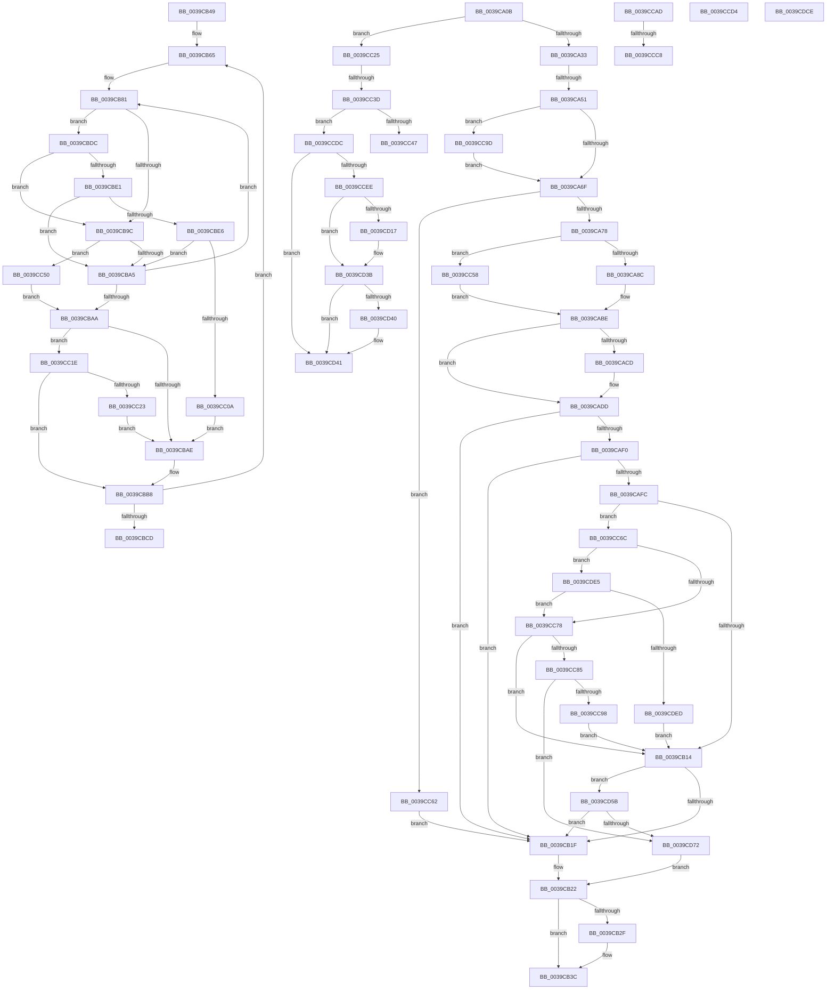

# sub_0039CA0B

- RVA: `0x0039CA0B`–`0x0039CDF2` (길이 `999` bytes)
- VA: `0x000000014039CA0B`
- 실행 섹션: `.text`
- PDB 이름 있음: `아니요`; PDB Function 태그: `아니요`
- unwind 정보 RVA: `0x000819E0`
- 디코드: `234`개 명령, `999/999` bytes 표시
- 미해석 바이트: `0` (있으면 어셈블리에 `.byte`로 보존)

> 이 문서는 커널 이미지의 기계어와 PDB 기호를 분석해 생성했습니다. 4번과 5번은 함수 원형과 자료형을 바이너리 사용 방식에서 추정한 C 해석이며 원본 소스 복구 결과는 아닙니다.

## 1. Dependencies

- 직접 호출 지점: **11**; 고유 호출 대상: **11**
- 직접 호출자로 확인된 함수: **0**
- RIP 상대 이미지 참조: **16**

### Outgoing calls
- `0x0039CA8C` → [Feature_Servicing_Kernel_ClockTickIdleEstimateFix__private_IsEnabledNoReportingNoInline](Feature_Servicing_Kernel_ClockTickIdleEstimateFix__private_IsEnabledNoReportingNoInline_function_0039CEE8.md) (function, `0x0039CEE8`)
- `0x0039CAB9` → [KiSetClockTimer](KiSetClockTimer_function_0039DB2C.md) (function, `0x0039DB2C`)
- `0x0039CB37` → [KiLowerIrqlProcessIrqlFlags](../4F/KiLowerIrqlProcessIrqlFlags_function_004F5698.md) (function, `0x004F5698`)
- `0x0039CC30` → [KiSetDpcRequestFlag](KiSetDpcRequestFlag_function_0039DC50.md) (function, `0x0039DC50`)
- `0x0039CC58` → [KiSetClockIntervalToMinimumRequested](KiSetClockIntervalToMinimumRequested_function_0039DF1C.md) (function, `0x0039DF1C`)
- `0x0039CC62` → [KiResetClockIntervalOneShot](KiResetClockIntervalOneShot_function_0039E0D4.md) (function, `0x0039E0D4`)
- `0x0039CCA3` → [KiRaiseIrqlProcessIrqlFlags](../4F/KiRaiseIrqlProcessIrqlFlags_function_004F56FC.md) (function, `0x004F56FC`)
- `0x0039CCF7` → [HalpDisableInterrupts](../25/HalpDisableInterrupts_function_002521A0.md) (function, `0x002521A0`)
- `0x0039CD51` → [HalpInterruptSendIpi](../25/HalpInterruptSendIpi_function_00252310.md) (function, `0x00252310`)
- `0x0039CD65` → [EtwpLevelKeywordEnabled](../2F/EtwpLevelKeywordEnabled_function_002FD110.md) (function, `0x002FD110`)
- `0x0039CDC4` → [EtwWriteEx](../25/EtwWriteEx_function_0025F0D0.md) (function, `0x0025F0D0`)

### Direct callers
- 이 함수 시작 RVA로 연결되는 직접 call은 확인되지 않았습니다. 간접 호출은 완전히 역산할 수 없습니다.

### Static image references
- `0x0039CA0B` → RVA `0x00F23360` (`.data`; read)
- `0x0039CA12` → RVA `0x00F23348` (`.data`; read)
- `0x0039CA19` → RVA `0x00FC6AA0` (`ALMOSTRO`; read)
- `0x0039CA33` → RVA `0x00F21F90` (`.data`; read)
- `0x0039CA62` → RVA `0x00FC6D20` (`ALMOSTRO`; read)
- `0x0039CA78` → RVA `0x00FC6A85` (`ALMOSTRO`; read)
- `0x0039CA7F` → RVA `0x00F21F90` (`.data`; write)
- `0x0039CABE` → RVA `0x00FC6B3C` (`ALMOSTRO`; read)
- `0x0039CADD` → RVA `0x00E67858` (`.data`; read)
- `0x0039CAF0` → RVA `0x00F0B408` (`.data`; read)
- `0x0039CBF3` → RVA `0x00FC6BEC` (`ALMOSTRO`; read)
- `0x0039CBFC` → RVA `0x00FC6BB8` (`ALMOSTRO`; read)
- `0x0039CC15` → RVA `0x00E668B0` (`.data`; write)
- `0x0039CCE1` → RVA `0x00FC6BC5` (`ALMOSTRO`; read)
- `0x0039CD81` → RVA `0x00010FD0` (`.rdata`; read)
- `0x0039CDCE` → RVA `0x00F23300` (`.data`; read)

## 2. Other-region calls and transfers

- 다른 실행 섹션으로 향하는 call: **0**
- call이 아닌 외부 분기/꼬리 이동: **10**
  - `0x0039CA4B` → [sub_0039C884 + 0x136](Unknown_function_0039C884.md) (`tail-transfer`)
  - `0x0039CB44` → [sub_0039C884 + 0x139](Unknown_function_0039C884.md) (`tail-transfer`)
  - `0x0039CBD7` → [sub_0039C884 + 0xC5](Unknown_function_0039C884.md) (`tail-transfer`)
  - `0x0039CC37` → [sub_0039C884 + 0x142](Unknown_function_0039C884.md) (`tail-transfer`)
  - `0x0039CC4B` → [sub_0039C884 + 0x142](Unknown_function_0039C884.md) (`tail-transfer`)
  - `0x0039CCC2` → [sub_0039C884 + 0xE9](Unknown_function_0039C884.md) (`tail-transfer`)
  - `0x0039CCCF` → [sub_0039C884 + 0x12A](Unknown_function_0039C884.md) (`tail-transfer`)
  - `0x0039CCD7` → [sub_0039C884 + 0x65](Unknown_function_0039C884.md) (`tail-transfer`)
  - `0x0039CD56` → [sub_0039C884 + 0x142](Unknown_function_0039C884.md) (`tail-transfer`)
  - `0x0039CDE0` → [sub_0039C884 + 0x12D](Unknown_function_0039C884.md) (`tail-transfer`)

## 3. Assembly (complete function range)

```asm
0039CA0B  48 8B 05 4E 69 B8 00            mov rax, qword ptr [rip + 0xb8694e]
0039CA12  4C 8B 3D 2F 69 B8 00            mov r15, qword ptr [rip + 0xb8692f]
0039CA19  44 8B 2D 80 A0 C2 00            mov r13d, dword ptr [rip + 0xc2a080]
0039CA20  4D 03 EC                        add r13, r12
0039CA23  49 3B C7                        cmp rax, r15
0039CA26  4C 0F 42 F8                     cmovb r15, rax
0039CA2A  4D 3B FC                        cmp r15, r12
0039CA2D  0F 86 F2 01 00 00               jbe 0x14039cc25
0039CA33  48 8B 05 56 55 B8 00            mov rax, qword ptr [rip + 0xb85556]
0039CA3A  48 C7 C1 FF FF FF FF            mov rcx, 0xffffffffffffffff
0039CA41  48 85 C0                        test rax, rax
0039CA44  48 0F 44 C1                     cmove rax, rcx
0039CA48  49 3B C7                        cmp rax, r15
0039CA4B  0F 84 69 FF FF FF               je 0x14039c9ba
0039CA51  44 0F 20 C0                     mov rax, cr8
0039CA55  48 89 45 CF                     mov qword ptr [rbp - 0x31], rax
0039CA59  B9 0F 00 00 00                  mov ecx, 0xf
0039CA5E  44 0F 22 C1                     mov cr8, rcx
0039CA62  83 3D B7 A2 C2 00 00            cmp dword ptr [rip + 0xc2a2b7], 0
0039CA69  0F 85 2E 02 00 00               jne 0x14039cc9d
0039CA6F  4D 3B EF                        cmp r13, r15
0039CA72  0F 86 EA 01 00 00               jbe 0x14039cc62
0039CA78  80 3D 06 A0 C2 00 00            cmp byte ptr [rip + 0xc2a006], 0
0039CA7F  4C 89 3D 0A 55 B8 00            mov qword ptr [rip + 0xb8550a], r15
0039CA86  0F 84 CC 01 00 00               je 0x14039cc58
0039CA8C  E8 57 04 00 00                  call 0x14039cee8
0039CA91  65 48 8B 0C 25 20 00 00 00      mov rcx, qword ptr gs:[0x20]
0039CA9A  85 C0                           test eax, eax
0039CA9C  C6 44 24 30 01                  mov byte ptr [rsp + 0x30], 1
0039CAA1  4D 8B C7                        mov r8, r15
0039CAA4  0F 94 C0                        sete al
0039CAA7  49 8B D4                        mov rdx, r12
0039CAAA  88 44 24 28                     mov byte ptr [rsp + 0x28], al
0039CAAE  45 33 C9                        xor r9d, r9d
0039CAB1  C7 44 24 20 02 00 00 00         mov dword ptr [rsp + 0x20], 2
0039CAB9  E8 6E 10 00 00                  call 0x14039db2c
0039CABE  8B 0D 78 A0 C2 00               mov ecx, dword ptr [rip + 0xc2a078]
0039CAC4  49 8D 04 0C                     lea rax, [r12 + rcx]
0039CAC8  4C 3B F8                        cmp r15, rax
0039CACB  76 10                           jbe 0x14039cadd
0039CACD  45 2B FC                        sub r15d, r12d
0039CAD0  8D 41 FF                        lea eax, [rcx - 1]
0039CAD3  41 03 C7                        add eax, r15d
0039CAD6  33 D2                           xor edx, edx
0039CAD8  F7 F1                           div ecx
0039CADA  0F AF C8                        imul ecx, eax
0039CADD  80 3D 74 AD AC 00 00            cmp byte ptr [rip + 0xacad74], 0
0039CAE4  C7 45 DF 48 52 4F 53            mov dword ptr [rbp - 0x21], 0x534f5248
0039CAEB  89 4D D7                        mov dword ptr [rbp - 0x29], ecx
0039CAEE  74 2F                           je 0x14039cb1f
0039CAF0  48 8B 15 11 E9 B6 00            mov rdx, qword ptr [rip + 0xb6e911]
0039CAF7  48 85 D2                        test rdx, rdx
0039CAFA  74 23                           je 0x14039cb1f
0039CAFC  48 8B 4A 20                     mov rcx, qword ptr [rdx + 0x20]
0039CB00  49 B8 04 00 00 00 00 00 00 40   movabs r8, 0x4000000000000004
0039CB0A  83 79 60 00                     cmp dword ptr [rcx + 0x60], 0
0039CB0E  0F 85 58 01 00 00               jne 0x14039cc6c
0039CB14  66 83 7A 66 00                  cmp word ptr [rdx + 0x66], 0
0039CB19  0F 85 3C 02 00 00               jne 0x14039cd5b
0039CB1F  45 33 ED                        xor r13d, r13d
0039CB22  83 3D F7 A1 C2 00 00            cmp dword ptr [rip + 0xc2a1f7], 0
0039CB29  4C 8B 7D CF                     mov r15, qword ptr [rbp - 0x31]
0039CB2D  74 0D                           je 0x14039cb3c
0039CB2F  44 0F 20 C1                     mov rcx, cr8
0039CB33  41 0F B6 D7                     movzx edx, r15b
0039CB37  E8 5C 8B 15 00                  call 0x1404f5698
0039CB3C  41 0F B6 C7                     movzx eax, r15b
0039CB40  44 0F 22 C0                     mov cr8, rax
0039CB44  E9 74 FE FF FF                  jmp 0x14039c9bd
0039CB49  4D 8B CC                        mov r9, r12
0039CB4C  4D 8D B8 10 42 00 00            lea r15, [r8 + 0x4210]
0039CB53  B8 FF FF FF FF                  mov eax, 0xffffffff
0039CB58  49 C1 E9 12                     shr r9, 0x12
0039CB5C  89 45 C7                        mov dword ptr [rbp - 0x39], eax
0039CB5F  41 8B D3                        mov edx, r11d
0039CB62  49 8B DB                        mov rbx, r11
0039CB65  41 8B 0F                        mov ecx, dword ptr [r15]
0039CB68  41 8B C1                        mov eax, r9d
0039CB6B  2B C1                           sub eax, ecx
0039CB6D  3D 00 01 00 00                  cmp eax, 0x100
0039CB72  44 8D 99 FF 00 00 00            lea r11d, [rcx + 0xff]
0039CB79  45 0F 42 D9                     cmovb r11d, r9d
0039CB7D  44 8D 49 FF                     lea r9d, [rcx - 1]
0039CB81  41 FF C1                        inc r9d
0039CB84  41 0F B6 C9                     movzx ecx, r9b
0039CB88  48 03 CB                        add rcx, rbx
0039CB8B  48 C1 E1 05                     shl rcx, 5
0039CB8F  4A 8B 8C 01 18 02 00 00         mov rcx, qword ptr [rcx + r8 + 0x218]
0039CB97  83 FA 01                        cmp edx, 1
0039CB9A  74 40                           je 0x14039cbdc
0039CB9C  4C 3B E1                        cmp r12, rcx
0039CB9F  0F 83 AB 00 00 00               jae 0x14039cc50
0039CBA5  45 3B CB                        cmp r9d, r11d
0039CBA8  75 D7                           jne 0x14039cb81
0039CBAA  85 D2                           test edx, edx
0039CBAC  75 70                           jne 0x14039cc1e
0039CBAE  8B C2                           mov eax, edx
0039CBB0  45 89 8C 80 10 42 00 00         mov dword ptr [r8 + rax*4 + 0x4210], r9d
0039CBB8  FF C2                           inc edx
0039CBBA  49 83 C7 04                     add r15, 4
0039CBBE  48 81 C3 00 01 00 00            add rbx, 0x100
0039CBC5  45 8B CB                        mov r9d, r11d
0039CBC8  83 FA 02                        cmp edx, 2
0039CBCB  72 98                           jb 0x14039cb65
0039CBCD  4C 8B 4D CF                     mov r9, qword ptr [rbp - 0x31]
0039CBD1  41 BF 01 00 00 00               mov r15d, 1
0039CBD7  E9 6D FD FF FF                  jmp 0x14039c949
0039CBDC  45 84 D2                        test r10b, r10b
0039CBDF  75 BB                           jne 0x14039cb9c
0039CBE1  4C 3B E1                        cmp r12, rcx
0039CBE4  72 BF                           jb 0x14039cba5
0039CBE6  8B 45 C7                        mov eax, dword ptr [rbp - 0x39]
0039CBE9  41 3B C1                        cmp eax, r9d
0039CBEC  41 0F 43 C1                     cmovae eax, r9d
0039CBF0  89 45 C7                        mov dword ptr [rbp - 0x39], eax
0039CBF3  8B 05 F3 9F C2 00               mov eax, dword ptr [rip + 0xc29ff3]
0039CBF9  48 03 C8                        add rcx, rax
0039CBFC  8B 05 B6 9F C2 00               mov eax, dword ptr [rip + 0xc29fb6]
0039CC02  49 03 C4                        add rax, r12
0039CC05  48 3B C1                        cmp rax, rcx
0039CC08  76 9B                           jbe 0x14039cba5
0039CC0A  44 8B 4D C7                     mov r9d, dword ptr [rbp - 0x39]
0039CC0E  40 B6 01                        mov sil, 1
0039CC11  44 0F B6 D6                     movzx r10d, sil
0039CC15  4C 89 25 94 9C AC 00            mov qword ptr [rip + 0xac9c94], r12
0039CC1C  EB 90                           jmp 0x14039cbae
0039CC1E  45 84 D2                        test r10b, r10b
0039CC21  74 95                           je 0x14039cbb8
0039CC23  EB 89                           jmp 0x14039cbae
0039CC25  45 33 ED                        xor r13d, r13d
0039CC28  BA 08 00 00 00                  mov edx, 8
0039CC2D  49 8B CE                        mov rcx, r14
0039CC30  E8 1B 10 00 00                  call 0x14039dc50
0039CC35  A8 A9                           test al, 0xa9
0039CC37  0F 85 89 FD FF FF               jne 0x14039c9c6
0039CC3D  80 7F 20 00                     cmp byte ptr [rdi + 0x20], 0
0039CC41  0F 84 95 00 00 00               je 0x14039ccdc
0039CC47  C6 47 06 01                     mov byte ptr [rdi + 6], 1
0039CC4B  E9 76 FD FF FF                  jmp 0x14039c9c6
0039CC50  40 B6 01                        mov sil, 1
0039CC53  E9 52 FF FF FF                  jmp 0x14039cbaa
0039CC58  E8 BF 12 00 00                  call 0x14039df1c
0039CC5D  E9 5C FE FF FF                  jmp 0x14039cabe
0039CC62  E8 6D 14 00 00                  call 0x14039e0d4
0039CC67  E9 B3 FE FF FF                  jmp 0x14039cb1f
0039CC6C  0F B6 41 64                     movzx eax, byte ptr [rcx + 0x64]
0039CC70  3C 04                           cmp al, 4
0039CC72  0F 82 6D 01 00 00               jb 0x14039cde5
0039CC78  8B 41 68                        mov eax, dword ptr [rcx + 0x68]
0039CC7B  4C 85 41 70                     test qword ptr [rcx + 0x70], r8
0039CC7F  0F 84 8F FE FF FF               je 0x14039cb14
0039CC85  48 8B 49 78                     mov rcx, qword ptr [rcx + 0x78]
0039CC89  48 8B C1                        mov rax, rcx
0039CC8C  49 23 C0                        and rax, r8
0039CC8F  48 3B C1                        cmp rax, rcx
0039CC92  0F 84 DA 00 00 00               je 0x14039cd72
0039CC98  E9 77 FE FF FF                  jmp 0x14039cb14
0039CC9D  0F B6 D1                        movzx edx, cl
0039CCA0  0F B6 C8                        movzx ecx, al
0039CCA3  E8 54 8A 15 00                  call 0x1404f56fc
0039CCA8  E9 C2 FD FF FF                  jmp 0x14039ca6f
0039CCAD  8B 05 39 9F C2 00               mov eax, dword ptr [rip + 0xc29f39]
0039CCB3  48 03 C8                        add rcx, rax
0039CCB6  8B 05 FC 9E C2 00               mov eax, dword ptr [rip + 0xc29efc]
0039CCBC  49 03 C4                        add rax, r12
0039CCBF  48 3B C1                        cmp rax, rcx
0039CCC2  0F 86 A5 FC FF FF               jbe 0x14039c96d
0039CCC8  4C 89 25 E1 9B AC 00            mov qword ptr [rip + 0xac9be1], r12
0039CCCF  E9 DA FC FF FF                  jmp 0x14039c9ae
0039CCD4  48 8B C7                        mov rax, rdi
0039CCD7  E9 0D FC FF FF                  jmp 0x14039c8e9
0039CCDC  33 C0                           xor eax, eax
0039CCDE  0F 57 C0                        xorps xmm0, xmm0
0039CCE1  38 05 DE 9E C2 00               cmp byte ptr [rip + 0xc29ede], al
0039CCE7  F3 0F 7F 45 13                  movdqu xmmword ptr [rbp + 0x13], xmm0
0039CCEC  74 53                           je 0x14039cd41
0039CCEE  65 4C 8B 04 25 20 00 00 00      mov r8, qword ptr gs:[0x20]
0039CCF7  E8 A4 54 EB FF                  call 0x1402521a0
0039CCFC  41 8B 90 A8 00 00 00            mov edx, dword ptr [r8 + 0xa8]
0039CD03  44 0F B6 C8                     movzx r9d, al
0039CD07  8B CA                           mov ecx, edx
0039CD09  83 C9 04                        or ecx, 4
0039CD0C  41 89 88 A8 00 00 00            mov dword ptr [r8 + 0xa8], ecx
0039CD13  85 D2                           test edx, edx
0039CD15  75 24                           jne 0x14039cd3b
0039CD17  B9 15 00 01 C0                  mov ecx, 0xc0010015
0039CD1C  0F 32                           rdmsr
0039CD1E  48 C1 E2 20                     shl rdx, 0x20
0039CD22  48 0B C2                        or rax, rdx
0039CD25  48 BA 00 00 00 00 01 00 00 00   movabs rdx, 0x100000000
0039CD2F  48 0B C2                        or rax, rdx
0039CD32  48 8B D0                        mov rdx, rax
0039CD35  48 C1 EA 20                     shr rdx, 0x20
0039CD39  0F 30                           wrmsr
0039CD3B  45 84 C9                        test r9b, r9b
0039CD3E  74 01                           je 0x14039cd41
0039CD40  FB                              sti
0039CD41  BA 2F 00 00 00                  mov edx, 0x2f
0039CD46  C7 45 0F 05 00 00 00            mov dword ptr [rbp + 0xf], 5
0039CD4D  48 8D 4D 0F                     lea rcx, [rbp + 0xf]
0039CD51  E8 BA 55 EB FF                  call 0x140252310
0039CD56  E9 6B FC FF FF                  jmp 0x14039c9c6
0039CD5B  48 8B 4A 28                     mov rcx, qword ptr [rdx + 0x28]
0039CD5F  B2 04                           mov dl, 4
0039CD61  48 83 C1 60                     add rcx, 0x60
0039CD65  E8 A6 03 F6 FF                  call 0x1402fd110
0039CD6A  84 C0                           test al, al
0039CD6C  0F 84 AD FD FF FF               je 0x14039cb1f
0039CD72  48 8B 0D 8F E6 B6 00            mov rcx, qword ptr [rip + 0xb6e68f]
0039CD79  48 8D 45 D7                     lea rax, [rbp - 0x29]
0039CD7D  48 89 45 0F                     mov qword ptr [rbp + 0xf], rax
0039CD81  48 8D 15 48 42 C7 FF            lea rdx, [rip - 0x38bdb8]
0039CD88  45 33 ED                        xor r13d, r13d
0039CD8B  48 C7 45 17 04 00 00 00         mov qword ptr [rbp + 0x17], 4
0039CD93  48 8D 45 DF                     lea rax, [rbp - 0x21]
0039CD97  48 C7 45 27 04 00 00 00         mov qword ptr [rbp + 0x27], 4
0039CD9F  48 89 45 1F                     mov qword ptr [rbp + 0x1f], rax
0039CDA3  45 33 C9                        xor r9d, r9d
0039CDA6  48 8D 45 0F                     lea rax, [rbp + 0xf]
0039CDAA  45 33 C0                        xor r8d, r8d
0039CDAD  48 89 44 24 38                  mov qword ptr [rsp + 0x38], rax
0039CDB2  C7 44 24 30 02 00 00 00         mov dword ptr [rsp + 0x30], 2
0039CDBA  4C 89 6C 24 28                  mov qword ptr [rsp + 0x28], r13
0039CDBF  4C 89 6C 24 20                  mov qword ptr [rsp + 0x20], r13
0039CDC4  E8 07 23 EC FF                  call 0x14025f0d0
0039CDC9  E9 54 FD FF FF                  jmp 0x14039cb22
0039CDCE  48 8B 05 2B 65 B8 00            mov rax, qword ptr [rip + 0xb8652b]
0039CDD5  49 3B C4                        cmp rax, r12
0039CDD8  40 0F B6 F6                     movzx esi, sil
0039CDDC  41 0F 46 F7                     cmovbe esi, r15d
0039CDE0  E9 CC FB FF FF                  jmp 0x14039c9b1
0039CDE5  84 C0                           test al, al
0039CDE7  0F 84 8B FE FF FF               je 0x14039cc78
0039CDED  E9 22 FD FF FF                  jmp 0x14039cb14
```

## 4. C-style interpretation (structured pseudocode)

```c
__int64 __fastcall sub_0039CA0B(__int64 a1, __int64 a2, __int64 a3, int a4)
{
    __int64 result;
    __int64 v_r13;
    __int64 v_r15;
    unsigned int v_stack_p20;
    unsigned __int8 v_stack_p28;
    unsigned __int8 v_stack_p30;
    unsigned __int64 v_stack_p38;

    v_r13 = ((unsigned int)(*(unsigned int *)(v_rip + 12755072))) + (v_r12);
    v_r15 = *(unsigned __int64 *)(v_rip + 12085551);
    if ((*(unsigned __int64 *)(v_rip + 12085582)) < (*(unsigned __int64 *)(v_rip + 12085551))) { v_r15 = *(unsigned __int64 *)(v_rip + 12085582); }
    if (v_r15 <= v_r12) goto loc_0039CC25;
    result = *(unsigned __int64 *)(v_rip + 12080470);
    if (*(unsigned __int64 *)(v_rip + 12080470) == 0) { result = -1; }
    *(unsigned __int64 *)(v_rbp - 49) = v_cr8;
    if ((*(unsigned int *)(v_rip + 12755639)) != 0) goto loc_0039CC9D;
loc_0039CA6F:
    if (v_r13 <= v_r15) goto loc_0039CC62;
    *(unsigned __int64 *)(v_rip + 12080394) = v_r15;
    if ((*(unsigned __int8 *)(v_rip + 12754950)) == 0) goto loc_0039CC58;
    result = Feature_Servicing_Kernel_ClockTickIdleEstimateFix__private_IsEnabledNoReportingNoInline(15, a2, a3, a4);
    v_stack_p30 = 1;
    result = ((unsigned int)(result) == 0) ? 1 : 0;
    v_stack_p28 = (unsigned __int8)(result);
    a4 = 0;
    v_stack_p20 = 2;
    result = KiSetClockTimer(*(unsigned __int64 *)(gs_base + (0 + 32)), v_r12, v_r15, a4);
loc_0039CABE:
    result = v_r12 + (unsigned int)(*(unsigned int *)(v_rip + 12755064)) * 1;
    if (v_r15 >= = (v_r12 + (unsigned int)(*(unsigned int *)(v_rip + 12755064)) * 1)) {
        v_r15 = (unsigned int)((v_r15) - ((unsigned int)(v_r12)));
        result = (unsigned int)(*(unsigned int *)(v_rip + 12755064)) - 1;
        result = (unsigned int)((result) + ((unsigned int)(v_r15)));
        a2 = 0;
        a1 = (unsigned int)(((unsigned int)(*(unsigned int *)(v_rip + 12755064))) * ((unsigned int)(result)));
    }
    *(unsigned int *)(v_rbp - 33) = 0x534F5248ULL;
    *(unsigned int *)(v_rbp - 41) = (unsigned int)(a1);
    if ((*(unsigned __int8 *)(v_rip + 11316596)) == 0) goto loc_0039CB1F;
    if (*(unsigned __int64 *)(v_rip + 11987217) == 0) goto loc_0039CB1F;
    if ((*(unsigned int *)(*(unsigned __int64 *)(*(unsigned __int64 *)(v_rip + 11987217) + 32) + 96)) != 0) goto loc_0039CC6C;
loc_0039CB14:
    if ((*(unsigned __int16 *)(*(unsigned __int64 *)(v_rip + 11987217) + 102)) != 0) goto loc_0039CD5B;
loc_0039CB1F:
    v_r13 = 0;
loc_0039CB22:
    if ((*(unsigned int *)(v_rip + 12755447)) != 0) {
        a1 = 15;
        a2 = (unsigned __int8)(*(unsigned __int64 *)(v_rbp - 49));
        result = KiLowerIrqlProcessIrqlFlags(a1, a2, v_r15, a4);
    }
loc_0039CC25:
    v_r13 = 0;
    result = KiSetDpcRequestFlag(v_r14, 8, v_r15, a4);
    if ((*(unsigned __int8 *)(v_rdi + 32)) == 0) goto loc_0039CCDC;
    *(unsigned __int8 *)(v_rdi + 6) = 1;
loc_0039CC58:
    result = KiSetClockIntervalToMinimumRequested(v_r14, 8, v_r15, a4);
    goto loc_0039CABE;
loc_0039CC62:
    result = KiResetClockIntervalOneShot(v_r14, 8, v_r15, a4);
    goto loc_0039CB1F;
loc_0039CC6C:
    if (((unsigned __int8)(*(unsigned __int8 *)(v_r14 + 100))) < 4) goto loc_0039CDE5;
loc_0039CC78:
    if (((*(unsigned __int64 *)(v_r14 + 112)) & (v_r15)) == 0) goto loc_0039CB14;
    result = (*(unsigned __int64 *)(v_r14 + 120)) & (v_r15);
    if (result == (*(unsigned __int64 *)(v_r14 + 120))) goto loc_0039CD72;
    goto loc_0039CB14;
loc_0039CC9D:
    result = KiRaiseIrqlProcessIrqlFlags((unsigned __int8)(result), (unsigned __int8)(*(unsigned __int64 *)(v_r14 + 120)), v_r15, a4);
    goto loc_0039CA6F;
loc_0039CCDC:
    result = 0;
    *(unsigned __int64 *)(v_rbp + 19) = v_xmm0;
    if ((*(unsigned __int8 *)(v_rip + 12754654)) == 0) goto loc_0039CD41;
    result = HalpDisableInterrupts((unsigned __int8)(result), (unsigned __int8)(*(unsigned __int64 *)(v_r14 + 120)), *(unsigned __int64 *)(gs_base + (0 + 32)), a4);
    a1 = (unsigned int)(((unsigned int)((unsigned int)((unsigned int)(*(unsigned int *)(*(unsigned __int64 *)(gs_base + (0 + 32)) + 168))))) | (4));
    *(unsigned int *)(*(unsigned __int64 *)(gs_base + (0 + 32)) + 168) = (unsigned int)(a1);
    if ((unsigned int)((unsigned int)(*(unsigned int *)(*(unsigned __int64 *)(gs_base + (0 + 32)) + 168))) == 0) {
        a1 = 0xC0010015ULL;
        a2 = ((unsigned int)(*(unsigned int *)(*(unsigned __int64 *)(gs_base + (0 + 32)) + 168))) << (32);
        result = (result) | (a2);
        result = (result) | (a2);
        a2 = result;
        a2 = (a2) >> (32);
    }
    if ((unsigned __int8)((unsigned __int8)(result)) != 0) {
    }
    *(unsigned int *)(v_rbp + 15) = 5;
    result = HalpInterruptSendIpi(v_rbp + 15, 47, *(unsigned __int64 *)(gs_base + (0 + 32)), (unsigned __int8)(result));
loc_0039CD5B:
    a1 = (*(unsigned __int64 *)(47 + 40)) + (96);
    result = EtwpLevelKeywordEnabled(a1, 4, *(unsigned __int64 *)(gs_base + (0 + 32)), (unsigned __int8)(result));
    if ((unsigned __int8)(result) == 0) goto loc_0039CB1F;
loc_0039CD72:
    *(unsigned __int64 *)(v_rbp + 15) = v_rbp - 41;
    v_r13 = 0;
    *(unsigned __int64 *)(v_rbp + 23) = 4;
    *(unsigned __int64 *)(v_rbp + 39) = 4;
    *(unsigned __int64 *)(v_rbp + 31) = v_rbp - 33;
    a4 = 0;
    a3 = 0;
    v_stack_p38 = v_rbp + 15;
    v_stack_p30 = 2;
    v_stack_p28 = 0;
    v_stack_p20 = 0;
    result = EtwWriteEx(*(unsigned __int64 *)(v_rip + 11986575), v_rip - 3718584, a3, a4);
    goto loc_0039CB22;
loc_0039CDE5:
    if ((unsigned __int8)(result) == 0) goto loc_0039CC78;
    goto loc_0039CB14;
}
```

## 5. (Beta) C Style

```c
int64_t sub_0039CA0B(int64_t Arg1, int64_t Arg2, int64_t Arg3, int32_t Arg4)
{
    int64_t result;
    int64_t local_r13;
    int64_t local_r15;
    uint32_t v_stack_p20;
    uint8_t v_stack_p28;
    uint8_t v_stack_p30;
    uint64_t v_stack_p38;

    local_r13 = ((uint32_t)(*(uint32_t *)(v_rip + 0xC2A080))) + (local_r12);
    local_r15 = *(uint64_t *)(v_rip + 0xB8692F);
    if ((*(uint64_t *)(v_rip + 0xB8694E)) < (*(uint64_t *)(v_rip + 0xB8692F))) { local_r15 = *(uint64_t *)(v_rip + 0xB8694E); }
    if (local_r15 <= local_r12) goto loc_0039CC25;
    result = *(uint64_t *)(v_rip + 0xB85556);
    if (*(uint64_t *)(v_rip + 0xB85556) == 0) { result = -1; }
    *(uint64_t *)(local_rbp - 0x31) = v_cr8;
    if ((*(uint32_t *)(v_rip + 0xC2A2B7)) != 0) goto loc_0039CC9D;
loc_0039CA6F:
    if (local_r13 <= local_r15) goto loc_0039CC62;
    *(uint64_t *)(v_rip + 0xB8550A) = local_r15;
    if ((*(uint8_t *)(v_rip + 0xC2A006)) == 0) goto loc_0039CC58;
    result = Feature_Servicing_Kernel_ClockTickIdleEstimateFix__private_IsEnabledNoReportingNoInline(15, Arg2, Arg3, Arg4);
    v_stack_p30 = 1;
    result = ((uint32_t)(result) == 0) ? 1 : 0;
    v_stack_p28 = (uint8_t)(result);
    Arg4 = 0;
    v_stack_p20 = 2;
    result = KiSetClockTimer(*(uint64_t *)(gs_base + (0 + 0x20)), local_r12, local_r15, Arg4);
loc_0039CABE:
    result = local_r12 + (uint32_t)(*(uint32_t *)(v_rip + 0xC2A078)) * 1;
    if (local_r15 >= = (local_r12 + (uint32_t)(*(uint32_t *)(v_rip + 0xC2A078)) * 1)) {
        local_r15 = (uint32_t)((local_r15) - ((uint32_t)(local_r12)));
        result = (uint32_t)(*(uint32_t *)(v_rip + 0xC2A078)) - 1;
        result = (uint32_t)((result) + ((uint32_t)(local_r15)));
        Arg2 = 0;
        Arg1 = (uint32_t)(((uint32_t)(*(uint32_t *)(v_rip + 0xC2A078))) * ((uint32_t)(result)));
    }
    *(uint32_t *)(local_rbp - 0x21) = 0x534F5248ULL;
    *(uint32_t *)(local_rbp - 0x29) = (uint32_t)(Arg1);
    if ((*(uint8_t *)(v_rip + 0xACAD74)) == 0) goto loc_0039CB1F;
    if (*(uint64_t *)(v_rip + 0xB6E911) == 0) goto loc_0039CB1F;
    if ((*(uint32_t *)(*(uint64_t *)(*(uint64_t *)(v_rip + 0xB6E911) + 0x20) + 0x60)) != 0) goto loc_0039CC6C;
loc_0039CB14:
    if ((*(uint16_t *)(*(uint64_t *)(v_rip + 0xB6E911) + 0x66)) != 0) goto loc_0039CD5B;
loc_0039CB1F:
    local_r13 = 0;
loc_0039CB22:
    if ((*(uint32_t *)(v_rip + 0xC2A1F7)) != 0) {
        Arg1 = 15;
        Arg2 = (uint8_t)(*(uint64_t *)(local_rbp - 0x31));
        result = KiLowerIrqlProcessIrqlFlags(Arg1, Arg2, local_r15, Arg4);
    }
loc_0039CC25:
    local_r13 = 0;
    result = KiSetDpcRequestFlag(local_r14, 8, local_r15, Arg4);
    if ((*(uint8_t *)(local_rdi + 0x20)) == 0) goto loc_0039CCDC;
    *(uint8_t *)(local_rdi + 0x6) = 1;
loc_0039CC58:
    result = KiSetClockIntervalToMinimumRequested(local_r14, 8, local_r15, Arg4);
    goto loc_0039CABE;
loc_0039CC62:
    result = KiResetClockIntervalOneShot(local_r14, 8, local_r15, Arg4);
    goto loc_0039CB1F;
loc_0039CC6C:
    if (((uint8_t)(*(uint8_t *)(local_r14 + 0x64))) < 4) goto loc_0039CDE5;
loc_0039CC78:
    if (((*(uint64_t *)(local_r14 + 0x70)) & (local_r15)) == 0) goto loc_0039CB14;
    result = (*(uint64_t *)(local_r14 + 0x78)) & (local_r15);
    if (result == (*(uint64_t *)(local_r14 + 0x78))) goto loc_0039CD72;
    goto loc_0039CB14;
loc_0039CC9D:
    result = KiRaiseIrqlProcessIrqlFlags((uint8_t)(result), (uint8_t)(*(uint64_t *)(local_r14 + 0x78)), local_r15, Arg4);
    goto loc_0039CA6F;
loc_0039CCDC:
    result = 0;
    *(uint64_t *)(local_rbp + 0x13) = v_xmm0;
    if ((*(uint8_t *)(v_rip + 0xC29EDE)) == 0) goto loc_0039CD41;
    result = HalpDisableInterrupts((uint8_t)(result), (uint8_t)(*(uint64_t *)(local_r14 + 0x78)), *(uint64_t *)(gs_base + (0 + 0x20)), Arg4);
    Arg1 = (uint32_t)(((uint32_t)((uint32_t)((uint32_t)(*(uint32_t *)(*(uint64_t *)(gs_base + (0 + 0x20)) + 0xA8))))) | (4));
    *(uint32_t *)(*(uint64_t *)(gs_base + (0 + 0x20)) + 0xA8) = (uint32_t)(Arg1);
    if ((uint32_t)((uint32_t)(*(uint32_t *)(*(uint64_t *)(gs_base + (0 + 0x20)) + 0xA8))) == 0) {
        Arg1 = 0xC0010015ULL;
        Arg2 = ((uint32_t)(*(uint32_t *)(*(uint64_t *)(gs_base + (0 + 0x20)) + 0xA8))) << (32);
        result = (result) | (Arg2);
        result = (result) | (Arg2);
        Arg2 = result;
        Arg2 = (Arg2) >> (32);
    }
    if ((uint8_t)((uint8_t)(result)) != 0) {
    }
    *(uint32_t *)(local_rbp + 0xF) = 5;
    result = HalpInterruptSendIpi(local_rbp + 15, 47, *(uint64_t *)(gs_base + (0 + 0x20)), (uint8_t)(result));
loc_0039CD5B:
    Arg1 = (*(uint64_t *)(47 + 0x28)) + (96);
    result = EtwpLevelKeywordEnabled(Arg1, 4, *(uint64_t *)(gs_base + (0 + 0x20)), (uint8_t)(result));
    if ((uint8_t)(result) == 0) goto loc_0039CB1F;
loc_0039CD72:
    *(uint64_t *)(local_rbp + 0xF) = local_rbp - 41;
    local_r13 = 0;
    *(uint64_t *)(local_rbp + 0x17) = 4;
    *(uint64_t *)(local_rbp + 0x27) = 4;
    *(uint64_t *)(local_rbp + 0x1F) = local_rbp - 33;
    Arg4 = 0;
    Arg3 = 0;
    v_stack_p38 = local_rbp + 15;
    v_stack_p30 = 2;
    v_stack_p28 = 0;
    v_stack_p20 = 0;
    result = EtwWriteEx(*(uint64_t *)(v_rip + 0xB6E68F), v_rip - 3718584, Arg3, Arg4);
    goto loc_0039CB22;
loc_0039CDE5:
    if ((uint8_t)(result) == 0) goto loc_0039CC78;
    goto loc_0039CB14;
}
```

## 6. Execution-region graph

[열기: 2D/3D 그래프와 함수 탐색 컨트롤 패널](../../../control-panel.html?section=text&rva=0x0039CA0B&view=graph)

- 2D 그래프는 위에서 아래로 흐르고, 3D 그래프는 빈 공간을 드래그해 회전합니다. Shift+드래그는 이동, 휠은 확대·축소, 함수 노드 선택은 대상 보고서 이동입니다.

### Static fallback


