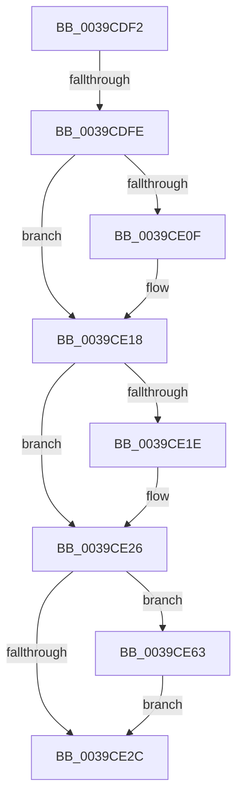

# sub_0039CDF2

- RVA: `0x0039CDF2`–`0x0039CE6D` (길이 `123` bytes)
- VA: `0x000000014039CDF2`
- 실행 섹션: `.text`
- PDB 이름 있음: `아니요`; PDB Function 태그: `아니요`
- unwind 정보 RVA: `0x000819FC`
- 디코드: `29`개 명령, `123/123` bytes 표시
- 미해석 바이트: `0` (있으면 어셈블리에 `.byte`로 보존)

> 이 문서는 커널 이미지의 기계어와 PDB 기호를 분석해 생성했습니다. 4번과 5번은 함수 원형과 자료형을 바이너리 사용 방식에서 추정한 C 해석이며 원본 소스 복구 결과는 아닙니다.

## 1. Dependencies

- 직접 호출 지점: **1**; 고유 호출 대상: **1**
- 직접 호출자로 확인된 함수: **0**
- RIP 상대 이미지 참조: **0**

### Outgoing calls
- `0x0039CE59` → [EtwTraceKernelEvent](../23/EtwTraceKernelEvent_function_00235350.md) (function, `0x00235350`)

### Direct callers
- 이 함수 시작 RVA로 연결되는 직접 call은 확인되지 않았습니다. 간접 호출은 완전히 역산할 수 없습니다.

### Static image references
- 디코드된 RIP-relative 메모리 참조가 없습니다.

## 2. Other-region calls and transfers

- 다른 실행 섹션으로 향하는 call: **0**
- call이 아닌 외부 분기/꼬리 이동: **2**
  - `0x0039CDF8` → [sub_0039C9EE](Unknown_function_0039C9EE.md) (`tail-transfer`)
  - `0x0039CE5E` → [sub_0039C9EE](Unknown_function_0039C9EE.md) (`tail-transfer`)

## 3. Assembly (complete function range)

```asm
0039CDF2  44 0F 20 C0                     mov rax, cr8
0039CDF6  3C 0D                           cmp al, 0xd
0039CDF8  0F 85 F0 FB FF FF               jne 0x14039c9ee
0039CDFE  80 3B 00                        cmp byte ptr [rbx], 0
0039CE01  41 0F B7 CD                     movzx ecx, r13w
0039CE05  66 89 4D F7                     mov word ptr [rbp - 9], cx
0039CE09  4C 89 65 EF                     mov qword ptr [rbp - 0x11], r12
0039CE0D  74 09                           je 0x14039ce18
0039CE0F  B9 01 00 00 00                  mov ecx, 1
0039CE14  66 89 4D F7                     mov word ptr [rbp - 9], cx
0039CE18  41 F6 06 08                     test byte ptr [r14], 8
0039CE1C  74 08                           je 0x14039ce26
0039CE1E  66 83 C9 08                     or cx, 8
0039CE22  66 89 4D F7                     mov word ptr [rbp - 9], cx
0039CE26  83 7D E7 01                     cmp dword ptr [rbp - 0x19], 1
0039CE2A  76 37                           jbe 0x14039ce63
0039CE2C  48 8D 45 EF                     lea rax, [rbp - 0x11]
0039CE30  48 C7 45 07 10 00 00 00         mov qword ptr [rbp + 7], 0x10
0039CE38  41 B9 4F 0F 00 00               mov r9d, 0xf4f
0039CE3E  48 89 45 FF                     mov qword ptr [rbp - 1], rax
0039CE42  BA 01 00 00 00                  mov edx, 1
0039CE47  C7 44 24 20 02 0A 50 00         mov dword ptr [rsp + 0x20], 0x500a02
0039CE4F  41 B8 00 00 04 40               mov r8d, 0x40040000
0039CE55  48 8D 4D FF                     lea rcx, [rbp - 1]
0039CE59  E8 F2 84 E9 FF                  call 0x140235350
0039CE5E  E9 8B FB FF FF                  jmp 0x14039c9ee
0039CE63  66 83 C9 10                     or cx, 0x10
0039CE67  66 89 4D F7                     mov word ptr [rbp - 9], cx
0039CE6B  EB BF                           jmp 0x14039ce2c
```

## 4. C-style interpretation (structured pseudocode)

```c
__int64 __fastcall sub_0039CDF2(void)
{
    __int64 result;
    unsigned int v_stack_p20;

    *(unsigned __int16 *)(v_rbp - 9) = (unsigned __int16)((unsigned __int16)(v_r13));
    *(unsigned __int64 *)(v_rbp - 17) = v_r12;
    if ((*(unsigned __int8 *)(v_rbx)) != 0) {
        a1 = 1;
        *(unsigned __int16 *)(v_rbp - 9) = (unsigned __int16)(a1);
    }
    if (((*(unsigned __int8 *)(v_r14)) & (8)) != 0) {
        a1 = (unsigned __int16)((a1) | (8));
        *(unsigned __int16 *)(v_rbp - 9) = (unsigned __int16)(a1);
    }
    if ((*(unsigned int *)(v_rbp - 25)) <= 1) goto loc_0039CE63;
loc_0039CE2C:
    *(unsigned __int64 *)(v_rbp + 7) = 16;
    *(unsigned __int64 *)(v_rbp - 1) = v_rbp - 17;
    v_stack_p20 = 0x500A02ULL;
    result = EtwTraceKernelEvent(v_rbp - 1, 1, (unsigned int)(0x40040000ULL), (unsigned int)(0xF4FULL));
loc_0039CE63:
    a1 = (unsigned __int16)((v_rbp - 1) | (16));
    *(unsigned __int16 *)(v_rbp - 9) = (unsigned __int16)(a1);
    goto loc_0039CE2C;
}
```

## 5. (Beta) C Style

```c
void sub_0039CDF2(void)
{
    int64_t result;
    uint32_t v_stack_p20;

    *(uint16_t *)(local_rbp - 0x9) = (uint16_t)((uint16_t)(local_r13));
    *(uint64_t *)(local_rbp - 0x11) = local_r12;
    if ((*(uint8_t *)(local_rbx)) != 0) {
        a1 = 1;
        *(uint16_t *)(local_rbp - 0x9) = (uint16_t)(a1);
    }
    if (((*(uint8_t *)(local_r14)) & (8)) != 0) {
        a1 = (uint16_t)((a1) | (8));
        *(uint16_t *)(local_rbp - 0x9) = (uint16_t)(a1);
    }
    if ((*(uint32_t *)(local_rbp - 0x19)) <= 1) goto loc_0039CE63;
loc_0039CE2C:
    *(uint64_t *)(local_rbp + 0x7) = 16;
    *(uint64_t *)(local_rbp - 0x1) = local_rbp - 17;
    v_stack_p20 = 0x500A02ULL;
    result = EtwTraceKernelEvent(local_rbp - 1, 1, (uint32_t)(0x40040000ULL), (uint32_t)(0xF4FULL));
loc_0039CE63:
    a1 = (uint16_t)((local_rbp - 1) | (16));
    *(uint16_t *)(local_rbp - 0x9) = (uint16_t)(a1);
    goto loc_0039CE2C;
}
```

## 6. Execution-region graph

[열기: 2D/3D 그래프와 함수 탐색 컨트롤 패널](../../../control-panel.html?section=text&rva=0x0039CDF2&view=graph)

- 2D 그래프는 위에서 아래로 흐르고, 3D 그래프는 빈 공간을 드래그해 회전합니다. Shift+드래그는 이동, 휠은 확대·축소, 함수 노드 선택은 대상 보고서 이동입니다.

### Static fallback


