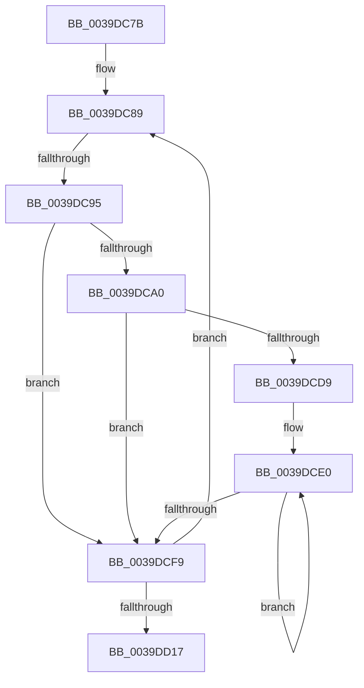

# sub_0039DC7B

- RVA: `0x0039DC7B`–`0x0039DD20` (길이 `165` bytes)
- VA: `0x000000014039DC7B`
- 실행 섹션: `.text`
- PDB 이름 있음: `아니요`; PDB Function 태그: `아니요`
- unwind 정보 RVA: `0x00081B1C`
- 디코드: `46`개 명령, `165/165` bytes 표시
- 미해석 바이트: `0` (있으면 어셈블리에 `.byte`로 보존)

> 이 문서는 커널 이미지의 기계어와 PDB 기호를 분석해 생성했습니다. 4번과 5번은 함수 원형과 자료형을 바이너리 사용 방식에서 추정한 C 해석이며 원본 소스 복구 결과는 아닙니다.

## 1. Dependencies

- 직접 호출 지점: **0**; 고유 호출 대상: **0**
- 직접 호출자로 확인된 함수: **0**
- RIP 상대 이미지 참조: **1**

### Outgoing calls
- 직접 디코드된 call 명령이 없습니다.

### Direct callers
- 이 함수 시작 RVA로 연결되는 직접 call은 확인되지 않았습니다. 간접 호출은 완전히 역산할 수 없습니다.

### Static image references
- `0x0039DC95` → RVA `0x00FC6A80` (`ALMOSTRO`; read)

## 2. Other-region calls and transfers

- 다른 실행 섹션으로 향하는 call: **0**
- call이 아닌 외부 분기/꼬리 이동: **2**
  - `0x0039DC8F` → [sub_0039DD20](Unknown_function_0039DD20.md) (`tail-transfer`)
  - `0x0039DD1E` → [sub_0039DD36 + 0x3](Unknown_function_0039DD36.md) (`tail-transfer`)

## 3. Assembly (complete function range)

```asm
0039DC7B  48 89 1C 24                     mov qword ptr [rsp], rbx
0039DC7F  48 BB D6 02 00 00 80 F7 FF FF   movabs rbx, 0xfffff780000002d6
0039DC89  45 8B C8                        mov r9d, r8d
0039DC8C  45 85 C0                        test r8d, r8d
0039DC8F  0F 85 8B 00 00 00               jne 0x14039dd20
0039DC95  8B 05 E5 8D C2 00               mov eax, dword ptr [rip + 0xc28de5]
0039DC9B  83 F8 01                        cmp eax, 1
0039DC9E  74 59                           je 0x14039dcf9
0039DCA0  41 B9 40 00 00 00               mov r9d, 0x40
0039DCA6  45 8B C1                        mov r8d, r9d
0039DCA9  0F 31                           rdtsc
0039DCAB  48 C1 E2 20                     shl rdx, 0x20
0039DCAF  48 0B C2                        or rax, rdx
0039DCB2  33 D2                           xor edx, edx
0039DCB4  48 8B C8                        mov rcx, rax
0039DCB7  41 8D 41 FF                     lea eax, [r9 - 1]
0039DCBB  23 C8                           and ecx, eax
0039DCBD  44 03 C9                        add r9d, ecx
0039DCC0  0F B7 0B                        movzx ecx, word ptr [rbx]
0039DCC3  43 8D 04 89                     lea eax, [r9 + r9*4]
0039DCC7  03 C0                           add eax, eax
0039DCC9  F7 F1                           div ecx
0039DCCB  44 8B C8                        mov r9d, eax
0039DCCE  33 C0                           xor eax, eax
0039DCD0  89 44 24 10                     mov dword ptr [rsp + 0x10], eax
0039DCD4  45 85 C9                        test r9d, r9d
0039DCD7  74 20                           je 0x14039dcf9
0039DCD9  0F 1F 80 00 00 00 00            nop dword ptr [rax]
0039DCE0  8B 4C 24 10                     mov ecx, dword ptr [rsp + 0x10]
0039DCE4  8B 4C 24 10                     mov ecx, dword ptr [rsp + 0x10]
0039DCE8  8B 4C 24 10                     mov ecx, dword ptr [rsp + 0x10]
0039DCEC  F3 90                           pause
0039DCEE  FF C0                           inc eax
0039DCF0  89 44 24 10                     mov dword ptr [rsp + 0x10], eax
0039DCF4  41 3B C1                        cmp eax, r9d
0039DCF7  72 E7                           jb 0x14039dce0
0039DCF9  41 0F 0D 0A                     prefetchw byte ptr [r10]
0039DCFD  41 0F B7 12                     movzx edx, word ptr [r10]
0039DD01  0F B7 CA                        movzx ecx, dx
0039DD04  0F B7 C2                        movzx eax, dx
0039DD07  66 41 0B CB                     or cx, r11w
0039DD0B  66 F0 41 0F B1 0A               lock cmpxchg word ptr [r10], cx
0039DD11  0F 85 72 FF FF FF               jne 0x14039dc89
0039DD17  48 8B 1C 24                     mov rbx, qword ptr [rsp]
0039DD1B  0F B7 C2                        movzx eax, dx
0039DD1E  EB 19                           jmp 0x14039dd39
```

## 4. C-style interpretation (structured pseudocode)

```c
__int64 __fastcall sub_0039DC7B(__int64 a1, __int64 a2, int a3)
{
    __int64 result;
    unsigned __int64 v_stack_p0;
    unsigned int v_stack_p10;

    v_stack_p0 = v_rbx;
loc_0039DC89:
    if (((unsigned int)((unsigned int)(*(unsigned int *)(v_rip + 12750309)))) == 1) goto loc_0039DCF9;
    a2 = (a2) << (32);
    result = ((unsigned int)(*(unsigned int *)(v_rip + 12750309))) | (a2);
    a2 = 0;
    a1 = (unsigned int)((result) & ((unsigned int)(64 - 1)));
    a4 = (unsigned int)((64) + ((unsigned int)(a1)));
    result = (unsigned int)((a4 + a4 * 4) + ((unsigned int)(a4 + a4 * 4)));
    result = 0;
    v_stack_p10 = 0;
    if ((unsigned int)((unsigned int)((unsigned int)(result))) == 0) goto loc_0039DCF9;
loc_0039DCE0:
    result = (unsigned int)((result) + 1);
    v_stack_p10 = (unsigned int)(result);
    if (((unsigned int)(result)) < ((unsigned int)((unsigned int)((unsigned int)(result))))) goto loc_0039DCE0;
loc_0039DCF9:
    a1 = (unsigned __int16)(((unsigned __int16)(*(unsigned __int16 *)(v_r10))) | ((unsigned __int16)(v_r11)));
    if (condition_is_not_equal) goto loc_0039DC89;
}
```

## 5. (Beta) C Style

```c
int64_t sub_0039DC7B(int64_t Arg1, int64_t Arg2, int32_t Arg3)
{
    int64_t result;
    uint64_t v_stack_p0;
    uint32_t v_stack_p10;

    v_stack_p0 = local_rbx;
loc_0039DC89:
    if (((uint32_t)((uint32_t)(*(uint32_t *)(v_rip + 0xC28DE5)))) == 1) goto loc_0039DCF9;
    Arg2 = (Arg2) << (32);
    result = ((uint32_t)(*(uint32_t *)(v_rip + 0xC28DE5))) | (Arg2);
    Arg2 = 0;
    Arg1 = (uint32_t)((result) & ((uint32_t)(64 - 1)));
    a4 = (uint32_t)((64) + ((uint32_t)(Arg1)));
    result = (uint32_t)((a4 + a4 * 4) + ((uint32_t)(a4 + a4 * 4)));
    result = 0;
    v_stack_p10 = 0;
    if ((uint32_t)((uint32_t)((uint32_t)(result))) == 0) goto loc_0039DCF9;
loc_0039DCE0:
    result = (uint32_t)((result) + 1);
    v_stack_p10 = (uint32_t)(result);
    if (((uint32_t)(result)) < ((uint32_t)((uint32_t)((uint32_t)(result))))) goto loc_0039DCE0;
loc_0039DCF9:
    Arg1 = (uint16_t)(((uint16_t)(*(uint16_t *)(local_r10))) | ((uint16_t)(local_r11)));
    if (condition_is_not_equal) goto loc_0039DC89;
}
```

## 6. Execution-region graph

[열기: 2D/3D 그래프와 함수 탐색 컨트롤 패널](../../../control-panel.html?section=text&rva=0x0039DC7B&view=graph)

- 2D 그래프는 위에서 아래로 흐르고, 3D 그래프는 빈 공간을 드래그해 회전합니다. Shift+드래그는 이동, 휠은 확대·축소, 함수 노드 선택은 대상 보고서 이동입니다.

### Static fallback


