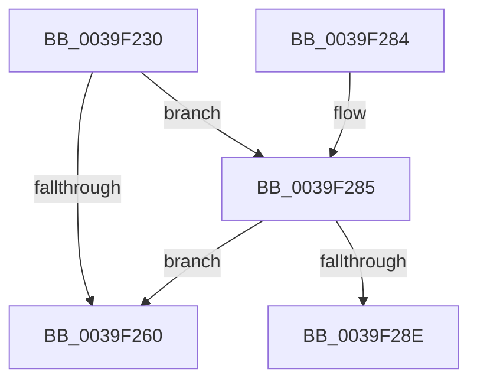

# WdtpArmTimer

- RVA: `0x0039F230`–`0x0039F2B2` (길이 `130` bytes)
- VA: `0x000000014039F230`
- 실행 섹션: `.text`
- PDB 이름 있음: `예`; PDB Function 태그: `아니요`
- unwind 정보 RVA: `0x00081C80`
- 디코드: `33`개 명령, `130/130` bytes 표시
- 미해석 바이트: `0` (있으면 어셈블리에 `.byte`로 보존)

> 이 문서는 커널 이미지의 기계어와 PDB 기호를 분석해 생성했습니다. 4번과 5번은 함수 원형과 자료형을 바이너리 사용 방식에서 추정한 C 해석이며 원본 소스 복구 결과는 아닙니다.

## 1. Dependencies

- 직접 호출 지점: **3**; 고유 호출 대상: **3**
- 직접 호출자로 확인된 함수: **2**
- RIP 상대 이미지 참조: **0**

### Outgoing calls
- `0x0039F263` → [ExpCheckForFreedEnhancedTimer](../3A/ExpCheckForFreedEnhancedTimer_function_003A0148.md) (function, `0x003A0148`)
- `0x0039F274` → [KeSetTimer2](../3A/KeSetTimer2_function_003A08E0.md) (function, `0x003A08E0`)
- `0x0039F2AC` → [KeBugCheckEx](../4F/KeBugCheckEx_function_004FD660.md) (function, `0x004FD660`)

### Direct callers
- [WdtpTimerCallback](../6A/WdtpTimerCallback_function_006A31B0.md) at `0x006A320D`
- [PnpWatchdogTimerStart](../../page/8F/PnpWatchdogTimerStart_function_008FB624.md) at `0x008FB634`

### Static image references
- 디코드된 RIP-relative 메모리 참조가 없습니다.

## 2. Other-region calls and transfers

- 다른 실행 섹션으로 향하는 call: **0**
- 별도 외부 분기/꼬리 이동을 확인하지 못했습니다.

## 3. Assembly (complete function range)

```asm
0039F230  48 89 5C 24 10                  mov qword ptr [rsp + 0x10], rbx
0039F235  57                              push rdi
0039F236  48 83 EC 30                     sub rsp, 0x30
0039F23A  48 A1 08 00 00 00 80 F7 FF FF   movabs rax, qword ptr [0xfffff78000000008]
0039F244  48 8B 59 30                     mov rbx, qword ptr [rcx + 0x30]
0039F248  48 89 41 78                     mov qword ptr [rcx + 0x78], rax
0039F24C  8B C2                           mov eax, edx
0039F24E  48 69 F8 F0 D8 FF FF            imul rdi, rax, -0x2710
0039F255  89 91 80 00 00 00               mov dword ptr [rcx + 0x80], edx
0039F25B  48 85 FF                        test rdi, rdi
0039F25E  7F 25                           jg 0x14039f285
0039F260  48 8B CB                        mov rcx, rbx
0039F263  E8 E0 0E 00 00                  call 0x1403a0148
0039F268  45 33 C9                        xor r9d, r9d
0039F26B  45 33 C0                        xor r8d, r8d
0039F26E  48 8B D7                        mov rdx, rdi
0039F271  48 8B CB                        mov rcx, rbx
0039F274  E8 67 16 00 00                  call 0x1403a08e0
0039F279  48 8B 5C 24 48                  mov rbx, qword ptr [rsp + 0x48]
0039F27E  48 83 C4 30                     add rsp, 0x30
0039F282  5F                              pop rdi
0039F283  C3                              ret
0039F284  CC                              int3
0039F285  F6 83 81 00 00 00 04            test byte ptr [rbx + 0x81], 4
0039F28C  74 D2                           je 0x14039f260
0039F28E  48 83 64 24 20 00               and qword ptr [rsp + 0x20], 0
0039F294  4C 8D 4C 24 40                  lea r9, [rsp + 0x40]
0039F299  BA 09 00 00 00                  mov edx, 9
0039F29E  48 89 7C 24 40                  mov qword ptr [rsp + 0x40], rdi
0039F2A3  B9 C7 00 00 00                  mov ecx, 0xc7
0039F2A8  44 8D 42 F9                     lea r8d, [rdx - 7]
0039F2AC  E8 AF E3 15 00                  call 0x1404fd660
0039F2B1  CC                              int3
```

## 4. C-style interpretation (structured pseudocode)

```c
__int64 __fastcall WdtpArmTimer(__int64 a1, int a2, int a3, int a4)
{
    __int64 result;
    __int64 v_rdi;
    __int64 v_rsp;
    unsigned __int64 v_stack_p10;
    unsigned __int64 v_stack_p20;
    unsigned __int64 v_stack_p40;

    v_stack_p10 = v_rbx;
    v_rsp = (v_rsp) - (48);
    *(unsigned __int64 *)(a1 + 120) = result;
    v_rdi = (v_rdi) * ((unsigned int)(a2));
    *(unsigned int *)(a1 + 128) = a2;
    if (condition_is_greater) goto loc_0039F285;
loc_0039F260:
    result = ExpCheckForFreedEnhancedTimer(*(unsigned __int64 *)(a1 + 48), a2, a3, a4);
    a4 = 0;
    a3 = 0;
    result = KeSetTimer2(*(unsigned __int64 *)(a1 + 48), v_rdi, a3, a4);
    v_rsp = (v_rsp) + (48);
    return result;
loc_0039F285:
    if (((*(unsigned __int8 *)(v_stack_p10 + 129)) & (4)) == 0) goto loc_0039F260;
    v_stack_p40 = v_rdi;
    result = KeBugCheckEx(199, 9, 9 - 7, v_stack_p40);
    return result;
}
```

## 5. (Beta) C Style

```c
int64_t WdtpArmTimer(void *Arg1, int32_t Arg2, int32_t Arg3, int32_t Arg4)
{
    uint8_t *arg1 = (uint8_t *)Arg1;

    int64_t result;
    int64_t local_rdi;
    int64_t local_rsp;
    uint64_t v_stack_p10;
    uint64_t v_stack_p20;
    uint64_t v_stack_p40;

    v_stack_p10 = local_rbx;
    local_rsp = (local_rsp) - (48);
    *(uint64_t *)(arg1 + 0x78) = result;
    local_rdi = (local_rdi) * ((uint32_t)(Arg2));
    *(uint32_t *)(arg1 + 0x80) = Arg2;
    if (condition_is_greater) goto loc_0039F285;
loc_0039F260:
    result = ExpCheckForFreedEnhancedTimer(*(uint64_t *)(arg1 + 0x30), Arg2, Arg3, Arg4);
    Arg4 = 0;
    Arg3 = 0;
    result = KeSetTimer2(*(uint64_t *)(arg1 + 0x30), local_rdi, Arg3, Arg4);
    local_rsp = (local_rsp) + (48);
    return result;
loc_0039F285:
    if (((*(uint8_t *)(v_stack_p10 + 0x81)) & (4)) == 0) goto loc_0039F260;
    v_stack_p40 = local_rdi;
    result = KeBugCheckEx(199, 9, 9 - 7, v_stack_p40);
    return result;
}
```

### 관측된 메모리 오프셋

구조체 형식이 확인되지 않은 접근은 인자 기준의 오프셋으로만 기록했습니다.

| 기준 인자 | 오프셋 표현 | 폭 (bit) | 접근 |
|---|---:|---:|---|
| `Arg1` | `+ 0x30` | `64` | `R` |
| `Arg1` | `+ 0x78` | `64` | `W` |
| `Arg1` | `+ 0x80` | `32` | `W` |

## 6. Execution-region graph

[열기: 2D/3D 그래프와 함수 탐색 컨트롤 패널](../../../control-panel.html?section=text&rva=0x0039F230&view=graph)

- 2D 그래프는 위에서 아래로 흐르고, 3D 그래프는 빈 공간을 드래그해 회전합니다. Shift+드래그는 이동, 휠은 확대·축소, 함수 노드 선택은 대상 보고서 이동입니다.

### Static fallback


