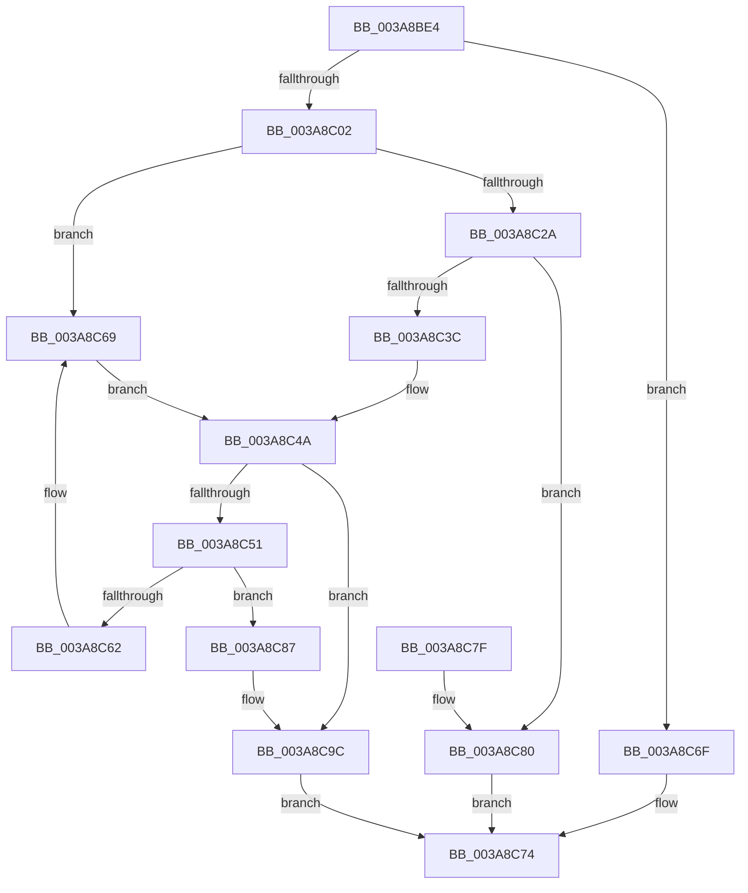

# AuthzBasepAddSecurityAttribute

- RVA: `0x003A8BE4`–`0x003A8CA6` (길이 `194` bytes)
- VA: `0x00000001403A8BE4`
- 실행 섹션: `.text`
- PDB 이름 있음: `예`; PDB Function 태그: `아니요`
- unwind 정보 RVA: `0x00089E94`
- 디코드: `57`개 명령, `194/194` bytes 표시
- 미해석 바이트: `0` (있으면 어셈블리에 `.byte`로 보존)

> 이 문서는 커널 이미지의 기계어와 PDB 기호를 분석해 생성했습니다. 4번과 5번은 함수 원형과 자료형을 바이너리 사용 방식에서 추정한 C 해석이며 원본 소스 복구 결과는 아닙니다.

## 1. Dependencies

- 직접 호출 지점: **3**; 고유 호출 대상: **3**
- 직접 호출자로 확인된 함수: **2**
- RIP 상대 이미지 참조: **0**

### Outgoing calls
- `0x003A8C1D` → [AuthzBasepFindSecurityAttribute](AuthzBasepFindSecurityAttribute_function_003A8980.md) (function, `0x003A8980`)
- `0x003A8C2F` → [AuthzBasepAllocateSecurityAttribute](AuthzBasepAllocateSecurityAttribute_function_003A93A0.md) (function, `0x003A93A0`)
- `0x003A8C9F` → [AuthzBasepAddSecurityAttributeValues](../30/AuthzBasepAddSecurityAttributeValues_function_003020EC.md) (function, `0x003020EC`)

### Direct callers
- [AuthzBasepReplaceSecurityAttribute](AuthzBasepReplaceSecurityAttribute_function_003A8CAC.md) at `0x003A8CFE`
- [AuthzBasepSetSecurityAttributesToken](AuthzBasepSetSecurityAttributesToken_function_003A8D1C.md) at `0x003A8DEA`

### Static image references
- 디코드된 RIP-relative 메모리 참조가 없습니다.

## 2. Other-region calls and transfers

- 다른 실행 섹션으로 향하는 call: **0**
- 별도 외부 분기/꼬리 이동을 확인하지 못했습니다.

## 3. Assembly (complete function range)

```asm
003A8BE4  48 89 5C 24 08                  mov qword ptr [rsp + 8], rbx
003A8BE9  57                              push rdi
003A8BEA  48 83 EC 30                     sub rsp, 0x30
003A8BEE  83 7A 18 00                     cmp dword ptr [rdx + 0x18], 0
003A8BF2  0F 57 C0                        xorps xmm0, xmm0
003A8BF5  0F 11 44 24 20                  movups xmmword ptr [rsp + 0x20], xmm0
003A8BFA  48 8B DA                        mov rbx, rdx
003A8BFD  48 8B F9                        mov rdi, rcx
003A8C00  74 6D                           je 0x1403a8c6f
003A8C02  0F B7 02                        movzx eax, word ptr [rdx]
003A8C05  66 89 44 24 20                  mov word ptr [rsp + 0x20], ax
003A8C0A  66 89 44 24 22                  mov word ptr [rsp + 0x22], ax
003A8C0F  48 8B 42 08                     mov rax, qword ptr [rdx + 8]
003A8C13  48 8D 54 24 20                  lea rdx, [rsp + 0x20]
003A8C18  48 89 44 24 28                  mov qword ptr [rsp + 0x28], rax
003A8C1D  E8 5E FD FF FF                  call 0x1403a8980
003A8C22  48 8B C8                        mov rcx, rax
003A8C25  48 85 C0                        test rax, rax
003A8C28  75 3F                           jne 0x1403a8c69
003A8C2A  48 8D 4C 24 20                  lea rcx, [rsp + 0x20]
003A8C2F  E8 6C 07 00 00                  call 0x1403a93a0
003A8C34  48 8B C8                        mov rcx, rax
003A8C37  48 85 C0                        test rax, rax
003A8C3A  74 44                           je 0x1403a8c80
003A8C3C  8B 43 14                        mov eax, dword ptr [rbx + 0x14]
003A8C3F  89 41 34                        mov dword ptr [rcx + 0x34], eax
003A8C42  0F B7 43 10                     movzx eax, word ptr [rbx + 0x10]
003A8C46  66 89 41 30                     mov word ptr [rcx + 0x30], ax
003A8C4A  8B 41 38                        mov eax, dword ptr [rcx + 0x38]
003A8C4D  A8 02                           test al, 2
003A8C4F  75 4B                           jne 0x1403a8c9c
003A8C51  48 8D 57 20                     lea rdx, [rdi + 0x20]
003A8C55  4C 8B 42 08                     mov r8, qword ptr [rdx + 8]
003A8C59  48 8D 41 10                     lea rax, [rcx + 0x10]
003A8C5D  49 39 10                        cmp qword ptr [r8], rdx
003A8C60  74 25                           je 0x1403a8c87
003A8C62  B9 03 00 00 00                  mov ecx, 3
003A8C67  CD 29                           int 0x29
003A8C69  83 60 38 FB                     and dword ptr [rax + 0x38], 0xfffffffb
003A8C6D  EB DB                           jmp 0x1403a8c4a
003A8C6F  B8 0D 00 00 C0                  mov eax, 0xc000000d
003A8C74  48 8B 5C 24 40                  mov rbx, qword ptr [rsp + 0x40]
003A8C79  48 83 C4 30                     add rsp, 0x30
003A8C7D  5F                              pop rdi
003A8C7E  C3                              ret
003A8C7F  CC                              int3
003A8C80  B8 9A 00 00 C0                  mov eax, 0xc000009a
003A8C85  EB ED                           jmp 0x1403a8c74
003A8C87  48 89 10                        mov qword ptr [rax], rdx
003A8C8A  4C 89 40 08                     mov qword ptr [rax + 8], r8
003A8C8E  49 89 00                        mov qword ptr [r8], rax
003A8C91  48 89 42 08                     mov qword ptr [rdx + 8], rax
003A8C95  83 49 38 02                     or dword ptr [rcx + 0x38], 2
003A8C99  FF 47 18                        inc dword ptr [rdi + 0x18]
003A8C9C  48 8B D3                        mov rdx, rbx
003A8C9F  E8 48 94 F5 FF                  call 0x1403020ec
003A8CA4  EB CE                           jmp 0x1403a8c74
```

## 4. C-style interpretation (structured pseudocode)

```c
__int64 __fastcall AuthzBasepAddSecurityAttribute(__int64 a1, __int64 a2)
{
    __int64 result;
    __int64 v_rsp;
    unsigned __int64 v_stack_m10;
    unsigned __int16 v_stack_m16;
    unsigned __int64 v_stack_m18;
    unsigned __int64 v_stack_p8;

    v_stack_p8 = v_rbx;
    v_rsp = (v_rsp) - (48);
    v_stack_m18 = v_xmm0;
    if ((*(unsigned int *)(a2 + 24)) == 0) goto loc_003A8C6F;
    v_stack_m18 = (unsigned __int16)(*(unsigned __int16 *)(a2));
    v_stack_m16 = (unsigned __int16)(*(unsigned __int16 *)(a2));
    v_stack_m10 = *(unsigned __int64 *)(a2 + 8);
    result = AuthzBasepFindSecurityAttribute(a1, v_stack_m18, a3, a4);
    if (result != 0) goto loc_003A8C69;
    result = AuthzBasepAllocateSecurityAttribute(v_stack_m18, v_stack_m18, a3, a4);
    if (result == 0) goto loc_003A8C80;
    *(unsigned int *)(result + 52) = (unsigned int)((unsigned int)(*(unsigned int *)(a2 + 20)));
    *(unsigned __int16 *)(result + 48) = (unsigned __int16)(*(unsigned __int16 *)(a2 + 16));
loc_003A8C4A:
    if ((((unsigned __int8)((unsigned int)(*(unsigned int *)(result + 56)))) & (2)) != 0) goto loc_003A8C9C;
    if ((*(unsigned __int64 *)(*(unsigned __int64 *)(a1 + 32 + 8))) == (a1 + 32)) goto loc_003A8C87;
loc_003A8C69:
    goto loc_003A8C4A;
loc_003A8C6F:
loc_003A8C74:
    v_rsp = (v_rsp) + (48);
    return (unsigned int)(0xC000000DULL);
loc_003A8C80:
    goto loc_003A8C74;
loc_003A8C87:
    *(unsigned __int64 *)((unsigned int)(0xC000009AULL)) = a1 + 32;
    *(unsigned __int64 *)((unsigned int)(0xC000009AULL) + 8) = *(unsigned __int64 *)(a1 + 32 + 8);
    *(unsigned __int64 *)(*(unsigned __int64 *)(a1 + 32 + 8)) = (unsigned int)(0xC000009AULL);
    *(unsigned __int64 *)(a1 + 32 + 8) = (unsigned int)(0xC000009AULL);
loc_003A8C9C:
    result = AuthzBasepAddSecurityAttributeValues(3, v_stack_p8, *(unsigned __int64 *)(a1 + 32 + 8), a4);
    goto loc_003A8C74;
}
```

## 5. (Beta) C Style

```c
int64_t AuthzBasepAddSecurityAttribute(void *Arg1, void *Arg2)
{
    uint8_t *arg1 = (uint8_t *)Arg1;
    uint8_t *arg2 = (uint8_t *)Arg2;

    int64_t result;
    int64_t local_rsp;
    uint64_t v_stack_m10;
    uint16_t v_stack_m16;
    uint64_t v_stack_m18;
    uint64_t v_stack_p8;

    v_stack_p8 = local_rbx;
    local_rsp = (local_rsp) - (48);
    v_stack_m18 = v_xmm0;
    if ((*(uint32_t *)(arg2 + 0x18)) == 0) goto loc_003A8C6F;
    v_stack_m18 = (uint16_t)(*(uint16_t *)(arg2));
    v_stack_m16 = (uint16_t)(*(uint16_t *)(arg2));
    v_stack_m10 = *(uint64_t *)(arg2 + 0x8);
    result = AuthzBasepFindSecurityAttribute(Arg1, v_stack_m18, a3, a4);
    if (result != 0) goto loc_003A8C69;
    result = AuthzBasepAllocateSecurityAttribute(v_stack_m18, v_stack_m18, a3, a4);
    if (result == 0) goto loc_003A8C80;
    *(uint32_t *)(result + 0x34) = (uint32_t)((uint32_t)(*(uint32_t *)(arg2 + 0x14)));
    *(uint16_t *)(result + 0x30) = (uint16_t)(*(uint16_t *)(arg2 + 0x10));
loc_003A8C4A:
    if ((((uint8_t)((uint32_t)(*(uint32_t *)(result + 0x38)))) & (2)) != 0) goto loc_003A8C9C;
    if ((*(uint64_t *)(*(uint64_t *)(arg1 + 0x20 + 0x8))) == (Arg1 + 32)) goto loc_003A8C87;
loc_003A8C69:
    goto loc_003A8C4A;
loc_003A8C6F:
loc_003A8C74:
    local_rsp = (local_rsp) + (48);
    return (uint32_t)(0xC000000DULL);
loc_003A8C80:
    goto loc_003A8C74;
loc_003A8C87:
    *(void **)((uint32_t)(0xC000009AULL)) = Arg1 + 32;
    *(uint64_t *)((uint32_t)(0xC000009AULL) + 0x8) = *(uint64_t *)(arg1 + 0x20 + 0x8);
    *(uint64_t *)(*(uint64_t *)(arg1 + 0x20 + 0x8)) = (uint32_t)(0xC000009AULL);
    *(uint64_t *)(arg1 + 0x20 + 0x8) = (uint32_t)(0xC000009AULL);
loc_003A8C9C:
    result = AuthzBasepAddSecurityAttributeValues(3, v_stack_p8, *(uint64_t *)(arg1 + 0x20 + 0x8), a4);
    goto loc_003A8C74;
}
```

### 관측된 메모리 오프셋

구조체 형식이 확인되지 않은 접근은 인자 기준의 오프셋으로만 기록했습니다.

| 기준 인자 | 오프셋 표현 | 폭 (bit) | 접근 |
|---|---:|---:|---|
| `Arg1` | `+ 0x8` | `64` | `R` |
| `Arg1` | `+ 0x8` | `64` | `W` |
| `Arg1` | `+ 0x18` | `32` | `R/W` |
| `Arg1` | `+ 0x20` | `64` | `R` |
| `Arg2` | `+ 0x0` | `16` | `R` |
| `Arg2` | `+ 0x8` | `64` | `R` |
| `Arg2` | `+ 0x10` | `16` | `R` |
| `Arg2` | `+ 0x14` | `32` | `R` |
| `Arg2` | `+ 0x18` | `32` | `R` |

## 6. Execution-region graph

[열기: 2D/3D 그래프와 함수 탐색 컨트롤 패널](../../../control-panel.html?section=text&rva=0x003A8BE4&view=graph)

- 2D 그래프는 위에서 아래로 흐르고, 3D 그래프는 빈 공간을 드래그해 회전합니다. Shift+드래그는 이동, 휠은 확대·축소, 함수 노드 선택은 대상 보고서 이동입니다.

### Static fallback


