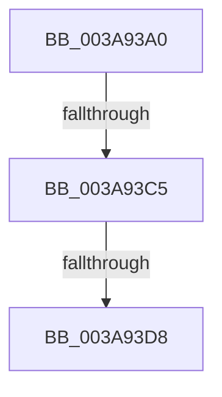

# AuthzBasepAllocateSecurityAttribute

- RVA: `0x003A93A0`–`0x003A93DA` (길이 `58` bytes)
- VA: `0x00000001403A93A0`
- 실행 섹션: `.text`
- PDB 이름 있음: `예`; PDB Function 태그: `아니요`
- unwind 정보 RVA: `0x00089F20`
- 디코드: `16`개 명령, `58/58` bytes 표시
- 미해석 바이트: `0` (있으면 어셈블리에 `.byte`로 보존)

> 이 문서는 커널 이미지의 기계어와 PDB 기호를 분석해 생성했습니다. 4번과 5번은 함수 원형과 자료형을 바이너리 사용 방식에서 추정한 C 해석이며 원본 소스 복구 결과는 아닙니다.

## 1. Dependencies

- 직접 호출 지점: **1**; 고유 호출 대상: **1**
- 직접 호출자로 확인된 함수: **1**
- RIP 상대 이미지 참조: **0**

### Outgoing calls
- `0x003A93CB` → [ExAllocatePool2](../../poolcode/B8/ExAllocatePool2_function_00B820F0.md) (function, `0x00B820F0`)

### Direct callers
- [AuthzBasepAddSecurityAttribute](AuthzBasepAddSecurityAttribute_function_003A8BE4.md) at `0x003A8C2F`

### Static image references
- 디코드된 RIP-relative 메모리 참조가 없습니다.

## 2. Other-region calls and transfers

- 다른 실행 섹션으로 향하는 call: **1**
  - `0x003A93CB` → [ExAllocatePool2](../../poolcode/B8/ExAllocatePool2_function_00B820F0.md) (`.text` → `POOLCODE`)
- call이 아닌 외부 분기/꼬리 이동: **2**
  - `0x003A93BF` → [sub_003A9457 + 0xC](Unknown_function_003A9457.md) (`tail-transfer`)
  - `0x003A93D6` → [sub_003A9457](Unknown_function_003A9457.md) (`tail-transfer`)

## 3. Assembly (complete function range)

```asm
003A93A0  48 89 5C 24 10                  mov qword ptr [rsp + 0x10], rbx
003A93A5  57                              push rdi
003A93A6  48 83 EC 20                     sub rsp, 0x20
003A93AA  0F B7 11                        movzx edx, word ptr [rcx]
003A93AD  48 8B F9                        mov rdi, rcx
003A93B0  48 83 C2 70                     add rdx, 0x70
003A93B4  B9 00 01 00 00                  mov ecx, 0x100
003A93B9  44 0F 20 C0                     mov rax, cr8
003A93BD  3C 02                           cmp al, 2
003A93BF  0F 83 9E 00 00 00               jae 0x1403a9463
003A93C5  41 B8 53 65 41 74               mov r8d, 0x74416553
003A93CB  E8 20 8D 7D 00                  call 0x140b820f0
003A93D0  48 8B D8                        mov rbx, rax
003A93D3  48 85 C0                        test rax, rax
003A93D6  74 7F                           je 0x1403a9457
003A93D8  33 D2                           xor edx, edx
```

## 4. C-style interpretation (structured pseudocode)

```c
__int64 __fastcall AuthzBasepAllocateSecurityAttribute(__int64 a1)
{
    __int64 result;
    __int64 v_rsp;
    unsigned __int64 v_stack_p10;

    v_stack_p10 = v_rbx;
    v_rsp = (v_rsp) - (32);
    a2 = (*(unsigned __int16 *)(a1)) + (112);
    result = ExAllocatePool2(256, a2, (unsigned int)(0x74416553ULL), a4);
    a2 = 0;
    return result;
}
```

## 5. (Beta) C Style

```c
int64_t AuthzBasepAllocateSecurityAttribute(void *Arg1)
{
    uint8_t *arg1 = (uint8_t *)Arg1;

    int64_t result;
    int64_t local_rsp;
    uint64_t v_stack_p10;

    v_stack_p10 = local_rbx;
    local_rsp = (local_rsp) - (32);
    a2 = (*(uint16_t *)(arg1)) + (112);
    result = ExAllocatePool2(256, a2, (uint32_t)(0x74416553ULL), a4);
    a2 = 0;
    return result;
}
```

### 관측된 메모리 오프셋

구조체 형식이 확인되지 않은 접근은 인자 기준의 오프셋으로만 기록했습니다.

| 기준 인자 | 오프셋 표현 | 폭 (bit) | 접근 |
|---|---:|---:|---|
| `Arg1` | `+ 0x0` | `16` | `R` |

## 6. Execution-region graph

[열기: 2D/3D 그래프와 함수 탐색 컨트롤 패널](../../../control-panel.html?section=text&rva=0x003A93A0&view=graph)

- 2D 그래프는 위에서 아래로 흐르고, 3D 그래프는 빈 공간을 드래그해 회전합니다. Shift+드래그는 이동, 휠은 확대·축소, 함수 노드 선택은 대상 보고서 이동입니다.

### Static fallback


